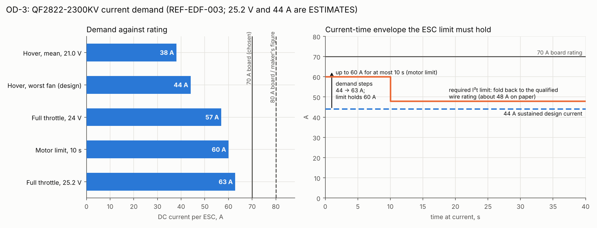
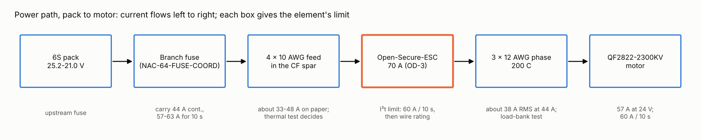
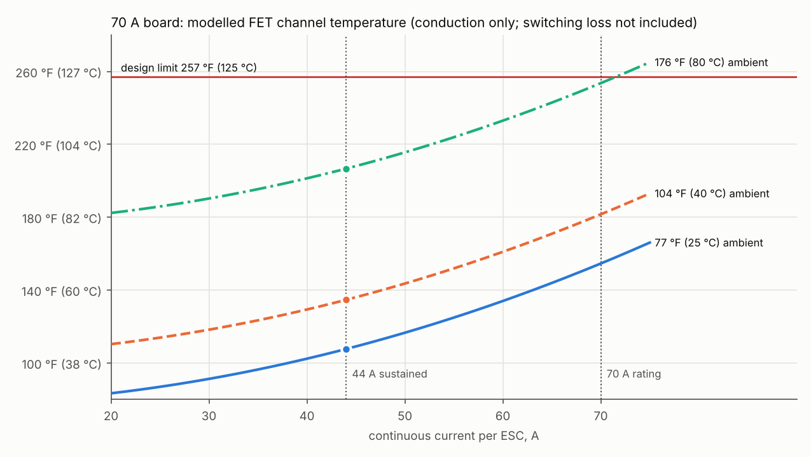
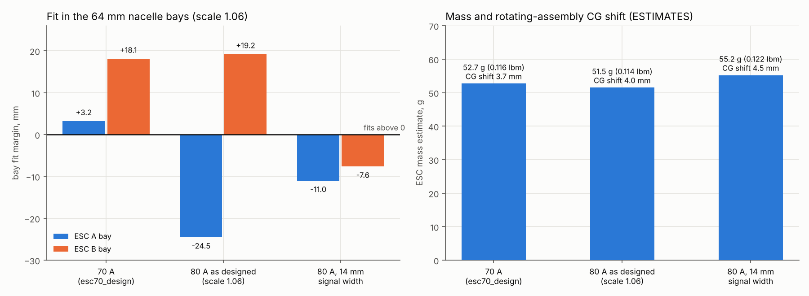

# OD-3 — Owner Decision Brief: nacelle ESC rating, 70 A vs 80 A

**Revision:** Rev U, 2026-11-12. **Status:** **decided** — the owner accepted the 70 A
Open-Secure-ESC on 2026-11-12, conditional on WBS NAC-64-ESC70-QUAL.
**Author:** Steve Griffing, PE(CSE), CISSP-ISSEP, CPP (owner) — assessment by Claude (Anthropic) under
the author's direction, with the `electrical-engineering` skill.
**License:** CC BY-SA 4.0 — see LICENSES/CC-BY-SA-4.0 (SPDX-License-Identifier: CC-BY-SA-4.0)
**Figures:** `tools/od3_esc_figures.py` → `docs/figures/od3_esc_*.png` (re-runs every figure).
**Owning WBS entry:** `airframe/wings-nacelles/WBS.md` OD-3 / NAC-64-ESC-80A / NAC-64-ESC70-QUAL.

> [!WARNING]
> **ENGINEERING REVIEW REQUIRED — this output is not a substitute for a
> qualified engineer.** Every result, calculation, and recommendation produced
> with this skill **must be independently reviewed and accepted by a properly
> qualified individual** — a licensed Professional Engineer or an equivalently
> qualified authority for the jurisdiction and discipline — **before it is
> applied to any system carrying risk to life or safety.**

<!-- -->

> [!CAUTION]
> **This skill informs engineering judgment; it does not replace it.** Applying
> unreviewed results to real equipment or hardware — even where no life-safety
> risk exists — carries a risk of equipment damage or property loss. It is
> reference material provided AS-IS (see LICENSE §5), is not an engineering
> service, and does not constitute a sealed, certified, or reviewed work
> product for any specific project.

> **CAUTION — no other ESC without a full engineering analysis.** The 70 A rating is valid only for
> the Open-Secure-ESC design analysed here (`tools/esc70_design.json`). Do not substitute any other
> ESC (commercial, another Open-Secure-ESC build, or a changed layout) until it has been analysed for
> this motor and bay: current demand (44 A sustained, 57-63 A peak, 60 A / 10 s motor limit), thermal
> performance in the bay at hot ambient, fit, current-limit behaviour and fuse coordination. A
> commercial ESC's rating is an unverified label; any commercial ESC shall be rated at least the motor
> maker's 80 A recommendation and still be analysed. Consequence of an unanalysed ESC: overheating or
> cut-out in hover loses a fan and likely the aircraft (WARNING if people are under or near the
> aircraft; a FET that fails shorted across the 6S pack is a fire hazard, WARNING).

## The question

The QX-Motor QF2822-2300KV sheet [REF-EDF-003] recommends an **80 A** ESC. The nacelle ESC is the
in-house Open-Secure-ESC build (BOM OSESC-NAC), laid out and fitted for **70 A**
(`tools/esc70_design.json`, nacelle scale 1.06). Does the 2300 KV need the 80 A board?

## Inputs

| Input | Value | Status |
|---|---|---|
| Full throttle, 24 V | 57.0 A, 1,368 W, 2,370 gf | REF-EDF-003 |
| Motor current limit | 60 A for 10 s | REF-EDF-003 |
| Maker's ESC recommendation | 80 A | REF-EDF-003 |
| Full throttle, fresh pack 25.2 V | about 63 A (57 × (25.2/24)²) | ESTIMATE |
| Hover, mean per fan, 21.0 V | 38 A | ESTIMATE (`reports/UAV ESC wire market survey.md`) |
| Hover, worst-loaded fan (sustained design current) | 44 A | ESTIMATE, owner design current 2026-11-11 |
| 70 A board channel temperature at 70 A | 154 °F (68.1 °C) at a 77 °F (25 °C) design ambient | `tools/esc80_cooptimize.py`; conduction only, hot max R_DS(on), estimated convection factor |
| FET | Toshiba TPHR8504PL, two per leg | REF-SEMI-001 |

## Statics and dynamics

For an ESC the governing "load" is current against time; the mechanical loads on the board
(vibration, tilt slew) are the same for both options and are not changed by this decision.

Every current the motor can use lies below 70 A: 44 A sustained, 57 A at full throttle on 24 V, about
63 A on a fresh pack. The motor's own limit is 60 A for 10 s, so current above 60 A for longer is a
motor overload whatever the ESC rating. The required ESC limit (WBS NAC-64-FUSE-COORD) is
time-dependent: up to 60 A for at most 10 s, then folding back to the qualified wire rating (about
48 A on paper). Under that limit the ESC never carries more than about 48 A continuous, against its
70 A rating.

## Function

The ESC must commutate the motor to full throttle, hold the I²t limit, and report over CAN-FD/RS-485.
Both options do this. The 70 A board covers the motor's full range; the 80 A board's extra current
capacity sits above the motor's own 60 A / 10 s limit, where it cannot be used.

## Structural integrity

Not applicable to the choice: the ESC carries no structural load, and the bay walls, mounts and
inserts are the same for both options. (The 80 A board does not fit the bays; see interactions.)

## Thermal margin (part of structural and functional integrity for an electrical part)

| Case | 77 °F (25 °C) | 104 °F (40 °C) | 176 °F (80 °C) near-motor |
|---|---|---|---|
| 44 A sustained | 108 °F (42 °C) | 135 °F (57 °C) | 207 °F (97 °C) |
| 70 A sustained | 154 °F (68 °C) | 181 °F (83 °C) | 253 °F (123 °C) |

Design limit 257 °F (125 °C). The 44 A case keeps about 50 °F (28 °C) margin at the hot ambient.
The model is conservative on FET resistance but optimistic in three ways: a 77 °F design ambient,
no switching loss, and an estimated 0.35 forced-convection factor. Cooling is the fan's own airflow.
**The 80 A board runs no cooler at the same current:** both have two FETs per leg and the same
modelled loss per amp squared (8.7 mW/A²).

## Mechanism and component interactions

Run with `tools/esc80_cooptimize.py` at nacelle scale 1.06 with the 70 A file's measured exclusions
(trunnion, disconnect, nav, nozzle servo and dorsal shroud keep-outs). Both pods are mirror images.

| Design | ESC A bay margin | ESC B bay margin |
|---|---|---|
| 70 A (`esc70_design.json`) | +3.2 mm | +18.1 mm |
| 80 A as designed (`esc80_design_m2.json`) | **−24.5 mm** | +19.2 mm |
| 80 A with the 70 A board's 14 mm signal width | **−11.0 mm** | **−7.6 mm** |

The 80 A board does not fit at scale 1.06. Fitting it would mean a larger nacelle scale (re-opening
the nacelle geometry, OD-17 and the pivot) or giving up one of the two bays.

## Weight and balance

| Design | ESC mass (ESTIMATE) | Rotating-assembly CG shift |
|---|---|---|
| 70 A | 0.116 lbm (52.7 g) | 3.7 mm |
| 80 A as designed | 0.114 lbm (51.5 g) | 4.0 mm |
| 80 A, 14 mm signal width | 0.122 lbm (55.2 g) | 4.5 mm |

Within 2.5 g per ESC (10 g per aircraft); not a discriminator. The AUW ledger and BOM already carry
the 70 A roll-up (52.7 g, OSESC-NAC); no ledger change follows from the decision.

## Canonical shape

Internal only: the ESC sits in bays inside the pod; the outer mould line is unchanged. (Only a
larger nacelle scale to fit an 80 A board would change it.)

## Options

| | A. 70 A Open-Secure-ESC | B. 80 A Open-Secure-ESC | C. Commercial ESC |
|---|---|---|---|
| Covers motor demand | yes (44 A sustained, 63 A peak) | yes | only if rated ≥ 80 A and analysed |
| Fits the bays at scale 1.06 | yes (+3.2 / +18.1 mm) | **no** (−24.5 or −11.0 mm) | unknown per part |
| Thermal at operating current | same as B | same as A | unverified label |
| Mass | 52.7 g | 51.5-55.2 g | per part |
| Follows maker's 80 A figure | no (rating by analysis) | yes | must |
| Cost and schedule | design exists | larger nacelle or one bay lost | analysis per part; loses the Open-Secure-ESC features |

**Recommendation: A**, because it covers every current the motor can use, fits, and the 80 A board
buys no thermal margin at the operating current. The maker's 80 A is a margin rule for unverified
commercial ESC ratings, which is why option C must follow it.

**Owner decision (2026-11-12): A**, with the CAUTION above against substituting any other ESC.

## Conditions and what is still unverified (WBS NAC-64-ESC70-QUAL)

1. Bench thermal test of a built board at 44 A sustained in 176 °F (80 °C) air at hover airflow,
   thermocouple on the FETs, against the 257 °F (125 °C) limit; this settles the switching loss and
   the convection factor.
2. Desync/stall detection and current-limit response time (cooling drops when current rises).
3. TPHR8504PL safe-operating-area and pulse ratings (REF-SEMI-001) against limit overshoot.
4. Bulk capacitor ripple-current rating at 44 A sustained and 63 A peak (sourcing still open).
5. The I²t firmware limit per WBS NAC-64-FUSE-COORD.

Also unverified: the 44 A and 63 A currents (estimates; re-derive from the flight-control allocation
and a measured motor); the near-motor ambient of 176 °F (80 °C).
