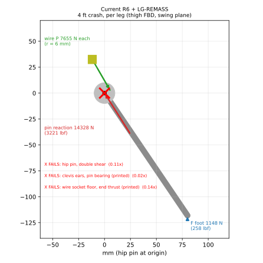
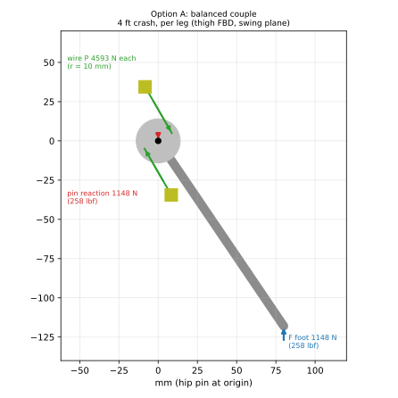
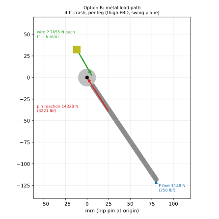

# Landing-gear bellcrank load path: free-body study

**Status:** analysis complete; owner decision required (BUILD-BLOCKING, WBS LG-LOADPATH).
**Date:** 2026-10-26
**Author:** Claude (Claude Opus 5.5, Anthropic), under the direction of Stab-Rabbit-coding, per `AGENTS.md` §3.
**License:** CC BY-SA 4.0 (SPDX-License-Identifier: CC-BY-SA-4.0)
**Numbers:** regenerate with `/usr/bin/python3 tools/lg_bellcrank_fbd.py --svg docs/images/lg_bellcrank`.

> **WARNING**
>
> The Rev R6 landing gear, as drawn and as resized by LG-REMASS, cannot carry
> its own internal loads. In a 4 ft crash the hip pin, the printed clevis ears
> and the printed wire sockets fail before the energy-absorber wires finish
> their stroke. A gear that breaks at the bay instead of at the wire fuse can
> let the aircraft strike on the nozzles or the belly. Do not build or fly the
> R6 bay until an option below is chosen, implemented and re-checked.

## 1. What was wrong

The thigh is a bellcrank. The ground pushes up on the foot at the horizontal
arm `R_H` = 80 mm from the hip pin. The energy-absorber wires push on a crank
of radius `r` = 6 mm around the same pin. `tools/landing_gear_r6_sizing.py`
solves the wire force from the **moment** balance, `F R_H = 2 P r`, so each
wire carries `P = F R_H / (2r)`, which is 13.3 times the foot force.

The sizing tool then checks the hip pin against the foot force `F` alone.
That is only correct if the two wires form a **pure couple**, meaning they push
in opposite directions on opposite sides of the pin. In the R6 layout both wires
of a row sit at the **same** crank azimuth and push the **same** way. The
**force** balance of the thigh therefore sends almost the whole wire pair, about
`2P`, through the pin, the clevis ears and the bay. The same error hides two
more failures:

- **Socket floors.** Each wire is a bowed column in compression. Its full
  end thrust `P` bears on the flat floor of a blind printed socket. That floor
  is about 28 mm² of CF-PETG.
- **Allowable.** The sizing used a 70 MPa CF-PETG "bearing" allowable. No
  source supports it. The repository's only CF-PETG compressive data is bulk
  ASTM D695 at 47–60 MPa [REF-MAT-001], and REFERENCES.md already flags a
  CF-PETG bearing allowable as "requires verification".

## 2. Load cases and dynamics (per leg, 13.0 lbm design mass)

The foot force is the same for every configuration. Only the internal load path
differs.

| Case | Definition | Touchdown speed | Energy per leg | Stroke | Foot force | Aircraft deceleration |
| --- | --- | --- | --- | --- | --- | --- |
| Static | stance, 25.1 % per-leg share (R2 ledger) | — | — | — | 3.3 lbf (15 N) | 1 g |
| **Normal** (LG-06) | 1.5 ft drop, stopped elastically inside the 13.7 mm hover nozzle clearance | 9.8 ft/s (2.99 m/s, 5.8 kt) | 4.9 ft·lbf (6.6 J) | 0.54 in (13.7 mm) | **218 lbf (969 N)** peak, linear spring | 67 g peak, level 4-point |
| **Crash** (LG-17) | 4 ft drop, tail-down 2-point, ductile plateau | 16.0 ft/s (4.89 m/s, 9.5 kt) | 26.0 ft·lbf (35.3 J) | 1.21 in (30.7 mm) | **258 lbf (1,148 N)** plateau | 40 g (2-point) / 79 g (level 4-point) |
| Hierarchy | owner rule: mounts ≥ 1.25 × the demand at the leg's own breaking moment (grown thigh 197.3 N·m) | — | — | — | 554 lbf (2,466 N) | — |

> **Note**
>
> The normal-landing peak of about 67 g is a direct consequence of the owner rule
> that a 1.5 ft drop must stop inside the 13.7 mm nozzle clearance: 9.8 ft/s
> arrested in 0.54 in. It is the same in every option. If 67 g is too much for
> the avionics mounts, the lever is the nozzle clearance (gear length or
> nacelle tilt at touchdown), not the bellcrank.

## 3. Free-body diagrams (4 ft crash, per leg, swing plane)

Hip pin at the origin. The foot force is blue, the wire forces green, the pin
reaction red. A red X and the red text mark each failure location.

| Current R6 + LG-REMASS (C0) | Option A: balanced couple | Option B: steel load path |
| --- | --- | --- |
|  |  |  |

Equilibrium of the thigh (planar rigid body, [REF-NCEES-009]):

- Moment about the pin: `F R_H = n P r`, with `n` the number of active wires.
- Force: `R_pin = -(F + Σ P_i)`. For C0 and B, `Σ P_i` ≈ `2P` along the
  chord, so `R_pin` ≈ 12.5 × `F`. For A, `Σ P_i` = 0, so `R_pin` = `-F`.

## 4. Results

Demand on each part is its failure-hierarchy demand: the 1.25 × leg-break
reaction for the pin and the ears, and 1.25 × the ductile plateau for the wire
path. "Margin" is capacity divided by demand, and 1.00 is the pass line.

### 4.1 Current design (C0): crank r 6 mm, same-side wire pair

| Location | Failure mode | Normal / crash / hierarchy pin reaction | Capacity | Margin |
| --- | --- | --- | --- | --- |
| Hip pin (M3 A2) | double shear | 2,718 / 3,221 / 6,918 lbf (12.1 / 14.3 / 30.8 kN) | 953 lbf (4,241 N) | **0.11, FAILS** |
| Clevis ears (printed, 2 × 3 mm) | pin bearing / crushing | as above | 203 lbf (902 N) | **0.02, FAILS** |
| Wire socket floor (printed, blind bore Ø5.92) | end-thrust crushing | 2,151 lbf (9,569 N) per wire | 291 lbf (1,294 N) | **0.14, FAILS** |

Even the **normal** 1.5 ft landing puts 2,718 lbf (12.1 kN) through the M3 pin,
2.9 times its capacity. The parts fail in this order: socket floors and ears
first, then the pin. The wire fuse never reaches its plateau.

### 4.2 Option A: balanced couple, crank r 10 mm

Each row (ductile, spring) puts one wire on each side of the pin with
antiparallel chords. Stainless 304 thrust cups sit under the socket floors and
stainless liners in the clevis ears.

| Location | Failure mode | Sized part | Demand | Capacity | Margin |
| --- | --- | --- | --- | --- | --- |
| Hip pin | double shear | M3 A2 (unchanged) | 693 lbf (3,083 N) | 953 lbf (4,241 N) | 1.38 OK |
| Clevis ears | pin bearing | 304 liner, 2 × 3.0 mm | 693 lbf (3,083 N) | 830 lbf (3,690 N) | 1.20 OK |
| Wire thrust cups | flat bearing on CF-PETG | 304 cup, flange Ø13 × 1.5 mm | 1,291 lbf (5,741 N) | 1,402 lbf (6,238 N) | 1.09 OK |

- The pin reaction is the foot force alone: 218 / 258 / 554 lbf (normal / crash / leg-break).
- The wire force drops to 4,593 N per wire, so the ductile wire becomes about Ø4.44 instead of Ø5.27.
- The longer crank needs 3.84 mm of wire stroke for the 22° hip rotation. The 20 mm bow span gives 3.67 mm, so the span grows to about 21 mm.
- **Mass penalty: +15.1 g per leg, +44.6 g (+0.098 lbm) per aircraft**, net of the lighter wires. The thigh root ring grows from r 6 to r 10.
- **Open packaging risk.** With the crank at 30°/210°, the lower wire's boss lies about 35 mm below the hip, and the hip is only 38 mm above the belly. The crank azimuth pair has to be re-screened in `tools/lg_wire_layout_study.py` and the 3-D census so that both bosses stay inside the canonical bay outline. This study has not proved that they can.

### 4.3 Option B: steel load path, R6 layout kept (r 6 mm)

The bay keeps its outline and the same-side wire pair. The 2P reaction is
carried in metal from the pin to the thrust plates.

| Location | Failure mode | Sized part | Demand | Capacity | Margin |
| --- | --- | --- | --- | --- | --- |
| Hip pin | double shear | A2-70, Ø8 mm | 8,647 lbf (38.5 kN) | 9,492 lbf (42.2 kN) | 1.10 OK |
| Clevis side plates | pin bearing | 304, 2 × 12.0 mm | 8,647 lbf (38.5 kN) | 8,849 lbf (39.4 kN) | 1.02 OK |
| Wire thrust plates | flat bearing on CF-PETG | 304, flange Ø17 × 1.5 mm | 2,151 lbf (9,569 N) | 2,398 lbf (10,668 N) | 1.11 OK |

- **Mass penalty: +115.1 g per leg, +460.5 g (+1.015 lbm) per aircraft.**
- The 13.0 lbm target already lacks 0.34 lbm (handoff 2026-10-20), so Option B
  would leave the aircraft about 1.35 lbm over target. Two 12 mm stainless side
  plates also do not fit the 14–16 mm lug and the bay aperture without
  re-drawing the bay.

## 5. Comparison

| | C0 current | A balanced couple | B steel load path |
| --- | --- | --- | --- |
| Worst margin | **0.02 (fails)** | 1.09 | 1.02 |
| Pin reaction, crash | 3,221 lbf (14.3 kN) | 258 lbf (1,148 N) | 3,221 lbf (14.3 kN) |
| Wire P, crash | 7,655 N | 4,593 N | 7,655 N |
| Ductile wire | Ø5.27 | about Ø4.44 | Ø5.27 |
| Mass vs C0, per aircraft | 0 | **+44.6 g (+0.098 lbm)** | +460.5 g (+1.015 lbm) |
| Canonical outline | as drawn | thigh root ring grows; boss packaging **unproven** | side plates do not fit the present bay |
| Failure hierarchy (fuse < leg < bay) | violated | met (as sized) | met (as sized) |

**Recommendation: Option A.** It is the only option that meets the hierarchy at
a mass the 13.0 lbm target can absorb. Its open item is geometric, not
structural: re-screen the crank azimuths so both bosses stay inside the bay.
Option B is structurally sound but costs about 1 lbm.

## 6. Assumptions and verification needed

- **CF-PETG allowable.** 47 MPa, the low end of ASTM D695 bulk compression
  [REF-MAT-001], is used as the flat-contact limit under the stainless cups. It
  is not a pin-bearing allowable. A real bearing coupon (LG-11, ASTM D953 or
  equivalent, printed in the part's own orientation) is still required. The
  thrust-cup margins (1.09 and 1.11) are thin; the cup flanges should grow
  one size when the layout is drawn.
- **Pin shear.** Pin shear uses 0.6 × the ISO 3506-1 tensile strength
  [REF-MAT-005]. That ratio is a design judgment and is marked "requires
  verification" in REFERENCES.md.
- **Steel.** 304 bearing and tension use the 205 MPa ASTM A240 minimum yield,
  and the density is 7.90 g/cm³ [REF-MAT-006].
- **Load-case conventions.** Normal case is a linear spring with peak `2E/x`.
  Crash case is a constant ductile plateau `E/s`. Both are solved at the
  sizing tool's 25.1 % worst static share and the 50 % tail-down share.
- **Superseded check.** The sizing tool's `LG-02` / structure check of the hip
  pin against `F` alone, and its "bay boss bearing 6,300 N" (70 MPa × 90 mm²),
  are superseded by this study. Neither should be quoted as a margin.
