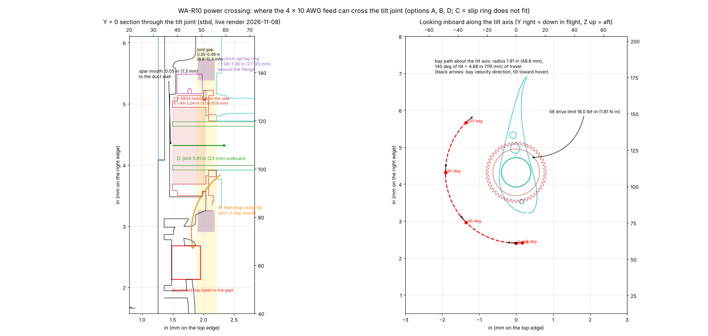
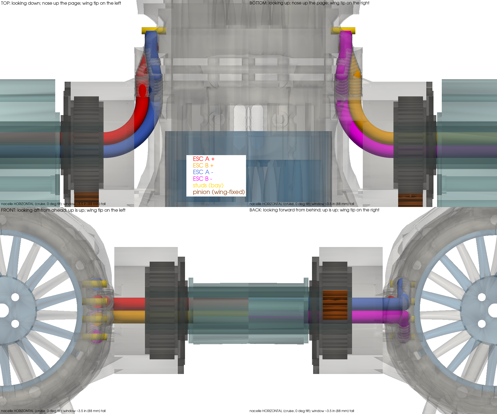
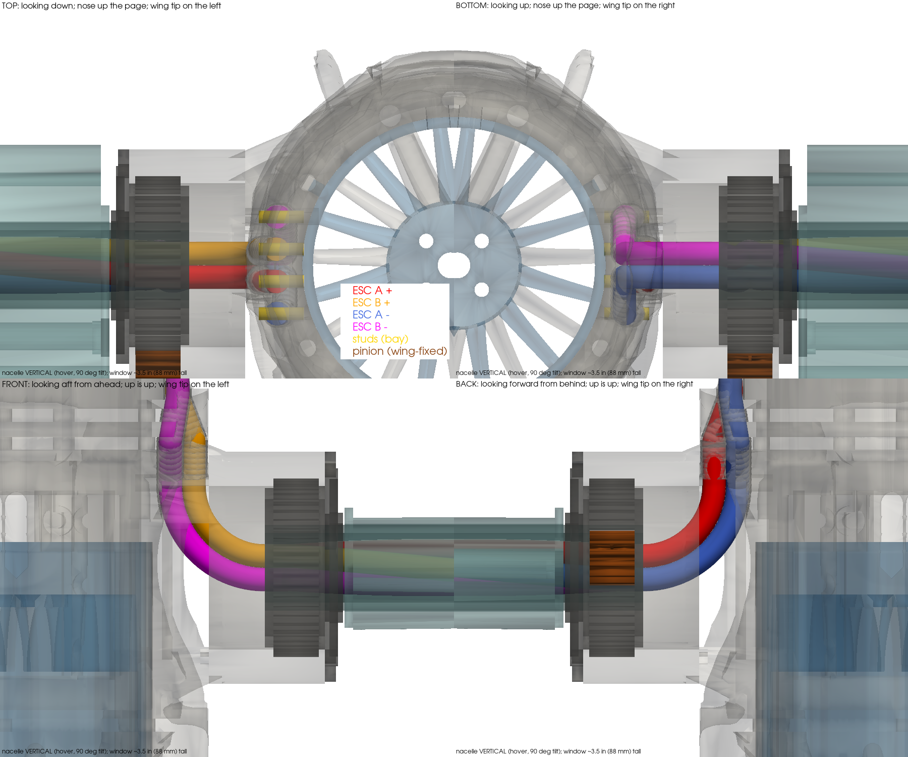

# Owner Decision Brief OD-17 — How the 4 × 10 AWG feed crosses the tilt joint (WA-R10)

**Revision:** Rev U, 2026-11-08 (Sprint 2, plan `docs/plans/2026-11-07-001-…`)
**Author:** Steve Griffing, PE(CSE), CISSP-ISSEP, CPP (owner) — analysis and brief by Claude
(Anthropic, Claude Opus 5.5) under the author's direction.
**License:** CC BY-SA 4.0 — see LICENSES/CC-BY-SA-4.0 (SPDX-License-Identifier: CC-BY-SA-4.0)
**Format:** Owner Decision Brief (`docs/DOC_TEMPLATES.md`). Units: inches first, millimetres in parentheses.

## The problem in one paragraph

The four 10 AWG power conductors run from the wing to the nacelle inside the fixed Ø0.79 in (Ø20 mm)
CF spar, as the design intended (`docs/WING_ATTACH_INTERFACE.md` §2.3, WA-R11). The spar's open end is
inside the pod and **0.05 in (1.3 mm) from the duct wall** (measured 2026-11-07/08 on both live renders,
`tools/nacelle64_assembly_check.py --stage cable`). The two 6804 trunnion bearings ride directly on the
spar from X 1.49 to 2.04 in (37.8 to 51.8 mm), so the tube wall cannot be slotted there either. There is
**no path** for the wires out of the spar inside the current joint, at any wire size. The disconnect
bay they have to reach is now built (NAC-64-ASM-03). It sits 1.91 in (48.6 mm) forward of the tilt
axis and is open to the joint gap, and it travels 4.68 in (119 mm) along an arc as the nacelle tilts
through 140°.

*Left: Y = 0 section through the joint, with option paths drawn. Right: looking inboard along the tilt
axis; the red arc is the bay's path from −5° to +135°, the black arrows are its velocity direction when
tilting toward hover, and the wing-tip section is in cyan.*

## Options

- **A — Clock-spring (flat-conductor) ring in the joint gap around the trunnion flange.** The feed
  leaves the spar inside the wing, crosses the wing-tip face at r ≥ 1.15 in (29.3 mm), and wraps in a
  rolling loop inside a ring chamber at r 1.06–1.38 in (27–35 mm), 0.28 in (7 mm) long axially.
- **B — Enclosed free loop across the gap.** The feed leaves the spar inside the wing, exits a port on
  the wing-tip face near the leading edge, and runs as a flexible loop to the bay mouth inside a boot
  that spans the 0.35–0.48 in (8.8–12.3 mm) gap.
- **C — Through-bore slip ring at the tilt axis.** Four circuits of ≥ 28 A on the Ø0.79 in (Ø20 mm) spar.
- **D — Move the joint 0.91 in (23 mm) outboard** (first written as 0.71 in (18 mm); corrected 2026-11-08, see below). This opens a 0.96 in (24.3 mm) bend chamber between
  the spar mouth and the duct. The twist stays inside the spar bore, which is what the 0.06 in (1.5 mm)
  radial clearance there was sized for. The wires turn radially in the pod and run in the annulus to the
  bay.

## The six checks

| Check | A clock-spring | B enclosed loop | C slip ring | D joint +0.91 in (corrected) |
|---|---|---|---|---|
| **Statics and dynamics** | One conductor's 0.0082 in² (5.26 mm²) in a 0.28 in (7 mm) wide strip is 0.030 in (0.75 mm) thick. Rolled at the ~0.16 in (4 mm) radius the chamber allows, the bending strain is about 9 %, far past copper's yield, every cycle. **Fails.** | The loop is pulled through 4.68 in (119 mm) of arc per tilt cycle; port-to-bay distance 1.06 → 2.59 in (27 → 66 mm). Wire stiffness for 10 AWG silicone fine-strand is not in the repo, so the torque against the 16.0 lbf·in (1.81 N·m) tilt-drive limit **requires verification** (bench pull). | Not assessed beyond fit (below). | Hover thrust per nacelle ≈ 7.1 lbf (31.4 N). Moving it 0.91 in (23 mm) outboard adds ≈ 6.4 lbf·in (0.72 N·m) of bending at the wing spar root per side. Bearing loads unchanged. |
| **Function** | — | Works if the loop survives the flex cycles. 10 AWG fine-strand fatigue life over 140° cycles **requires verification** (cycle test). Exposed to FOD and debris in the gap unless the boot is sealed. | — | Wires bend once, statically. Twist (140°) is taken along the spar-bore length. Service is unchanged: slide the nacelle off the spar, and the bay is the junction. |
| **Structural integrity** | — | Boot attachments only; no load path change. | — | Longer spar overhang; pylon boss grows 0.91 in (23 mm); wire channels cut through the trunnion plug, collar and one bulkhead (0.42 in³ (6,907 mm³) removed in the concept); spar-root allowable not verified (`allowables.json`, SPAR-20-ALLOW). Re-check the trunnion register, collar inserts and wing-tip pad. |
| **Mechanism and component interactions** | Chamber r 27–35 mm collides with the wing-fixed pinion and its sweep (tip r 1.26 in (32.1 mm)) and the Ø0.16 in (Ø4 mm) shaft. **Fails.** | The loop must clear the pinion shaft (r 0.90–1.12 in (22.9–28.5 mm), aft of the axis), the trunnion flange, and the AK7455 encoder pad. The EMI spec asks for power-to-signal separation (`TILT_ENCODER_WIRING_EMI_SPEC` §2.3, not re-verified here). | Axial length of a 4 × 28 A slip ring is far more than the 0.35–0.48 in gap; no product verified. **Does not fit.** | The whole joint shifts together, so the gear mesh, bearings and encoder keep their relations. Every hull-frame placement of the nacelle, trunnion and pinion moves; the wing-tip pad and stub (`SPAR_TIP_PROTRUSION_64N`) change. |
| **Weight and balance** | — | +0.007–0.013 lbm (+3–6 g) per nacelle (longer feed plus boot, ESTIMATE). On the pivot station, so pitch CG barely moves. | Slip ring mass not verified. | Concept model: boss +0.076 lbm (+34.5 g) solid, channels −0.017 lbm (−7.7 g), spar +0.0083 lbm (+3.8 g): about +0.067 lbm (+30.6 g) per nacelle (ESTIMATE, boss not hollowed). Lateral CG moves outboard 0.91 in (23 mm), which raises roll inertia; pitch CG and pivot residual are unaffected because the mass sits at the pivot station. |
| **Canonical shape** | A ring fairing in the gap (inside the Ø2.76 in (Ø70 mm) collar footprint). | A boot visible in the 0.35–0.48 in gap between the pylon face and the wing tip. | — | The nacelle sits 0.91 in (23 mm) further from the wing tip, which visibly changes the wing–nacelle spacing against REF-CAD-003. Owner judgement. |

## Side by side

| | A | B | C | D |
|---|---|---|---|---|
| Feasible | No (copper strain, pinion) | Yes, if the loop passes a flex/fatigue test | No (does not fit) | Yes |
| Work | — | Wing-tip port and in-wing exit from the spar, boot, loop retention; bench flex test | — | Re-datum the joint: pod pylon, spar stub, wing pad, bake/assembly placements, re-sweep, re-converge the pivot |
| Risk | — | Fatigue; FOD; exposed in the gap | — | Canonical proportion; spar-root moment +6.4 lbf·in (0.72 N·m) |
| Mass per nacelle | — | +0.007–0.013 lbm (+3–6 g) | — | ≈ +0.067 lbm (+30.6 g) concept estimate |

## Option D, modelled (2026-11-08)

**Correction.** The 0.71 in (18 mm) shift was sized for one 0.217 in (5.5 mm) wire. The four wires
leave the spar as a 2 × 2 group, so the aft pair bends on a 0.87 in (22 mm) centreline radius when the
forward pair is at the 0.65 in (16.5 mm) minimum (3 × OD). At 18 mm the aft pair would leave the bend at
X 1.33 in (33.8 mm), inside the duct wall. **The minimum shift is 0.91 in (23 mm)**. That makes the spar
mouth X 2.39 in (60.81 mm), the bend chamber 0.96 in (24.3 mm), and both pairs clear the duct wall: they
leave the bend at X 1.53 and 1.74 in (38.8 and 44.3 mm). If the four are bound as one harness and must
bend at 3 × the bundle OD, 1.57 in (39.8 mm), the shift roughly doubles. That variant is not modelled.

Concept model (`tools/nacelle64_optD_concept.py --shift 23`, manifold3d booleans): the pod collar boss is carried 0.91 in
(23 mm) outboard; trunnion, spar, wing and pinion move with it; each wire runs from the spar bore around its
bend, forward in the annulus, fanning out to its stud; channels are cut through the pod. Results:
- The wires do not cross. Neighbours touch only where they run as the bundle; the closest non-adjacent
  pair is 0.090 in (2.27 mm) apart.
- The wires (which tilt with the pod) never touch the wing or the wing-fixed pinion from −5° to +135°.
- Channels remove 0.42 in³ (6,907 mm³) of pod material (trunnion plug, collar, one bulkhead web).
- Inside the spar the bundle takes the tilt as twist. The model spreads it over 2.76 in (70 mm) of spar
  bore; the real bore is longer, so the twist rate is lower.

*Pod, cartridge, wing and spar are drawn translucent so the wires show. Red ESC A +, blue ESC A −, orange
ESC B +, magenta ESC B −; gold studs in the disconnect bay; brown the wing-fixed pinion. The view window
is about 3.5 in (88 mm) tall.*

## Recommendation

**D**, if the 0.91 in (23 mm) change in the wing–nacelle spacing is acceptable to you against the
canonical references. It keeps the 28 A conductors inside protected structure, and it takes the tilt as
twist in the spar bore, which is what that bore was sized for. Nothing then flexes in bending each
cycle. Otherwise **B**, gated on a bench flex test of 10 AWG fine-strand silicone through the 140° cycle
before any part is drawn.

**Still unverified:** the conductor OD (SPAR-20-WIREOD; 0.217 in (5.5 mm) is assumed); the NASA-STD-8739.4A
bend-radius clause the repo cites; the 10 AWG loop stiffness and fatigue life; the spar-root allowable;
and every mass marked ESTIMATE.
