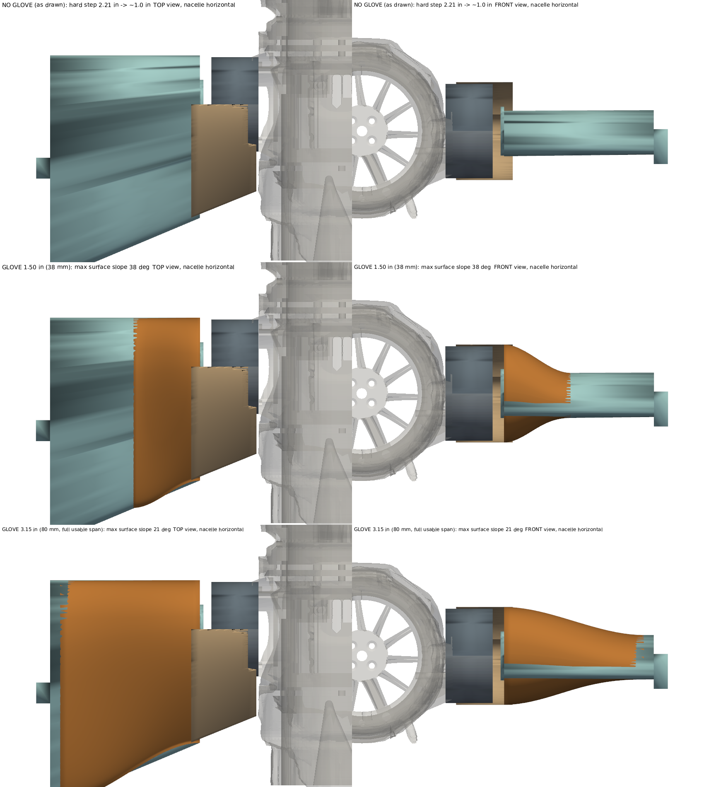
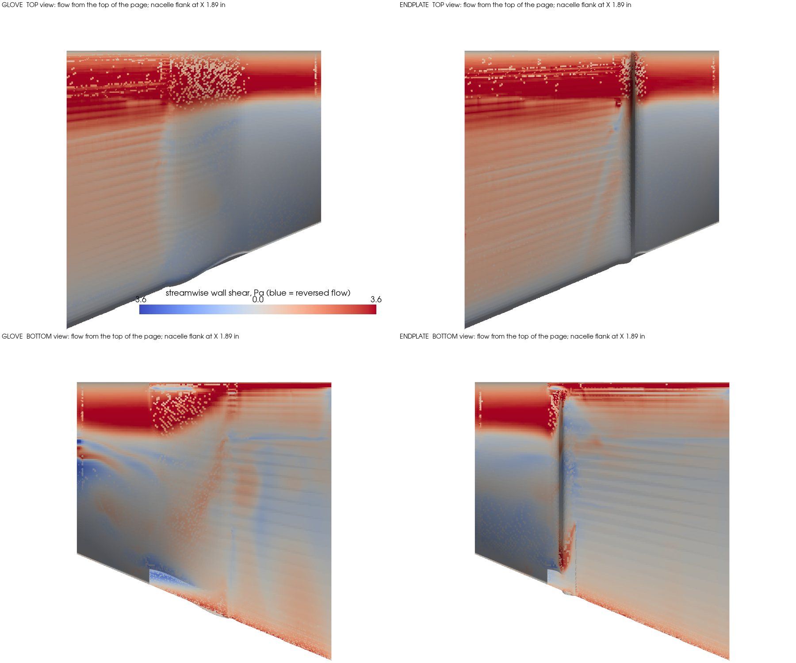
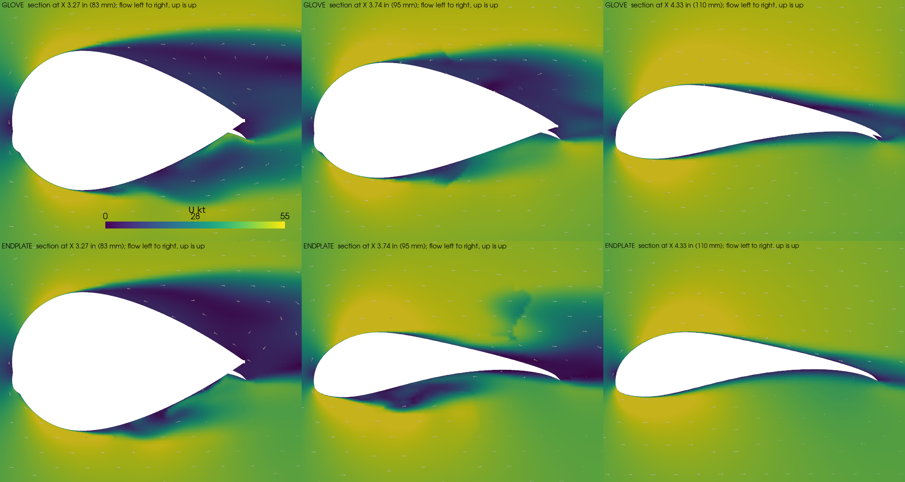

# Owner Decision Brief OD-17 — How the 4 × 10 AWG feed crosses the tilt joint (WA-R10)

**Revision:** Rev U, 2026-11-08 (Sprint 2, plan `docs/plans/2026-11-07-001-…`)
**Author:** Steve Griffing, PE(CSE), CISSP-ISSEP, CPP (owner) — analysis and brief by Claude
(Anthropic, Claude Opus 5.5) under the author's direction.
**License:** CC BY-SA 4.0 — see LICENSES/CC-BY-SA-4.0 (SPDX-License-Identifier: CC-BY-SA-4.0)
**Format:** Owner Decision Brief (`docs/DOC_TEMPLATES.md`). Units: inches first, millimetres in parentheses.

## The problem in one paragraph

The four 10 AWG power conductors run from the wing to the nacelle inside the fixed Ø0.79 in (Ø20 mm)
CF spar, as the design intended (`docs/WING_ATTACH_INTERFACE.md` §2.3, WA-R11). The spar's open end is
inside the pod and **0.05 in (1.3 mm) from the duct wall** (measured 2026-11-07/08 on both live renders,
`tools/nacelle64_assembly_check.py --stage cable`). The two 6804 trunnion bearings ride directly on the
spar from X 1.49 to 2.04 in (37.8 to 51.8 mm), so the tube wall cannot be slotted there either. There is
**no path** for the wires out of the spar inside the current joint, at any wire size. The disconnect
bay they have to reach is now built (NAC-64-ASM-03). It sits 1.91 in (48.6 mm) forward of the tilt
axis and is open to the joint gap, and it travels 4.68 in (119 mm) along an arc as the nacelle tilts
through 140°.

*Left: Y = 0 section through the joint, with option paths drawn. Right: looking inboard along the tilt
axis; the red arc is the bay's path from −5° to +135°, the black arrows are its velocity direction when
tilting toward hover, and the wing-tip section is in cyan.*

## Options

- **A — Clock-spring (flat-conductor) ring in the joint gap around the trunnion flange.** The feed
  leaves the spar inside the wing, crosses the wing-tip face at r ≥ 1.15 in (29.3 mm), and wraps in a
  rolling loop inside a ring chamber at r 1.06–1.38 in (27–35 mm), 0.28 in (7 mm) long axially.
- **B — Enclosed free loop across the gap.** The feed leaves the spar inside the wing, exits a port on
  the wing-tip face near the leading edge, and runs as a flexible loop to the bay mouth inside a boot
  that spans the 0.35–0.48 in (8.8–12.3 mm) gap.
- **C — Through-bore slip ring at the tilt axis.** Four circuits of ≥ 28 A on the Ø0.79 in (Ø20 mm) spar.
- **D — Move the joint 0.91 in (23 mm) outboard** (first written as 0.71 in (18 mm); corrected 2026-11-08, see below). This opens a 0.96 in (24.3 mm) bend chamber between
  the spar mouth and the duct. The twist stays inside the spar bore, which is what the 0.06 in (1.5 mm)
  radial clearance there was sized for. The wires turn radially in the pod and run in the annulus to the
  bay.

## The six checks

| Check | A clock-spring | B enclosed loop | C slip ring | D joint +0.91 in (corrected) |
|---|---|---|---|---|
| **Statics and dynamics** | One conductor's 0.0082 in² (5.26 mm²) in a 0.28 in (7 mm) wide strip is 0.030 in (0.75 mm) thick. Rolled at the ~0.16 in (4 mm) radius the chamber allows, the bending strain is about 9 %, far past copper's yield, every cycle. **Fails.** | The loop is pulled through 4.68 in (119 mm) of arc per tilt cycle; port-to-bay distance 1.06 → 2.59 in (27 → 66 mm). Wire stiffness for 10 AWG silicone fine-strand is not in the repo, so the torque against the 16.0 lbf·in (1.81 N·m) tilt-drive limit **requires verification** (bench pull). | Not assessed beyond fit (below). | Hover thrust per nacelle ≈ 7.1 lbf (31.4 N). Moving it 0.91 in (23 mm) outboard adds ≈ 6.4 lbf·in (0.72 N·m) of bending at the wing spar root per side. Bearing loads unchanged. |
| **Function** | — | Works if the loop survives the flex cycles. 10 AWG fine-strand fatigue life over 140° cycles **requires verification** (cycle test). Exposed to FOD and debris in the gap unless the boot is sealed. | — | Wires bend once, statically. Twist (140°) is taken along the spar-bore length. Service is unchanged: slide the nacelle off the spar, and the bay is the junction. |
| **Structural integrity** | — | Boot attachments only; no load path change. | — | Longer spar overhang; pylon boss grows 0.91 in (23 mm); wire channels cut through the trunnion plug, collar and one bulkhead (0.42 in³ (6,907 mm³) removed in the concept); spar-root allowable not verified (`allowables.json`, SPAR-20-ALLOW). Re-check the trunnion register, collar inserts and wing-tip pad. |
| **Mechanism and component interactions** | Chamber r 27–35 mm collides with the wing-fixed pinion and its sweep (tip r 1.26 in (32.1 mm)) and the Ø0.16 in (Ø4 mm) shaft. **Fails.** | The loop must clear the pinion shaft (r 0.90–1.12 in (22.9–28.5 mm), aft of the axis), the trunnion flange, and the AK7455 encoder pad. The EMI spec asks for power-to-signal separation (`TILT_ENCODER_WIRING_EMI_SPEC` §2.3, not re-verified here). | Axial length of a 4 × 28 A slip ring is far more than the 0.35–0.48 in gap; no product verified. **Does not fit.** | The whole joint shifts together, so the gear mesh, bearings and encoder keep their relations. Every hull-frame placement of the nacelle, trunnion and pinion moves; the wing-tip pad and stub (`SPAR_TIP_PROTRUSION_64N`) change. |
| **Weight and balance** | — | +0.007–0.013 lbm (+3–6 g) per nacelle (longer feed plus boot, ESTIMATE). On the pivot station, so pitch CG barely moves. | Slip ring mass not verified. | Concept model: boss +0.076 lbm (+34.5 g) solid, channels −0.017 lbm (−7.7 g), spar +0.0083 lbm (+3.8 g): about +0.067 lbm (+30.6 g) per nacelle (ESTIMATE, boss not hollowed). Lateral CG moves outboard 0.91 in (23 mm), which raises roll inertia; pitch CG and pivot residual are unaffected because the mass sits at the pivot station. |
| **Canonical shape** | A ring fairing in the gap (inside the Ø2.76 in (Ø70 mm) collar footprint). | A boot visible in the 0.35–0.48 in gap between the pylon face and the wing tip. | — | The nacelle sits 0.91 in (23 mm) further from the wing tip, which visibly changes the wing–nacelle spacing against REF-CAD-003. Owner judgement. |

## Side by side

| | A | B | C | D |
|---|---|---|---|---|
| Feasible | No (copper strain, pinion) | Yes, if the loop passes a flex/fatigue test | No (does not fit) | Yes |
| Work | — | Wing-tip port and in-wing exit from the spar, boot, loop retention; bench flex test | — | Re-datum the joint: pod pylon, spar stub, wing pad, bake/assembly placements, re-sweep, re-converge the pivot |
| Risk | — | Fatigue; FOD; exposed in the gap | — | Canonical proportion; spar-root moment +6.4 lbf·in (0.72 N·m) |
| Mass per nacelle | — | +0.007–0.013 lbm (+3–6 g) | — | ≈ +0.067 lbm (+30.6 g) concept estimate |

## Option D, modelled (2026-11-08)

**Correction.** The 0.71 in (18 mm) shift was sized for one 0.217 in (5.5 mm) wire. The four wires
leave the spar as a 2 × 2 group, so the aft pair bends on a 0.87 in (22 mm) centreline radius when the
forward pair is at the 0.65 in (16.5 mm) minimum (3 × OD). At 18 mm the aft pair would leave the bend at
X 1.33 in (33.8 mm), inside the duct wall. **The minimum shift is 0.91 in (23 mm)**. That makes the spar
mouth X 2.39 in (60.81 mm), the bend chamber 0.96 in (24.3 mm), and both pairs clear the duct wall: they
leave the bend at X 1.53 and 1.74 in (38.8 and 44.3 mm). If the four are bound as one harness and must
bend at 3 × the bundle OD, 1.57 in (39.8 mm), the shift roughly doubles. That variant is not modelled.

Concept model (`tools/nacelle64_optD_concept.py --shift 23`, manifold3d booleans): the pod collar boss is carried 0.91 in
(23 mm) outboard; trunnion, spar, wing and pinion move with it; each wire runs from the spar bore around its
bend, forward in the annulus, fanning out to its stud; channels are cut through the pod. Results:
- The wires do not cross. Neighbours touch only where they run as the bundle; the closest non-adjacent
  pair is 0.090 in (2.27 mm) apart.
- The wires (which tilt with the pod) never touch the wing or the wing-fixed pinion from −5° to +135°.
- Channels remove 0.42 in³ (6,907 mm³) of pod material (trunnion plug, collar, one bulkhead web).
- Inside the spar the bundle takes the tilt as twist. The model spreads it over 2.76 in (70 mm) of spar
  bore; the real bore is longer, so the twist rate is lower.

*Pod, cartridge, wing and spar are drawn translucent so the wires show. Red ESC A +, blue ESC A −, orange
ESC B +, magenta ESC B −; gold studs in the disconnect bay; brown the wing-fixed pinion. The view window
is about 3.5 in (88 mm) tall.*

## Option D with the airfoil extended to the nacelle (owner question, 2026-11-10)

*Can the wing's airfoil be carried outboard, ahead of and behind the pivot, to the nacelle so the joint
is not a bare cylinder?* **Partly, and the gap can be kept small at every tilt angle.**

*Tan: the airfoil extension (wing-fixed), modelled by extruding the wing's full-chord tip section from
X 3.32 in (84.3 mm) down to X 1.93 in (49.0 mm). Dark gray: the rotating collar boss, Ø2.13 in (54 mm),
that carries the trunnion in option D. Pod translucent.*

| Check | Finding |
|---|---|
| **Statics and dynamics** | The tilt axis runs spanwise, so tilting rotates every pod point about it without changing its spanwise X. The extension's outboard face can sit 0.04 in (1 mm) off the pod's inboard face (pod max X 1.89 in (48.0 mm) for r ≥ 1.18 in (30 mm)) and that gap stays 0.04 in at every tilt from −5° to +135°. The extension is wing-fixed and carries only its own air load, cantilevered 1.39 in (35.3 mm) off the tip. |
| **Function** | The joint is covered except for the collar. The collar is Ø2.13 in (54 mm) against an airfoil that is about 1.0 in (26 mm) thick at the tip, and it spans the front 58 % of the 3.7 in (94 mm) chord. **80 % of the collar's volume, 1.52 of 1.89 in³ (24,935 of 31,031 mm³), stands outside the airfoil**, above and below the forward half of the extension. |
| **Structural integrity** | The extension has to be bored for the collar (r 1.10 in (28 mm), 0.04 in clearance). That leaves only thin slivers ahead of the collar; most of the extension sits aft of it. |
| **Mechanism and component interactions** | The wing-fixed pinion reaches r 1.26 in (32.1 mm), outside the collar, so the extension needs a pocket for it as the pod relief does now. The wires stay inside the pod and are unaffected. The disconnect bay (r 1.91 in (48.6 mm)) never passes under the extension at any tilt, because the airfoil is only about ±0.5 in (±13 mm) thick. |
| **Weight and balance** | Extension 0.42 in³ (6,867 mm³) solid, 0.017 lbm (7.6 g) per side in PA CF before hollowing; wing-fixed, so the nacelle pivot is unaffected. |
| **Canonical shape** | The gap between wing and nacelle closes to 0.04 in (1 mm) along the chord, but a round hub about twice the airfoil thickness still shows above and below the leading half. Compare it to the canonical wing–nacelle junction (REF-CAD-003) yourself; I have not checked the reference images for this. |

**Ways to fair the collar as well:**
1. A body of revolution (spinner-like) on the collar. It rotates with the nacelle but looks the same at
   every tilt, and the wing-fixed extension wraps it with a constant gap. This is the cleanest fit to the
   constant-gap geometry.
2. Thicken the wing tip locally into a pylon fairing about 2.3 in (58 mm) thick that blends into the
   airfoil. This changes the canonical shape more.
3. Neck the collar down where it passes through the extension. The trunnion's register bore is Ø1.50 in
   (38.1 mm), so the collar cannot get below about Ø1.6 in (40 mm), still about 1.5 times the airfoil.

## Option D with an aft fairing behind the collar (owner direction, 2026-11-11)

*Fairing behind the collar, trailing edge on the line of the wing's trailing edge, thickened to the
best shape for airflow.* Built with `tools/nacelle64_optD_aft_fairing.py`.

**Shape.** A NACA 4-digit symmetric section puts its maximum thickness at 30 % of chord. Here the rotating
collar's widest point falls at 29–30 % of the room between the collar front and the wing TE line, so the
collar becomes the section's round nose and the fairing is the NACA tail behind it. The fairing's
half-thickness at the axis equals the collar radius + 0.04 in (1 mm), so it meets the collar tangent with
no step. Its trailing edge lies on the wing's TE line extended outboard. That line is swept: 6.85 in
(173.9 mm) at the wing tip, 6.35 in (161.2 mm) next to the nacelle. The TE is truncated at 0.08 in (2 mm),
the `AGENTS.md` §7 minimum wall.

| Check | Finding |
|---|---|
| **Statics and dynamics** | The fairing is wing-fixed, loft-bonded 0.28 in (7 mm) into the wing's full-chord section (0.042 in³ (691 mm³) of overlap). It carries only its own air load over a 1.39 in (35.3 mm) span. Tilting rotates the pod about the spanwise axis, so its 0.04 in (1 mm) face gap cannot close. |
| **Function (airflow)** | Thickness 2.21 in (56 mm). The section's t/c is 0.61 at the wing tip and 0.76 next to the nacelle, fineness (chord ÷ thickness) 1.64 and 1.31. That is the best NACA-type tail that fits between the collar and the TE line, but it is still a thick, bluff section. Carrying the tail past the TE line to a fineness of about 3 would cut pressure drag further; the TE-line constraint is what limits it. No drag figure is computed here. |
| **Structural integrity** | Solid it is 1.77 in³ (29,011 mm³). As a 0.08 in (2 mm) SLS skin it can be hollowed; not modelled. There is a pocket for the wing-fixed pinion and a stepped bore that clears the pod's own collar (X ≤ 2.04 in (51.8 mm) within r 1.18 in (30 mm)). |
| **Mechanism and component interactions** | 0 in³ against the pod, collar, trunnion and cartridge at every 5° from −5° to +135° on the starboard model. Nearest gap to the pod and collar at 0°: 0.038 in (0.96 mm). 0 in³ against the pinion. The wires and the disconnect bay are inside the pod and unaffected. |
| **Weight and balance** | 0.071 lbm (32.2 g) per side solid in PA CF, wing-fixed, so the nacelle pivot is unaffected. Hollowing would reduce it. |
| **Canonical shape** | The joint reads as a round hub with a teardrop tail running to the TE line. The fairing is 2.21 in (56 mm) thick against the wing's ~1.0 in (26 mm) at the tip, so there is a thickness step where the fairing meets the wing (front view). A short spanwise glove blending the fairing down to the wing section over 1.5–2 in (38–51 mm) of wing would remove the step; that is a wing change and is not modelled. Owner judgement against REF-CAD-003. |

## Smoothing the fairing-to-wing junction (owner question, 2026-11-11)

**Where the step comes from.** In option D the rotating bearing housing (bearings, ring gear Ø1.64 in
(41.6 mm), Hall magnet Ø1.62 in (41.2 mm)) has to sit in the gap between the nacelle and the wing. Its
fairing is 2.21 in (56 mm) thick; the wing's tip section is about 1.0 in (26 mm). At the junction each
surface steps by up to 0.65 in (16.4 mm). The only fix is a gradual thickness change. The question is how
much span the change is spread over.

**What "laminar" means here.** At 40 kt the wing tip runs at Re ≈ 131,000
(`docs/WING_ATTACH_INTERFACE.md`, "What published S1223 data still applies"). In this regime laminar
separation bubbles dominate. The practical aim is attached flow and no junction vortex; holding a long
laminar run is not a realistic goal. The built tip section is already about 26.7 % thick, "closer to a
strut-fairing nose than to a low-Reynolds high-lift section" (same document).

*Copper: a wing-fixed glove that morphs the fairing outline into the wing's own section with a smoothstep
blend. A smoothstep has zero spanwise slope at both ends, so the glove adds no crease where it starts or
ends. Built with `tools/nacelle64_optD_glove.py`.*

| | No glove (as drawn) | Glove 1.50 in (38 mm) | Glove 3.15 in (80 mm, all the usable span) |
|---|---|---|---|
| Junction | hard step | smooth, tangent at both ends | smooth, tangent at both ends |
| Peak spanwise surface slope | — (a step) | 38° | 21° |
| Material added (solid / as a 0.08 in (2 mm) skin, ESTIMATE) | — | 0.147 lbm (66.7 g) / ≈ 0.07 lbm (32 g) | 0.321 lbm (145.5 g) / ≈ 0.125 lbm (57 g) |
| Clearance to pinion, trunnion, collar | — | 0 in³ contact | 0 in³ contact |

The wing is only 3.77 in (95.7 mm) long from tip to root, and its clean section ends at X 6.5 in
(165 mm). So 3.15 in (80 mm) is the most span a glove can use, and even that leaves a 21° peak surface
slope.

**The six checks for the glove.**
- **Statics and dynamics:** wing-fixed; it adds mass at the wing tip, and its air load passes into the
  wing spar.
- **Function:** removes the step. Whether the flow stays attached over a 21–38° spanwise flare at
  Re ≈ 131,000 is **not established**. That needs a 3-D CFD run of the junction (the repo's OpenFOAM setup,
  `tools/nacelle_intake_cfd.py`, is the starting point) or a wind-tunnel check.
- **Structural integrity:** printable as a skin over the wing tip, or as part of the wing print.
- **Mechanism and component interactions:** inboard of the trunnion flange (X 3.11 in (79.0 mm)), so it
  meets nothing that tilts; no contact with the pinion.
- **Weight and balance:** 0.07–0.13 lbm (32–57 g) per side as a skin (ESTIMATE), wing-fixed; the
  nacelle pivot is unaffected.
- **Canonical shape:** the wing visibly swells toward the tip (front view). This is a larger departure
  from REF-CAD-003 than the fairing alone.

**Other ways to soften it, alone or together:**
1. **A junction fillet** (a concave radius where fairing meets wing). Small and cheap; it rounds the corner
   and helps the junction (horseshoe) vortex, but it does not remove the thickness change.
2. **A leading-edge root fillet** ahead of the collar–wing junction. It aims at the same junction vortex.
3. **A slimmer joint at the wing end.** Neck the rotating housing to about Ø1.8 in (46 mm) around the
   gear and magnet. That cuts the step by about 20 %; it is a trunnion redesign.
4. **Accept the step as an end plate,** with rounded edges. It is the lightest option and leaves the wing
   canonical.

**My recommendation:** the 3.15 in (80 mm) glove plus a junction fillet if smooth flow is the priority,
but only after a CFD check of the junction, because a 21° flare can itself separate at this Reynolds
number. If you want to keep the canonical wing, take option 4 with fillets 1 and 2.

## Junction CFD: 1.50 in glove vs rounded end plate with fillets (owner direction, 2026-11-11)

**Setup** (`tools/od17_junction_cfd/`):
- **Solver:** OpenFOAM v1912 (Ubuntu package), steady incompressible `simpleFoam`, k-ω SST with the
  Spalding wall function.
- **Flow:** 40 kt (20.58 m/s) along the chord, ν = 1.46 × 10⁻⁵ m²/s, inlet turbulence 0.5 %; tip
  Re ≈ 131,000.
- **Domain:** a spanwise strip from the nacelle flank (X 1.89 in (48 mm)) to near the wing root (X 6.50 in
  (165 mm)), with slip walls at both ends and far field 1.8 in (45 mm) above and below.
- **Body:** wing + collar nose + aft fairing + the transition under test.
  - **Glove:** the 1.50 in (38 mm) smoothstep glove.
  - **End plate:** the fairing ends in a 0.24 in (6 mm) convex rounding and a short wall, and a
    0.24 in (6 mm) concave fillet runs around the whole perimeter into the wing. The fillet ahead of the
    collar is part of that same perimeter fillet.
- **Mesh:** snappyHexMesh, 1.16 M cells (glove) and 1.23 M cells (end plate), `checkMesh` OK, 3 prism
  layers; y+ median 5.0 / 4.1, 95th percentile 14.3 / 13.4.
- **Averaging:** the separated wake keeps the steady solution oscillating, so drag and reversed-flow area
  are averaged over the saved iterations 1,500–2,000 and their standard deviation is reported.
- **Post-processing:** forces and wall shear are computed from the near-wall cells (pressure +
  (ν + ν_t)·∂U/∂n). This OpenFOAM build cannot run function objects.

| | 1.50 in glove | Rounded end plate + fillets |
|---|---|---|
| Drag of the strip (wing segment + fairing + junction) | **0.171 lbf (0.759 N)**, sd 0.005 lbf (0.022 N) | **0.146 lbf (0.650 N)**, sd 0.004 lbf (0.016 N) |
| of which pressure / viscous | 0.166 / 0.005 lbf (0.737 / 0.022 N) | 0.140 / 0.006 lbf (0.624 / 0.026 N) |
| Drag area C_D·A | 4.53 in² (2,924 mm²) | 3.88 in² (2,506 mm²) |
| Reversed-flow area, junction strip X 2.95–5.12 in (75–130 mm) | 8.52 in² (5,496 mm²), sd 1.37 in² (886 mm²), of 21.3 in² | 6.86 in² (4,425 mm²), sd 1.35 in² (874 mm²), of 21.8 in² |

**What it shows.**
1. **The end plate has 14 % less drag than the glove:** 0.146 vs 0.171 lbf, a difference about 5 times
   the iteration-to-iteration spread. The glove carries the thick, separating section about 1.5 in
   further inboard (sections at X 3.74 in (95 mm)). The end plate keeps it to the gap, at the price of a
   trailing vortex off the end-plate edge (the disturbed region above the wing at X 3.74 in).
2. **Both lose most of their drag to separation on the fairing's upper aft surface.** That is the dark
   region in the X 3.27 in (83 mm) sections, and it reaches the trailing edge. With t/c 0.61–0.76
   (fineness 1.31–1.64) the fairing behaves as a bluff body at this Reynolds number. Pressure drag is
   96–97 % of the total in both cases. The biggest remaining lever is the fairing itself: a longer tail
   past the TE line, or a thinner collar, not the junction shape.
3. **Reversed-flow area** is lower for the end plate, but the difference is about one standard deviation,
   so on its own it is not decisive.
4. **The clean wing shows trailing-edge separation in both runs** (26 % of the reference strip is
   reversed). That is the built tip section, not the junction, and it is the same in both cases.

**Limits (read before relying on the numbers):**
- One mesh; no grid-convergence study.
- Fully turbulent RANS. There is no transition model, and at Re ≈ 131,000 the real flow has laminar
  separation bubbles that this does not capture. Absolute drag is therefore uncertain; the comparison
  between the two options is the useful result.
- Steady solver with an oscillating wake, averaged over 6–11 snapshots.
- Slip walls stand in for the nacelle flank and the fuselage. The rotating collar is modelled as a static
  solid with no running gaps.
- Cruise only (0° tilt, 0° incidence, 40 kt); no hover or incidence sweep.
- The wall-shear map has speckle near the leading edge where the near-wall probe lands in a neighbouring
  cell; the integrated numbers are not sensitive to it.

**Conclusion for OD-17:** of the two, the **rounded end plate with fillets** is better: less drag, the
same or less reversed flow, no added wing mass, and the canonical wing is kept.

## Owner decisions on OD-17 (2026-11-11)

- **Junction: DECIDED. Rounded end plate with fillets** (0.24 in (6 mm) convex rounding, short wall, 0.24 in
  (6 mm) concave fillet), not the 1.50 in glove. Basis: the junction CFD above (14 % less drag).
- **Longer tail: OPEN, owner decides 2026-11-12.** Direction given: keep the trailing edge a straight
  linear taper, and rotate it toward (not all the way to) parallel with the leading edge. Case in
  progress: tip chord 3.66 in (93 mm) to 4.37 in (111 mm), trailing-edge angle 22.8 deg to 11.9 deg, root
  chord and leading edge unchanged, fairing following the new line (t/c 0.77-0.60 to 0.52-0.47). Needs the
  wing re-render with the spar bore dihedral changed 0.057 in (1.46 mm) to 0.025 in (0.63 mm), and a full
  wing-pod-pinion sweep, before it can be adopted. Planform:
  `figures/nacelle64_od17_tail_planform.png`.

## Recommendation

**D**, if the 0.91 in (23 mm) change in the wing–nacelle spacing is acceptable to you against the
canonical references. It keeps the 28 A conductors inside protected structure, and it takes the tilt as
twist in the spar bore, which is what that bore was sized for. Nothing then flexes in bending each
cycle. Otherwise **B**, gated on a bench flex test of 10 AWG fine-strand silicone through the 140° cycle
before any part is drawn.

**Still unverified:** the conductor OD (SPAR-20-WIREOD; 0.217 in (5.5 mm) is assumed); the NASA-STD-8739.4A
bend-radius clause the repo cites; the 10 AWG loop stiffness and fatigue life; the spar-root allowable;
and every mass marked ESTIMATE.
