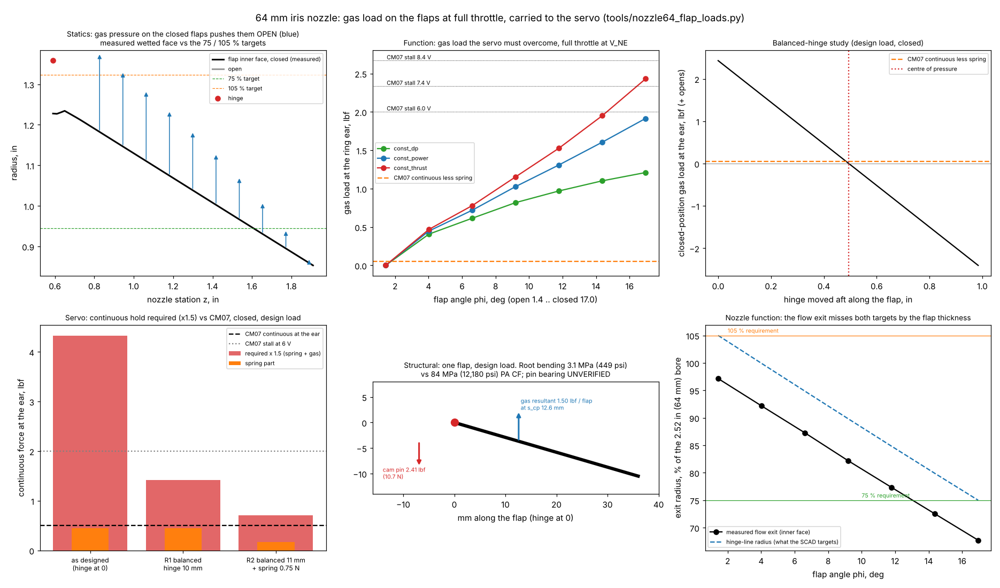
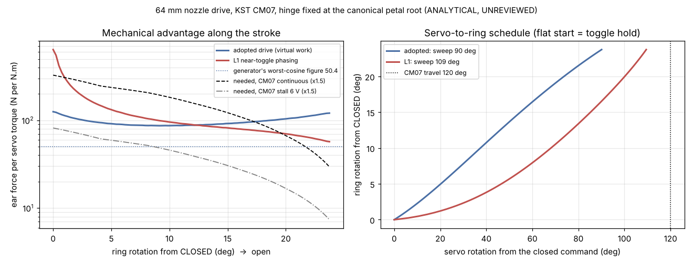

# 64 mm Iris Nozzle — Gas Load, Spring and Servo Study (2026-11-21)

License: CC BY-SA 4.0 — see LICENSES/CC-BY-SA-4.0 (SPDX-License-Identifier: CC-BY-SA-4.0)

**Author:** Steve Griffing, PE(CSE), CISSP-ISSEP, CPP (GitHub `Stab-Rabbit-coding`), owner direction
2026-11-21 ("resolve the load calculations to ensure the nozzles do their jobs and the servos do as
well").
**Analysis:** Claude (Claude Opus 5.5, Anthropic), with the `statics-and-dynamics` and
`mechanical-engineering` skills. **Reproduce:** `/usr/bin/python3 tools/nozzle64_flap_loads.py`
(gas loads) and `/usr/bin/python3 tools/nozzle64_linkage_ma.py` (linkage, §4).
**Owning items:** `airframe/wings-nacelles/WBS.md` NAC-64-SERVO-01, NAC-64-SERVO-HOLD,
NAC-64-NOZ-EXIT, NAC-64-NOZ-BALANCE (rejected); plan `docs/plans/2026-11-16-001-...` (D-SV-2, U2, U6, U8);
`docs/THEME_N_DECISION_BRIEFS.md` briefs D and E.

> **WARNING** — These results are analytical, unreviewed, and are not a substitute for a qualified
> engineer. A licensed Professional Engineer or an equivalently qualified authority shall review
> and accept them before they are applied to flight hardware. The nozzle is part of the hover
> thrust path; a nozzle that cannot reach or hold its scheduled position changes thrust in flight.

## 1. Prior studies

None computed the gas load. The drive was fit-closed (2026-10-04) against a fail-open spring of
0.45 lbf (2.0 N) at the ring ear and an **assumed** flap allowance of 0.38 lbf (1.7 N), marked
"PENDING-U8" for a bench measurement (`tools/nozzle_servo_linkage_64.py`; plan 2026-09-28-001 U8
carries a 20 N placeholder). Its "holding" force was taken as 50 % of stall. Station pressures in
`nacelle_esc_bay.scad` (50 mm, inter-stage −2,781 Pa) are upstream of the fans' second stage and do
not describe the nozzle.

## 2. Method

- **Geometry, measured.** The eight flaps are rendered from `nacelle_nozzle_iris_64mm.scad` at seven
  angles from open (−2.54°) to closed (12.94°) and sliced for the wetted inner radius. The exit is
  read at the trailing edge of the inner face (0.7 mm short of the tip bevel), not at the minimum
  radius: open, the flaps diverge and the smallest radius is the hinge clevis lobes (§3, Finding 2).
- **Flow.** One-dimensional and incompressible (duct M 0.21): the exit is a subsonic free jet at
  ambient static pressure, and the static pressure at area A is
  Δp = q_e [1 − (A_e/A)²]. The exit dynamic pressure q_e is bounded three ways per nacelle (two
  QF2822-2300KV fans in series, 5.23 lbf (23.24 N) each at full throttle [REF-EDF-003]; stock exit
  ASSUMED equal to the bore): **constant pressure rise** (lower bound), **constant jet power**
  (nominal), **constant thrust** (upper bound, used as the design case because a fan's pressure
  rises toward shutoff as the nozzle closes). Ram at V_NE 87 kt (`flight_limits.json`) adds
  1,227 Pa in forward flight.
- **Statics.** Isolated body: the ring of eight flaps, each on its own tangential hinge pin, loaded
  by the net inner pressure (outer faces at ambient) and reacted at the hinge and the cam follower
  pin. Determinate per flap (hinge force components + pin force). Hinge moment
  M = Σ Δp · 2πr · s · ds, s along the face from the hinge station.
- **Transfer to the servo.** Virtual work through the spiral cam (pin radius linear in ring angle,
  the SCAD's `TAB_X`/`TAB_Z`, 3.185/7.163 mm): T_ring = M · |dφ/dθ| (0.63 at closed), then
  F_ear = T_ring / 39.0 mm. Frictionless; friction is a bench quantity.
- **Servo capability.** KST CM07 sheet (2026-05): stall 1.80 / 2.10 / 2.40 kgf·cm at 6.0 / 7.4 /
  8.4 V; continuous zone ends ≈ 0.45 kgf·cm (read off the 7.4 V chart); travel ±60°. (Sheet:
  `open-servo-core-secure/hardware/CM07_Technical_Specifcation.pdf`; not yet in `REFERENCES.md`,
  plan 2026-11-16-001 U2.) At the ear: by virtual work through the whole chain,
  F_ear / T = |dθ_servo/dψ_ring| / r_ear (§4). Revision 1 used the generator's 50.4 N per N·m,
  which multiplies each joint's worst cosine taken at different stroke points; the adopted drive
  actually gives 87–125 N per N·m.
- **Factor of safety.** 1.5 on the holding requirement, declared as engineering judgment (it
  equals the project's `fastener_default`, `current-specification/safety_factors.json`); no code
  sets one for this mechanism.

## 3. Results

Revision 2 (same day): the exit targets are now set on the flow surface (owner direction
2026-11-21, Finding 2) and the hinge stays at the root of the canonical petals (owner direction
2026-11-21, which rejects the balanced hinge of revision 1). The numbers below are for that
geometry; revision 1's numbers (closed at 16.96°, 67.7 % exit) are in the changelog.

**Closed (cruise schedule, flow exit 75.0 % of the bore), full throttle:**

| Fan model | Flight | Exit q_e | Radial gas force, all flaps | Hinge moment, all flaps | Gas load at the ring ear |
|---|---|---|---|---|---|
| constant Δp | static | 7,225 Pa | 4.37 lbf (19.4 N) | 2.16 lbf·in (0.244 N·m) | 0.88 lbf (3.9 N) |
| constant Δp | V_NE | 8,452 Pa | 5.11 lbf (22.7 N) | 2.53 lbf·in (0.285 N·m) | 1.03 lbf (4.6 N) |
| constant power | static | 10,599 Pa | 6.41 lbf (28.5 N) | 3.17 lbf·in (0.358 N·m) | 1.29 lbf (5.8 N) |
| constant power | V_NE | 11,826 Pa | 7.15 lbf (31.8 N) | 3.53 lbf·in (0.399 N·m) | 1.44 lbf (6.4 N) |
| **constant thrust** | **V_NE** | **14,065 Pa** | **8.50 lbf (37.8 N)** | **4.20 lbf·in (0.475 N·m)** | **1.72 lbf (7.6 N)** |

The gas pushes the flaps **open** (the fail-safe direction) at every angle; the load falls to zero
as the nozzle opens.

### Finding 1 — today's drive cannot hold the nozzle closed continuously

| | At the ring ear |
|---|---|
| Required continuous hold, design (spring 2.0 + gas 7.6 N) | **2.17 lbf (9.6 N)**; × 1.5 = 3.25 lbf (14.5 N) |
| Required, nominal (spring 2.0 + gas 6.4 N) | 1.89 lbf (8.4 N) |
| CM07 **continuous** through today's drive at closed (125 N per N·m) | **1.24 lbf (5.5 N)**: × 0.38 of the design need |
| CM07 stall at 6.0 V through today's drive at closed | 4.97 lbf (22.1 N): × 1.53 over the need with its 1.5 |

Today's drive **moves** the nozzle at every point of the stroke on 6.0 V stall torque with the
1.5 factor and 45 % to spare (× 1.45 at the worst point), so closing needs no more than the 6.0 V
rail. It cannot **hold** closed continuously (× 0.38). The assumed 0.38 lbf (1.7 N) flap
allowance was 3–4 × too low, and the 50 %-of-stall holding assumption was 2.4 × the sheet's
continuous rating. Setting the exit on the flow surface cut the closed design gas load from 10.8
to 7.6 N; §4 shows that re-phasing the linkage closes the holding gap.

### Finding 2 — exit targets, now met on the flow surface

Revision 1 found the 75 % / 105 % targets applied to the flap **hinge line**, so the flow (which
sees the inner face, 2.5–3.3 mm further in) got 67.7 % closed and 97.1 % open. The SCAD now
solves the angle for the inner-face trailing edge,
r_exit = R_HINGE − L sin φ − t cos φ (L 36 mm, t 2.5 mm), and asserts it. Measured from the
rendered flaps: **closed 0.945 in (24.01 mm) = 75.0 %**; **open 1.316 in (33.43 mm) = 104.5 %**
(target 105 %; the 0.17 mm shortfall is the slice station 0.7 mm ahead of the tip and facet
error). The open nozzle now diverges (φ −2.54°), so a 0.5 mm (0.020 in) lift was added under the
lever-tab tip (`TAB_TIP_LIFT`) to keep it off the ring face.

Two root-region findings, recorded and **not** changed (the hinges stay at the canonical petal
root):

- **Clevis lobes inside the bore, open.** The flap hinge lobes stand to r 31.18 mm (0.8 mm,
  0.03 in, inside the 32.0 mm bore) over 48° of circumference at z 15.5 mm, 16° at z 17 mm, none
  by z 20 mm. A local step at the hinge, upstream of the exit; it does not set the exit area. Its
  loss is a CFD question (§5).
- **Lever tab through the housing hinge boss.** The rendered flap overlaps the housing's central
  hinge boss by about 1,600–1,800 mm³ (0.10–0.11 in³) at every angle, unchanged by this revision
  (it predates it). This is a modelling interference to resolve before print (WBS NAC-64-NOZ-EXIT).

### Finding 3 — centre of pressure; balancing rejected

The centre of pressure sits 0.49 in (12.6 mm) along the 1.39 in (35.4 mm) wetted face at every
angle and fan model. Moving the hinge about 12 mm aft would balance the flaps (revision 1), but
the owner has directed that the hinges stay at the root of the canonical petals, so **the gas
hinge moment is taken as given** and any relief has to come from the drive: the linkage
mechanical advantage (§4), the spring, or a latch.

### Structure (one flap, design load)

Gas resultant 1.06 lbf (4.7 N) per flap; it is reacted by the hinge pin and the cam follower pin
at a 0.31 in (7.8 mm) tab, **1.70 lbf (7.6 N) at each follower pin**. Root bending in a 1.02 ×
0.098 in (26 × 2.5 mm) section: 318 psi (2.2 MPa) against the 12,180 psi (84 MPa) DuraForm PA CF
tensile strength (`allowables.json`, REF-MAT-011); not governing. **Governing and unverified:**
pin bearing in PA CF and the cam-slot wear under the 7.6 N pin load (`allowables.json` bearing
strength "requires_verification").

## 4. Linkage mechanical advantage (owner direction 2026-11-21)

**Method.** `tools/nozzle64_linkage_ma.py` keeps the ring side as adopted (ring ear ball, bellcrank
pivot, output arm and rod, from the generated `nozzle_servo_linkage_64_params.scad`) and frees the
servo side: horn length, horn angle at closed, bellcrank input-arm length and its phase on the
bellcrank. Advantage is by virtual work, rigid and frictionless. The requirement along the stroke
is spring 2.0 N + the design gas load, × 1.5. Every candidate passes an envelope screen: horn tip
r 38.0–44.0 mm (bore-wall floor to today's maximum), input-arm tip r ≤ 43.1 mm, servo sweep
≤ 115° of the CM07's 120°, and ≥ 10° from dead centre. The screen is not a fit check.

**Why a toggle is allowed here.** KTD3's ring cup is open: the rod only pushes the ball toward
closed (plan 2026-09-28-001 KTD3). A dead or seized servo releases the ball wherever the linkage
sits, and the spring opens the nozzle, so a near-toggle at closed does not cost fail-open. The
energy bound still holds: with an ideal matched profile, continuous duty over the **whole** stroke
would need 151° of servo travel at the 2.0 N spring (120° at a 1.0 N spring), more than the CM07
has. A progressive linkage therefore buys continuous duty at the two ends, where the nozzle
dwells (closed in cruise, open in hover), and leaves mid-stroke on short-time torque.

| | Adopted drive | **L1** (recommended) | Best of search |
|---|---|---|---|
| Horn | 4.0 mm | 4.0 mm (unchanged) | 3.5 mm |
| Bellcrank input arm | 4.49 mm | 5.0 mm, phase +35° on the bellcrank | 4.49 mm, +35° |
| Horn angle at closed / link | −42° / 35.5 mm | −82° / 39.1 mm | −82° / 38.7 mm |
| Servo sweep (CM07 120°) | 90° | 109° | 112° |
| Advantage closed / minimum / open (N per N·m) | 125 / 87 / 121 | **641** / 57 / 57 | 654 / 61 / 61 |
| Continuous margin at closed (over × 1.5) | × 0.38 ✗ | **× 1.96** ✓ | × 2.00 |
| Continuous margin at open, hover (over × 1.5) | × 4.10 | **× 1.94** ✓ | × 2.06 |
| Continuous holds from closed to | — | ring 0.99° = 17° of servo | ring 1.24° = 21° |
| 6.0 V stall margin, worst point (over × 1.5) | × 1.45 | **× 2.02** | × 2.06 |
| Continuous margin, worst (mid-stroke) | × 0.36 | × 0.50 | × 0.52 |
| Dead-centre margin | 41° | 11° | 11° |
| Servo torque / link force at closed, design | 76.8 mN·m / 26.7 N | **15.0 mN·m / 19.5 N** | 14.7 mN·m / 22.0 N |
| Horn tip radius | 42.6–43.9 mm | 40.5–43.9 mm | 40.4–43.4 mm |

L1 keeps today's horn and servo position. It changes only the horn indexing, the link length and
the bellcrank's input arm. It holds the cruise-closed nozzle at full throttle on the CM07's
continuous rating with × 1.96 over the 1.5 factor. The hold covers a 17° servo window around the
closed command, so servo trim error does not lose it. Mid-stroke (ring 1–20°, the transition)
stays on short-time torque at × 2.02 over stall-with-factor; the firmware shall limit the dwell
there (the sheet's short-time limit, bench U6). The hinges do not move.

**Not yet checked (before adoption):**

- the shroud crest (`dorsal_shroud_resize_64.py --eval-only`);
- the generator's joint-clearance and transmission checks with the new phasing;
- the bellcrank and link clearances against the pod in OpenSCAD;
- pin bearing at the 19.5 N link force.

The generator's force chain (worst-cosine product) shall be replaced by this virtual-work measure
so the tools agree.

## 5. Options for D and E

| | **L1 linkage** (recommended) | S1 keep drive, reduce loads | S2 bigger servo | S3 drive + zero-power latch |
|---|---|---|---|---|
| Hinge | fixed (owner) | fixed | fixed | fixed |
| Closed hold, continuous | × 1.96 ✓ | fails (× 0.38) | needs a published continuous rating ≥ 14.5 N at the ear | latch holds, no current |
| Open hold (hover), continuous | × 1.94 ✓ | ✓ | ✓ | ✓ |
| Closing on 6.0 V stall | × 2.02 ✓ | × 1.45 ✓ | per servo | × 1.45 ✓ |
| Transition (mid-stroke) | short-time; firmware dwell limit | short-time | ok if rated | short-time |
| Fail-open | kept (open cup) | kept | kept | kept (latch releases on power loss) |
| Added parts | none (re-indexed horn, longer link, new bellcrank) | throttle limit on closure (firmware) | larger pocket | pawl + solenoid per nacelle |
| Rail (D-SV-2) | **6.0 V** | 6.0 V | per servo | 6.0 V |

**Recommendation: L1 on the 6.0 V rail (brief D, option D1).** Keep the 2.0 N spring until the U8
friction measurement re-sizes it, and add a firmware dwell limit at intermediate nozzle
positions. L1 meets both dwell positions on the continuous rating with no added parts and keeps
fail-open. Its geometry checks (above) come before adoption. S3 remains the fallback if L1 fails
the shroud or clearance checks.

**Bench measurements that close the largest unknowns (plan U8):** a static-pressure tap upstream
of the closed nozzle at full throttle (selects the fan model: 3.9–7.6 N spread), the
ring-and-flap friction (sets the spring), and the CM07 holding current and case temperature.

## 6. Not checked here

Fan surge or stall with the nozzle closed at full throttle (no fan curve published); thermal
effects on PA CF at the nozzle (cold exhaust, electric fan); flap flutter; the open-position
seal-flap step (U8). The pressure loss of the clevis-lobe step at the open hinge is not computed; an axisymmetric CFD (`openfoam-cfd` skill, `tools/od17_junction_cfd/` pattern) would size it.

## Changelog

- 2026-11-21 — first issue (Claude Opus 5.5). Closed at 16.96°: flow exit 67.7 %, open 97.1 %;
  closed design gas load 10.8 N at the ear; recommended a 10 mm aft (balanced) hinge.
- 2026-11-21 — revision 2 (Claude Opus 5.5): exit targets set on the flow surface (closed 12.94°,
  open −2.54°; measured 75.0 % / 104.5 %); design gas load 7.6 N; balanced hinge withdrawn per
  owner direction (hinges at the canonical petal root); open-exit read at the trailing edge;
  clevis-lobe and tab/boss findings recorded; recommendation held for the linkage study.
- 2026-11-21 — revision 3 (Claude Opus 5.5): linkage study (§4, `tools/nozzle64_linkage_ma.py`).
  Servo capability re-based on virtual work (the adopted drive gives 87–125 N per N·m, not the
  generator's worst-cosine 50.4); Finding 1 and the options re-stated; L1 near-toggle phasing
  recommended.
