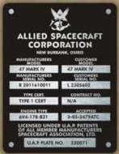

<!-- SYNC-STAMP
parent commit: a7ed7d09
source digest: 231fd03768f6
current-specification/auw_ledger.json: 363edefce3
current-specification/flight_limits.json: 25167e891e
docs/CARGO_WINCH_SPECIFICATION.md: 0565d75171
docs/FIRST_FLIGHT_READINESS.md: 28b0ef9d53
docs/POWER_DISTRIBUTION.md: 136c14ea8b
docs/failsafe_thresholds.md: 6af0586b02
docs/flight_envelope.md: 4c99937947
graphical-build-guide/flight-phases/WBS.md: c5673621a7
tools/auw_ledger.py: 43db7d7d7a
tools/flight_envelope_endurance.py: 00f0e434fc
-->
<!-- markdownlint-disable MD033 MD036 MD041 -->
<!--
Serenity UAV — Operator's Manual (NATOPS-style), v0.1 DRAFT.

Written for: the remote pilot in command, visual observer, and ground crew of the Serenity UAV.
Format: organization and wording patterned on a Navy NATOPS flight manual. Only the callout
definitions (§1.5) and requirement verbs (§1.6) of CNAF M-3710.7 are adopted [REF-MIL-003];
this is not a NATOPS publication and claims no conformance with one.

Authors: Steve Griffing, PE(CSE), CISSP-ISSEP, CPP (owner, requirements, direction).
         Claude Sonnet 5.5 (Anthropic) drafted v0.1 on 2026-11-02 from the repository sources
         named in each chapter, per root AGENTS.md §3. No other AI model contributed.
Requirement: root WBS.md §0.10.3; detail docs/WBS.md §0.10.3 (OM-1..OM-8).

License: CC BY-SA 4.0 — see LICENSES/CC-BY-SA 4.0 (SPDX-License-Identifier: CC-BY-SA-4.0)
         — applies to the text of this manual. The Allied Spacecraft Corporation, Firefly and
         Serenity artwork shown is published as fan art and keeps its own copyright; it is
         cited and acknowledged on the title page and in Appendix A.3. Its inclusion does not
         alter that prior copyright, and it does not bring the rest of this manual under it.
-->

# SERENITY UAV

## OPERATOR'S MANUAL

### Serenity-Class Tilt-Rotor Unmanned Aircraft — Model SERENITY-UAV, Rev T

&nbsp;&nbsp;&nbsp;

**ALLIED SPACECRAFT CORPORATION · NEW BURBANK, OSIRIS** 
**FIREFLY COACH WORKS, LTD. · OSIRIS**

**DRAFT v0.1 — NOT RELEASED FOR FLIGHT** 
2 November 2026

*"Can't stop the signal."*

> **WARNING**
>
> **This manual is a pre-first-flight draft. The aircraft it describes has not been built or
> flown.** Every limit, speed, time and threshold in it is a design value, an estimate, or a
> regulatory ceiling — none is flight-tested. Do not use this manual to operate an aircraft
> until the release gates in Appendix B are closed and the owner has signed the release block
> below. Where the manual says "not established," no value exists, and the operator shall not
> supply one.

> **NOTE — fan art and acknowledgements.** The Allied Spacecraft Corporation and Firefly Coach
> Works plates, the Serenity insignia and the blueprint sheets are reproduced from the QMx
> *Serenity* blueprint reference pack (sheets 11 and 12; extracts in
> `references/qmx-bp-exports/`) and are published here as **fan art**. *Firefly* and *Serenity*
> are © Joss Whedon / Mutant Enemy / Universal; the blueprint artwork is © QMx. Each item
> carries its own copyright, which this manual's publication neither removes nor replaces.
> The CC BY-SA 4.0 licence covers this manual's own text and drawings only; the artwork stays
> under its original owners' notices and does not extend its terms to the rest of the document.
> The Rev T aircraft is not a product of, and is not endorsed by, any rights holder.

| Release block | |
| --- | --- |
| Status | DRAFT v0.1 — pre-first-flight |
| Released for flight by | *unsigned* |
| Owner review (PE) | *pending* — `WBS.md` §0.10.3 |
| Applies to | Rev T airframe, avionics and firmware as described in each chapter's sources |

---

## RECORD OF CHANGES

| Change | Date | Description | Entered by |
| --- | --- | --- | --- |
| Original | 2026-11-02 | v0.1 draft | Claude Sonnet 5.5 for S. Griffing |
| 1 | 2026-11-02 | Owner corrections: tilt −5° to +135° (0° horizontal); EDF QF2822-2300KV, 83.60 ozf (2,370 gf), 80 A ESC; figures now generated | Claude Sonnet 5.5 for S. Griffing |

---

## CONTENTS

| Part | Chapter | Title |
| --- | --- | --- |
| — | — | Preface |
| **I** | | **THE AIRCRAFT** |
| | 1 | General description |
| | 2 | Systems |
| | 3 | Operating limitations |
| **II** | | **INDOCTRINATION** |
| | 4 | Operator qualification and legal requirements |
| | 5 | Mission planning |
| **III** | | **NORMAL PROCEDURES** |
| | 6 | Preflight |
| | 7 | Power-up and arming |
| | 8 | Launch, hover, transition, landing |
| | 9 | Cargo operations |
| | 10 | Shutdown and postflight |
| **IV** | 11 | **FLIGHT CHARACTERISTICS** |
| **V** | 12 | **EMERGENCY PROCEDURES** |
| **VI** | 13 | **COMMUNICATIONS** |
| **VII** | 14 | **PERFORMANCE DATA** |
| App. A | | Source documents and references |
| App. B | | Release gates and open items |
| App. C | | Pocket checklists |

---

## PREFACE

### Purpose

This manual tells the remote pilot in command (RPIC), the visual observer (VO) and the ground
crew how to operate the Serenity UAV: what it is, what it may and may not do, and what to do
when something goes wrong.

### Scope and status

The Serenity UAV is an electric-ducted-fan (EDF) tilt-rotor replica of the Firefly-class
transport *Serenity* [`README.md`]. **As of 2 November 2026 it is a design and PCB-layout
project; nothing is fabricated or assembled** [`README.md` "Project Status"]. This manual is
written ahead of the aircraft so the operating concept, limits and procedures are reviewed
before flight rather than after. Procedures that depend on hardware that does not yet exist
are marked **[PLANNED]**.

### Wording and callouts

Wording follows CNAF M-3710.7 §1.6 as adopted in root `AGENTS.md` §6a [REF-MIL-003 §1.6]:

| Word | Meaning |
| --- | --- |
| **shall** | Mandatory |
| **should** | Recommended |
| **may**, **need not** | Optional |
| **will** | Futurity only — never a requirement |
| **can**, **could** | Physical or performance capability only |

Callouts follow CNAF M-3710.7 §1.5 [REF-MIL-003 §1.5] and always precede the text they apply to:

> **WARNING** — an operating procedure or condition that can cause injury, illness or death
> if not followed.
>
> **CAUTION** — an operating procedure or condition that can cause equipment damage if not
> followed.
>
> **NOTE** — an item that needs emphasis; no hazard.

Directions are written in the active voice; requirement statements and as-built descriptions
are written in the passive voice. Units are US customary with SI in parentheses; airspeed is in
knots (kt) with m/s in parentheses.

### Automatic synchronization

Figures that come from the flight envelope and the other limits are **generated**, not typed.
`tools/sync_operators_manual.py` runs in the pre-commit chain on every commit: it polls the
source documents, checks `current-specification/flight_limits.json` against the tools and
documents that restate it, rewrites every region marked `AUTO` or `V` in this file, and writes
the sync stamp at the top of the source file (parent commit and source digest). Do not edit
those regions by hand — change the source and commit. A commit is refused when the sources
disagree with each other.

### Sources and how to report errors

Every value is traced to a repository document, named in square brackets or in the chapter's
source line. Where two repository documents disagree, the manual follows the newer, more
specific one and says so. Report an error or a disagreement by opening a work item in
`docs/WBS.md` §0.10.3; do not correct a limit locally.

---

# PART I — THE AIRCRAFT

## Chapter 1 — General description

*Sources: `README.md`; `docs/flight_envelope.md`; `current-specification/`; root `AGENTS.md` §1.*

### 1.1 Configuration

The Serenity UAV is a high-wing tilt-rotor VTOL aircraft with a permanently bonded printed hull,
two wings, and **two tilting nacelles**, each carrying **two
64 mm EDFs in tandem (series)** [`docs/flight_envelope.md` "Design inputs"]. A belly cargo bay
with a winch and clamshell doors carries a payload. Eight networked compute nodes fly the
aircraft with PACE (Primary / Alternate / Contingency / Emergency) failover [root `AGENTS.md` §1].

<!-- AUTO:config -->
| Item | Value | Source / status |
| --- | --- | --- |
| Length | 24.0 in (609 mm) | `README.md` Rev S figure — **hull scale under review; verify against `current-specification/`** |
| Wingspan | 19.1 in (486 mm) | same |
| Height | 7.93 in (201.5 mm) | same |
| Propulsion | 4 × 64 mm EDF, QX Motor QF2822-2300KV 64 mm EDF, two per nacelle in tandem, co-rotating; 80 A ESCs | `current-specification/flight_limits.json`; [REF-EDF-003] |
| Rated thrust per fan | 5.22 lbf (83.60 ozf, 2,370 gf, 23.2 N) at 57.0 A, 1,368 W, 24 V, 100 % throttle | [REF-EDF-003] second sheet |
| Total nacelle thrust | 20.90 lbf (9,480 gf, 93.0 N) — **no tandem stacking loss applied** | `docs/flight_envelope.md` |
| Battery | 6S, two cells (4.4 Ah pair) on a payload mission | `docs/flight_envelope.md`; `docs/BATTERY_SPLIT_OPTIONS.md` |
| AUW, two cells + 8.0 oz payload | 13.93 lbm (6,318 g) — **provisional** | `docs/flight_envelope.md` |
| T/W, two cells + payload | 1.50 (design floor 1.2) | computed |
| Nacelle tilt range | −5° to +135° (140° span); **0° = horizontal (cruise), 90° = vertical (hover)** | owner 2026-11-02; `current-specification/flight_limits.json` |
| Payload | 8.0 oz (226.8 g) in a 4 in × 3 in × 3 in (102 × 76 × 76 mm) bay | `README.md` |
<!-- /AUTO:config -->

> **WARNING**
>
> The AUW and T/W above rest on a mass ledger whose printed-part masses were found understated
> by 521.6 g, with the true AUW possibly higher [`docs/FIRST_FLIGHT_READINESS.md`, blocker 1].
> Hover margin may be smaller than shown. The RPIC shall not rely on <!--V:tw_pl-->1.50<!--/V--> until the as-built
> aircraft has been weighed (Ch. 6).

> **NOTE — tilt convention.** The zero datum is **horizontal** (0° = cruise, 90° = vertical
> hover), and the range is −5° to +135° (owner, 2026-11-02). Build-guide text that stated the
> opposite was corrected on that date; the tilt calibration shall still be checked against this
> convention at first power-up.

### 1.2 Crew

| Position | Duty |
| --- | --- |
| **RPIC** | Holds the controls and the responsibility for the flight [REF-FAA-002]. |
| **VO** | Maintains visual contact and calls traffic and obstacles. Required whenever the RPIC cannot keep unaided visual line of sight alone [REF-FAA-002 §107.31]. |
| **Ground crew** | Battery handling, cargo loading, post-flight inspection. |

### 1.3 Identification and marking

The aircraft shall carry its FAA registration number on the exterior in characters at least
3 in (76 mm) high [REF-FAA-001 §48.205(a), §48.205(b)(1)]. The manufacturer's data plate
(§1.4) is a separate identification item. The registration number shall replace the `N00000`
placeholder before first flight [`graphical-build-guide/flight-phases/WBS.md` Phase 5].

### 1.4 Manufacturer's plates

The builder's plate is reproduced as an inspection item, not as a regulatory marking:

| Plate | Marking | Source |
| --- | --- | --- |
| Allied Spacecraft Corporation, New Burbank, Osiris | Type certificate block; U.A.P. plate no. 220071 | QMx sheet 12 (decoration) |
| Engineered by Firefly Coach Works, Ltd., Osiris | No. 03-K64-FF | QMx sheet 12; `images/EngineerByFF.png` |

> **NOTE**
>
> These plates are fan-build decoration. They are not an FAA identification plate, and they
> shall not be read as a type-certification claim. The aircraft holds no FAA certificate other
> than its Part 48 registration.

## Chapter 2 — Systems

### 2.1 Airframe *(`airframe/README.md`; `docs/WING_ATTACH_INTERFACE.md`)*

- **Hull.** The fuselage is a 24" 3d printed piece with single permanently bonded joint at the aft end of the cargo bay, just before the ring and skids. All interior access is via the cargo bay and removable access panels.

- **Wings.** Fixed, bonded 20 × 16.3 mm carbon-fiber spar as the primary bending member; wing
  section S1223 camber line with thickness scaled (S1223/t17.7 root, /t26.7 tip) — **not a
  true S1223** [`docs/flight_envelope.md`].
- **Landing gear.** Four corner legs, post and wire braces, with a progressive,
  field-replaceable failure mode. The 3.0 in (76 mm) leg is the flight article
  [`docs/LANDING_GEAR_ANALYSIS.md`].

> **WARNING**
>
> **The landing gear is not flight-cleared.** A bellcrank load-path issue is a build blocker,
> and a side-hit study predicts fore-thigh failure in a hard bank-over crash
> [`docs/LG_BELLCRANK_LOAD_PATH_STUDY.md`; `docs/LG_SIDE_HIT_FAILURE_MODES.md`]. Land with the
> aircraft level and with no lateral drift. The RPIC shall not intentionally land with bank or
> sideways velocity.

### 2.2 Propulsion and tilt *(`docs/TILT_DRIVE_CONTROL_SPEC.md`; `docs/NOZZLE_DRIVE_TRADE.md`)*

Each nacelle pivots on a trunnion carried on two bearings, driven by a geared tilt actuator
read by an off-axis AK7455 angle encoder. A servo-driven iris nozzle trims exhaust.

- Four ESCs, one per EDF, are commanded by two different flight-control nodes so that **loss
  of any one node leaves 50 % of thrust in both nacelles**
  [`graphical-build-guide/flight-phases/WBS.md` ESC assignment].

> **WARNING**
>
> The tilt drive train is **not self-locking** and the actuator selection is open
> [`docs/FIRST_FLIGHT_READINESS.md`, blocker 3]. On loss of tilt power the nacelle may drift.
> The nozzle drive has no axial datum in the as-built joint (blocker 2). Both are first-flight
> blockers; Ch. 12 gives the interim response.

### 2.3 Electrical power *(`docs/POWER_DISTRIBUTION.md`)*

- Main bus is the 6S pack (18–25.2 V) through an XT90 power distribution board. Avionics run
  on a 5 V rail; servos on a 6 V rail.
- A BQ76930 monitor protects the pack **independent of firmware**: over-voltage 4.20 V/cell,
  under-voltage 3.00 V/cell, over-current 50 A / 8 ms, short-circuit 150 A / 100 µs,
  over-temperature 60 °C [`docs/POWER_DISTRIBUTION.md` §8.4].
- After a hardware trip the battery is fully disconnected. Recovery requires a power cycle
  after the fault clears.

> **WARNING**
>
> The design hover current is about <!--V:i_PLANNING_pl-->168<!--/V--> A on the planning case (<!--V:i_NOMINAL_pl-->138<!--/V--> A nominal)
> [`docs/flight_envelope.md` §6.1]. Connectors, fuses and wiring carry this current. A loose
> or damaged main connector can cause fire. Inspect it every flight (Ch. 6).

> **NOTE**
>
> `docs/POWER_DISTRIBUTION.md` §8.3 still quotes a T/W of 1.61 from the 50 mm-fan baseline. The
> value is stale; use `docs/flight_envelope.md`.

### 2.4 Avionics and flight control *(`avionics/README.md`; root `AGENTS.md` §1)*

- Eight PocketBeagle2-based nodes, each a Pilot (flight control) and TACCO (comms/logging/payload)
  cape pair, interconnected by CAN FD, MIL-STD-1553C, RS-485 and Ethernet. Commo is a standalone
  MCU node at the antennas carrying the 49 MHz and 915 MHz links.
- **First-flight set:** four nodes in two bays (nose Bay A and dorsal-forward Bay B)
  [`graphical-build-guide/flight-phases/WBS.md` Phase 5]. The other four install in Phase 6.
- Every message is signed, authenticated and logged; logs write to hardware-write-protected
  microSD [root `AGENTS.md` §1].
- Any of the four flight-control nodes can take over any EDF. A node's loss is detected by CAN
  FD heartbeat timeout of **100 ms** [`docs/failsafe_thresholds.md` §2.1].

> **CAUTION**
>
> The flight-controller firmware is a **stub**: no rate governor, tilt command, IMU/baro fusion
> or GNSS fusion exist yet [`docs/FIRST_FLIGHT_READINESS.md`, blocker 8]. The aircraft cannot be
> flown until it does.

### 2.5 Navigation lights *(`graphical-build-guide/build_guide_20_nav_lights.svg`; [REF-FAA-003])*

Six RGB LEDs show red (port), green (starboard) and white (aft), with a white belly strobe
[`graphical-build-guide/flight-phases/WBS.md` Phase 5]. They are the anti-collision lighting
referred to in Ch. 3 for civil-twilight operations [REF-FAA-002 §107.29].

### 2.6 Cargo system *(`docs/CARGO_WINCH_SPECIFICATION.md`; `docs/CARGO_DOOR_LATCH_SPEC.md`)*

Clamshell doors, a winch and a one-way safety ratchet carry and lower the payload on a line
(1.5 m / 4.9 ft) [`docs/flight_envelope.md` §6.2].

| Condition | Solenoid | Ratchet | Spool | Outcome |
| --- | --- | --- | --- | --- |
| Normal, stowed | off | engaged | retract only | Payload held |
| Commanded pay-out | on | retracted | free both ways | Controlled descent |
| Overload, powered | on | retracted | slow pay-out | Sensed shed |
| Overload, unpowered | off | cams out at 8.0 N | slow pay-out | Mechanical shed |
| Comms loss or watchdog | off | engaged | retract only | Payload held; cannot pay out |
| Total power loss | off | engaged | retract only | Payload held; ratchet still sheds above 8.0 N |

[`docs/CARGO_WINCH_SPECIFICATION.md` §5.2]

> **NOTE**
>
> The cargo **winch** is not a first-flight item (Phase 7). The cargo **doors** are
> [`docs/FIRST_FLIGHT_READINESS.md`].

## Chapter 3 — Operating limitations

### 3.1 Regulatory limits

The aircraft shall be operated under 14 CFR Part 107 [REF-FAA-002]:

<!-- AUTO:reg_limits -->
| Limit | Value | Source |
| --- | --- | --- |
| Groundspeed (V_NE) | ≤ 87 kt (45 m/s) | [REF-FAA-002 §107.51(a)] |
| Altitude | ≤ 400 ft (122 m) AGL, unless within 400 ft of a structure | [REF-FAA-002 §107.51(b)] |
| Visibility | ≥ 3 statute miles from the control station | [REF-FAA-002 §107.51(c)] |
| Cloud clearance | ≥ 500 ft below, ≥ 2,000 ft horizontal | [REF-FAA-002 §107.51(d)] |
| Operating hours | Daylight, or civil twilight with anti-collision lighting | [REF-FAA-002 §107.29] |
| Line of sight | Unaided VLOS by the RPIC or VO throughout the flight | [REF-FAA-002 §107.31] |
| Registration | Required above 0.55 lbm (250 g); this aircraft is 13.93 lbm | [REF-FAA-001 §48.25] |
<!-- /AUTO:reg_limits -->

> **NOTE**
>
> This aircraft is far below the 55 lbm Part 107 ceiling. This catalog lists only the Part 107
> sections already verified in `REFERENCES.md`. Section-level citations for remote-pilot
> certification, preflight, operations over people and accident reporting are **pending
> verification** (Appendix B); the RPIC shall comply with all of Part 107, not only the rows above.

### 3.2 Design limits

<!-- AUTO:design_limits -->
| Limit | Value | Basis |
| --- | --- | --- |
| Never-exceed speed | 87 kt | The regulatory ceiling. **Not an aerodynamic limit.** Actual top speed not established. |
| Tilt range | −5° to +135° | Hard stops; above θ_hover the vertical T/W falls to 1.06 at +135° (Ch. 11) |
| Minimum T/W for flight | 1.2 (hover control floor, WA-R18) | `docs/flight_envelope.md` §3.2 |
| Density altitude at T/W = 1.2 | about 7,400 ft | First-order estimate; a hot-day launch at a moderate-elevation site can reach it |
| Transition sweep (90° ↔ 0°) | **Initiate no lower than 20 ft (6.1 m) AGL** | Conservative pre-validation policy [`docs/flight_envelope.md` §5] |
| Phase 5 first-flight transition | ≥ 8 m (26 ft) AGL | `graphical-build-guide/flight-phases/WBS.md` Phase 5 |
| Payload | ≤ 8.0 oz (226.8 g); the third battery cell shall not be carried on a payload mission | `docs/flight_envelope.md` |
| 64 mm EDF RPM redline | **Not established** | `docs/flight_envelope.md` §2.2 |
| Crosswind | **Not established** (hover bank-authority bound ≈ 48.2° is not a limit) | `docs/flight_envelope.md` §4 |
| Stall speed | **Not established** — CL_max unknown for the built wing section | `docs/flight_envelope.md` banner |
<!-- /AUTO:design_limits -->

> **WARNING**
>
> Do not fly to any speed in `docs/flight_envelope.md`'s V_min table. It rests on a CL_max that
> does not describe the built wing section.

### 3.3 Powerplant limits

<!-- AUTO:powerplant -->
| Parameter | Value | Source |
| --- | --- | --- |
| Cell voltage, normal | ≥ 3.5 V/cell (21 V pack) | `docs/failsafe_thresholds.md` §1 |
| Low-battery warning | < 3.5 V/cell or < 21 V | same |
| **Return-to-home trigger** | < 3.3 V/cell or < 19.8 V | same |
| Emergency | < 3 V/cell or < 18 V | same |
| ESC rating | 80 A | owner 2026-11-02 |
| Per-fan current at full throttle | 57.0 A at 24 V | [REF-EDF-003] second sheet |
| ESC over-current warning | > 35 A | `docs/POWER_DISTRIBUTION.md` §8.2 |
| ESC over-current, critical | > 40 A for > 5 s | same |
| ESC burst | > 55 A: that EDF is disarmed immediately | same |
| ESC thermal cutback / shutdown | 85 °C / 95 °C **design target** | `docs/failsafe_thresholds.md` §4 |
| Phase 5 pass criterion | All four ESCs ≤ 70 °C at full hover power | `graphical-build-guide/flight-phases/WBS.md` |
<!-- /AUTO:powerplant -->

> **CAUTION**
>
> The live firmware (`governor_config.h`) cuts out at **100 °C** in a single stage; the failsafe
> document specifies 85 °C cutback and 95 °C shutdown. The two are not reconciled
> [`docs/failsafe_thresholds.md` §4]. Until they are, the RPIC shall treat 70 °C as the
> operating ceiling and land when any ESC reports it.

### 3.4 Endurance

> **WARNING**
>
> **Hover endurance with two cells and the payload is about <!--V:t_PLANNING_pl-->66<!--/V--> s on the planning case (<!--V:t_NOMINAL_pl-->92<!--/V--> s
> nominal) to the return-to-home trigger.** The derived mission need is <!--V:target_s-->318<!--/V--> s. The aircraft does
> **not** meet it, and added battery capacity does not close the gap [`docs/flight_envelope.md`
> §6.2]. The RPIC shall not plan the full mission profile on this configuration. First-flight
> cards shall end well before the trigger.

---

# PART II — INDOCTRINATION

## Chapter 4 — Operator qualification and legal requirements

### 4.1 Remote pilot

The RPIC shall hold the FAA remote pilot qualification Part 107 requires and shall know the Part 107
operating rules [REF-FAA-002]. The specific certificate, currency and preflight-familiarization
sections are not yet catalogued in `REFERENCES.md` and shall be verified before release
(Appendix B).

### 4.2 Aircraft-specific training

Before flying, each RPIC and VO shall have:

1. Read this manual.
2. Completed the ground sections of Ch. 6–10 on the bench aircraft with propulsion
   disconnected.
3. Practiced the emergency procedures of Ch. 12 on the ground station in simulation or with
   the aircraft tethered and unarmed.

> **NOTE**
>
> No simulator or training aircraft exists. "Simulation" means a ground-station software-in-
> the-loop run once the flight-controller firmware supports one **[PLANNED]**.

### 4.3 Registration and radio

- Register the aircraft and mark it (Ch. 1.3) [REF-FAA-001].
- The 49 MHz link operates under 47 CFR Part 15 §15.235 — unlicensed, not Part 95 [REF-FCC-003].
  Other bands: see `avionics/AGENTS.md` "External Communications Regulations Compliance".

## Chapter 5 — Mission planning

### 5.1 Planning checklist

The RPIC shall, before every flight:

1. Confirm the site, time and weather meet Ch. 3.1: daylight (or twilight with lights), 3 SM
   visibility, cloud clearance, no operation beyond VLOS.
2. Compute density altitude. Do not fly if it exceeds about <!--V:da_floor-->7,400<!--/V--> ft (Ch. 3.2).
3. Plan the flight to end **well before** the return-to-home trigger (Ch. 3.4). **Do not plan to
   the trigger.**
4. Brief the VO on limits, the landing area, the emergency landing area and the abort call.
5. Check wind. No crosswind limit exists; the Phase 5 pass criterion is stable hover at 1 m AGL
   in ≤ 15° headwind [`graphical-build-guide/flight-phases/WBS.md`]. Fly only in light, steady wind
   until Phase 9 data exists.
6. Keep people clear of the duct plane and the flight area (Ch. 6 WARNING).

### 5.2 Weight and balance

| Item | Value | Source |
| --- | --- | --- |
| Static CG (first-flight guide) | 190 mm from nose, adjusted by battery position on its rail | `graphical-build-guide/flight-phases/WBS.md` Phase 5 — pre-Rev-T figure; **verify** |
| Current CG target | pivot at the thrust line, Y 326.7 mm in the hull frame | `docs/CG_RELOCATION_STUDY.md` |
| Payload | ≤ 8.0 oz | `README.md` |

> **CAUTION**
>
> The two CG figures use different datums and different revisions. The RPIC shall use the value
> in the current `current-specification/` release and shall weigh and balance the as-built aircraft
> before first flight. Do not fly on the 190 mm figure without confirming it.

---

# PART III — NORMAL PROCEDURES

## Chapter 6 — Preflight

*Sources: `graphical-build-guide/flight-phases/WBS.md` Phase 5 "Ground tests" and "First flight sequence";
`graphical-build-guide/build_guide_25_test_flight.svg`.*

The preflight is the Phase 5 **ABCD** check: Airframe, Battery, Comms, Docs.

> **WARNING**
>
> Spinning EDFs and a free aircraft can cause serious injury. Keep all people clear of the duct
> plane and the flight area. Do not connect the battery with anyone in line with an inlet or
> exhaust [`graphical-build-guide/build_guide_25_test_flight.svg`].

### 6.1 A — Airframe

1. Registration number present and legible, ≥ 3 in characters [REF-FAA-001 §48.205].
2. Hull, wing roots, nacelle trunnions and ESC-bay covers secure; no cracks, delamination
   or loose fasteners.
3. Landing gear legs and wire braces intact. Replace a bent or kinked wire brace
   [`docs/LANDING_GEAR_ANALYSIS.md`]. Gear is **not flight-cleared** (Ch. 2.1).
4. EDF intakes and nozzles clear of debris. Rotate each fan by hand: free, no rub.
5. Nacelles tilt smoothly through 0°–90°; both nacelles are at the same angle (Ch. 6.4).
6. Cargo doors open, close and latch; ratchet engaged; line spooled.
7. Weigh the aircraft. Record AUW and compare with the ledger. Balance per Ch. 5.2.

### 6.2 B — Battery

1. Pack fully charged and cell voltages balanced. **Cell-balance tolerance and full-charge
   acceptance values are not established** — no repository source gives them (Appendix B.3).
   Never fly a cell below the 3.50 V/cell WARN level (Ch. 3.3).
2. XT90 and main connectors clean, fully seated, undamaged (Ch. 2.3 WARNING).
3. Battery strapped on its rail per the CG setting; no movement.
4. No swelling, damage or heat. Do not fly a swollen cell.

> **WARNING**
>
> Lithium-polymer cells can burn violently if punctured, short-circuited, overcharged or deeply
> discharged. Charge only in a fire-resistant container with a person present; do not leave a
> pack unattended on a charger. *(General battery practice — the repository holds no battery
> charging procedure; one is an open item, Appendix B.)*

### 6.3 C — Comms

1. Ground station powered; the GCS shows a C2 heartbeat on each link in use
   [`docs/failsafe_thresholds.md` §2.2].
2. Attitude, tilt and nozzle respond on the ground.
3. GPS lock: HDOP ≤ 1.5 on both flight nodes; their positions agree within 2 m.
4. Radio checks: MAVLink heartbeat on SiK and LoRa backup; 49 MHz channels correct; Wi-Fi
   telemetry.
5. Nav lights cycle red, green, white, belly strobe (Ch. 2.5).

### 6.4 D — Documents and ground tests

1. Part 107 documents in hand; FAA registration on the airframe; site authorization if applicable.
2. ESC calibration complete; motor spin test (5 % throttle, 2 s) shows correct rotation on all
   four EDFs.
3. Tilt calibration: both nacelles reach their end stops; angle matches the commanded value
   (verify convention, Ch. 1.1 NOTE).
4. Security: write-block on the flight-log microSD verified (a write attempt must return a
   read-only error); each node's TPM provisioned.
5. Node failover: kill the master flight node's power on the tether; a standby shall assume
   authority within 100 ms.
6. Tethered thrust: 60 % throttle, 10 s; lift exceeds AUW; ESC temperatures ≤ 60 °C.

> **CAUTION**
>
> Run the thrust test only on the tether and an anchored bench. A free aircraft at 60 % throttle
> can leave the bench.

## Chapter 7 — Power-up and arming

*Source: `docs/POWER_DISTRIBUTION.md` §10.*

On battery connect the system powers up in a fixed sequence. The RPIC shall **not** command
throttle until step 7.

| Time | Event |
| --- | --- |
| T+0 ms | Battery voltage present; BQ76930 wakes and measures cells (≈ 200 ms) |
| T+10 ms | 5 V rail up; nodes begin booting |
| T+20 ms | 6 V rail up; servos power and hold last position |
| T+250 ms | Cell voltages valid |
| T+30 s | All nodes booted; heartbeat election complete; the primary flight node takes authority |
| T+31 s | ESC arming sequence (zero throttle ≥ 2 s) |
| T+33 s | All ESCs armed; ready for command |

> **WARNING**
>
> **Servos power and move at T+20 ms**, before the flight controller finishes booting. Keep hands
> and tools clear of the nacelles, nozzles and cargo doors when connecting the battery.

> **NOTE**
>
> Wait for all node heartbeats before arming. The Phase 5 pass criterion checks CAN FD
> heartbeats from all four first-flight nodes (frames 0x001–0x004 within 100 ms)
> [`graphical-build-guide/flight-phases/WBS.md`].

## Chapter 8 — Launch, hover, transition, landing

*Source: `graphical-build-guide/flight-phases/WBS.md` Phase 5; `docs/flight_envelope.md` §5.*

All first flights shall follow the **Phase 5 ladder**, in order. Each step shall be completed
before the next.

| Step | Maneuver | Criterion |
| --- | --- | --- |
| 1 | **Tethered** hover, 1 m AGL, nacelles 90°, about 60 % throttle | **Three** successful passes before any free flight |
| 2 | Free hover, 1 m AGL | Stable; ±10° attitude authority; altitude hold ±0.3 m |
| 3 | Free hover, 3 m AGL | Yaw 360° in both directions |
| 4 | Transition, ≥ 8 m AGL | Gradual sweep 90° → 0°; altitude hold ±1.5 m |
| 5 | Forward-flight circuit | One lap, ≤ 10 m AGL; transition back to hover; land |
| 6 | Verify flight log | Written to both control-node microSD cards |

### 8.1 Launch

1. Complete Ch. 6 and Ch. 7. Clear the area; announce "launching."
2. Nacelles to 90°. Advance throttle smoothly. Lift off vertically to 1 m. Hold. Check attitude
   and altitude hold before continuing.

### 8.2 Hover and station-keeping

- Hold station with small inputs. Watch battery state continuously; a WARN call shall be answered
  by planning the landing, a CRITICAL by landing at once (Ch. 12).
- Do not exceed the length of flight planned in Ch. 5.1.

### 8.3 Transition

1. Climb to at least 8 m (26 ft) AGL for the first flights (never below 20 ft / 6.1 m).
2. Sweep the nacelles from 90° toward 0° gradually while watching altitude and the ESC
   temperatures.
3. Below **about <!--V:theta_pl-->41.8<!--/V-->° tilt**, thrust alone cannot support the aircraft; the wings must be carrying
   weight, which needs **airspeed of <!--V:vmin_pl_40-->18.9<!--/V-->–<!--V:vmin_pl_20-->69.9<!--/V--> kt between 40° and 20° tilt** on the design table
   (CL_max unverified) [`docs/flight_envelope.md` §1].

> **WARNING**
>
> **Below about <!--V:theta_pl-->41.8<!--/V-->° nacelle tilt (two cells with payload), the aircraft cannot hold altitude on
> thrust alone**, and the design table shows wing-borne flight needs airspeeds this airframe is
> not expected to reach. At 0° the minimum speed is above the <!--V:vne-->87<!--/V--> kt Part 107 ceiling
> [`docs/flight_envelope.md` §1]. The RPIC shall not leave hover-class tilt (≥ <!--V:theta_pl-->41.8<!--/V-->°) in any step
> of the Phase 5 ladder unless the flight-test cards for that step state the expected altitude
> loss and the ESC, battery and tether margins. The Phase 5 forward-flight circuit is a design
> goal that **conflicts with this table** and shall be resolved by the owner (Appendix B).

### 8.4 Landing

1. Return to hover tilt (90°). Align with the landing area, descend at a steady, slow rate.
2. Touch down level, with no lateral velocity (Ch. 2.1 WARNING). Reduce throttle to idle.
3. Do not shut down the propulsion over loose ground; debris can ingest into the inlets.

## Chapter 9 — Cargo operations

*Sources: `README.md` mission profile; `docs/CARGO_WINCH_SPECIFICATION.md`; `docs/CARGO_DOOR_LATCH_SPEC.md`.*

> **NOTE**
>
> The winch is a Phase 7 item. The first flights carry no payload and keep the doors closed and
> latched.

### 9.1 Payload

Payload shall be 4 in × 3 in × 3 in (102 × 76 × 76 mm) and shall not exceed 8.0 oz (226.8 g).
The payload shall be secured and its mass recorded before loading.

### 9.2 Loading and release *[PLANNED — Phase 7]*

1. Land with the cargo doors facing the payload (aircraft level, Ch. 8.4).
2. Open the doors; load and secure the payload; close and latch the doors; verify the latch.
3. In flight, a commanded pay-out lowers the payload on the 1.5 m line; the ratchet disengages
   only while commanded.
4. Retrieval: lower the line, attach the hook, reel in, close the doors.

> **WARNING**
>
> **Do not hand-feed the line or put hands in the bay with the battery connected.** The winch,
> solenoid and doors move under power. The ratchet sheds the load mechanically at 8.0 N
> [`docs/CARGO_WINCH_SPECIFICATION.md` §5.2].

> **CAUTION**
>
> The cargo-door servos run on their own gateway board and the doors rely on a positive
> mechanical latch, not friction. A door that does not latch shall be treated as a failure; land
> and inspect [`docs/CARGO_DOOR_LATCH_SPEC.md`].

## Chapter 10 — Shutdown and postflight

1. After touchdown, throttle idle, then disarm. Wait for the EDFs to stop completely.
2. **Disconnect the battery** before approaching the aircraft with hands.
3. Record: flight time, minimum cell voltage, peak current, peak ESC temperature, events, anomalies.
4. Inspect: legs and wire braces; nacelle trunnions; inlet and nozzle condition; battery temperature
   and swelling; hull for cracks.
5. Remove the flight-log microSD cards only after power is off. Preserve both cards for review.
6. Store lithium packs at a safe storage charge in a fire-resistant container *(open item —
   repository has no storage specification)*.

---

# PART IV — FLIGHT CHARACTERISTICS

## Chapter 11 — Flight characteristics

*Source: `docs/flight_envelope.md`. **None of these is flight-tested.***

<!-- AUTO:tilt_table -->
| Tilt | Vertical T/W (two cells + payload) | Behavior (design estimate) |
| --- | --- | --- |
| 90° | 1.50 | Full hover |
| 120° | 1.30 | Backing thrust |
| 130° | 1.15 | Backing thrust |
| +135° (hard stop) | **1.06** | Thin margin over weight — hold only briefly |
| ≈ 41.8° | 1.00 | Critical angle: thrust equals weight |
<!-- /AUTO:tilt_table -->

- **Hover bank authority.** The thrust margin allows at most about <!--V:bank_pl-->48.2<!--/V-->° of bank at full hover
  weight. That is a control-authority bound, **not** a crosswind limit.
- **Reynolds number.** The wing runs at Re about 1.8 × 10⁵ at 40 kt. The laminar separation bubble
  may influence stall, which is unmeasured.
- **Wing lift.** At 0° tilt, the wings alone cannot carry weight below about 100 kt.
  Sustained forward flight below about <!--V:theta_pl-->41.8<!--/V-->° tilt is therefore not available (Ch. 8.3 WARNING).
- **Crosswind and gust response:** not established; Phase 9 data fill it.

---

# PART V — EMERGENCY PROCEDURES

## Chapter 12 — Emergency procedures

*Sources: `docs/failsafe_thresholds.md`; `docs/POWER_DISTRIBUTION.md` §8; `docs/CARGO_WINCH_SPECIFICATION.md` §5.2.*

### 12.1 General rules

1. **Fly the aircraft first.** Then diagnose.
2. The VO announces the emergency; the RPIC acknowledges.
3. **Land as soon as practical** unless a procedure says otherwise.
4. After any emergency: do not fly again until the flight log has been read and the cause
   corrected.

> **NOTE**
>
> Items in **bold capitals** are intended for recall without reference to this manual. They are
> proposed as memory items for the owner's review; no item has been designated by the owner.

### 12.2 Battery warnings

<!-- AUTO:battery_alerts -->
| Alert | Condition | Automatic action | Operator action |
| --- | --- | --- | --- |
| WARN | < 3.5 V/cell or < 21 V | CAN FD warning; ground alert; log | Plan landing |
| CRITICAL | < 3.3 V/cell or < 19.8 V | Non-essential loads shed; return-to-home begins | **LAND** |
| EMERGENCY | < 3 V/cell, < 18 V, or hardware under-voltage latch | All non-propulsion loads off; **70 % throttle cap**; fault latch | **LAND IMMEDIATELY** |
<!-- /AUTO:battery_alerts -->

> **WARNING**
>
> At the 70 % throttle cap, thrust falls to about 49 % of full (thrust ∝ throttle²); T/W is then about
> <!--V:tw_throttle70-->0.74<!--/V-->, below 1.0. The aircraft **cannot hover** in this state [`docs/POWER_DISTRIBUTION.md` §8.3
> gives the method; its quoted T/W 1.61 is stale]. Firmware attempts a
> controlled descent. The RPIC shall expect a descent and clear the area below.

> **NOTE**
>
> With a <!--V:t_PLANNING_pl-->66<!--/V--> s hover endurance (Ch. 3.4), a WARN may occur within seconds of the planned
> landing. Land at the WARN.

### 12.3 Loss of a flight-control node

- The CAN FD heartbeat times out at **100 ms**; the standby tier takes over the affected EDFs
  [`docs/failsafe_thresholds.md` §2.1].
- ESCs are split across two nodes, so a single node loss leaves 50 % of the thrust in **both**
  nacelles (balanced, not lopsided) until a standby node takes over the affected EDFs
  [`graphical-build-guide/flight-phases/WBS.md` ESC assignment].
- 50 % of thrust is well below hover (T/W about <!--V:tw_half-->0.75<!--/V--> from <!--V:tw_pl-->1.50<!--/V-->). If the takeover does not
  complete, the aircraft cannot hold altitude.
- **LAND IMMEDIATELY** on any node-loss caution, even if the takeover succeeds.

### 12.4 Loss of command link

<!-- AUTO:radio_loss -->
| Link | Timer | Automatic action |
| --- | --- | --- |
| SiK 915 MHz / LoRa | **5 s** | Return-to-home |
| 49 MHz AX.25 | **10 s** | Return-to-home |
| Wi-Fi 5 GHz / Zigbee 2.4 GHz | **not established** | — |
<!-- /AUTO:radio_loss -->

1. Attempt to restore the link; switch C2 link if one remains.
2. If the link does not return, the aircraft returns home. The RPIC should prepare to take over
   when the link is restored and **shall not rely on Wi-Fi or Zigbee loss handling**.

### 12.5 ESC overheat

- Warning: the RPIC shall land when any ESC reports **70 °C** (Ch. 3.3 CAUTION).
- Cutback at 85 °C commands 70 % throttle on that EDF; shutdown at 95 °C latches the EDF off with
  no automatic recovery [`docs/failsafe_thresholds.md` §4]. Live firmware cuts out at 100 °C.

### 12.6 EDF over-current or failure

- Over-current above 40 A for 5 s idles that EDF; above 55 A it is disarmed at once
  [`docs/POWER_DISTRIBUTION.md` §8.2].
- **LAND IMMEDIATELY.** A single EDF out leaves its nacelle at reduced thrust and the aircraft
  with a thrust imbalance.

### 12.7 Obstacle proximity

The time-of-flight array halts forward motion at **1.0 m (3.3 ft)** clearance and permits
resumption at **1.5 m (4.9 ft)** [`docs/failsafe_thresholds.md` §3].

### 12.8 Tilt drive or nozzle failure

> **WARNING**
>
> The tilt train is not self-locking (Ch. 2.2). If a nacelle moves from its commanded angle or
> the two nacelles disagree, the aircraft will yaw or roll. **LAND IMMEDIATELY.** Do not attempt a
> transition.

### 12.9 Fire or smoke

1. **DISARM; LAND.** Keep people at least 30 ft (9 m) clear *(distance proposed for owner
   confirmation; no repository source)*.
2. A battery fire cannot be extinguished safely by the crew; let it burn out in the open away from
   structures.

### 12.10 Cargo emergencies

| Event | Result | Action |
| --- | --- | --- |
| Comms loss or watchdog | Ratchet engages; payload held | Land normally |
| Power loss | Ratchet engages; payload held | Land normally |
| Overload (snag) | Line sheds at 8.0 N | Land; inspect the line and spool |

### 12.11 Crash

1. Disconnect the battery if it is safe to do so. Do not touch a damaged pack bare-handed.
2. Remove and preserve the flight-log cards.
3. Report any injury or property damage to the FAA as Part 107 requires *(section citation pending
   verification, Appendix B)*.

---

# PART VI — COMMUNICATIONS

## Chapter 13 — Communications

*Sources: root `AGENTS.md` §1; `avionics/AGENTS.md`; [REF-FCC-003]; `gcs/README.md`.*

| Link | Role | Carried by |
| --- | --- | --- |
| Wi-Fi 5 GHz | C2 / telemetry | Every TACCO cape |
| Zigbee 2.4 GHz | C2 | Every TACCO cape |
| mLRS | C2 | Every TACCO cape |
| MAVLink / SiK 915 MHz | C2 | Commo |
| AX.25 49 MHz (47 CFR §15.235) | C2 backup | Commo |

- S-Bus is **not** a C2 channel.
- The ground station is **Skipper**. It is in design; no hardware is built, and its radio loadout is
  an open owner decision [`gcs/README.md`]. Until Skipper exists, a QGroundControl station on the
  SiK link is the first-flight minimum [`docs/FIRST_FLIGHT_READINESS.md`].
- Voice: the RPIC and VO communicate directly by voice or hand signal. Proposed standard calls
  (not yet owner-approved): "launching," "airborne," "abort, abort," "landing," "down and safe."

> **NOTE**
>
> Every command is signed and authenticated; an unsigned or unauthorized command is rejected,
> logged and reported to ground control (root `AGENTS.md` §1 mission requirements). A rejected
> command is not an aircraft fault.

---

# PART VII — PERFORMANCE DATA

## Chapter 14 — Performance data

*Source: `docs/flight_envelope.md`. Design estimates, not flight data.*

<!-- AUTO:performance -->
| Parameter | Value | Status |
| --- | --- | --- |
| AUW, two cells + payload | 13.93 lbm (6,318 g) | Provisional |
| AUW, two cells, no payload | 13.43 lbm (6,091 g) | Provisional |
| T/W (payload / no payload) | 1.50 / 1.56 | Computed; no tandem loss |
| Hover current, two cells + payload | 168 A planning (138 A nominal) | Computed |
| Hover endurance to RTH trigger | 66 s planning (92 s nominal) with payload; 70 s / 97 s without | Computed |
| Hover endurance, three cells, no payload | 90 s planning (125 s nominal) | Computed |
| Derived mission endurance target | 318 s | **Not met** |
| Critical tilt angle | 41.8° (40.0° without payload) | Computed |
| Hover bank bound | 48.2° | Control-authority bound |
| Max demonstrated crosswind | Not established | Phase 9 target ≥ 10 kt hover |
| Transition altitude excursion target | ≤ 0.5 m | Post-tuning target; not demonstrated |
<!-- /AUTO:performance -->

---

# APPENDIX A — SOURCE DOCUMENTS AND REFERENCES

### A.1 Catalogued references cited (see `REFERENCES.md`)

| REF-ID | Title | Sections applied here |
| --- | --- | --- |
| REF-MIL-003 | CNAF M-3710.7, NATOPS General Flight and Operating Instructions Manual | §1.5, §1.6 only |
| REF-FAA-001 | 14 CFR Part 48 — Registration and Marking for sUAS | §48.25, §48.205(a), §48.205(b)(1) |
| REF-FAA-002 | 14 CFR Part 107 — Small Unmanned Aircraft Systems | §107.3, §107.29, §107.31, §107.51(a)–(d) |
| REF-FAA-003 | 14 CFR §91.209 — Aircraft Lights | Context for navigation lights |
| REF-FCC-003 | 47 CFR §15.235 — 49 MHz band | 49 MHz link |
| REF-EDF-003 | EDF manufacturer manual sheet | Rated thrust per fan, via `docs/flight_envelope.md` |

### A.2 Project documents drawn on

`README.md` · `AGENTS.md` · `docs/flight_envelope.md` · `docs/failsafe_thresholds.md` ·
`docs/POWER_DISTRIBUTION.md` · `docs/FIRST_FLIGHT_READINESS.md` · `docs/CARGO_WINCH_SPECIFICATION.md` ·
`docs/CARGO_DOOR_LATCH_SPEC.md` · `docs/LANDING_GEAR_ANALYSIS.md` · `docs/TILT_DRIVE_CONTROL_SPEC.md` ·
`docs/CG_RELOCATION_STUDY.md` · `graphical-build-guide/flight-phases/WBS.md` ·
`graphical-build-guide/build_guide_25_test_flight.svg` · `gcs/README.md`

### A.3 Artwork and attribution

| Item | Source | Rights |
| --- | --- | --- |
| Serenity final insignia (2518) | QMx *Serenity* blueprint reference pack, sheet 11; crop in `images/operators-manual/` | Fan art. © Joss Whedon / Mutant Enemy / Universal; © QMx. Keeps its own copyright. |
| Allied Spacecraft Corporation plate | QMx sheet 12; crop in `images/operators-manual/` | Same |
| Engineered by Firefly plate (No. 03-K64-FF) | QMx sheet 12 / `images/EngineerByFF.png` | Same |
| Manual text | S. Griffing; Claude Sonnet 5.5 (draft) | CC BY-SA 4.0 |

---

# APPENDIX B — RELEASE GATES AND OPEN ITEMS

The manual shall not be released for flight while any gate below is open.

### B.1 First-flight blockers (from `docs/FIRST_FLIGHT_READINESS.md`)

| # | Blocker | Effect on this manual |
| --- | --- | --- |
| 1 | Mass truth: AUW may exceed <!--V:auw_pl_g-->6,318<!--/V--> g; T/W may be below <!--V:tw_floor-->1.2<!--/V--> | Ch. 1, 3, 5, 14 |
| 2 | Nozzle drive datum | Ch. 2.2, 12.8 |
| 3 | Tilt actuator and non-self-locking train | Ch. 2.2, 12.8 |
| 4 | Landing gear not cleared | Ch. 2.1, 8.4 |
| 5–7 | Nacelle print, Pilot fab, gateway routing | Hardware must exist |
| 8 | Flight-controller firmware is a stub | Ch. 2.4 |
| 9 | Build guide describes deleted hardware | Ch. 6 steps |

### B.2 Conflicts this draft found

1. **Transition vs. the V_min table.** Phase 5 calls for sweeping to 0° tilt and a forward-flight
   lap; `docs/flight_envelope.md` says wing-borne flight needs <!--V:vmin_pl_40-->18.9<!--/V-->–100 kt that the airframe is not
   expected to reach, and thrust alone cannot hold altitude below about <!--V:theta_pl-->41.8<!--/V-->°. Owner decision needed
   on what the first transition actually demonstrates.
2. **Endurance.** <!--V:t_PLANNING_pl-->66<!--/V--> s hover to the RTH trigger against a <!--V:target_s-->318<!--/V--> s mission need.
3. **ESC thermal limit.** 100 °C (firmware) vs 85/95 °C (failsafe document).
4. **Tilt convention — resolved 2026-11-02.** Owner: 0° is horizontal; range −5° to +135°. Build-guide and
   AK7455 text corrected; geometry sweeps recorded as −5…140° remain valid (a superset).
5. **CG datum.** 190 mm (Phase 5 text) vs Y 326.7 mm (relocation study).
6. **T/W in `docs/POWER_DISTRIBUTION.md` §8.3** (1.61) vs `docs/flight_envelope.md` (<!--V:tw_pl-->1.50<!--/V-->).
7. **README dimensions** (Rev S, 24 in) vs hull scale under SLS migration.
8. **ESC rating.** The flight ESC is 80 A (owner, 2026-11-02) but the nacelle ESC bays and the
   Open-Secure-ESC design are sized for 70 A; fit, connector and fuse sizing against 57.0 A per
   fan are open (`airframe/wings-nacelles/WBS.md` NAC-64-EDF-2300KV).

### B.3 Values this draft could not source

Battery cell-balance tolerance, charging and storage procedure, 64 mm EDF redline, crosswind limit,
Wi-Fi/Zigbee link-loss timers, fire standoff distance, memory-item designation, additional
Part 107 section citations (certification, preflight, over-people, reporting). Each is marked in
the text and tracked in `WBS.md` §0.10.3.

---

# APPENDIX C — POCKET CHECKLISTS

> **NOTE**
>
> Cut-down cards for the Phase 5 test. Each line refers back to its chapter; the chapter governs.

### C.1 Preflight (ABCD)

- [ ] **A** Registration · airframe · gear · inlets · tilt · doors · weigh (Ch. 6.1)
- [ ] **B** Cells · connectors · strap · no swelling (Ch. 6.2)
- [ ] **C** C2 heartbeat · GPS HDOP ≤ 1.5 · radios · lights (Ch. 6.3)
- [ ] **D** Documents · ESC cal · spin · tilt cal · write-block · failover · tether test (Ch. 6.4)

### C.2 Before launch

- [ ] Area clear, VO briefed, limits and abort call stated
- [ ] Battery connected; **hands clear** (servos move at T+20 ms)
- [ ] All node heartbeats present; ESCs armed (T+33 s)
- [ ] Tether attached (Phase 5 steps 1–3)

### C.3 Emergency recall

- Battery **CRITICAL** → **LAND.** Battery **EMERGENCY** → **LAND IMMEDIATELY.**
- Node loss, EDF out, tilt fault, nacelle disagree → **LAND IMMEDIATELY.**
- ESC at 70 °C → **LAND.**
- Fire or smoke → **DISARM; LAND; CLEAR.**
- Link lost → expect **return-to-home** after 5 s (SiK/LoRa) or 10 s (49 MHz).

---

*"Take my love, take my land… take me where I cannot stand." — and, from this manual's point
of view, please do not take the aircraft anywhere the checklist did not.*
