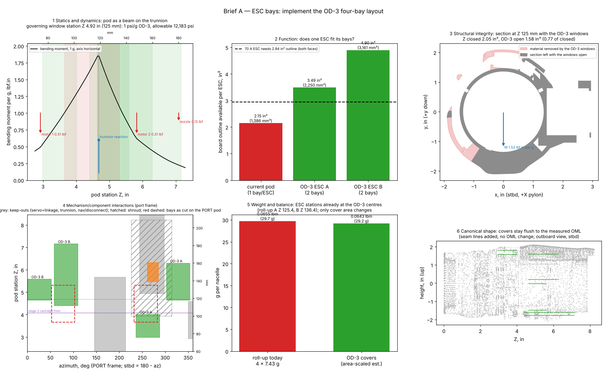
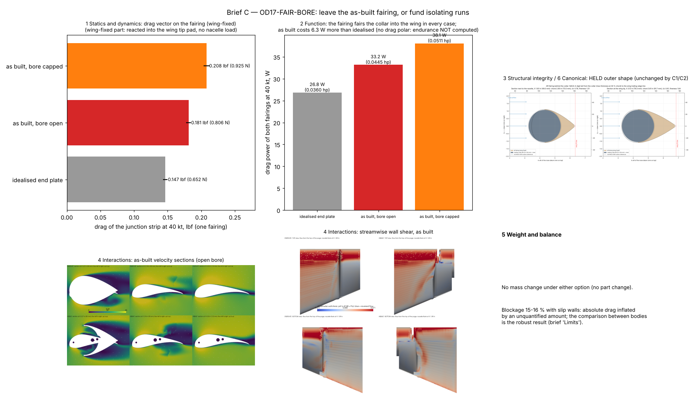
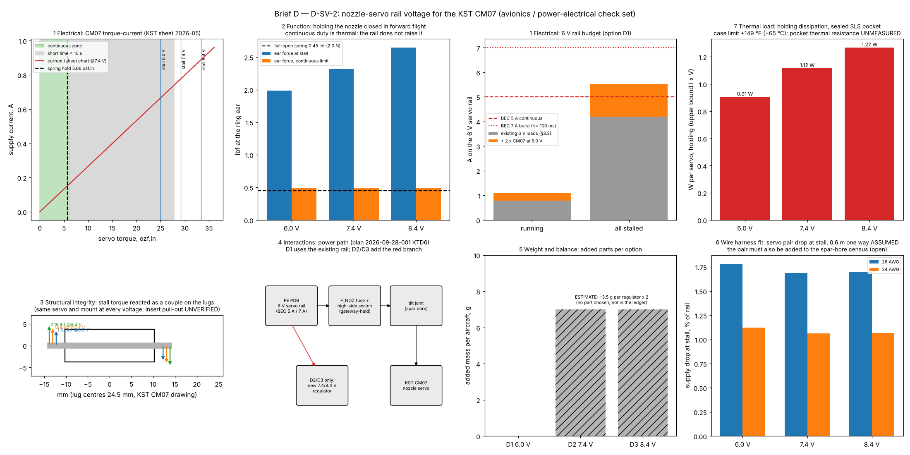

# Theme N Owner Decision Briefs (2026-11-21)

License: CC BY-SA 4.0 — see LICENSES/CC-BY-SA-4.0 (SPDX-License-Identifier: CC-BY-SA-4.0)

**Author:** Steve Griffing, PE(CSE), CISSP-ISSEP, CPP (GitHub `Stab-Rabbit-coding`), owner decisions.
**Analysis:** Claude (Claude Opus 5.5, Anthropic), 2026-11-21, under the owner's direction.
**Plan:** `docs/plans/2026-11-07-001-feat-rev-u-completion-execution-plan.md`, Theme N (S2–S6),
branch `Theme-N-S2-S6`, PR #313.
**Reproduce:** `/usr/bin/python3 tools/theme_n_od_briefs.py` writes every figure and number below.

Five decisions remain open in Theme N after OD-9 closed (2026-11-21: SPAR-25-5 superseded by the servo
nozzle drive; the nozzle servo is the KST CM07). Each brief follows `docs/DOC_TEMPLATES.md` "Owner
Decision Briefs": the six checks, each with a picture and with load or motion vectors, then the
options side by side, a recommendation and what is still unverified. Brief D is an electrical part
(a motor), so it uses the avionics and power-electrical check set. A check that does not apply says
so and why.

| Brief | Decision | Owning item | Recommendation |
|---|---|---|---|
| A | ESC bays: build the OD-3 four-bay layout | NAC-64-BAYB-SHROUD, NAC-64-ESC-80A.j/.l | **A1** |
| B | Port/starboard mirror rule for ESC features | NAC-64-LEAD-AZ | **B1** (X mirror) |
| C | As-built fairing drag | OD17-FAIR-BORE | **C1** (leave; release the HOLD) |
| D | Nozzle-servo rail voltage for the CM07 | D-SV-2 | **D1** (6.0 V), and see the holding-margin finding |
| E | CM07 pocket in the dorsal spine | NAC-64-SERVO-01, plan U4 | **E2** (shaft az 282°) |

Briefs A and B are linked: B's rule is how A's layout is placed on the starboard pod.

---

## Brief A — ESC bays: build the OD-3 four-bay layout

**The question.** ESC bay B (hinge 248°) is filled by the resized dorsal shroud on both pods: the
bay-B cover overlaps the pod by 0.23 in³ (3,700–3,800 mm³). The underlying cause is larger. OD-3
(2026-11-12) chose the 70 A Open-Secure-ESC on the strength of `tools/esc80_cooptimize.py`, which
fitted each ESC into **two** hinged bays (four per nacelle, `tools/esc70_design.json`
`bays_per_esc: 2`). The pod still cuts the earlier **two-bay** layout (one bay per ESC, at 68° and
248°). That pod change was never made (NAC-64-ESC-80A.j item 1). The OD-3 bays, port frame
(starboard by the rule of brief B):

| ESC | Bay hinge | Z, in (mm) | Azimuth | Board outline |
|---|---|---|---|---|
| A | 324° | 4.64–6.30 (117.9–159.9) | 302.7–354.1° | 2.19 in² (1,416 mm²) |
| A | 258° | 2.99–4.01 (75.9–101.9) | 236.7–288.1° | 1.29 in² (835 mm²) |
| B | 80° | 4.41–7.16 (111.9–181.9) | 58.7–110.1° | 3.63 in² (2,345 mm²) |
| B | 22° | 4.64–5.59 (117.9–141.9) | 0.7–52.1° | 1.26 in² (816 mm²) |

**Options.**

- **A1 — Build the OD-3 four-bay layout** in `nacelle_pod_64mm_tandem.scad`: four bay cuts, doublers
  and covers per pod (eight covers), discharge slots and lead routes re-sited to the new bays.
- **A2 — Keep two bays, re-site bay B** clear of the shroud.
- **A3 — Keep bay B at 248° and open the shroud** over it.
- **A4 — Move one ESC off the pod** (wing root or fuselage).

| Check | A1 four-bay | A2 two-bay re-sited | A3 open the shroud | A4 ESC off-pod |
|---|---|---|---|---|
| **Statics and dynamics** | Pod as a beam on the trunnion, axis horizontal (panel 1): bending moment peaks at the pivot, 1.85 lbf·in (209 N·mm) per g; at the governing window station Z 4.92 in (125 mm) 1.53 lbf·in (173 N·mm) per g. With the OD-3 windows open the section modulus there is 1.58 in³ (25,820 mm³), giving about **1 psi (0.007 MPa) per g**. Even at the 79.4 g level-drop deceleration (`docs/LANDING_GEAR_ANALYSIS.md`, a crash case, not a limit load) that is 77 psi (0.53 MPa) against the 12,180 psi (84 MPa) DuraForm PA CF tensile strength (`allowables.json`, REF-MAT-011). The governing structure is local: the cover M3 inserts. | As A1 for the shell. | As A1, plus the shroud loses its skin over the bay. | Pod unloaded by 0.116 lbm (52.7 g). |
| **Function** | Each ESC needs 2.94 in² (1,895 mm²) of board outline (3,790 mm² of parts over both faces, `esc80_cooptimize.needs_v2`). OD-3 gives ESC A 3.49 in² (2,250 mm²) and ESC B 4.90 in² (3,161 mm²); the optimiser's own margins are +0.13 in (+3.2 mm) and +0.71 in (+18.1 mm), channel temperature 154.6 °F (68.1 °C) against 257 °F (125 °C). **Fits.** | One bay per ESC is 2.15 in² (1,386 mm²): **73 % of what a 70 A ESC needs. Does not fit**, wherever bay B goes. | Two bays: **does not fit**, as A2. | Phase leads (3 per motor) must cross the tilt joint; the spar bore is sized for 4 × 10 AWG only (OD-17). **Reopens OD-17.** |
| **Structural integrity** | Panel 3: at Z 125 mm the windows take the section modulus to 0.77 of the closed section (0.72 at Z 175 mm). Stresses above stay three orders below the allowable; the doubler (now lapped 1 mm past each rebate), cover ledges and M3 inserts carry over per bay. Insert pull-out in PA CF **requires verification**. | As today. | The shroud is a load-free fairing; opening it is structurally minor, but see interactions. | n/a |
| **Mechanism and component interactions** | Panel 4 (port frame): all four bays honour the keep-outs the optimiser carries (servo and linkage zone 244–298° aft of Z 4.93 in (125.3 mm), trunnion/pylon, nav and disconnect bay). The CM07 pocket sits inside the servo keep-out. Bay A258 ends at Z 4.01 in (101.9 mm), ahead of the stage-2 cartridge (Z 103.7 mm). **To redo for A1:** the bay-tied cavity webs, the stage-1 lead conduit and lead vane, the stage-2 lead slot and the discharge slots of NAC-64-GEOM-02 (built 2026-11-21 for the old bays). Bay A258 overlaps the shroud's forward start by about 0.08 in (2 mm): check at implementation. | Bay B has nowhere clear to go on the same azimuth budget (the inboard skin 146–240° is too thin at any Z, NAC-64-ESC-80A.k). | Bay window over the servo cover opening (250–292°, from Z 135.3 mm): **conflicts with the CM07 pocket and its cover**. | New harness through the joint. |
| **Weight and balance** | The roll-up already places ESC A at Z 125.4 mm and ESC B at Z 136.4 mm, the OD-3 centres, and already counts four covers (0.0655 lbm (29.7 g) per nacelle, measured). OD-3 covers by area: 0.0643 lbm (29.2 g) per nacelle (estimate). **No change to the ledger AUW, CG or pivot**, beyond the cover re-measure. | Ledger unchanged; the ESC would not fit. | As A2. | Pivot CG shift; both ESCs off-pod moves the rotating CG +0.23 mm (NAC-64-ESC-80A.k). |
| **Canonical shape** | Covers are built from the measured, scaled skin and sit flush (`nacelle_esc_cover_64mm.scad`); the OML is unchanged. Panel 6: eight cover seams in place of four. | As today. | **Breaks the canonical shroud** (owner rule 2026-10-04: the shroud changes only by a uniform resize). | Unchanged. |

**Recommendation: A1.** It is the only option in which a 70 A ESC fits, and it is the layout OD-3
was decided on. A2 and A3 cannot hold the ESC OD-3 chose; A4 reopens OD-17.

**Still unverified.** M3 insert pull-out and bearing strength in PA CF (`allowables.json`
"requires_verification"). ESC mass 0.116 lbm (52.7 g) and the packing factor 0.75 (estimates in
`esc70_design.json`). The circuit loss coefficient K = 3 of the aspirated cooling path. Cover masses
for A1 are area-scaled until rendered. The A258/shroud overlap (≈ 2 mm) needs the rendered check.

---

## Brief B — Port/starboard mirror rule for the ESC bays, lead conduits and vanes

**The question.** The pod applies three different side rules today. The shell, shroud, nozzle
servo, nav light, trunnion and disconnect bay are mirrored in X (left/right, azimuth a → 180° − a).
The ESC bays are not mirrored at all (68°/248° on both pods). The motor-lead conduit, the stage-2
lead slot and the cartridge's lead vane use `PYLON_SIDE × a`, a mirror in **Y** (a → −a, top/bottom).
Result: on the port pod the stage-1 lead conduit ends in the cavity about 44° from the nearest bay.
One rule must govern all ESC features, and it decides where brief A's bays go on the starboard pod.

**Options.** **B1** X mirror (a → 180° − a); **B2** no mirror (same azimuths on both pods);
**B3** Y mirror (a → −a). Figure: the OD-3 bays placed on the **starboard** pod by each rule.

| Check | B1 X mirror | B2 no mirror | B3 Y mirror |
|---|---|---|---|
| **Statics and dynamics** | Panel 4: the ESC and cover weight vectors of the two pods are mirror images; the lateral moments cancel. | The lateral moments do not cancel. | As B2. |
| **Function** | Every OD-3 bay keeps its full board run on the starboard pod: 1.65 / 1.02 / 2.76 / 0.94 in (42 / 26 / 70 / 24 mm). The leads end in their bays. | **4 of 4 bays short:** A324 0 of 42 mm (does not fit at all), A258 14 of 26, B80 62 of 70, B22 14 of 24 mm. | **3 of 4 bays short** (A324 14 of 42, B80 26 of 70, B22 6 of 24 mm). |
| **Structural integrity** | Does not apply as a discriminator: the rule moves cut-outs, it does not size them. Under B1 the two pods are exact mirrors, so one analysis covers both (panel 5). | Two different pods to analyse. | As B2. |
| **Mechanism and component interactions** | The shell, shroud and keep-outs are already X-mirrored, so the bays meet the same neighbours on both sides (panels 1–3). Changes: bays, discharge slots, lead conduit and slot, the stage-1 lead vane in `edf_motor_mount_64mm.scad` and the **published port stage-2 cartridge** (its lead vane is at 112°, X-mirror wants 292°): re-render it. | Bays land on the other pod's shroud flank and inboard thin skin (panel 2). | Bays land under the shroud (panel 3). |
| **Weight and balance** | Aircraft lateral CG shift **0.000 in (0.000 mm)**; vertical −0.004 in (−0.09 mm), as for all rules. | Lateral CG shift +0.025 in (+0.63 mm) toward port. | +0.025 in (+0.63 mm). |
| **Canonical shape** | Cover seams symmetric about the centreline, as the canonical ship is (panel 6). | Seams asymmetric between the nacelles. | Asymmetric. |

**Recommendation: B1.** It is the rule the shell and every other feature already follow, the rule
the OD-3 optimiser documents ("port = starboard mirrored in x, a → 180 − a"), the only rule under
which all four bays fit on both pods, and it keeps the aircraft laterally balanced.

**Still unverified.** The rule must be applied in source and re-checked on both rendered pods with
`tools/nacelle64_esc_bay_check.py` and the assembly check, both sides.

---

## Brief C — OD17-FAIR-BORE: leave the as-built fairing, or fund isolating runs

**The question.** The as-built wing-fixed fairing behind the rotating collar has 23 % more drag than
the idealised end plate in the junction-strip CFD (`docs/NACELLE_64MM_POWER_CROSSING_BRIEF.md`).
The 2026-11-19 capped-bore run showed the open bore is **not** the cause (capping it raised drag
about 15 %). The rest of the excess comes from the printing allowances (thicker tail, trailing-edge
cut, fillet toe) or the real collar, trunnion and spar steps, not yet separated. The fairing's outer
shape is HELD pending this item.

**Options.** **C1** leave the as-built fairing and release the HOLD; **C2** fund isolating CFD runs
(printing allowances, then collar/trunnion/spar steps), then decide again.

| Check | C1 leave | C2 isolating runs |
|---|---|---|
| **Statics and dynamics** | Panel 1, drag on one fairing at 40 kt: idealised 0.147 lbf (0.652 N), as built 0.181 lbf (0.806 N), capped 0.208 lbf (0.925 N); spread ±0.004 lbf. The fairing is wing-fixed: the load goes into the wing tip pad, not the nacelle or the tilt drive. | Same loads until a cause is found. |
| **Function** | Panel 2: the fairing fairs the collar into the wing in every case. Both as-built fairings cost **0.069 lbf (0.31 N)** more than idealised, **6.3 W (0.0085 hp)** of drag power at 40 kt. No drag polar exists for the aircraft, so the endurance effect is not computed. | No function change; the cost is analysis effort (one OpenFOAM case per feature, 1.3–1.5 M cells each; the capped-bore case ran 2026-11-12 to 11-19) with the outer shape still HELD meanwhile. |
| **Structural integrity** | Does not apply: no part change. | Does not apply until a geometry change is proposed. |
| **Mechanism and component interactions** | Panels 4–5 (as-built velocity sections and wall shear): the excess is pressure drag (0.175 vs 0.141 lbf) at the bore pocket and the C-shaped wall; the collar's 0.04 in (1 mm) running gap was closed in the mesh. | Same. |
| **Weight and balance** | No mass change. | No mass change. |
| **Canonical shape** | Panel 3: the HELD outer shape (NACA-type tail to the wing trailing-edge line) is released as drawn. | Shape stays HELD. |

**Recommendation: C1.** The whole effect is 0.069 lbf for the aircraft and the obvious fix (a nose
cap) is already ruled out. The planned OD17-JUNC-RETEST (as-built end plate against an as-built
glove) still runs and will show any printing-allowance effect on the comparison that matters.
Releasing the HOLD unblocks the fairing for print.

**Still unverified.** Absolute drag: 15–16 % blockage with slip walls inflates it by an unquantified
amount (OD17-CFD-BLOCKAGE); one mesh per body, no grid study; cruise only.

---

## Brief D — D-SV-2: nozzle-servo rail voltage for the KST CM07

**The question.** The nozzle-servo plan's U3 gate asks for the rail voltage the servo runs at. The
CM07 is rated 7.4 V, range 3.5–8.4 V (KST CM07 Technical Specification, 2026-05,
`open-servo-core-secure/hardware/`). The plan feeds each nozzle servo from a fused, gateway-switched
`F_NOZ` branch of the Flight Engineer 6 V servo rail (plan 2026-09-28-001 KTD6).

**A finding that frames the choice.** On the sheet's performance chart (at 7.4 V) the **continuous**
zone ends at about **0.45 kgf·cm (6.25 ozf·in, 0.044 N·m)**; up to about 2.0 kgf·cm is "short time,
< 10 s". Holding the nozzle closed against the 0.45 lbf (2.0 N) fail-open spring is continuous duty
for the whole of forward flight and needs about 5.66 ozf·in (0.040 N·m). By the linkage tool's
linear scaling that leaves **+0.05 lbf (+0.21 N), +10 %, at the ring ear with no flap load**, at any
rail voltage: continuous torque is thermal, so voltage does not raise it. The plan's KTD3 lists the
levers (lower the spring force within the 1.5 × friction floor, or change the lever ratio); both
reopen fit-closed geometry and are a separate owner decision. (The earlier ~19 % estimate assumed the
X06H's continuous-to-stall ratio; the CM07 chart replaces it.)

**Options.** **D1** 6.0 V, the existing servo rail; **D2** 7.4 V, the rated voltage, on a new rail;
**D3** 8.4 V, the top of the range.

| Check | D1 6.0 V | D2 7.4 V | D3 8.4 V |
|---|---|---|---|
| **Electrical engineering** | Stall 25.0 ozf·in (1.80 kgf·cm), 0.67 A; holding 0.15 A. On the 6 V rail (§3.3, BEC 5 A continuous / 7 A burst ≤ 100 ms): running 1.09 A; **all servos stalled at once 5.53 A**, over the 5 A continuous rating, inside the 7 A burst. | Stall 29.2 ozf·in (2.10 kgf·cm), 0.78 A. Needs a new regulated rail (none exists at 7.4 V; the tilt controllers' 6.5 V buck is the nearest). | Stall 33.3 ozf·in (2.40 kgf·cm), 0.89 A. At the top of the servo's range: a regulator tolerance above 8.4 V exceeds it. |
| **Function** | Ear force at stall 1.98 lbf (8.8 N); continuous 0.50 lbf (2.21 N) against the 0.45 lbf spring. Speed 0.08 s per 60°. | Stall 2.31 lbf (10.3 N); **continuous unchanged**; 0.07 s per 60°. | Stall 2.65 lbf (11.8 N); continuous unchanged; 0.06 s per 60°. |
| **Structural integrity** | Panel: stall reacted as a couple on the lugs (24.5 mm centres): 1.62 lbf (7.2 N) per lug. | 1.89 lbf (8.4 N). | 2.16 lbf (9.6 N). M2 insert pull-out in PA CF requires verification in every case. |
| **Mechanism and component interactions** | Panel (power path): FE PDB 6 V rail → `F_NOZ` fuse and high-side switch → tilt joint → CM07. No new part. | Adds a regulator branch (red path in the panel), a fuse and a harness branch. | As D2. |
| **Weight and balance** | 0 g. | About 0.015 lbm (7 g) per aircraft for two regulators (ESTIMATE, no part chosen). | As D2. |
| **Wire harness, fastener and mounting fit** | Panel: supply drop at stall over an ASSUMED 0.6 m one-way run, 1.8 % (26 AWG) or 1.1 % (24 AWG). The servo pair is **not yet in the spar-bore census** (4 × 10 AWG + signal + nav): open in every option. | 1.7 % / 1.1 %. | 1.7 % / 1.1 %. |
| **Thermal load** | Holding dissipation, upper bound I × V: 0.91 W per servo, in a sealed SLS pocket under the cover; case limit +149 °F (+65 °C). Pocket thermal resistance unmeasured. | 1.12 W. | 1.27 W. |

**Recommendation: D1 (6.0 V).** Raising the rail buys stall force and speed but not the continuous
holding margin, which is the binding limit, and it costs a new regulator, fuse and harness branch per
nacelle. Two follow-ups whichever option is chosen: (1) the all-stalled total on the 6 V rail
(5.53 A) exceeds the BEC's 5 A continuous rating; size the `F_NOZ` fuses and confirm the burst window
(the §3.3 note already asks this); (2) the thin holding margin (+10 %) needs a KTD3 decision.

**Still unverified.** Every CM07 figure above is from the KST sheet; the continuous zone and the
current slope are read off its chart. Holding current and case temperature are bench items (plan U6).
The ear-force scaling is linear from the linkage tool (analytical). The 0.6 m harness length is
assumed.

---

## Brief E — KST CM07 pocket integration in the dorsal spine

**The question.** The CM07 is 0.020 in (0.5 mm) longer, 0.020 in (0.5 mm) wider and **0.094 in
(2.4 mm) taller** than the X06 the pocket was fit-closed around; height runs tangentially in this
mounting. Two facts frame it:

1. **The pod has no working servo pocket today for either servo.** The resized shroud is added in
   Zone C after the pocket is cut (`nsv_pod_adds()` subtracts only the moving-linkage sweep), so 98 %
   of the servo body volume is solid material in the published pod (panel 6 shows it). The pocket
   has to be cut through the shroud add-back in any option (WBS "Servo mount, pod pocket, flush
   cover + fit check", plan U4).
2. **Cover screw 1** (252.5°, Z 138.3 mm) is cut by the pocket of either servo (X06H −0.03 in
   (−0.70 mm), CM07 −0.047 in (−1.20 mm)), so it moves in any option. Forward has no room (the pocket
   starts 3.4 mm inside the cover opening); aft at (252.5°, Z 6.50 in (165 mm)) it clears the CM07
   pocket by 0.119 in (3.03 mm) with today's edge distance.

**Options.** **E1** CM07 at the designed shaft azimuth 280°; **E2** shaft at 282° (toward the shroud
crest); **E3** grow the shroud (uniform resize) for more cover clearance.

| Check | E1 az 280° | E2 az 282° | E3 shroud resize |
|---|---|---|---|
| **Statics and dynamics** | Panel 1: stall torque 25.0 ozf·in at 6 V reacted as a couple on the lugs, 1.62 lbf (7.2 N) each. | Same. | Same. |
| **Function** | Linkage re-solved with the CM07: **PASS**, ear stall 2.00 lbf (8.9 N). | **PASS**, 1.98 lbf (8.8 N), −1 %. (At 284° it still passes; at 286° it fails.) | As E1. |
| **Structural integrity** | Panel 3: servo body to cover inner face **0.028 in (0.72 mm)** at the pocket's aft end (the 0.063 in (1.6 mm) cover is the skin there); X06H had 0.091 in (2.32 mm). | **0.035 in (0.89 mm)**. | Not evaluated numerically: needs a K_H search in `tools/dorsal_shroud_resize_64.py`. |
| **Mechanism and component interactions** | Panel 4: screw 1 moved to Z 165 mm clears by 3.03 mm; screw 2 (289.5°) 5.68 mm; screw 3 33.7 mm; linkage sweep unchanged. The pocket stays inside brief A's servo keep-out. | Screw 2 clearance 4.35 mm; others as E1. | As E1. |
| **Weight and balance** | +0.0022 lbm (1 g) per servo, +0.0044 lbm (2 g) per aircraft; pivot residual +0.0019 in (+0.048 mm), inside the 0.25 mm gate; re-converge at plan U7. | Same. | Plus shroud mass. |
| **Canonical shape** | Panel 6: both bodies inside the unchanged OML; shroud resize result identical to the X06's (K_H 1.006, K_Z 4.20, crest +0.036 in (+0.92 mm)). Internal only. | Same. | **Raises the canonical shroud** further. |

**Recommendation: E2.** It adds 24 % to the tightest clearance (0.89 against 0.72 mm) for a 1 % force
cost. The linkage is re-solved for the CM07 in plan U2 in any case, so the azimuth change costs
nothing extra. Fix the pocket through the shroud add-back and move cover screw 1 aft to Z 6.50 in
(165 mm) with it. E3 grows the canonical shroud for a fraction of a millimetre.

**Still unverified.** CM07 dimensions on a physical unit (sheet ±0.2 mm), M2 insert pull-out in PA
CF, SLS dimensional tolerance against the 0.89 mm gap, and the linkage force scaling (analytical
until the U6 bench).

---

## Changelog

- 2026-11-21 — first issue: briefs A–E (Claude Opus 5.5).
