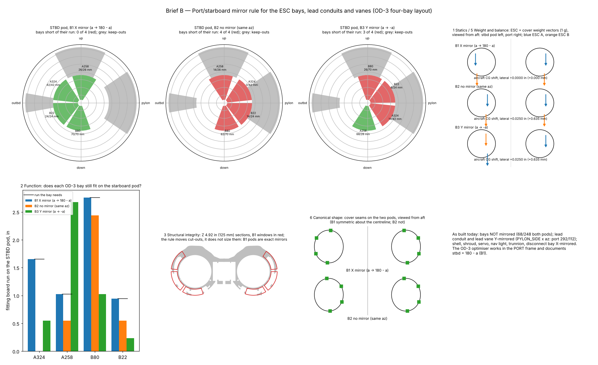
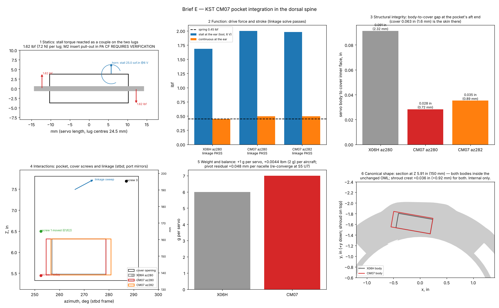
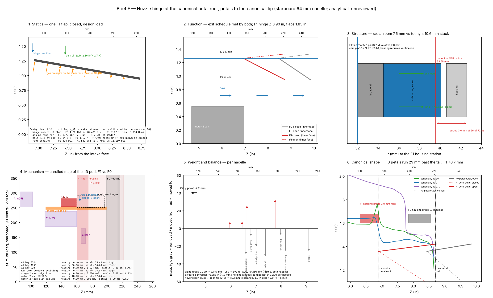
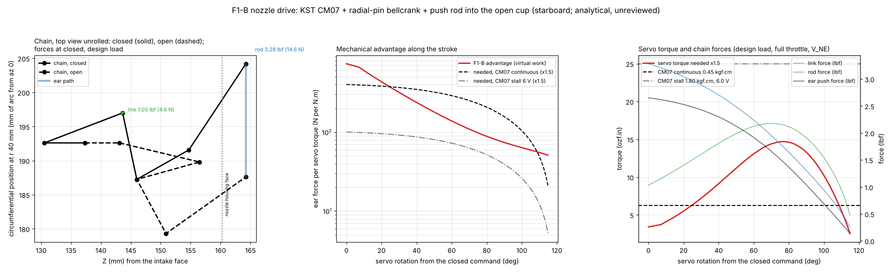
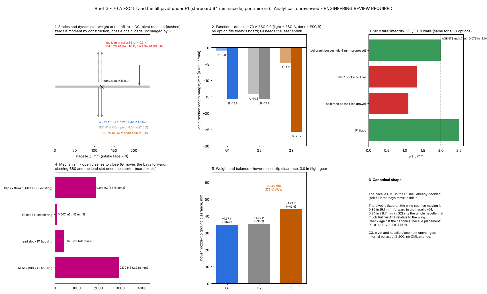
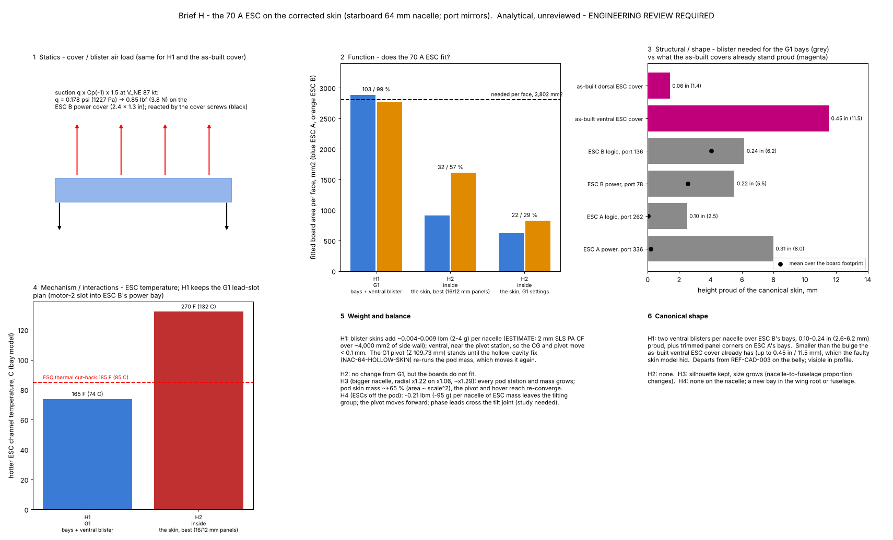
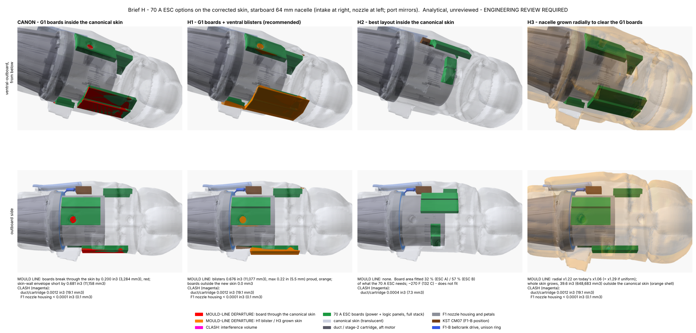
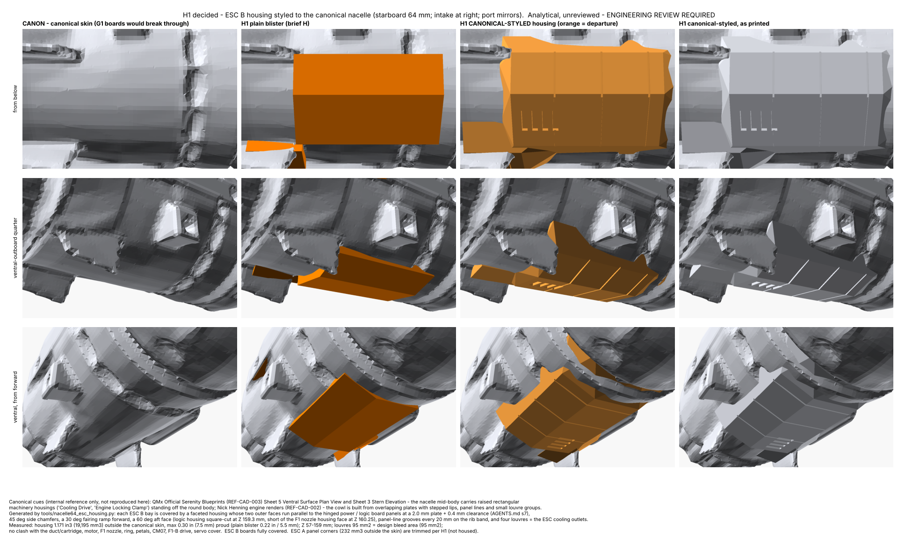
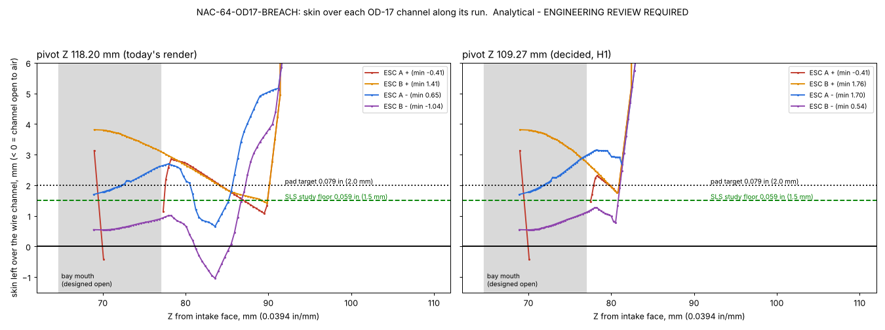
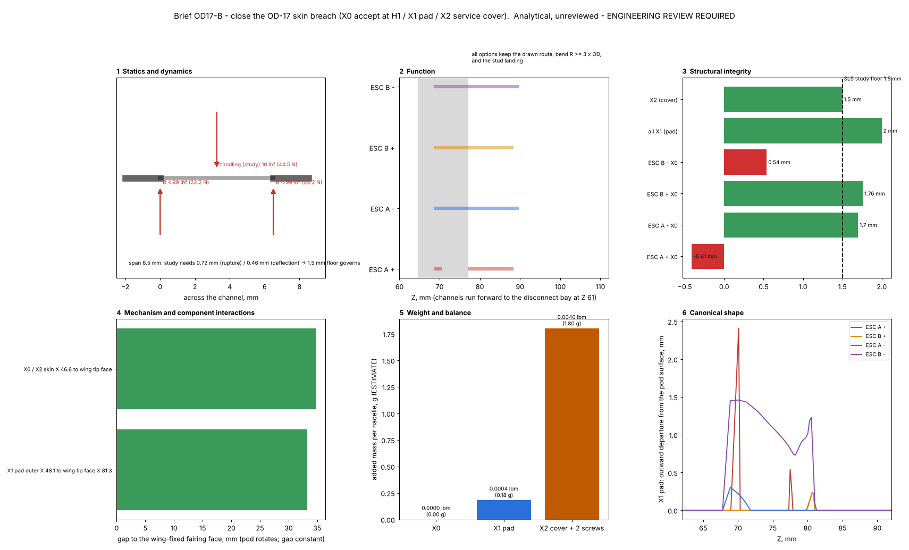

# Theme N Owner Decision Briefs (2026-11-21)

License: CC BY-SA 4.0 — see LICENSES/CC-BY-SA-4.0 (SPDX-License-Identifier: CC-BY-SA-4.0)

**Author:** Steve Griffing, PE(CSE), CISSP-ISSEP, CPP (GitHub `Stab-Rabbit-coding`), owner decisions.
**Analysis:** Claude (Claude Opus 5.5, Anthropic), 2026-11-21, under the owner's direction.
**Plan:** `docs/plans/2026-11-07-001-feat-rev-u-completion-execution-plan.md`, Theme N (S2–S6),
branch `Theme-N-S2-S6`, PR #313.
**Reproduce:** `/usr/bin/python3 tools/theme_n_od_briefs.py` writes every figure and number below.

Five decisions remained open in Theme N after OD-9 closed (2026-11-21: SPAR-25-5 superseded by the servo
nozzle drive; the nozzle servo is the KST CM07). Each brief follows `docs/DOC_TEMPLATES.md` "Owner
Decision Briefs": the six checks, each with a picture and with load or motion vectors, then the
options side by side, a recommendation and what is still unverified. Brief D is an electrical part
(a motor), so it uses the avionics and power-electrical check set. A check that does not apply says
so and why.

| Brief | Decision | Owning item | Recommendation |
|---|---|---|---|
| A | ESC bays: build the OD-3 four-bay layout | NAC-64-BAYB-SHROUD, NAC-64-ESC-80A.j/.l | **A1** — **DECIDED A1** (owner 2026-11-21) |
| B | Port/starboard mirror rule for ESC features | NAC-64-LEAD-AZ | **B1** (X mirror) — **DECIDED B1** |
| C | As-built fairing drag | OD17-FAIR-BORE | **C1** (leave; release the HOLD) — **DECIDED C1** |
| D | Nozzle-servo rail voltage for the CM07 | D-SV-2 | **D1** (6.0 V), and see the holding-margin finding |
| E | CM07 pocket in the dorsal spine | NAC-64-SERVO-01, plan U4 | **E2** (shaft az 282°) |
| F | Nozzle hinge at the canonical petal root, petals to the canonical tip | NAC-64-NOZ-ROOT | **F1** — **DECIDED F1** (owner 2026-11-22); bellcrank drive first, then the B80 and lead-slot clashes |

Briefs A and B are linked: B's rule is how A's layout is placed on the starboard pod.

---

## Brief A — ESC bays: build the OD-3 four-bay layout

**The question.** ESC bay B (hinge 248°) is filled by the resized dorsal shroud on both pods: the
bay-B cover overlaps the pod by 0.23 in³ (3,700–3,800 mm³). The underlying cause is larger. OD-3
(2026-11-12) chose the 70 A Open-Secure-ESC on the strength of `tools/esc80_cooptimize.py`, which
fitted each ESC into **two** hinged bays (four per nacelle, `tools/esc70_design.json`
`bays_per_esc: 2`). The pod still cuts the earlier **two-bay** layout (one bay per ESC, at 68° and
248°). That pod change was never made (NAC-64-ESC-80A.j item 1). The OD-3 bays, port frame
(starboard by the rule of brief B):

| ESC | Bay hinge | Z, in (mm) | Azimuth | Board outline |
|---|---|---|---|---|
| A | 324° | 4.64–6.30 (117.9–159.9) | 302.7–354.1° | 2.19 in² (1,416 mm²) |
| A | 258° | 2.99–4.01 (75.9–101.9) | 236.7–288.1° | 1.29 in² (835 mm²) |
| B | 80° | 4.41–7.16 (111.9–181.9) | 58.7–110.1° | 3.63 in² (2,345 mm²) |
| B | 22° | 4.64–5.59 (117.9–141.9) | 0.7–52.1° | 1.26 in² (816 mm²) |

**Options.**

- **A1 — Build the OD-3 four-bay layout** in `nacelle_pod_64mm_tandem.scad`: four bay cuts, doublers
  and covers per pod (eight covers), discharge slots and lead routes re-sited to the new bays.
- **A2 — Keep two bays, re-site bay B** clear of the shroud.
- **A3 — Keep bay B at 248° and open the shroud** over it.
- **A4 — Move one ESC off the pod** (wing root or fuselage).

| Check | A1 four-bay | A2 two-bay re-sited | A3 open the shroud | A4 ESC off-pod |
|---|---|---|---|---|
| **Statics and dynamics** | Pod as a beam on the trunnion, axis horizontal (panel 1): bending moment peaks at the pivot, 1.85 lbf·in (209 N·mm) per g; at the governing window station Z 4.92 in (125 mm) 1.53 lbf·in (173 N·mm) per g. With the OD-3 windows open the section modulus there is 1.58 in³ (25,820 mm³), giving about **1 psi (0.007 MPa) per g**. Even at the 79.4 g level-drop deceleration (`docs/LANDING_GEAR_ANALYSIS.md`, a crash case, not a limit load) that is 77 psi (0.53 MPa) against the 12,180 psi (84 MPa) DuraForm PA CF tensile strength (`allowables.json`, REF-MAT-011). The governing structure is local: the cover M3 inserts. | As A1 for the shell. | As A1, plus the shroud loses its skin over the bay. | Pod unloaded by 0.116 lbm (52.7 g). |
| **Function** | Each ESC needs 2.94 in² (1,895 mm²) of board outline (3,790 mm² of parts over both faces, `esc80_cooptimize.needs_v2`). OD-3 gives ESC A 3.49 in² (2,250 mm²) and ESC B 4.90 in² (3,161 mm²); the optimiser's own margins are +0.13 in (+3.2 mm) and +0.71 in (+18.1 mm), channel temperature 154.6 °F (68.1 °C) against 257 °F (125 °C). **Fits.** | One bay per ESC is 2.15 in² (1,386 mm²): **73 % of what a 70 A ESC needs. Does not fit**, wherever bay B goes. | Two bays: **does not fit**, as A2. | Phase leads (3 per motor) must cross the tilt joint; the spar bore is sized for 4 × 10 AWG only (OD-17). **Reopens OD-17.** |
| **Structural integrity** | Panel 3: at Z 125 mm the windows take the section modulus to 0.77 of the closed section (0.72 at Z 175 mm). Stresses above stay three orders below the allowable; the doubler (now lapped 1 mm past each rebate), cover ledges and M3 inserts carry over per bay. Insert pull-out in PA CF **requires verification**. | As today. | The shroud is a load-free fairing; opening it is structurally minor, but see interactions. | n/a |
| **Mechanism and component interactions** | Panel 4 (port frame): all four bays honour the keep-outs the optimiser carries (servo and linkage zone 244–298° aft of Z 4.93 in (125.3 mm), trunnion/pylon, nav and disconnect bay). The CM07 pocket sits inside the servo keep-out. Bay A258 ends at Z 4.01 in (101.9 mm), ahead of the stage-2 cartridge (Z 103.7 mm). **To redo for A1:** the bay-tied cavity webs, the stage-1 lead conduit and lead vane, the stage-2 lead slot and the discharge slots of NAC-64-GEOM-02 (built 2026-11-21 for the old bays). Bay A258 overlaps the shroud's forward start by about 0.08 in (2 mm): check at implementation. | Bay B has nowhere clear to go on the same azimuth budget (the inboard skin 146–240° is too thin at any Z, NAC-64-ESC-80A.k). | Bay window over the servo cover opening (250–292°, from Z 135.3 mm): **conflicts with the CM07 pocket and its cover**. | New harness through the joint. |
| **Weight and balance** | The roll-up already places ESC A at Z 125.4 mm and ESC B at Z 136.4 mm, the OD-3 centres, and already counts four covers (0.0655 lbm (29.7 g) per nacelle, measured). OD-3 covers by area: 0.0643 lbm (29.2 g) per nacelle (estimate). **No change to the ledger AUW, CG or pivot**, beyond the cover re-measure. | Ledger unchanged; the ESC would not fit. | As A2. | Pivot CG shift; both ESCs off-pod moves the rotating CG +0.23 mm (NAC-64-ESC-80A.k). |
| **Canonical shape** | Covers are built from the measured, scaled skin and sit flush (`nacelle_esc_cover_64mm.scad`); the OML is unchanged. Panel 6: eight cover seams in place of four. | As today. | **Breaks the canonical shroud** (owner rule 2026-10-04: the shroud changes only by a uniform resize). | Unchanged. |

**Recommendation: A1.** It is the only option in which a 70 A ESC fits, and it is the layout OD-3
was decided on. A2 and A3 cannot hold the ESC OD-3 chose; A4 reopens OD-17.

**Still unverified.** M3 insert pull-out and bearing strength in PA CF (`allowables.json`
"requires_verification"). ESC mass 0.116 lbm (52.7 g) and the packing factor 0.75 (estimates in
`esc70_design.json`). The circuit loss coefficient K = 3 of the aspirated cooling path. Cover masses
for A1 are area-scaled until rendered. The A258/shroud overlap (≈ 2 mm) needs the rendered check.

---

## Brief B — Port/starboard mirror rule for the ESC bays, lead conduits and vanes

**The question.** The pod applies three different side rules today. The shell, shroud, nozzle
servo, nav light, trunnion and disconnect bay are mirrored in X (left/right, azimuth a → 180° − a).
The ESC bays are not mirrored at all (68°/248° on both pods). The motor-lead conduit, the stage-2
lead slot and the cartridge's lead vane use `PYLON_SIDE × a`, a mirror in **Y** (a → −a, top/bottom).
Result: on the port pod the stage-1 lead conduit ends in the cavity about 44° from the nearest bay.
One rule must govern all ESC features, and it decides where brief A's bays go on the starboard pod.

**Options.** **B1** X mirror (a → 180° − a); **B2** no mirror (same azimuths on both pods);
**B3** Y mirror (a → −a). Figure: the OD-3 bays placed on the **starboard** pod by each rule.

| Check | B1 X mirror | B2 no mirror | B3 Y mirror |
|---|---|---|---|
| **Statics and dynamics** | Panel 4: the ESC and cover weight vectors of the two pods are mirror images; the lateral moments cancel. | The lateral moments do not cancel. | As B2. |
| **Function** | Every OD-3 bay keeps its full board run on the starboard pod: 1.65 / 1.02 / 2.76 / 0.94 in (42 / 26 / 70 / 24 mm). The leads end in their bays. | **4 of 4 bays short:** A324 0 of 42 mm (does not fit at all), A258 14 of 26, B80 62 of 70, B22 14 of 24 mm. | **3 of 4 bays short** (A324 14 of 42, B80 26 of 70, B22 6 of 24 mm). |
| **Structural integrity** | Does not apply as a discriminator: the rule moves cut-outs, it does not size them. Under B1 the two pods are exact mirrors, so one analysis covers both (panel 5). | Two different pods to analyse. | As B2. |
| **Mechanism and component interactions** | The shell, shroud and keep-outs are already X-mirrored, so the bays meet the same neighbours on both sides (panels 1–3). Changes: bays, discharge slots, lead conduit and slot, the stage-1 lead vane in `edf_motor_mount_64mm.scad` and the **published port stage-2 cartridge** (its lead vane is at 112°, X-mirror wants 292°): re-render it. | Bays land on the other pod's shroud flank and inboard thin skin (panel 2). | Bays land under the shroud (panel 3). |
| **Weight and balance** | Aircraft lateral CG shift **0.000 in (0.000 mm)**; vertical −0.004 in (−0.09 mm), as for all rules. | Lateral CG shift +0.025 in (+0.63 mm) toward port. | +0.025 in (+0.63 mm). |
| **Canonical shape** | Cover seams symmetric about the centreline, as the canonical ship is (panel 6). | Seams asymmetric between the nacelles. | Asymmetric. |

**Recommendation: B1.** It is the rule the shell and every other feature already follow, the rule
the OD-3 optimiser documents ("port = starboard mirrored in x, a → 180 − a"), the only rule under
which all four bays fit on both pods, and it keeps the aircraft laterally balanced.

**Still unverified.** The rule must be applied in source and re-checked on both rendered pods with
`tools/nacelle64_esc_bay_check.py` and the assembly check, both sides.

---

## Brief C — OD17-FAIR-BORE: leave the as-built fairing, or fund isolating runs

**The question.** The as-built wing-fixed fairing behind the rotating collar has 23 % more drag than
the idealised end plate in the junction-strip CFD (`docs/NACELLE_64MM_POWER_CROSSING_BRIEF.md`).
The 2026-11-19 capped-bore run showed the open bore is **not** the cause (capping it raised drag
about 15 %). The rest of the excess comes from the printing allowances (thicker tail, trailing-edge
cut, fillet toe) or the real collar, trunnion and spar steps, not yet separated. The fairing's outer
shape is HELD pending this item.

**Options.** **C1** leave the as-built fairing and release the HOLD; **C2** fund isolating CFD runs
(printing allowances, then collar/trunnion/spar steps), then decide again.

| Check | C1 leave | C2 isolating runs |
|---|---|---|
| **Statics and dynamics** | Panel 1, drag on one fairing at 40 kt: idealised 0.147 lbf (0.652 N), as built 0.181 lbf (0.806 N), capped 0.208 lbf (0.925 N); spread ±0.004 lbf. The fairing is wing-fixed: the load goes into the wing tip pad, not the nacelle or the tilt drive. | Same loads until a cause is found. |
| **Function** | Panel 2: the fairing fairs the collar into the wing in every case. Both as-built fairings cost **0.069 lbf (0.31 N)** more than idealised, **6.3 W (0.0085 hp)** of drag power at 40 kt. No drag polar exists for the aircraft, so the endurance effect is not computed. | No function change; the cost is analysis effort (one OpenFOAM case per feature, 1.3–1.5 M cells each; the capped-bore case ran 2026-11-12 to 11-19) with the outer shape still HELD meanwhile. |
| **Structural integrity** | Does not apply: no part change. | Does not apply until a geometry change is proposed. |
| **Mechanism and component interactions** | Panels 4–5 (as-built velocity sections and wall shear): the excess is pressure drag (0.175 vs 0.141 lbf) at the bore pocket and the C-shaped wall; the collar's 0.04 in (1 mm) running gap was closed in the mesh. | Same. |
| **Weight and balance** | No mass change. | No mass change. |
| **Canonical shape** | Panel 3: the HELD outer shape (NACA-type tail to the wing trailing-edge line) is released as drawn. | Shape stays HELD. |

**Recommendation: C1.** The whole effect is 0.069 lbf for the aircraft and the obvious fix (a nose
cap) is already ruled out. The planned OD17-JUNC-RETEST (as-built end plate against an as-built
glove) still runs and will show any printing-allowance effect on the comparison that matters.
Releasing the HOLD unblocks the fairing for print.

**Still unverified.** Absolute drag: 15–16 % blockage with slip walls inflates it by an unquantified
amount (OD17-CFD-BLOCKAGE); one mesh per body, no grid study; cruise only.

---

## Brief D — D-SV-2: nozzle-servo rail voltage for the KST CM07

**The question.** The nozzle-servo plan's U3 gate asks for the rail voltage the servo runs at. The
CM07 is rated 7.4 V, range 3.5–8.4 V (KST CM07 Technical Specification, 2026-05,
`open-servo-core-secure/hardware/`). The plan feeds each nozzle servo from a fused, gateway-switched
`F_NOZ` branch of the Flight Engineer 6 V servo rail (plan 2026-09-28-001 KTD6).

**A finding that frames the choice.** On the sheet's performance chart (at 7.4 V) the **continuous**
zone ends at about **0.45 kgf·cm (6.25 ozf·in, 0.044 N·m)**; up to about 2.0 kgf·cm is "short time,
< 10 s". Holding the nozzle closed against the 0.45 lbf (2.0 N) fail-open spring is continuous duty
for the whole of forward flight and needs about 5.66 ozf·in (0.040 N·m). By the linkage tool's
linear scaling that leaves **+0.05 lbf (+0.21 N), +10 %, at the ring ear with no flap load**, at any
rail voltage: continuous torque is thermal, so voltage does not raise it. The plan's KTD3 lists the
levers (lower the spring force within the 1.5 × friction floor, or change the lever ratio); both
reopen fit-closed geometry and are a separate owner decision. (The earlier ~19 % estimate assumed the
X06H's continuous-to-stall ratio; the CM07 chart replaces it.)

**Options.** **D1** 6.0 V, the existing servo rail; **D2** 7.4 V, the rated voltage, on a new rail;
**D3** 8.4 V, the top of the range.

| Check | D1 6.0 V | D2 7.4 V | D3 8.4 V |
|---|---|---|---|
| **Electrical engineering** | Stall 25.0 ozf·in (1.80 kgf·cm), 0.67 A; holding 0.15 A. On the 6 V rail (§3.3, BEC 5 A continuous / 7 A burst ≤ 100 ms): running 1.09 A; **all servos stalled at once 5.53 A**, over the 5 A continuous rating, inside the 7 A burst. | Stall 29.2 ozf·in (2.10 kgf·cm), 0.78 A. Needs a new regulated rail (none exists at 7.4 V; the tilt controllers' 6.5 V buck is the nearest). | Stall 33.3 ozf·in (2.40 kgf·cm), 0.89 A. At the top of the servo's range: a regulator tolerance above 8.4 V exceeds it. |
| **Function** | Ear force at stall 1.98 lbf (8.8 N); continuous 0.50 lbf (2.21 N) against the 0.45 lbf spring. Speed 0.08 s per 60°. | Stall 2.31 lbf (10.3 N); **continuous unchanged**; 0.07 s per 60°. | Stall 2.65 lbf (11.8 N); continuous unchanged; 0.06 s per 60°. |
| **Structural integrity** | Panel: stall reacted as a couple on the lugs (24.5 mm centres): 1.62 lbf (7.2 N) per lug. | 1.89 lbf (8.4 N). | 2.16 lbf (9.6 N). M2 insert pull-out in PA CF requires verification in every case. |
| **Mechanism and component interactions** | Panel (power path): FE PDB 6 V rail → `F_NOZ` fuse and high-side switch → tilt joint → CM07. No new part. | Adds a regulator branch (red path in the panel), a fuse and a harness branch. | As D2. |
| **Weight and balance** | 0 g. | About 0.015 lbm (7 g) per aircraft for two regulators (ESTIMATE, no part chosen). | As D2. |
| **Wire harness, fastener and mounting fit** | Panel: supply drop at stall over an ASSUMED 0.6 m one-way run, 1.8 % (26 AWG) or 1.1 % (24 AWG). The servo pair is **not yet in the spar-bore census** (4 × 10 AWG + signal + nav): open in every option. | 1.7 % / 1.1 %. | 1.7 % / 1.1 %. |
| **Thermal load** | Holding dissipation, upper bound I × V: 0.91 W per servo, in a sealed SLS pocket under the cover; case limit +149 °F (+65 °C). Pocket thermal resistance unmeasured. | 1.12 W. | 1.27 W. |

**Recommendation: D1 (6.0 V).** Raising the rail buys stall force and speed but not the continuous
holding margin, which is the binding limit, and it costs a new regulator, fuse and harness branch per
nacelle. Two follow-ups whichever option is chosen: (1) the all-stalled total on the 6 V rail
(5.53 A) exceeds the BEC's 5 A continuous rating; size the `F_NOZ` fuses and confirm the burst window
(the §3.3 note already asks this); (2) the thin holding margin (+10 %) needs a KTD3 decision.

**Still unverified.** Every CM07 figure above is from the KST sheet; the continuous zone and the
current slope are read off its chart. Holding current and case temperature are bench items (plan U6).
The ear-force scaling is linear from the linkage tool (analytical). The 0.6 m harness length is
assumed.

---

## Brief E — KST CM07 pocket integration in the dorsal spine

**The question.** The CM07 is 0.020 in (0.5 mm) longer, 0.020 in (0.5 mm) wider and **0.094 in
(2.4 mm) taller** than the X06 the pocket was fit-closed around; height runs tangentially in this
mounting. Two facts frame it:

1. **The pod has no working servo pocket today for either servo.** The resized shroud is added in
   Zone C after the pocket is cut (`nsv_pod_adds()` subtracts only the moving-linkage sweep), so 98 %
   of the servo body volume is solid material in the published pod (panel 6 shows it). The pocket
   has to be cut through the shroud add-back in any option (WBS "Servo mount, pod pocket, flush
   cover + fit check", plan U4).
2. **Cover screw 1** (252.5°, Z 138.3 mm) is cut by the pocket of either servo (X06H −0.03 in
   (−0.70 mm), CM07 −0.047 in (−1.20 mm)), so it moves in any option. Forward has no room (the pocket
   starts 3.4 mm inside the cover opening); aft at (252.5°, Z 6.50 in (165 mm)) it clears the CM07
   pocket by 0.119 in (3.03 mm) with today's edge distance.

**Options.** **E1** CM07 at the designed shaft azimuth 280°; **E2** shaft at 282° (toward the shroud
crest); **E3** grow the shroud (uniform resize) for more cover clearance.

| Check | E1 az 280° | E2 az 282° | E3 shroud resize |
|---|---|---|---|
| **Statics and dynamics** | Panel 1: stall torque 25.0 ozf·in at 6 V reacted as a couple on the lugs, 1.62 lbf (7.2 N) each. | Same. | Same. |
| **Function** | Linkage re-solved with the CM07: **PASS**, ear stall 2.00 lbf (8.9 N). | **PASS**, 1.98 lbf (8.8 N), −1 %. (At 284° it still passes; at 286° it fails.) | As E1. |
| **Structural integrity** | Panel 3: servo body to cover inner face **0.028 in (0.72 mm)** at the pocket's aft end (the 0.063 in (1.6 mm) cover is the skin there); X06H had 0.091 in (2.32 mm). | **0.035 in (0.89 mm)**. | Not evaluated numerically: needs a K_H search in `tools/dorsal_shroud_resize_64.py`. |
| **Mechanism and component interactions** | Panel 4: screw 1 moved to Z 165 mm clears by 3.03 mm; screw 2 (289.5°) 5.68 mm; screw 3 33.7 mm; linkage sweep unchanged. The pocket stays inside brief A's servo keep-out. | Screw 2 clearance 4.35 mm; others as E1. | As E1. |
| **Weight and balance** | +0.0022 lbm (1 g) per servo, +0.0044 lbm (2 g) per aircraft; pivot residual +0.0019 in (+0.048 mm), inside the 0.25 mm gate; re-converge at plan U7. | Same. | Plus shroud mass. |
| **Canonical shape** | Panel 6: both bodies inside the unchanged OML; shroud resize result identical to the X06's (K_H 1.006, K_Z 4.20, crest +0.036 in (+0.92 mm)). Internal only. | Same. | **Raises the canonical shroud** further. |

**Recommendation: E2.** It adds 24 % to the tightest clearance (0.89 against 0.72 mm) for a 1 % force
cost. The linkage is re-solved for the CM07 in plan U2 in any case, so the azimuth change costs
nothing extra. Fix the pocket through the shroud add-back and move cover screw 1 aft to Z 6.50 in
(165 mm) with it. E3 grows the canonical shroud for a fraction of a millimetre.

**Still unverified.** CM07 dimensions on a physical unit (sheet ±0.2 mm), M2 insert pull-out in PA
CF, SLS dimensional tolerance against the 0.89 mm gap, and the linkage force scaling (analytical
until the U6 bench).

---

## Brief F — Nozzle hinge at the canonical petal root, petals to the canonical tip

**Reproduce:** `/usr/bin/python3 tools/nozzle64_hinge_root_brief.py` (figure and every number below).

**The direction.** Owner, 2026-11-21: the nozzle petals were to be lengthened so that the hinge
aligns with the canonical roots of the exhaust petals, seen on the sides and ventral surface of the
nacelle below the cowl that extends aft on the dorsal surface. Owner choices the same day: petal
tips at the **canonical** tip, and this brief before any geometry changes. (An earlier reading of
the owner's "keep the nozzle hinges aligned to the root of the canonical nozzle petals" as "do not
move the hinge" was wrong; the records that carried it are corrected in this revision.)

**Measured on the canonical shell** (starboard, placed as `nsv_shell()` places it, ray-probed every
5°):

- **Petal root:** the skin steps inward by 0.12–0.42 in (3–11 mm) at a mean Z of **6.90 in
  (175.3 mm)** from the intake face, Z 6.83–7.01 in (173.5–178 mm) over the sides and ventral
  surface.
- **Dorsal cowl:** the step runs aft to Z 7.76 in (197 mm) over az 250–290°; this is the cowl that
  extends aft over the petals.
- **Tail:** Z **8.71 in (221.1 mm)**. Canonical petal outer radius is 1.42–1.65 in (36–42 mm) at the
  root and 1.35–1.50 in (34.3–38 mm) at the tail: the canonical petals are drawn **open**.
- **Today (F0):** hinge at Z 8.43 in (214.1 mm), 1.53 in (38.9 mm) aft of the canonical root; the
  open flaps end 1.14 in (29.0 mm) past the canonical tail, and the 1.677 in (42.6 mm) housing stands
  proud of the canonical skin at every azimuth, by up to 0.278 in (7.06 mm).

**Options.** **F0** as built. **F1** hinge at the canonical root (Z 6.90 in / 175.25 mm, hinge circle
unchanged at r 1.358 in / 34.5 mm), flaps 1.83 in (46.6 mm) long so the closed tip lands on the
canonical tail; exit targets unchanged and set on the flow surface (closed 9.93°, open −1.97°). The
nozzle module (throat, unison ring, housing) moves forward with the hinge; the stage-2 cartridge's
plain liner tube (Z 136–196 mm, no structure) is trimmed to the housing face.

| Check | F0 as built | F1 hinge at the canonical root |
|---|---|---|
| **Statics and dynamics** | Panel 1. Design load (full throttle, V_NE 87 kt, constant-thrust fan, `docs/NOZZLE_64MM_LOAD_STUDY.md`): hinge moment 4.20 lbf·in (0.475 N·m); gas at the ring ear 1.72 lbf (7.6 N); hold × 1.5 = 3.25 lbf (14.5 N), so the CM07 needs 327 N per N·m at closed; cam pin 1.71 lbf (7.6 N) per flap; flap root 318 psi (2.2 MPa). | Same 1-D model, calibrated to the measured F0 (factor 0.91–0.95). Hinge moment **7.03 lbf·in (0.794 N·m), × 1.67**; gas at the ear **2.20 lbf (9.8 N), × 1.28** (the flatter cam recovers part of the longer flap's moment); hold × 1.5 = 3.98 lbf (17.7 N), needs **401 N per N·m**; cam pin 2.86 lbf (12.7 N); root 531 psi (3.7 MPa) against 12,180 psi (84 MPa) PA CF. |
| **Function** | Panel 2. Exit 75 % / 105 % on the flow surface (met, load study rev 2). Convergence half-angle 12.9° closed. | Exit 75 % / 105 % met by construction; gentler convergence (9.9° closed). The motor-2 can tail (Z 176.9 mm) sits 0.07 in (1.6 mm) aft of the hinge, inside the petal zone: the pod's R11 fit-gate assert (`EDF2_Z_EXIT <= NOZZLE_RING_Z`) has to be restated, since the can stays 0.69 in (17.6 mm) inside the petals' inner face. Nozzle still slides off aft under the dorsal cowl tongue (housing OD 3.35 in (85.2 mm) under a tongue of outer radius 1.85–1.89 in (47–48 mm)). |
| **Structural integrity** | Today's ring + housing stack is 0.417 in (10.6 mm) radial outside the bore. | Panel 3. At the new station the canonical skin leaves **0.298 in (7.6 mm)** from the bore to the outer mould line at its tightest (r 1.558 in / 39.58 mm, az 345°). Today's stack does not fit inside it. With the 0.079 in (2.0 mm) minimum walls (`AGENTS.md` §7) no stack fits fully inside canon there; a compact ring and housing reduces the proud band but does not remove it (estimate, not modelled). Cam pin load × 1.67: pin bearing in PA CF already "requires verification". |
| **Mechanism and component interactions** | Clash check (2026-11-21, 25 stroke points): no hard clash; the CM07 issues sit at the servo, not the nozzle. | Panel 4. **A1 bay B80 overlaps the new housing zone by 0.248 in³ (4,060 mm³)** and its aft end touches the petals (0.07 mm): B80 (Z 112–182 mm) would have to end near Z 158 mm, 46 of its 70 mm board run, or be re-sited (re-run the OD-3 optimiser with the new aft limit). A1 bay A324 ends 0.40 mm from the housing; the CM07 at today's position 0.48 mm from it (no room for a wall; the servo moves forward about 2 mm, which the A1 layout allows). The motor-2 lead slot crosses the housing (392 mm³) and is re-routed. Brief E's new home for cover screw 1 (Z 165 mm) lands in the ring zone and is re-sited. The ring ear moves to Z ≈ 6.47 in (164.3 mm), about 0.18 in (4.5 mm) aft of the servo: the drive becomes a short direct link (no long rod), re-solved from scratch; the L1 near-toggle result (641 N per N·m at closed) would give ×1.60 over the 1.5 factor against F1's 401 if a similar profile is reached. |
| **Weight and balance** | Tilting group 2.453 lbm (1,112.5 g), CG and pivot Z 4.68 in (118.9 mm), converged. Hover: pivot to open tip 5.17 in (131.2 mm); clearance +0.61 in (+15.6 mm) on the 3.0 in flight gear. | Panel 5. **−0.175 lbm (−79.5 g) per nacelle, −0.350 lbm (−159 g) AUW**: pod skin aft of the root, the housing pocket and 1.42 in (36 mm) of cartridge liner go; flaps +6.4 g. Tilting (off-axis) CG moves **−0.283 in (−7.2 mm)** *(corrected 2026-11-22 from −6.8 mm: off-axis mass basis)*: PIVOT_Z re-converges forward (or 0.190 lbm (86 g) of ballast at Z 200 mm per nacelle holds it). Hover reach 4.34 in (110.1 mm): clearance +1.45 in (+36.7 mm) on the 3.0 in flight gear. Ledger picks it up at the re-bake. |
| **Canonical shape** | Panel 6. Housing proud at 72 of 72 azimuths, up to 0.278 in (7.06 mm); petals 1.14 in (29.0 mm) past the canonical tail. | Hinge on the canonical root; open petals end 0.03 in (0.7 mm) past the canonical tail. Housing proud at 26 of 72 azimuths, up to 0.119 in (3.02 mm), around az 345° and the ventral side (less with a compact stack). The axisymmetric petals sit inside the non-round canonical petal skin; matching it exactly would need a shaped outer fairing on each flap (not evaluated). |

### F1-B — the bellcrank drive for F1 (2026-11-22)

**Reproduce:** `/usr/bin/python3 tools/nozzle64_f1_drive.py` (re-solves and re-checks the design; exits
2 on any failed check).

**Why a bellcrank and not a gear.** A gear is a fixed ratio: the CM07's 120° over the ring's 23.75°
caps it at 5.05:1, about 130 N at the ear per N·m, against the 401 N per N·m the CM07 needs to hold
the closed F1 nozzle on its continuous rating. A meshed gear also holds the ring if the servo seizes,
which breaks the KTD3 fail-open. A bellcrank phased near toggle reaches the hold torque and keeps
the push-only rod into the ring's open cup.

**F1-B** (chosen from a two-stage search and a penalised hill climb; constants in the tool):

| | |
|---|---|
| Chain | CM07 → 0.296 in (7.5 mm) horn → 0.548 in (13.9 mm) link → bellcrank on a radial Ø2 pin at az 268.2°, Z 5.75 in (146.0 mm), r 1.673 in (42.5 mm); input arm 0.426 in (10.8 mm), output arm 0.387 in (9.8 mm) → 0.647 in (16.4 mm) push rod → ring ear ball (Z 164.25 mm) |
| Servo | shaft at az 275.9°, Z 5.41 in (137.35 mm): **0.71 in (17.9 mm) forward of today's**; aft face 0.72 in (18.4 mm) ahead of the nozzle housing |
| Stroke | servo 114.9° of the CM07's 120°; bellcrank 88.2°; monotonic |
| Advantage at the ear | 736 N per N·m closed, 51 open (virtual work) |
| Continuous margin over × 1.5 | **closed × 1.83** (× 1.66 on the coarser search grid), **open × 2.46**; holds continuously for the last 1.2° of ring travel, a 26° servo window round the closed command |
| 6.0 V stall margin over × 1.5 | **× 1.70** at the worst point |
| Mid-stroke | short-time duty (worst × 0.43 of continuous); the firmware dwell limit stands |
| Dead-centre margins | output arm 20.1°, input arm 28.0°, horn 24.2°; push rod at most 57° off the ear's tangent |
| Forces at closed, design load | ear push 2.65 lbf (11.8 N), rod 3.28 lbf (14.6 N), link 1.03 lbf (4.6 N), servo 2.3 ozf·in (16 mN·m); peak link 2.18 lbf (9.7 N) mid-stroke |
| Envelope | inside the skin and cover with ≥ 0.124 in (3.15 mm) margin, outside the 36.4 mm pocket floor, forward of the housing face; only the rod enters the ear window |

**Mesh verification** (F1 assembly, 25 stroke points, hardware-size parts: Ø4.6 mm ball links,
Ø4.2 mm bellcrank arms, Ø6 mm horn hub, Ø1.6 mm link, Ø2.0 mm rod):

- **No clash with anything that stays.** Every drive part stays inside the outer mould line.
- **Retires with A1:** the horn and link sweep the as-built ESC bay at az 248° (34 and 7 mm³). That
  bay is replaced by the A1 four-bay layout; F1-B clears every A1 bay by ≥ 6 mm.
- **Re-cut:** the ring's rod-clearance cut moves to the new rod path (0.4 mm³ against today's cut);
  the pod's servo pocket, drive sweep and cover opening move forward with the servo (the CM07 at its
  new position overlaps 2,921 mm³ of today's pod, inside the skin).
- **Tight, to confirm on hardware:** the horn-end ball link rides 0.41 mm over the CM07 case top
  (set by the real horn's standoff); the bellcrank passes the case at 1.04 mm.
- **Next, per the owner:** the relocated CM07 sits 0.72 mm from the motor-2 lead slot and over
  cover screw 1 (both being re-sited); then the A1 bay B80 clash.

**Still unverified.** F1 loads are the calibrated ratio estimate (the rendered-flap load run is
pending); real CM07 horn geometry and standoff; pin bearing in PA CF at the 14.6 N rod load; the
drive is not yet built into `nozzle_servo_linkage_64.py` / the SCAD (WBS NAC-64-SERVO-F1B).

**F1 × A1, the B80 clash (2026-11-22).** Re-running the OD-3 optimiser (`tools/esc80_cooptimize.py
tools/esc70_design_f1.json`) with F1's aft limit (bays and harness loops end at Z 6.23 in /
158.25 mm, 2 mm ahead of the housing face) and the servo keep-out moved forward with F1-B: **the
70 A ESC no longer fits.** ESC A is 0.563 in (14.3 mm) short (logic board; its power board is
4.7 mm short), ESC B 1.013 in (25.7 mm) short (logic board, a bay only 0.472 in (12.0 mm) long between
the pivot keep-out and the housing); today's limit gives +3.2 / +18.1 mm. Letting the bays run
forward to Z 60 mm recovers ESC A to −4.7 mm but not ESC B (−25.7 mm). **Owner decision
(2026-11-22): option 2, a shorter 70 A board**; the space requirement is raised as
Stab-Rabbit-coding/Open-Secure-ESC issue #23. The motor-2 lead slot follows ESC B: its vane and slot move to the ESC-B bay azimuth under
A1 anyway, and under F1 the slot ends at the new pocket face, Z 160.25 mm.

**Forward room, with the pivot at the CG (2026-11-22, owner direction).** `tools/esc_f1_pivot_iter.py`
runs the bay optimiser and the off-axis CG to a fixed point. The pivot stays at the CG, and the
pivot-tied keep-outs (the inboard trunnion keep-out, 25.3 mm aft of the pivot, and the outboard nav
channel, 2.3 mm forward of it) move with it.

| Forward limit | Converged pivot | ESC A margin | ESC B margin | Hotter ESC, est. |
|---|---|---|---|---|
| today's, Z 75.85 mm | Z 4.338 in (110.19 mm) | −14.3 mm (logic) | −15.7 mm (logic) | 173.3 °F (78.5 °C) |
| Z 47.9 mm web (aft face Z 49.41) | **Z 4.320 in (109.73 mm)** | **−0.94 mm (logic)**; power +3.3 | **−15.7 mm (logic)**; power +14.8 | 164.8 °F (73.8 °C) |

*Corrected 2026-11-22 (code review): the first run of this table started from an F1 pivot of
112.10 mm, which mixed the total mass with the off-axis CG. The pivot is the CG of the off-axis mass
only; on that basis F1 alone moves it to 111.68 mm (−7.18 mm, not −6.76). The values above are the
re-run on the corrected basis. Full option comparison: brief G.*

**Per ESC** at the converged forward case (fitted board area per face, against 2,802 mm² per face needed):

- **ESC A:** 2,883 mm², +81. It fits if some logic area moves to the power board.
- **ESC B:** 2,773 mm², −29 (1.0 % short).

The shortfall is now mostly partitioning. B's logic bay sits between the trunnion keep-out and the
housing and cannot grow forward.

**What the pivot move costs:**

- **Size:** the pivot moves −0.360 in (−9.1 mm) from today: F1's −7.18 mm plus −1.95 mm from the
  ESCs moving forward.
- **Hover:** reach from the pivot to the open tip is 4.413 in (112.1 mm). Ground clearance on the
  3.0 in flight gear is +1.37 in (+34.8 mm) (today +0.61 in).
- **What moves with it:** the trunnion, the cavity trunnion bore and the nav channel end, all
  through the single-sourced PIVOT_Z (PIVOT-RC procedure and a hull re-bake).
- **Checks to re-run:** the tilt-sweep clearances and the OD-17 fairing, with the nacelle sitting
  9.1 mm further aft on the wing. The 10 AWG disconnect bay stays clear of the trunnion.

**What F1 changes, if chosen** (each is a work item, none is done):

1. `nacelle_nozzle_iris_64mm.scad`: flap length 46.6 mm; cam re-derived for the 9.93° / −1.97°
   schedule over the same 23.75° ring stroke.
2. `nacelle_64_scale.scad` `P64_Z_NOZ` 199.13 → 160.25 mm; pod nozzle pocket, dorsal tongue and
   R11 assert reworked; stage-2 cartridge liner trimmed to the housing face.
3. Nozzle drive re-solved for the ear at Z ≈ 164 mm (short direct link), CM07 pocket moved forward
   about 2 mm, cover screw 1 re-sited, motor-2 lead slot re-routed.
4. A1 bay B80 re-sited or shortened (OD-3 optimiser re-run with Z_MAX ≈ 158 mm), A324 checked for a
   2.0 mm wall to the housing.
5. PIVOT_Z re-converged (−7.2 mm; −9.1 mm with the ESC bays forward, brief G) with the tilt-joint gates; hull re-bake; AUW ledger.
6. Load study and servo margins re-run on the rendered F1 flaps (replacing the ratio estimate).

**Decision (owner, 2026-11-22): F1.** Owner direction with it: add a bellcrank (or gear) to the servo
linkage for more mechanical advantage; design the bellcrank first, then settle the A1 bay B80 and
motor-2 lead-slot clashes.

**Recommendation: F1**, as the owner directed, built in the order above. It puts the hinge on the
canonical root and the tail on the canonical tail, removes 0.350 lbm (159 g) from the aircraft and
gives 0.83 in (21.1 mm) more hover ground clearance. Its costs are a 28 % higher closed gas load at
the ear, a drive and pocket rework, and a conflict with A1's bay B80 that has to be resolved before
the bays are built.

**Still unverified.** F1 loads are a ratio estimate on an idealised flat flap (calibrated to F0),
not rendered flaps; flap and module masses are scaled, not rendered; the A1 bay envelopes are
optimiser outlines, not boards; the B80 re-site is not run; the drive at the new station is not
solved; pin bearing in PA CF; CFD of the longer petal zone with the motor tail inside it.

---

## Brief G — 70 A ESC fit and the tilt pivot under F1 (2026-11-22)

> **Note** — The ESC bay numbers in this brief (and in brief A's OD-3 layout and Open-Secure-ESC
> issue #23) were computed with a skin model that read the ventral skin as the dorsal one
> (WBS NAC-64-ESC-SKIN-RAY, found 2026-11-22). With the skin corrected, no bay of the 70 A
> design fits in the ventral half of the pod, where ESC B's bays sit. The G1 decision stands
> for the pivot rule, but its board areas are **invalid** until the bays are re-planned. Do not
> build or lay out a board to these envelopes.

**Question for the owner.** Under F1 the pod ends at the new housing face (Z 160.25 mm), so the
OD-3 bays (A1) lose their aft end and the 70 A ESC does not fit. Where do the bays go, and what
does the pivot do? The pivot is an output: it is the CG of the off-axis mass, so moving the ESCs
moves the pivot, and the pivot-tied keep-outs (inboard trunnion, outboard nav channel) move with it.

**Checked by** (owner direction 2026-11-22): `/ce-code-review` on the F1 tools, plus the
statics-and-dynamics, aeronautical-engineering, 3d-print-design and openscad skills. The review
found that brief F's F1 CG used the total mass against the off-axis CG; the corrected F1 pivot is
Z 111.68 mm (−7.18 mm), and every number below uses the corrected basis.

*Figure: `tools/brief_g_esc_pivot_fig.py`; numbers from `tools/esc_f1_pivot_iter.py`,
`tools/nozzle64_hinge_root_brief.py --json` and `tools/nozzle64_f1_drive.py`. Analytical,
unreviewed.*

**Options.**

- **G1:** move the bays forward to the Z 47.9 mm web (aft face Z 49.41 mm). The pivot re-converges
  to **Z 4.320 in (109.73 mm)**, −0.360 in (−9.1 mm) from today. The ESC board is re-partitioned
  through Open-Secure-ESC issue #23.
- **G2:** keep today's forward limit (aft face of the Z 74.3 mm web, Z 75.85 mm). The pivot
  converges at Z 4.338 in (110.19 mm). The board must shrink much more.
- **G3:** hold the pivot at today's Z 4.68 in (118.86 mm) with ballast. This takes at least 0.190 lbm
  (86 g) per nacelle at Z 200 mm, +0.38 lbm (172 g) AUW. The bays are run forward as in G1.

| Check | G1 forward to the Z 47.9 web | G2 today's forward limit | G3 hold the pivot with ballast |
|---|---|---|---|
| **Statics and dynamics** (panel 1) | The weight acts at the pivot by construction: zero tilt moment in hover. The F1-B chain loads are unchanged by G (see the drive checks below). | Same. | Same. The ballast puts 172 g more weight on the tilt bearings and the wing. |
| **Function** (panel 2): ESC logic-section length margin | ESC A −0.94 mm, ESC B −15.7 mm. Per ESC (per face): A +81 mm², B −29 mm² (1.0 % short). This is a partitioning fix. Hotter ESC 164.8 °F (73.8 °C). | ESC A −14.3 mm, ESC B −15.7 mm. Per ESC −373 / −480 mm². This needs a much smaller board. 173.3 °F (78.5 °C). | ESC A −4.7 mm, ESC B −25.7 mm. The keep-outs stay aft, so the bays are **worse** than in G1. |
| **Structural integrity** (panel 3) | Same F1 / F1-B parts for all three options. Two walls fail the 0.079 in (2.0 mm) SLS PA CF minimum (`AGENTS.md` §7). The bellcrank bosses are 1.1–1.5 mm: make them Ø6 mm. The CM07 pocket-to-liner wall is 1.33 mm: move the pocket 0.7 mm outboard (OML clearance not yet checked), or carry the liner as the wall and get an engineering waiver. The flaps (2.5 mm) pass. | Same. | Same. Add a ballast pocket. |
| **Mechanism and component interactions** (panel 4) | B80 × F1 housing (2,938 mm³) and the lead slot × housing (411 mm³) clear once the bays and the slot move forward (task NAC-64-NOZ-ROOT-ESC). Still open for every option: F1 flaps × unison ring, 81–115 mm³, so the cam must be re-derived for F1. Also open: flaps × throat, 1,717–1,875 mm³ (the existing TABBOSS item). The trunnion, cavity bore and nav channel move with PIVOT_Z, so re-run the tilt sweep (−5…+135°). | Same; the bays move less. | Keep-outs unchanged, but the ballast pocket at Z 200 must clear the CM07, the bellcrank and the motor-2 leads (not checked). |
| **Weight and balance** (panel 5) | −0.175 lbm (−79.5 g) per nacelle and −0.350 lbm (−159 g) AUW from F1. The ESCs moving forward add no mass. Pivot −9.1 mm. Hover reach 4.41 in (112.1 mm). Clearance on the 3.0 in flight gear +1.37 in (+34.8 mm) (today +0.61 in). | Pivot −8.7 mm; clearance +1.39 in (+35.2 mm). | Pivot unchanged; clearance +1.73 in (+43.9 mm). F1's AUW saving is all but erased (−159 + 172 = +13 g). |
| **Canonical shape** (panel 6) | Nacelle OML is the F1 shell, unchanged. The pivot is fixed on the wing spar, so the nacelle sits 0.36 in (9.1 mm) further aft relative to the wing; check against the canonical placement (REQUIRES VERIFICATION). The OD-17 fairing re-check is part of this. | 0.34 in (8.7 mm) aft. | No change. |

**The F1 / F1-B checks behind the table.** These are the same for every G option.

- **Statics:**
  - A free-body equilibrium solve of the chain matches virtual work within 0.2 % mid-stroke.
  - At the closed end, virtual work overstates the servo torque by about 13 % (14.2 against
    16.1 mN·m), so the published closed margin is conservative.
  - The link is in tension at every position.
  - The rod is at most 3.28 lbf (14.6 N) in compression. That is far below its Euler limit of
    about 1,280 lbf (5.7 kN) for Ø0.079 in (2 mm) steel, 0.65 in (16.4 mm) long.
  - The bellcrank pin peak is 4.33 lbf (19.3 N), about 465 psi (3.2 MPa) bearing. The PA CF bearing
    allowable is not in `allowables.json` (requires verification).
- **Aeronautical:**
  - Closed exit at M 0.445 (295 kt): the 1-D incompressible model under-reads the gas load by
    4.6–5.1 %.
  - With that correction the F1 gas load at the ear is about 2.32 lbf (10.3 N).
  - The F1-B continuous margin over ×1.5 is then about 1.74 closed (about 1.97 by the equilibrium
    torque). Open stays 2.46.
  - The lateral CG (the off-axis CG's offset across the tilt axis) is not checked: the roll-up
    carries axial stations only.
- **3-D print:**
  - The walls are as in the Structural row.
  - The horn ball link clears the CM07 case by 0.41 mm, below the 0.5 mm SLS clearance. These are
    bought parts; confirm on hardware.
  - State the flap print orientation and a warp allowance in the build guide.
- **OpenSCAD:**
  - `nacelle_nozzle_iris_64mm.scad` builds F1 at FLAP_LENGTH 46.6 mm. The asserts pass and the PHI
    solve echoes 9.93° / −1.97°. Meshes are watertight.
  - Single-sourced parameters to change: P64_Z_NOZ, then PIVOT_Z_64 (after this decision).
  - P64_Z_NOZ consumers: edf_motor_mount, nacelle_64_scale, nozzle_servo, servo_options_context, the
    pod SCAD, and five tools.

**Decision (owner, 2026-11-22): G1**, with Open-Secure-ESC issue #23 updated to the G1 envelope.

**Recommendation: G1.** It gives the most ESC room: B's shortfall falls to 1.0 % of board area,
which is a partitioning job for issue #23 rather than a new board. It keeps all of F1's mass saving.
Its hover clearance is within 0.02 in (0.4 mm) of G2's. G3 costs 172 g and fits the ESCs **worse**,
because holding the pivot aft also holds the trunnion keep-out aft. G2 needs a board about 15 %
smaller for the same pivot move.

**G1 work items** (tracked in `airframe/wings-nacelles/WBS.md` NAC-64-NOZ-ROOT-ESC; none is done):

1. ~~Update issue #23 with the G1 envelope~~ — done 2026-11-22: per face, ESC A 2,883 mm² and ESC B
   2,773 mm² fitted, against 2,802 mm² needed. ESC B's logic section is the constraint.
2. Re-site the motor-2 lead slot to the ESC-B bay azimuth, ending at Z 160.25 mm. Re-check B80.
3. PIVOT_Z_64 → 109.73 mm through the PIVOT-RC procedure. Hull re-bake, tilt-sweep and OD-17
   re-checks, and the AUW ledger.
4. F1-B fixes from the review: Ø6 mm bellcrank bosses, the pocket wall, and the cam re-derived to
   clear the ring.
5. A lateral-CG check added to the roll-up.

**Still unverified.**

- The ESC bays are optimiser envelopes, not boards.
- The cover mass is moved, not re-sized.
- The gas load is a 1-D model, calibrated to F0, with a compressibility correction.
- The PA CF pin bearing allowable.
- The canonical nacelle-to-wing placement after the pivot move.
- The lateral CG.
- The output-arm dead-centre margin is 20.08° against a 20.0° gate.

---

## Brief H — The 70 A ESC on the corrected skin (2026-11-22)

**Question for the owner.** With the skin read correctly (WBS NAC-64-ESC-SKIN-RAY), the 70 A ESC
does not fit inside the canonical 64 mm pod. ESC B's two bays sit in the ventral half, where the skin
is only r 1.57–1.73 in (40–44 mm). A board panel needs r ≥ 1.85 in (46.9 mm) at its corner. How
should the ESCs be housed?

**How the options were measured.**

- **Inside the skin:** the bay optimiser (`tools/esc80_cooptimize.py`, `tools/esc70_design_f1.json`)
  was re-run on the corrected skin with the G1 keep-outs (pivot Z 109.73 mm). Variants tried:
  - two bays per ESC, as G1;
  - one bay per ESC;
  - wider panels;
  - narrower 16/12 mm panels.
- **Blister:** the height a blister needs was measured from the G1 board panels against the
  corrected skin.
- **As-built covers:** the published cover meshes were measured against the scaled canonical OML.
- **Air load:** taken at V_NE 87 kt (`current-specification/flight_limits.json`, REF-FAA-002
  §107.51).

*Figure: `tools/brief_h_esc_skin_fig.py`. Analytical, unreviewed.*

*X-ray, owner request 2026-11-22: the canonical skin translucent, with the G1 (or H2) boards, the
duct and stage-2 cartridge, the aft motor, the F1 nozzle, the CM07 and the F1-B drive. Red is board
through the canonical skin; orange is the H1 blister or the H3 grown skin; magenta is a clash.
Measured on the meshes:*

- *Canon: 0.200 in³ (3,284 mm³) of board through the skin.*
- *H1: blisters 0.676 in³ (11,077 mm³), at most 0.22 in (5.5 mm) proud on the mesh (the grid
  estimate above is 6.2 mm), with no board left outside.*
- *H2: no departure, but 32 / 57 % of the board area.*
- *H3: 39.6 in³ (648,683 mm³) of grown skin.*
- *Clash in every G1 option: ESC B's logic board against a stage-2 cartridge feature, 0.0012 in³
  (19.1 mm³) at Z 135–157 mm; to re-site. H2: 0.0004 in³ (7.3 mm³).*

*The renders come from the session's assembly meshes (scratch), not from a committed tool.*

**Options.**

- **H1:** keep the G1 bays and pivot and give ESC B's two bays a ventral blister,
  0.10–0.24 in (2.6–6.2 mm) proud. Trim the few corners of ESC A's panels that touch the skin.
- **H2:** keep inside the canonical skin and shrink the ESC. The best layout found fits 32 % (ESC A)
  and 57 % (ESC B) of the board area per face. The boards would run at about 270 °F (132 °C), past
  the 185 °F (85 °C) thermal cut-back.
- **H3:** grow the nacelle so the skin clears the G1 bays with its 1.9 mm wall. That takes radial
  ×1.22 on top of today's ×1.06, about ×1.29 if the scale is uniform. This was measured on the
  meshes (X-ray below); it replaces the first estimate of ×1.22 overall.
- **H4:** move the ESCs off the tilting nacelle, into the wing root or the fuselage, and run the
  phase leads across the tilt joint. This needs its own study.

| Check | H1 G1 bays + blister | H2 inside the skin | H3 bigger nacelle | H4 ESCs off the pod |
|---|---|---|---|---|
| **Statics and dynamics** (panel 1) | Suction on the largest cover at V_NE: q 0.178 psi (1.23 kPa), Cp −1 (ASSUMED), ×1.5 → 0.85 lbf (3.8 N), reacted by the cover screws. Drag of a 0.24 in blister at 87 kt is negligible (about 0.02 lbf / 0.08 N each, Cd 0.3 ASSUMED). | Same covers, flush. | Pod loads grow with size; tilt-joint moments re-run. | 12 phase leads (2 motors × 3, both nacelles) cross the tilt joint and flex through −5…+135° on every tilt cycle. |
| **Function** (panel 2) | ESC A 103 %, ESC B 99 % of the area needed per face, as in G1. ESC B's 1 % is a partitioning fix (issue #23). Board 165 °F (74 °C). | 32 / 57 % at best. Does not fit. | Expected to fit as H1 does (not run). | Fits wherever the new bay is put (not designed). |
| **Structural integrity** (panel 3) | Blister walls 1.5 mm (SLS material study, non-load-bearing cover; was 2.0 mm, §7 fallback); the cover seats move out with the blister. | — | All walls scale; the pod needs re-checking. | Pod bays closed; a new bay elsewhere. |
| **Mechanism and component interactions** (panel 4) | The G1 lead-slot plan stands: motor 2's slot goes into ESC B's power bay. The blister must clear the ground on landing and in hover (belly; not yet checked). | — | Everything that references pod stations moves. | Tilt-joint harness: bend radius, wear and cycle life (OD-17 route already carries 10 AWG). |
| **Weight and balance** (panel 5) | About +0.004–0.009 lbm (2–4 g) per nacelle (ESTIMATE); pivot moves < 0.1 mm. | — | Pod skin mass about +65 % (area ~ scale², ×1.29/×1.06); pivot and hover reach re-converge. | −0.21 lbm (−95 g) per nacelle from the tilting group; the pivot moves forward. |
| **Canonical shape** (panel 6) | Two belly blisters per nacelle, departing from REF-CAD-003. They are smaller than the bulge the as-built ventral ESC cover already has: up to 0.45 in (11.5 mm), which the faulty skin model hid. | None. | Silhouette kept, size grows. | None on the nacelle. |

**Decision (owner, 2026-11-22): H1.** Owner direction with it: use the QMx blueprints (REF-CAD-003)
and the Nick Henning renders (REF-CAD-002) to make the blister look canonical.

**H1 canonical styling (2026-11-22).**

The styling takes its cues from two canonical sources, used for internal reference only:

- **QMx blueprints (REF-CAD-003):** Sheet 5, the ventral surface plan view, and Sheet 3, the stern
  elevation. The nacelle mid-body carries raised rectangular machinery housings standing off the
  round body ("Cooling Drive", "Engine Locking Clamp").
- **Nick Henning engine renders (REF-CAD-002):** the cowl is built from overlapping plates with
  stepped lips, panel lines and small louvre groups.

Each of ESC B's bays is covered by a faceted housing:

- its two outer faces run parallel to the hinged power and logic board panels, at the 1.9 mm wall;
- 45° side chamfers, a 30° fairing ramp forward and a 60° aft face;
- the logic housing is square-cut at Z 159.3 mm, where it abuts the F1 nozzle housing (concept;
  the generator keeps 159.3 mm with a full 1.9 mm aft wall, see the update below);
- panel-line grooves every 0.79 in (20 mm), lined up with the canonical rib band;
- four louvres, 0.10 × 0.37 in (2.5 × 9.5 mm), on the power face. They are the ESC cooling outlets,
  with the same 0.147 in² (95 mm²) as the design's four Ø5.5 mm bleed holes.

Measured on the meshes:

- 0.936 in³ (15,332 mm³) outside the canonical skin;
- at most 0.27 in (6.9 mm) proud, against 0.22 in (5.5 mm) for the plain blister: a constant-height
  plate is the cost of the canonical look;
- Z 58–159 mm;
- no clash with the duct and cartridge, motor, F1 nozzle, ring, petals, CM07, F1-B drive or servo
  cover;
- ESC B's boards fully covered;
- ESC A's panel corners still 0.014 in³ (232 mm³) outside the skin, to be trimmed (not housed).

Still to verify:

- the louvre position in the thermal model;
- ground clearance on the belly;
- the cover seats and screws.

**Update 2026-11-22 (owner: "make it so"):** the housing is now generated in the repo by
`tools/nacelle64_esc_housing.py` (with tests).

- **Plate:** 0.059 in (1.5 mm) plus 0.016 in (0.4 mm) clearance, from the SLS material study
  (owner direction 2026-11-22: "use the thicknesses derived from the material studies"):
  `docs/SLS_MIN_WALL_THICKNESS.md` (OD-25 option A, AGENTS.md §7) via `tools/sls_min_wall.py`,
  non-load-bearing free-standing PA CF, orientation not fixed, at the widest face span
  0.82 in (20.8 mm). The handling load needs 0.93 mm (rupture) / 1.01 mm (deflection), so the
  study's 1.5 mm process floor governs -- the bay design's 1.5 mm cover. (A 2.0 mm plate was used
  briefly on 22 Nov from §7's fallback for an unstated category; withdrawn.)
- **Size:** 1.083 in³ (17,748 mm³), at most 0.27 in (6.8 mm) proud, Z 2.26–6.27 in (57.3–159.3 mm).
  The outer plate carries the 0.45 mm panel-line depth, so it keeps the full 1.5 mm under a
  groove; the logic housing has a full aft wall; no groove crosses a louvre.
- **Clashes:** none. The nearest approach is 0.037 in (0.94 mm) to the F1 nozzle housing and
  unison ring.
- **Mass:** about 11.0 g as a 1.5 mm shell (ESTIMATE). The housings replace ESC B's two covers.

With the hollow-cavity fix (NAC-64-HOLLOW-SKIN), the as-built tilting group is 1,144.6 g, with its
CG at Z 118.23 mm. **The H1 pivot is Z 109.25 mm** (1.5 mm study plate; 109.30 with a 2.0 mm shell), against G1's 109.73 on the pre-fix pod; the
same tool reproduces 109.70 on the pre-fix basis. Pod SCAD integration waits for the G1 bays to
be built (S4).

**Recommendation: H1.** It keeps everything already decided: the G1 bays and pivot, the lead-slot
plan, and issue #23's envelope (now with the blister stated as a condition). Its shape cost is
smaller than the bulge the as-built pod already has. H2 cannot fit or cool the 70 A ESC. H3 changes
the whole nacelle to fix one local problem. H4 trades a bay problem for a tilt-joint harness problem
that needs its own study.

**If H1 is chosen** (each is a work item, none is done):

1. Design the blisters: G1 ESC B bays (port 78° and 136°), 1.5 mm walls (SLS study), faired leading and trailing
   edges. Trim ESC A's panel corners.
2. Fix the hollow cavity first (NAC-64-HOLLOW-SKIN). Then re-export the pods, re-run the mass
   roll-up and the pivot fixed point, and re-issue issue #23's envelope with the blister condition.
3. Re-site the motor-2 lead slot into ESC B's power bay (the paused task).
4. Ground-clearance and tilt-sweep check of the blisters.

**Still unverified.**

- The H3 scale factor is an estimate, and H4 is not studied.
- The blister mass is an estimate.
- The cover Cp is assumed.
- The thermal figures are from the aspirated-lane bay model.
- The as-built cover bulge was measured on meshes only.

---

## Brief I — Close the OD-17 wire-channel skin breach (2026-11-23)

> [!WARNING]
> **ENGINEERING REVIEW REQUIRED — this output is not a substitute for a qualified engineer.** Every
> result, calculation, and recommendation produced with this skill **must be independently reviewed
> and accepted by a properly qualified individual** — a licensed Professional Engineer or an
> equivalently qualified authority for the jurisdiction and discipline — **before it is applied to
> any system carrying risk to life or safety.**

> [!CAUTION]
> **This skill informs engineering judgment; it does not replace it.** Applying unreviewed results
> to real equipment or hardware — even where no life-safety risk exists — carries a risk of
> equipment damage or property loss.

**Question.** How should the inboard skin over the four OD-17 10 AWG feed-wire channels be closed?

**Trigger.** WBS NAC-64-OD17-BREACH (found 2026-11-22, S4.3): the channels drawn in S2 (OD-17 option D,
owner 2026-11-11) break through the 64 mm pod's inboard skin near Z 3.2–3.4 in (82–86 mm). The S2 exit
check proved bend radius and duct clearance but never the skin.

**If nothing is decided.** The 10 AWG feed runs under skin as thin as 0.54 mm, open to air at one
point. CAUTION: chafe or airflow damage to the feed insulation can short a fan's power (aircraft loss;
a WARNING only if people are under the hover).

**Bound by.** OD-17 option D and its channel paths (owner 2026-11-11); the H1 pivot at Z 109.27 mm
(owner 2026-11-22, built at S4.5); OD-25 option A SLS wall rule (`docs/SLS_MIN_WALL_THICKNESS.md`,
owner 2026-11-11) and the owner's 2026-11-22 direction to use the material study's thicknesses.

**Bottom line.** *(HELD: adversarial review did not support this; see below.)* Recommend **X1, a local pad on the inboard skin** that restores 0.079 in (2.0 mm)
over every channel: about 0.0004 lbm (0.18 g) per nacelle, at most 0.057 in (1.46 mm) outward, no
change to the decided route.

### What we measured

`tools/brief_od17_breach_fig.py` (this brief's figures and numbers) samples each wire's drawn path
(`nacelle64_optD_concept.pod_side_path`, the same path the SCAD cuts) and measures the skin between the
6.5 mm channel and the pod's outer surface on renders with the cavity and the channels removed. Samples
inside the bend chamber and the disconnect bay, and where the pod's own surface is below r 40 mm (the
bay's designed open mouth, Z 65–77 mm), are left out.

| Wire | Min skin, pivot 118.2 mm (today's render) | Min skin, pivot 109.27 mm (decided, H1) |
| --- | --- | --- |
| ESC A + | −0.41 mm at Z 70.1 (mouth edge) | −0.41 mm at Z 70.1 (mouth edge) |
| ESC A − | 0.65 mm at Z 83.6 | 1.70 mm at Z 68.9 |
| ESC B + | 1.41 mm at Z 89.8 | 1.76 mm at Z 80.6 |
| ESC B − | −1.04 mm at Z 83.6 (open Z 81–85) | **0.54 mm at Z 70.0** |

The decided pivot move closes the open run aft of Z 81 (the collar's junction fairing then covers it),
but not all of it. **Cross-check:** an independent exploratory run sampled more coarsely and found
ESC B − at 1.59 mm at H1; the denser sampling here finds 0.54 mm near Z 70, where the skin dips beside
the bay mouth. The adversarial review below takes this up.

**What the material study asks of this skin.** Over the channel the skin spans 0.256 in (6.5 mm). The
study's handling load (10 lbf (44.5 N) on a 0.25 in radius) needs 0.72 mm (rupture) and 0.46 mm
(deflection) as a non-load-bearing panel, 0.88 / 0.46 mm as load-bearing (`tools/sls_min_wall.py`,
any orientation). Its 0.059 in (1.5 mm) process floor governs either way. If the owner classes this
skin as load-bearing, the study's stiffness-parity rule (0.110 in (2.8 mm) any orientation, 0.077 in
(2.0 mm) with XY fixed on the drawing) applies on top.

### Options

- **X0 — accept the decided pivot move only.** No geometry change beyond S4.5.
- **X1 — local pad.** Thicken the inboard skin outward over each channel to a 2.0 mm skin
  (strip 0.42 in (10.5 mm) wide over the channel; Z 68–82 mm; plus a 0.09 in (2.4 mm) rounding at the
  one ESC A + point on the mouth edge). A 2.8 mm variant (X1-2.8) if the skin is classed load-bearing
  with no fixed print orientation.
- **X2 — service slot with a flush cover.** Open the channel run from Z 66 to 82 mm and close it with a
  1.5 mm flush cover and two screws, as the ESC covers are built; the cover also gives access to thread
  the 10 AWG wires through the bends.
- Considered and not carried: **re-routing** the fan-out to where the skin is deeper (an exploratory run
  found no path that keeps the 3 × OD bend radius and the stud landing; REQUIRES VERIFICATION) and a
  **smaller conductor** (the 44–47 A feed already sits at the 10 AWG thermal limit, NAC-64-FEED-THERM).

### Six checks

| Check | X0 accept at H1 | X1 pad (2.0 mm) | X2 service cover |
| --- | --- | --- | --- |
| **Statics and dynamics** | Skin strip over a 6.5 mm span under the study's 44.5 N handling load: needs 0.72 mm; ESC B − has 0.54 mm. **Fails.** Aero load at 40 kt (q = 259 Pa) on 6.5 mm is negligible. | 2.0 mm everywhere: > 0.88 mm needed even as load-bearing. **Passes.** | Cover 1.5 mm over a 6.5 mm channel: passes the floor; screws carry the cover. **Passes.** |
| **Function** | Route, 3 × OD bends and stud landing unchanged; one point open to air at the mouth edge. **Fails** (open). | Route unchanged; skin closed. **Passes.** | Route unchanged; adds install access to the bends. **Passes**, better for assembly. |
| **Structural integrity** | Below the 1.5 mm floor at ESC B − (0.54) and open at ESC A +. **Fails.** | Meets the floor and the XY-fixed parity (2.0); the X1-2.8 variant meets any-orientation parity. Pad is integral to the pod. **Passes.** | Breaks the inboard skin for 16 mm under the junction-fairing footprint (Z ≥ 74.3 at H1): load path through the skin there is interrupted. **Marginal** (needs a load check). |
| **Mechanism and component interactions** | No change. | Pad outer at X ≈ 48 mm vs the wing-tip face at X 81.3 mm: 1.31 in (33 mm) gap, constant over the tilt sweep (the pod turns about the spar axis). No clash with the disconnect bay or the wires. **Passes.** | Cover flush; screws need bosses clear of the 10 AWG channels and the bay (not yet laid out). **Open.** |
| **Weight and balance** | 0. | +0.0004 lbm (0.18 g) per nacelle (ESTIMATE, strip model, PA CF 1.11 g/cm³); CG effect nil. | +0.004 lbm (1.8 g) per nacelle (ESTIMATE: cover + 2 × M2 screws + bosses). |
| **Canonical shape** | Unchanged. | Up to 0.057 in (1.46 mm) outward over a 10.5 mm strip at Z 68–82 on the inboard (pylon) face; 2.4 mm at one point on the mouth edge. Internal to the canonical silhouette except this strip; partly under the junction fairing at H1. | Flush; one panel line. |

### Recommendation

**X1, the local pad, at 2.0 mm** (X1-2.8 if the skin is classed load-bearing in any print orientation).
It is the only option that closes the skin to the study's floor and the XY parity value with no new
part, at 0.18 g and under 1.5 mm of local outward departure, and it leaves the decided route alone.
X2 is the better option for assembly (threading 10 AWG through closed bends is hard) but breaks the
skin under the junction fairing and adds a part; take it only if threading proves impractical on the
first build.

### Adversarial review

Fresh-context reviewer, 1 cycle, verdict: **does not stand**. The brief is **held, not ready for an
owner decision**, until the re-measurement below is done.

**Strongest case against X1:** on the no-channel H1 render, a trough about 0.31 in (8 mm) wide
(Y -6 to +1, floor at X 37.3-38.1) runs at Z 70.8-76.9 mm. All four channels pass through open air
there. The tool excluded that stretch as the "designed bay mouth" (r < 40 mm), but the SCAD bay is
at Z 54.1-68.1 (ESC_DISC_Z 61.09, H 14). So the pad as sized does not cover the worst stretch.

| # | Challenge | Class | Response |
| --- | --- | --- | --- |
| 1 | Open trough at Z 71-77 hidden by the mouth exclusion; the bay mouth was misstated | open | Find the cut that makes the trough (esc_bay_cut / motor_lead_routes / esc_wire_exit_slot candidates). Re-measure by point containment, with the exclusion limited to the SCAD bay. |
| 2 | 0.54 vs 1.59 mm on B-: both are artifacts at the trough edge; the true minimum is negative | open | Same re-measurement as #1. |
| 3 | Fairing coverage aft of Z 88 is asserted, not measured | open | Containment check on pod + collar + fairing across the tilt sweep. |
| 4 | Bottom line understates departure: A+ needs 0.095 in (2.4 mm) | open | Restate when the brief is re-issued. |
| 5 | Mechanism check passes by construction (one gap) | open | Assembled clash check of the pad against the fairing, collar and connector. |
| 6 | X2 under-credited: closes any opening, eases threading, 1.8 g is trivial | open | Re-rank after #1. |
| 7 | Missing X3: fix or fill the feature cutting the trough | open | Add once #1 identifies the source. |
| 8 | Port side not measured (earlier mirror error) | open | Run on the STBD/PORT renders. |
| 9 | Study walls at 6.5 mm span | rebutted | Reviewer re-derived 0.72 / 0.46 mm; the 1.5 mm floor governs. |
| 10 | mm-only table; "open at one point" wording | open | Fix on re-issue. |

### Still unverified

- The load category of this skin (owner call: non-load-bearing → 1.5 mm floor; load-bearing → parity
  2.0 / 2.8 mm).
- The pad built in the SCAD and re-measured on the re-baked pod at the H1 pivot (S4.5).
- Threading the four 10 AWG wires through closed channels with 3 × OD bends (first build).
- The re-route search result (exploratory, not repeated here).
- Port pod: a mirror of the starboard; not measured separately.

### If chosen

1. X1: add the pad to `od17_wire_channels()`'s neighbourhood in `nacelle_pod_64mm_tandem.scad` (a
   Zone-A strip over each path, 2.0 mm over the channel), re-render, re-run this tool and the skin
   check at H1, then S4.5 re-bake. WBS NAC-64-OD17-BREACH.
2. Record the owner's classification of the skin in NAC-64-OD17-BREACH.

## Changelog

- 2026-11-21 — first issue: briefs A–E (Claude Opus 5.5).
- 2026-11-21 — owner decisions: A1, B1, C1. D and E: owner directed the nozzle load
  calculations to be resolved first (`docs/NOZZLE_64MM_LOAD_STUDY.md`).
- 2026-11-21 — load study done: the gas load overturns the premise of briefs D and E (the CM07
  cannot hold the closed nozzle; the exit misses its targets). Options and recommendation are in
  the study, section 4; D and E are re-opened for an owner decision on that basis.
- 2026-11-21 — brief F added (owner direction: hinge at the canonical petal root, canonical tip;
  brief before geometry). Corrects the earlier misreading that the hinge stays where it is.
- 2026-11-22 — owner decision: F1. Drive with a bellcrank first; B80 and the lead slot after.
- 2026-11-22 — F1-B bellcrank drive designed and checked (`tools/nozzle64_f1_drive.py`).
- 2026-11-22 — F1 × A1: the 70 A ESC no longer fits the OD-3 bays under F1's aft limit. Owner: shorter
  board (option 2); space requirements raised in Open-Secure-ESC.
- 2026-11-22 — forward room with the pivot at the CG (`tools/esc_f1_pivot_iter.py`): pivot Z 110.19,
  ESC A −0.94 mm, ESC B −17.7 mm (logic); per-ESC totals +81 / −97 mm² per face. *Superseded the
  same day (CG basis corrected): pivot Z 109.73, ESC B −15.7 mm, per ESC +81 / −29 mm².*
- 2026-11-22 — Brief G added (ESC fit and pivot under F1; options G1/G2/G3, recommendation G1)
  after `/ce-code-review` and the statics, aeronautical, 3-D print and OpenSCAD checks. The brief F
  CG basis is corrected: F1 pivot 111.68 mm (−7.18 mm), not 112.10 mm (−6.76 mm).
- 2026-11-22 — owner decision: G1. Issue #23 updated to the G1 per-bay envelope. Per-ESC area labels
  corrected to "per face" (the optimiser's `fitted_area_mm2` is one face).
- 2026-11-22 — Note added (first issued as a WARNING; re-graded 2026-11-22 per AGENTS.md §6, no hazard to people): the bay tools' skin ray cast kept the far-side hit (NAC-64-ESC-SKIN-RAY);
  the G1 bay envelopes and issue #23's areas are invalid until re-planned.
- 2026-11-22 — Brief H added (70 A ESC on the corrected skin; options H1 blister / H2 shrink / H3 bigger
  nacelle / H4 off-pod; recommendation H1).
- 2026-11-22 — Brief H X-ray added (canon / H1 / H2 / H3, clashes and mould-line departures); H3 corrected
  to radial ×1.22 on ×1.06 (≈ ×1.29 uniform); ESC B logic × cartridge clash found (19.1 mm³).
- 2026-11-22 — owner decision: H1, with the blister styled to the QMx blueprints and Henning renders.
- 2026-11-22 — H1 ESC B housing styled to REF-CAD-003 / REF-CAD-002 (faceted cowl housing, panel lines,
  louvres = cooling outlets); figure `docs/figures/h1_esc_housing_canonical.png`.
- 2026-11-22 — H1 housing generator committed (2.0 mm plate); hollow-cavity fix moves the as-built tilting
  group to 1,144.6 g / CG Z 118.23; H1 pivot Z 109.30 mm.
- 2026-11-22 — Retired 1.5 in landing gear removed from the briefs' hover-clearance figures and text: the
  3.0 in flight gear (hull_datums GROUND_Z_3IN; LANDING_GEAR_ANALYSIS §4.8) is the only configuration cited.
- 2026-11-22 — S4 code-review fixes to the H1 housing generator: full 2.0 mm plate under the
  panel lines, full logic aft wall (Z 159.8 mm), louvres checked open to air, wall measured on the
  built solid; housing 1.344 in³, 0.31 in proud, H1 pivot 109.31 mm.  Hollow-skin gate widened to
  every cavity cell: the S3 "0 open / 0 thin" result is withdrawn (WBS NAC-64-HOLLOW-SKIN-2).
- 2026-11-22 — Owner: "use the thicknesses derived from the material studies". H1 housing plate
  1.5 mm from `docs/SLS_MIN_WALL_THICKNESS.md` via `tools/sls_min_wall.py` (non-load-bearing cover);
  housing 1.083 in³, 0.27 in proud, nearest 0.94 mm to the nozzle housing; H1 pivot 109.25 mm.
  The 2.0 mm plate in the two entries above is withdrawn.
- 2026-11-22 — S4.1 keep-out frame fix (WBS NAC-64-ESC-KEEPOUT-FRAME): the inboard / nav keep-outs were
  mirrored, so G1's ESC A power bay (az 336) sat in the trunnion gear cavity (2,229 mm³). ESC A re-sited to
  az 210 / 268 (margin −1.78 mm, was −0.94); ESC B (H1) unchanged; H1 pivot Z 109.27 mm. G1 and H1 stand.
- 2026-11-23 — Brief I added (NAC-64-OD17-BREACH: close the OD-17 wire-channel skin breach), written with the decision-brief skill.
