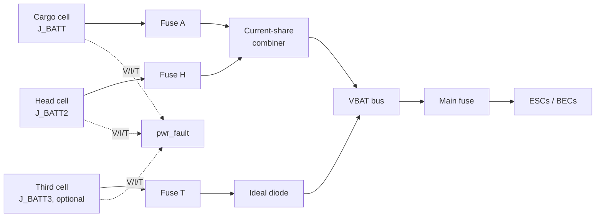

# Flight Engineer Multi-Battery PDB and Power Harnesses - Plan

**Author:** Claude (Claude Opus 5.5, Anthropic), under the direction of Stab-Rabbit-coding, per `AGENTS.md` §3.
**License:** CC BY-SA 4.0 (SPDX-License-Identifier: CC-BY-SA-4.0)
**Companion plan:** `docs/plans/2026-10-26-001-feat-split-battery-head-rail-plan.md` (cells, rail, head section).

---

## Goal Capsule

- **Objective.** Revise the Flight Engineer power distribution so it takes three battery inputs: the cargo cell, the head cell and an optional third cell. A combiner shares current between the matched pair and blocks reverse current on every input. Specify fuses, connectors and the power harnesses for the split-cell aircraft.
- **Authority.** Owner decisions below > `AGENTS.md` (sourcing and NDA rules, standards vetting, US jurisdiction) > this plan > `deferred/WBS.md` §Phase12 (the superseded deferred plan this replaces).
- **Status change.** The range-extender work is no longer a deferred Phase 12 task. It moves into the active build, because the split main pack depends on it.
- **Stop conditions.** Stop and report if a combiner part fails the sourcing or NDA rule, if no cited connector carries the combined current at margin, or if the KiCad generator has drifted from the board (use injection, not regeneration).

---

## Product Contract

### Summary

The Flight Engineer gets `J_BATT`, `J_BATT2` and `J_BATT3`. The matched pair is current-shared, the third input is ideal-diode OR'd, every input is fused and reverse-blocking, and `pwr_fault` tracks all three. The battery harnesses become three runs sized to their share of about 150 A hover.

### Problem Frame

The board as documented has one XT60 battery input, one BQ76930 6S monitor and one discharge FET. The split main pack (companion plan) needs two inputs; extended flight needs a third. WBS PWR-CONN-01 records about 150 A hover on an XT60 path (a WARNING item). The FE document and the WBS disagree on hover current (76 A against about 150 A).

### Requirements

**Inputs and combiner**

- R1. Three battery inputs: `J_BATT` (cargo cell), `J_BATT2` (head cell) and `J_BATT3` (optional third cell).
- R2. The matched pair shares current through a two-input current-share combiner (LTC4370 class). The third input uses an ideal-diode controller (LTC4359 class).
- R3. No input can back-feed another; an absent or faulted pack draws no current from the others.
- R4. Each input has its own fuse sized to its share with margin, and the combined rail has a main fuse.

**Monitoring and firmware**

- R5. Each pack's voltage, current and temperature reach `pwr_fault`; a pack fault isolates that pack and continues on the others (RTH).
- R6. Cell-level monitoring covers every connected pack (BQ76930 class per pack, or a per-pack balance input), decided in U2.

**Connectors and harnesses**

- R7. Every connector carries its worst-case current at cited margin (closes PWR-CONN-01).
- R8. Harness runs (head cell to FE, cargo cell to FE, third cell to FE) are sized for voltage drop and temperature rise at their share, with routing volumes taken from the companion plan.
- R9. Hover current is reconciled to one cited figure that every downstream sizing uses.

**Sourcing**

- R10. Every new IC passes `AGENTS.md` §5 (no restricted-country silicon, NDA-free documentation), with the data sheets read and catalogued in `REFERENCES.md`.

### Scope Boundaries

- Cell selection, rail and head geometry belong to the companion plan.
- The Flight Engineer's 5 V BEC and avionics rails are unchanged unless the combiner changes their input.

---

## Planning Contract

### Key Technical Decisions

- KTD1. Matched pair on a two-input current-share combiner (LTC4370 class); third cell on an ideal-diode controller (LTC4359 class). (session-settled: user-approved — chosen over plain ideal-diode OR on all three: forced sharing keeps the matched pair balanced.)
- KTD2. Promote the range-extender work out of deferred Phase 12 into the active build. (session-settled: user-directed — the split main pack depends on it.)
- KTD3. Edit the Flight Engineer KiCad files by targeted injection and validate with `kicad-cli`; do not regenerate from drifted generators (`avionics/kicad/FlightEngineer/GENERATOR_DRIFT_ANALYSIS.md`).
- KTD4. Size every conductor and connector from the reconciled hover current (R9) and record the source.

### High-Level Technical Design

### Risks

- LTC4370 / LTC4359 data sheets have not been read in this repository yet; a part may not suit 6S at about 150 A combined. U1 gates everything on that read.
- The KiCad board is dense; three inputs may not fit the current outline. U3 records a board-area budget before placement.

---

## Implementation Units

### U1. Reconcile hover current and select the combiner parts

**Goal:** One cited hover current; combiner and FET parts chosen with data sheets read.
**Requirements:** R2, R9, R10.
**Dependencies:** none.
**Files:** `docs/POWER_DISTRIBUTION.md`, `avionics/kicad/FlightEngineer/FlightEngineer.md`, `REFERENCES.md`.
**Approach:**
1. Reconcile 76 A (FE document) against about 150 A (WBS PWR-CONN-01) from the thrust and ESC data.
2. Read and catalogue the LTC4370 and LTC4359 data sheets and the external FETs; confirm Analog Devices' domicile.
3. Record rejected candidates with the reason.
**Test scenarios:**
- Each selected part has a cited data sheet and passes the sourcing and NDA rule.
- Combiner FET dissipation at the reconciled current is within its rating.
**Verification:** `REFERENCES.md` entries present; decision recorded in the FE document.

### U2. Decide per-pack monitoring

**Goal:** Each pack's cells are monitored.
**Requirements:** R5, R6.
**Dependencies:** U1.
**Files:** `avionics/kicad/FlightEngineer/FlightEngineer.md`, `docs/POWER_DISTRIBUTION.md`.
**Approach:** Choose between a BQ76930 per input and a multiplexed balance input; record I2C addressing and firmware impact.
**Test scenarios:**
- Every connected pack reports all six cell voltages.
- An absent third pack reports "not present", not a fault.
**Verification:** decision and pin budget recorded.

### U3. Revise the Flight Engineer schematic and PCB

**Goal:** Three inputs, fuses, the combiner and monitoring on the board.
**Requirements:** R1, R2, R3, R4.
**Dependencies:** U2.
**Files:** `avionics/kicad/FlightEngineer/kicads/FlightEngineer.kicad_sch`, `avionics/kicad/FlightEngineer/kicads/FlightEngineer.kicad_pcb`, an injection script in `avionics/kicad/FlightEngineer/scripts/`.
**Approach:** Inject by KTD3; ERC, then DRC and schematic/PCB parity through `kicad-cli`.
**Test scenarios:**
- ERC clean; schematic/PCB parity 0.
- Reverse-blocking verified in a SPICE or worked case (absent pack, low pack, reversed pack).
**Verification:** ERC 0, parity 0, DRC with no new violations.

### U4. Specify connectors and harnesses

**Goal:** Connectors and conductors for each run.
**Requirements:** R7, R8.
**Dependencies:** U1; routing volumes from the companion plan's U3 and U6.
**Files:** `docs/POWER_DISTRIBUTION.md`, `current-specification/bom_revT.csv`, `current-specification/bom_revT.json`.
**Approach:** Choose the connector class (XT90 / AS150 or equivalent) from cited ratings; size gauges for drop and rise per run; route lengths from the companion plan.
**Test scenarios:**
- Each connector's cited rating ≥ its worst-case current × margin.
- Voltage drop per run within budget at the reconciled current.
**Verification:** PWR-CONN-01 closed; BOM parity holds.

### U5. Firmware: three-pack context in pwr_fault

**Goal:** `pwr_fault` monitors and isolates each pack.
**Requirements:** R5.
**Dependencies:** U2.
**Files:** `avionics/firmware/` (the `pwr_fault` node sources).
**Approach:** Add per-pack telemetry, combiner fault and PGOOD logging, and isolate-and-continue behaviour.
**Test scenarios:**
- A pack fault on any input isolates it and continues.
- The third pack absent at boot is a normal state.
- All packs low triggers RTH.
**Verification:** host-simulation tests pass (the existing HAL simulator).

### U6. Retire the deferred Phase 12 entry

**Goal:** WBS and docs show the work as active.
**Requirements:** KTD2.
**Dependencies:** U1.
**Files:** `deferred/WBS.md`, `deferred/README.md`, `WBS.md`.
**Approach:** Replace §Phase12 with a pointer to this plan; regenerate TODOs.
**Test expectation:** none -- documentation move; `tools/gen_todo_from_wbs.py --check` passes.
**Verification:** TODO check passes.

---

## Verification Contract

- KiCad: ERC 0, schematic/PCB parity 0 and DRC with no new violations, run with a `kicad-cli` at or above the files' generator version.
- `tools/gen_todo_from_wbs.py --check` → ok; BOM CSV/JSON parity.
- Firmware host tests for `pwr_fault` pass.

## Definition of Done

- Three fused, reverse-blocking inputs with a current-shared pair, on a validated board.
- Connectors and harnesses specified from one reconciled hover current; PWR-CONN-01 closed.
- `pwr_fault` handles three packs; deferred Phase 12 retired; every new part catalogued and rule-checked.
