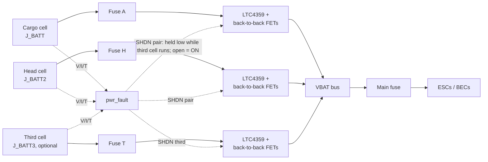

# Flight Engineer Multi-Battery PDB and Power Harnesses - Plan

**Author:** Claude (Claude Opus 5.5, Anthropic), under the direction of Stab-Rabbit-coding, per `AGENTS.md` §3.
**License:** CC BY-SA 4.0 (SPDX-License-Identifier: CC-BY-SA-4.0)
**Companion plan:** `docs/plans/2026-10-26-001-feat-split-battery-head-rail-plan.md` (cells, rail, head section).

---

## Goal Capsule

- **Objective.** Revise the Flight Engineer power distribution so it takes three battery inputs: the cargo cell, the head cell and an optional third cell. Each input has an ideal-diode load switch that blocks current both ways; the third cell is used first, then the matched pair takes over. Specify fuses, connectors and the power harnesses for the split-cell aircraft.
- **Authority.** Owner decisions below > `AGENTS.md` (sourcing and NDA rules, standards vetting, US jurisdiction) > this plan > `deferred/WBS.md` §Phase12 (the superseded deferred plan this replaces).
- **Status change.** The range-extender work is no longer a deferred Phase 12 task. It moves into the active build, because the split main pack depends on it.
- **Stop conditions.** Stop and report if a combiner part fails the sourcing or NDA rule, if no cited connector carries the combined current at margin, or if the KiCad generator has drifted from the board (use injection, not regeneration).

---

## Product Contract

### Summary

The Flight Engineer gets `J_BATT`, `J_BATT2` and `J_BATT3`. Each input has its own LTC4359 driving back-to-back FETs, so each input can be switched fully off. The third cell is drained first while the pair is held off, then the pair takes over and the third cell is isolated and may be jettisoned. Every input is fused, and `pwr_fault` tracks all three. The battery harnesses become three runs sized from the reconciled hover current (R9), each for its worst case (R4).

### Problem Frame

The board as documented has one XT60 battery input, one BQ76930 6S monitor and one discharge FET. The split main pack (companion plan) needs two inputs; extended flight needs a third. WBS PWR-CONN-01 records about 150 A hover on an XT60 path (a WARNING item). The FE document and the WBS disagree on hover current (76 A against about 150 A).

### Requirements

**Inputs and combiner**

- R1. Three battery inputs: `J_BATT` (cargo cell), `J_BATT2` (head cell) and `J_BATT3` (optional third cell).
- R2. Each input has an LTC4359 ideal-diode controller driving back-to-back N-channel FETs [REF-PWR-015]. The matched pair shares current passively through ideal-diode OR-ing, with equal harness resistance per R8.
- R3. No input can back-feed another; an absent, faulted or switched-off pack draws no current from the others and is not drawn on (back-to-back FETs block both directions).
- R13. **Third cell first.** With the third cell present, the firmware holds the pair's SHDN low, so the third cell carries the aircraft. At the third cell's cut-off voltage, the firmware releases the pair's SHDN, and the pair takes the load at its higher voltage with no gap (make-before-break). The firmware then pulls the third cell's SHDN low. **Fail-safe:** the pair is held off only by an active low drive. A firmware fault, reset, brown-out or open wire lets the LTC4359's internal pull-up re-enable the pair [REF-PWR-015]. The circuit shall preserve that default, for example with no external pull-down on the pair's SHDN.
- R4. Each input has its own fuse, connector and conductor sized for its worst case, and the combined rail has a main fuse. For each input of the pair the worst case is the full hover-plus-RTH current, carried alone after the other pack is isolated. For the third input it is the full bus current, because an ideal-diode OR'd source carries the whole load while its voltage is highest.

**Monitoring and firmware**

- R5. Each pack's voltage, current and temperature reach `pwr_fault`. A single-pack fault isolates that pack and starts RTH on the remaining packs, or an immediate landing if U1 shows one cell cannot sustain RTH. All packs low starts an immediate landing.
- R6. Cell-level monitoring covers every connected pack (BQ76930 class per pack, or a per-pack balance input), decided in U2.

**Connectors and harnesses**

- R7. Every connector carries its worst-case current at cited margin (closes PWR-CONN-01).
- R8. Harness runs (head cell to FE, cargo cell to FE, third cell to FE) are sized for voltage drop and temperature rise at their share, with routing volumes taken from the companion plan.
- R9. Hover current is reconciled to one cited figure that every downstream sizing uses.

**Third-cell jettison**

- R12. The J_BATT3 run has a rated breakaway connector, and firmware isolates J_BATT3 (R13 handover complete) before the payload release fires. Until both exist the third cell is non-jettisonable (companion plan R10). Purpose (owner 2026-10-26): discarding the spent cell and its mass extends endurance, which only works if the third cell is used first (R13).

**Sourcing**

- R11. The deferred Phase 12 entry is retired and the WBS shows the work active.
- R10. Every new IC passes `AGENTS.md` §5 (no restricted-country silicon, NDA-free documentation), with the data sheets read and catalogued in `REFERENCES.md`.

> **WARNING**
>
> Pulling a live 6S connector apart under load can arc, and a released LiPo is a
> ground fire hazard. Do not jettison the third cell until the breakaway connector and
> the isolate-before-release interlock (R12) are built and bench-tested.

### Scope Boundaries

- Cell selection, rail and head geometry belong to the companion plan.
- The Flight Engineer's 5 V BEC and avionics rails are unchanged unless the combiner changes their input.

---

## Planning Contract

### Key Technical Decisions

- KTD1. An LTC4359 with back-to-back FETs on each of the three inputs, with SHDN priority control (R13). (session-settled: user-approved 2026-10-26 — replaces the LTC4370 current-share pair, which fails the 6S gate: VIN operating 2.9–18 V, absolute maximum 24 V, against 25.2 V [REF-PWR-014]. Rejected: forced current sharing, because no 6S-rated candidate is selected; passive sharing is acceptable because each pack carries the full load alone, 95C × 2.2 Ah ≈ 209 A.)
- KTD2. Promote the range-extender work out of deferred Phase 12 into the active build. (session-settled: user-directed — the split main pack depends on it.)
- KTD3. Edit the Flight Engineer KiCad files by targeted injection and validate with `kicad-cli`; do not regenerate from drifted generators (`avionics/kicad/FlightEngineer/GENERATOR_DRIFT_ANALYSIS.md`).
- KTD4. Size every conductor and connector from the reconciled hover current (R9) and record the source.

### High-Level Technical Design

### Risks

- U1 gate result (2026-10-26): LTC4370 fails (24 V absolute maximum) [REF-PWR-014]; LTC4359 passes (80 V operating, 100 V absolute maximum) [REF-PWR-015]. The FETs are not yet chosen; their dissipation at the reconciled current is still open.
- The third cell alone carries the full load: about 94C for about 38 s at 150 A, or about 76 s at 76 A. The endurance gain from jettisoning 240 g is small (hover power scales with weight to the 1.5 power, so about 5–6 %). U1 shall report whether R12 is worth building once hover current is reconciled.
- The KiCad board is dense; three inputs may not fit the current outline. U3 records a board-area budget before placement.

---

## Implementation Units

### U1. Reconcile hover current and select the combiner parts

**Goal:** One cited hover current; combiner and FET parts chosen with data sheets read.
**Requirements:** R2, R9, R10.
**Dependencies:** none.
**Files:** `docs/POWER_DISTRIBUTION.md`, `avionics/kicad/FlightEngineer/FlightEngineer.md`, `REFERENCES.md`.
**Approach:**
1. **Gate (done 2026-10-26):** LTC4370 rejected, LTC4359 accepted (KTD1). Confirm Analog Devices' domicile under `AGENTS.md` §5 and verify the two data-sheet URLs.
2. Reconcile 76 A (FE document) against about 150 A (WBS PWR-CONN-01) from the thrust and ESC data.
3. Check one 2200 mAh cell alone at the reconciled hover current: C rate, voltage sag and RTH time. This sets R5's RTH-or-land behaviour.
4. Select and catalogue the back-to-back FETs (VDS ≥ 40 V, dissipation at the reconciled current); the LTC4359 data sheet is catalogued as REF-PWR-015.
6. Report the third-cell run time alone, and the jettison endurance gain, at the reconciled current (R12, R13).
5. Record rejected candidates with the reason.
**Test scenarios:**
- Each selected part has a cited data sheet and passes the sourcing and NDA rule.
- The LTC4359 rating (80 V) covers 25.2 V plus transients; the FET VDS rating does too.
- Combiner FET dissipation at the reconciled current is within its rating.
- One cell's sag and RTH time at the reconciled current are recorded.
**Verification:** `REFERENCES.md` entries present; decision recorded in the FE document.

### U2. Decide per-pack monitoring

**Goal:** Each pack's cells are monitored.
**Requirements:** R5, R6.
**Dependencies:** U1.
**Files:** `avionics/kicad/FlightEngineer/FlightEngineer.md`, `docs/POWER_DISTRIBUTION.md`.
**Approach:** Choose between a BQ76930 per input and a multiplexed balance input; record I2C addressing and firmware impact.
**Test scenarios:**
- Every connected pack reports all six cell voltages.
- An absent third pack reports "not present", not a fault.
**Verification:** decision and pin budget recorded.

### U3. Revise the Flight Engineer schematic and PCB

**Goal:** Three inputs, fuses, the combiner and monitoring on the board.
**Requirements:** R1, R2, R3, R4.
**Dependencies:** U2.
**Files:** `avionics/kicad/FlightEngineer/kicads/FlightEngineer.kicad_sch`, `avionics/kicad/FlightEngineer/kicads/FlightEngineer.kicad_pcb`, an injection script in `avionics/kicad/FlightEngineer/scripts/`.
**Approach:** Inject by KTD3; ERC, then DRC and schematic/PCB parity through `kicad-cli`.
**Test scenarios:**
- ERC clean; schematic/PCB parity 0.
- Reverse-blocking verified in a SPICE or worked case (absent pack, low pack, reversed pack, switched-off pack).
- No external pull-down on the pair's SHDN nets (R13 fail-safe).
**Verification:** ERC 0, parity 0, DRC with no new violations.

### U4. Specify connectors and harnesses

**Goal:** Connectors and conductors for each run.
**Requirements:** R4, R7, R8, R12.
**Dependencies:** U1; routing volumes from the companion plan's U3 and U6.
**Files:** `docs/POWER_DISTRIBUTION.md`, `current-specification/bom_revT.csv`, `current-specification/bom_revT.json`.
**Approach:** Choose the connector class (XT90 / AS150 or equivalent) from cited ratings, sized per R4 worst cases. Size gauges for drop and rise per run; route lengths come from the companion plan (U3 head lead, U6 cargo and third-cell leads). Specify the J_BATT3 breakaway connector with a cited separation force (R12).
**Test scenarios:**
- Each connector's cited rating ≥ its worst-case current × margin.
- Voltage drop per run within budget at the reconciled current.
- One pair input carries the full hover-plus-RTH current with its fuse intact.
- The J_BATT3 breakaway separates at its cited force with the lead retained on the aircraft side.
**Verification:** PWR-CONN-01 closed; BOM parity holds.

### U5. Firmware: three-pack context in pwr_fault

**Goal:** `pwr_fault` monitors and isolates each pack.
**Requirements:** R5, R12.
**Dependencies:** U2.
**Files:** `avionics/firmware/` (the `pwr_fault` node sources).
**Approach:** Add per-pack telemetry, controller fault logging, the R13 third-cell-first sequence (pair SHDN held low, release at the third cell's cut-off, then third cell SHDN low), the R5 isolate-then-RTH-or-land behaviour, and the R12 isolate-J_BATT3-before-release interlock on the payload release command. Host tests run on `avionics/firmware/mspm0/hal/sim/`.
**Test scenarios:**
- A single-pack fault isolates that pack and starts RTH (or landing, per U1).
- A payload-release command with J_BATT3 live isolates J_BATT3 first.
- With all three present, the third cell carries the load until its cut-off, then the pair takes over with no bus dropout, then J_BATT3 is off.
- Firmware reset or a stopped SHDN drive with the pair held off re-enables the pair (hardware default).
- The third pack absent at boot is a normal state.
- All packs low triggers RTH.
**Verification:** host-simulation tests pass (the existing HAL simulator).

### U6. Retire the deferred Phase 12 entry

**Goal:** WBS and docs show the work as active.
**Requirements:** R11, KTD2.
**Dependencies:** U1.
**Files:** `deferred/WBS.md`, `deferred/README.md`, `WBS.md`.
**Approach:** Replace §Phase12 with a pointer to this plan; regenerate TODOs.
**Test expectation:** none -- documentation move; `tools/gen_todo_from_wbs.py --check` passes.
**Verification:** TODO check passes.

---

## Verification Contract

- KiCad: ERC 0, schematic/PCB parity 0 and DRC with no new violations, run with a `kicad-cli` at or above the files' generator version.
- `tools/gen_todo_from_wbs.py --check` → ok; BOM CSV/JSON parity.
- Firmware host tests for `pwr_fault` pass.

## Definition of Done

- Three fused, switchable, reverse-blocking inputs with third-cell-first priority and a fail-safe pair default, on a validated board.
- Connectors and harnesses specified from one reconciled hover current; PWR-CONN-01 closed.
- `pwr_fault` handles three packs; deferred Phase 12 retired; every new part catalogued and rule-checked.
