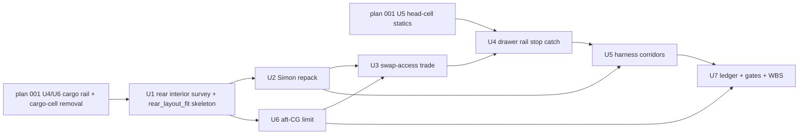

# Middle and Rear Section Layout

**Author:** Claude (Claude Opus 5.5, Anthropic), under the direction of Stab-Rabbit-coding, per `AGENTS.md` §3.
**License:** CC BY-SA 4.0 (SPDX-License-Identifier: CC-BY-SA-4.0)
**Continues:** `docs/plans/2026-10-03-002-feat-exhaustive-joint-analysis-plan.md` (rules R1–R6 apply unchanged).
**Inputs:** `docs/handoffs/2026-10-27-head-section-layout.md` §3; `tools/head_layout_fit.py` and `tools/gen_head_cell_rail.py` (pattern); `docs/plans/2026-10-26-001-feat-split-battery-head-rail-plan.md` (plan 001); `docs/plans/2026-10-26-002-feat-fe-multi-battery-pdb-plan.md` (plan 002).

---

## Goal Capsule

- **Objective.** Lay out the middle and rear sections in R2 so the second main cell sits behind the Flight Engineer (FE), can be swapped between sorties, and Simon's node pair (CN4 + FC4) moves into the rear section aft of it. Gate everything the way the head is gated, and establish an aft-CG limit to judge the result against.
- **Authority.** Owner decisions below > `AGENTS.md` (datum R2, standards, sourcing, material order) > this plan > `middle_layout_fit.py` Rev T6 rationale.
- **Stop conditions.** Stop and report in three cases:
  - No swap-access option clears the rear belly, the skids and the bonded middle/rear joint with every crossed load path shown carried (U3's test).
  - Simon cannot be repacked anywhere in the rear section.
  - The preliminary CG check (U6) fails the provisional aft limit by more than nose ballast of 0.20 lbm (91 g) can recover. That cap is a planning assumption the owner shall confirm; see Open Questions.

---

## Product Contract

### Problem Frame

Owner decisions on 2026-10-27 moved the head cell aft (Y 195–311) so Bay A stays in Shepherd's bay. That left no cargo room for the second cell (73 mm of band against 116 mm). The owner then directed the second cell into the middle and aft sections, with Simon pushed aft of it. Measured on 2026-10-27:

- The cell fits directly aft of the FE can at **Y 483.7–599.7, Zc 136**, across the bonded middle/rear joint.
- Simon's 77 mm stack does not fit aft of it within 60 mm as currently packed.
- The middle ventral hatch (~32 mm in Y) cannot pass the cell.
- **Corrected 2026-10-27:** the hover thrust line is the nacelle tilt pivot, Y 326.7 (`hull_datums.SPAR_Y`); Y 352.3 is the tilt worm-wheel shaft. The ledger puts that configuration at +32.8 mm aft of the pivot. **Owner target: the CG on the thrust line.** The best internal rearrangement studied reaches +13.2 mm, and the owner directed more relocations before a pivot move or ballast is considered.

### Requirements

- R1. The second cell (matched to the head cell, Tattu R-Line 6S 2200, same ORIGIN flag as plan 001 KTD4) sits aft of the FE can in the middle/rear sections, as a placed R2 solid.
- R2. The cell is removable and installable between sorties without tools beyond a screwdriver, without unbonding any joint, and without disturbing the FE or Simon.
- R3. The cell is retained for the 79.4 g crash load in every direction (plan 001 R7), at FOS 3.0 on cited allowables [REF-MAT-001, REF-MAT-002].
- R4. CN4 + FC4 move into the rear section aft of the cell and keep their antenna, bus-end termination and harness functions (`docs/AVIONICS_PB2_REDESIGN.md`).
- R5. Harness routes are reserved solids: second cell → FE, head cell → FE (through the cargo), and Simon → FE / ring.
- R6. An aft-CG limit is derived with each input cited or marked "requires verification". It is the more restrictive of two limits: hover trim with a reserved control fraction, and forward-flight static margin. The ledger CG for every configuration is judged against it.
- R7. The middle and rear sections pass a layout gate, the joint census and the symmetry check with no unregistered clash.
- R8. The Phase 11 aft-EDF reservation is released for this work. The plan records what Phase 11 will have to displace.

### Acceptance Examples

- AE1. Covers R2: with the aircraft on its gear, the cell comes out through the chosen access in one motion after opening the closure and releasing the catch, and goes back to the same stop.
- AE2. Covers R6: the ledger prints the CG of each configuration against the derived limit, with PASS or FAIL. The configurations are the existing `hover_4000` and `heaviest_4000_payload` keys, re-pointed to the split cells and renamed in U7, plus a new `extended_third_cell` key.

### Scope Boundaries

- Out: the aft EDF itself (Phase 11), FE PCB changes (plan 002), and the gear (LG-LOADPATH).
- Out: the head (plan 001 and `head_layout_fit.py`), except where the head-cell lead crosses into the cargo.

#### Deferred to Follow-Up Work

- The cargo rail piece and the cargo-cell removal from `cargo_layout_fit.py` belong to plan 001 U4/U6. This plan consumes them.

---

## Planning Contract

### Key Technical Decisions

- KTD1. Second cell in the middle and aft sections, aft of the FE can. (session-settled: user-directed — chosen over a second cell in the cargo band or the payload bay: the cargo band is 73 mm long after the head cell moved aft.)
- KTD2. Simon moves into the rear section aft of the cell. (session-settled: user-directed — chosen over the cell going aft of Simon: Simon's pair is 22 mm in Y, the cell 116 mm.)
- KTD3. Swap access is **traded by the plan, not presumed** (owner 2026-10-27). U3 compares three options with measured evidence and picks one:
  - (a) a rear belly hatch aft of the joint, with the cell drawn aft and down out of a forward-sliding drawer;
  - (b) a lengthened middle hatch that crosses the bonded joint;
  - (c) a removable tail cone.
- KTD4. The drawer, rail, stop and catch reuse the head-cell pattern and statics (`tools/head_layout_fit.py`; plan 001 U5). The rear tool imports those parameters and does not retype them.
- KTD5. The aft-CG limit is the more restrictive of two:
  - **Hover:** the weight moment about the thrust line may use at most a stated fraction of the tilt/nozzle pitch authority, with the rest reserved for gust and attitude control. The fraction and its basis are cited or marked "requires verification". The earlier FOS 1.5 figure had no citation and is withdrawn.
  - **Forward flight:** a static-margin limit from the wing and fuselage neutral point.

  Inputs are the cited thrust per fan [REF-EDF-003] and the nozzle/tilt geometry. Each uncited input is marked "requires verification", and the limit is reported as provisional.
- KTD6. New `tools/rear_layout_fit.py` mirrors `head_layout_fit.py` (boolean hit/near, pairwise, registered defects, written SCAD params). It owns the WHOLE second-cell solid, so a clash across the middle/rear seam is checked by one gate. `middle_layout_fit.py` drops Simon and imports the cell solid from it. "Near" means intersection after dilating by the gap; a part at exactly the gap passes.

### High-Level Technical Design

### Risks

- The rear section may be too narrow at Zc 136 for a hatch frame and a drawer together. U1 measures this first.
- Crossing a bonded joint with a hatch (option b) may break the double-lap collar's load path. U3 must show the joint load is carried.
- CG may fail the derived limit. The cell already sits at the FE can's +2 mm gap, so moving it forward recovers nothing. The remaining levers are lighter rear items, then nose ballast up to the cap in the Goal Capsule. U6 runs before the access trade so a FAIL stops the work cheaply.

---

## Implementation Units

### U1. Survey the rear interior and stand up the rear gate

**Goal:** Section-probe the published rear and middle shells and create `tools/rear_layout_fit.py` with the cell placed.
**Requirements:** R1, R7.
**Dependencies:** plan 001 U6 (cargo-cell removal), so that the second cell is not also counted in the cargo band.
**Files:** `tools/rear_layout_fit.py` (new), `tools/middle_layout_fit.py`.
**Approach:**
1. Probe free X/Z per Y station for Y 480–690, as was done for the head (2026-10-27).
2. Confirm that every station in `middle_layout_fit.py` is in R2. Its FE_CAN_* and SIMON_* comments still read R1 values (148..176, 178.0); run `tools/check_datum_drift.py` on it. Define the cell station as an explicit R2 constant in `rear_layout_fit.py` (Y 483.7–599.7, Zc 136, at FE_CAN_Y1 + 2.0), and record the rear-shell aft end from the probe. Remove Simon from `middle_layout_fit.py` and mark it moved.
3. Check against the middle shell, the rear shell, the middle/rear collar, the FE envelopes and the skids.

**Patterns to follow:** `tools/head_layout_fit.py`, `tools/cargo_layout_fit.py`.
**Test scenarios:**
- The cell at its station reports zero hit and zero 2 mm-near.
- A deliberately shifted cell (+10 mm in Z) reports a FAIL; this negative control proves the gate.
- The middle gate still passes with Simon removed.

**Verification:** both gates run and print a result.

### U2. Repack Simon into the rear section

**Goal:** Find a CN4 + FC4 placement aft of the cell.
**Requirements:** R4, R7.
**Dependencies:** U1.
**Files:** `tools/rear_layout_fit.py`, `docs/AVIONICS_PB2_REDESIGN.md` (station note only).
**Approach:** Grid-search the pouch orientations (stacked, side by side, on edge) from the cell's aft face to the rear-shell aft end measured in U1, keeping the SMA/antenna stations reachable. The earlier "60 mm" figure was only a quick search window, not measured room. Record a rejected placement with its reason.
**Test scenarios:**
- The chosen placement has zero 2 mm-near.
- The cable zone faces the trunk route.
- No placement clears → the stop condition fires and is reported.

**Verification:** Simon placed and gated, or the stop is reported.

### U3. Trade the swap access

**Goal:** Pick the access option with evidence (KTD3).
**Requirements:** R2, R8.
**Dependencies:** U2 (Simon's envelope and corridor must be known), U6 (the CG check passes first).
**Files:** `docs/REAR_CELL_ACCESS_TRADE.md` (new), `tools/rear_layout_fit.py`.
**Approach:** For each option, measure four things:
- the opening size against the cell's extraction path, swept as a solid;
- skin and joint material removed, and whether the cut crosses a load path (collar, skid root, horseshoe legs);
- closure retention under flight loads;
- the number of steps for AE1.

Also record what each option costs Phase 11.

**Test scenarios:**
- The extraction sweep clears every fixed solid for the chosen option, including Simon's placed envelope and its harness corridor (R2: the swap does not disturb Simon).
- Each option is screened against R2's "screwdriver only" requirement before it is measured.
- An option whose cut crosses the bonded collar is rejected unless a load-path check shows the joint is carried.

**Verification:** the trade doc names the winner. The owner confirms before U4.

### U4. Drawer, rail, stop and catch for the second cell

**Goal:** Retain the cell (R3) and slide it to its stop through the chosen access.
**Requirements:** R2, R3.
**Dependencies:** U3; plan 001 U5. The head-cell statics live in `tools/gen_head_cell_rail.py --statics` (written 2026-10-27), and the narrative goes in `docs/BATTERY_MOUNT.md` §8.
**Files:** `airframe/openscad/fuselage/rear_cell_drawer.scad` (new), generated `rear_layout_params.scad`, `docs/BATTERY_MOUNT.md` (statics section).
**Approach:** Reuse the head-cell statics and catch (KTD4). Adjust for the drawer's span and whatever support the chosen access provides.
**Test scenarios:**
- 79.4 g in each of the six directions → every element at FOS ≥ 3.0 on cited allowables.
- Catch release force recorded, one-hand.
- The drawer sweep stays inside the gate.

**Verification:** statics recorded; STL rendered and watertight; the gate passes.

### U5. Harness corridors

**Goal:** Reserve every power and data route touching these sections (R5).
**Requirements:** R5.
**Dependencies:** U2, U4.
**Files:** `tools/rear_layout_fit.py`, `tools/middle_layout_fit.py`.
**Approach:** Model bend radius and a service loop at the drawer. Hand the route lengths to plan 002 U4.
**Test scenarios:**
- Each corridor is continuous from end to end.
- No corridor crosses the drawer sweep.

**Verification:** the gates pass with the corridors in.

### U6. Derive the aft-CG limit

**Goal:** A provisional aft-CG limit (KTD5), plus a preliminary CG check that gates U3.
**Requirements:** R6.
**Dependencies:** U1 (cell and Simon candidate stations).
**Files:** `tools/hover_trim_cg_limit.py` (new), `docs/flight_envelope.md` (section).
**Approach:**
1. Hover: balance the pitch moments about the thrust line, leaving the reserved control fraction (KTD5) unused.
2. Forward flight: compute the static-margin aft limit.
3. Take the more restrictive of the two.
4. Mark each uncited input "requires verification" in REFERENCES.md and add a TODO §0.x item for it.
5. Run a preliminary ledger CG with the cell and Simon at their candidate stations, and stop per the Goal Capsule if it fails beyond the ballast cap.
**Test scenarios:**
- Hand-check case: CG on the thrust line → zero trim demand.
- The limit falls as the available trim authority falls.

**Verification:** the limit is printed with its inputs and their citation status.

### U7. Ledger, gates and WBS close-out

**Goal:** CG verdicts and a clean gate state.
**Requirements:** R6, R7.
**Dependencies:** U5, U6; plan 001 U4/U6 landed.
**Files:** `tools/hover_trim_cg_limit.py`, `tools/auw_ledger.py`, `current-specification/auw_ledger.json`, `current-specification/bom_revT.csv`, `current-specification/bom_revT.json`, `WBS.md`, `airframe/fuselage-mid/WBS.md`.
**Approach:**
1. Move the cells and Simon to their stations in the ledger.
2. Re-point `hover_4000` and `heaviest_4000_payload` to the split cells and rename them, then add `extended_third_cell`.
3. Import the limit from `tools/hover_trim_cg_limit.py` and print PASS/FAIL per configuration.
4. Run the export, the census and the placement audit.
5. Add WBS rows.

**Test scenarios:**
- Covers AE2. Each configuration prints CG against the limit.
- BOM CSV/JSON parity holds.

**Verification:** all gates PASS or show only registered items.

---

## Open Questions

- The nose-ballast cap (0.20 lbm / 91 g assumed) for the CG stop condition: owner to confirm.
- The reserved pitch-control fraction (KTD5): owner or flight-controls input, or cite a source.
- Doc review 2026-10-27 residual: crossing the bonded collar sleeve (AFT_SLEEVE_Y0 R2 500.0) may not reach zero near without trimming the collar. If so, U1 reports it as a load-path change for owner decision.

## Verification Contract

- `/usr/bin/python3 tools/rear_layout_fit.py`, `tools/middle_layout_fit.py`, `tools/head_layout_fit.py` → PASS.
- `tools/check_datum_drift.py` → PASS.
- `tools/auw_ledger.py --write` → CG verdicts printed; `tools/gen_todo_from_wbs.py --check` → ok.

## Definition of Done

- The second cell and Simon are placed, gated and in the ledger.
- The swap access is traded, chosen by the owner, and drawn, with statics.
- A provisional aft-CG limit exists, with each input cited or marked "requires verification" per KTD5, and every configuration is judged against it.
- WBS updated; the Phase 11 displacement is recorded.
