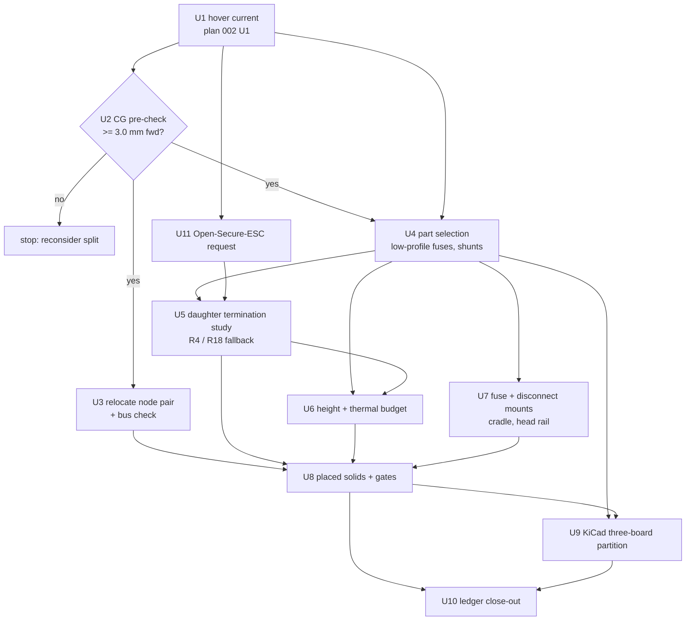
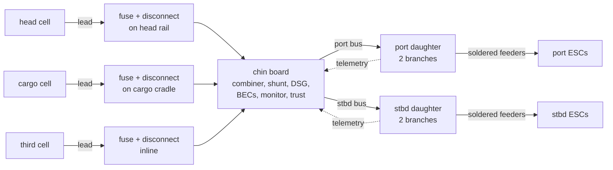

# Flight Engineer Chin + Shuttle Split - Plan

**Author:** Claude (Claude Opus 5.5, Anthropic), under the direction of Stab-Rabbit-coding, per `AGENTS.md` §3.
**License:** CC BY-SA 4.0 (SPDX-License-Identifier: CC-BY-SA-4.0)
**Related:** `docs/plans/2026-10-26-002-feat-fe-multi-battery-pdb-plan.md` (plan 002, circuit content); `docs/CG_RELOCATION_STUDY.md` (CG basis); `docs/plans/2026-10-27-001-feat-middle-rear-layout-plan.md` (superseded in part: its KTD1 and U3/U4, the second cell aft, were already void; this plan's R2 now shares Simon's middle-neck region with CN2/CN3, so that plan's node placements are re-checked under R3 and R19).

---

## Goal Capsule

- **Objective.** Re-package the Flight Engineer (FE) as a chin central board plus two mirrored shuttle daughter boards, so its mass and most of its heavy-gauge copper move toward the hover thrust line (nacelle pivot, R2 Y 326.7).
- **Product authority.** Owner decisions recorded below > `AGENTS.md` (datum R2, sourcing and NDA rules, standards vetting, material order) > plan 002 (what the FE must do electrically) > this plan (where and in what shape it lives).
- **Open blockers.** None for planning; the hover-current reconciliation (plan 002 U1) sizes the branch fuses and must land before layout.

---

## Product Contract

### Summary

Split the FE into three boards. The **chin central board** sits on the cargo chin floor between the two cells and carries the battery inputs, combiner, main protection, regulators, cell monitoring and trust module. Two **shuttle daughter boards**, one per side in the aft shuttle hollows, each carry their nacelle's two fused, monitored ESC branches with hard-soldered feeders, unless R18 applies, in which case the branch fuses move into the feeders and the daughters carry only shunts and monitors. The chin node pair moves into the FE's old middle-neck slot.

### Problem Frame

The FE (225 g with its can) sits in the middle neck at Y 467.7, 141 mm aft of the pivot. With the rail-lever arrangement and the counted aft weight cuts the hover CG is still +13.6 mm aft of the thrust line (`docs/CG_RELOCATION_STUDY.md`). The routed harness carries about 301 g of 6 AWG battery leads and 10 AWG ESC feeders, all converging on the FE. Measured on 2026-10-28:

- **No free volume forward.** No FE-sized pocket exists forward: the head is full (Observer, Bay A, rail), and the pivot station is full (payload, cell band, tilt drive, cargo Observer).
- **The board is already double-sided.** `avionics/kicad/FlightEngineer/kicads/FlightEngineer.kicad_pcb` is 90 × 65 mm, 4 layers, 83 F.Cu + 70 B.Cu footprints, courtyard fill 66 % / 46 %. A single 84 × 58 mm chin board would run at 79 % / 56 % before plan 002 adds two more inputs, a third BEC and J_OBS, so one chin board cannot hold the content.
- **Mirrored daughter pockets clear only in the aft shuttle hollows.** That's Y ~374–434, about 47–107 mm aft of the pivot (the R4 envelope, Y 386–406, sits 59–79 mm aft); the forward part holds the tilt drive and tilt-controller board.

### Key Decisions

- **Chin central board plus shuttle daughter boards.** (session-settled: user-directed — chosen over a single chin board and over a single chin board using ESC telemetry: the single board cannot hold the FE content.) Governs R1, R5, R7.
- **Low-profile fuses off the chin board.** (session-settled: user-directed — chosen over keeping the 150 A MAXI holder on the board: it alone exceeds the chin height budget.) Governs R14, R15.
- **Hard-soldered ESC feeders.** (session-settled: user-directed — chosen over branch connectors rated for 57 A: removes the largest branch parts.) Governs R9.
- **Foil-pouch shielding.** (session-settled: user-directed — chosen over a low-profile formed can or board-level shielding only: fits the chin height and saves most of the can's mass.) Governs R4, R8.
- **Node distribution is a planning factor, ranked below volume, mass, balance, controllability and stability.** (session-settled: user-directed — the nodes were intended to be spread through the aircraft to limit single points of failure.) Governs R19.
- **FE swaps places with the chin node pair.** (session-settled: user-approved — chosen over leaving the FE in the neck: frees the chin, and the node pair fits the neck slot.) Governs R2, R3.

### Requirements

**Placement and envelopes**

- R1. The chin central board's bare footprint fits the chin-floor area now held by nodes CN2/CN3 (about 84 × 58 mm, Y 247.7–305.7); the pouch adds height only, inside the Z span of R14 (Z 146 up to the rail); and the board clears every gated solid in `tools/cargo_layout_fit.py`.
- R2. Nodes CN2 and CN3 relocate to the middle-neck slot the FE vacates and clear every gated solid in `tools/middle_layout_fit.py`.
- R3. After the move, CN2 and CN3 keep their bus roles; each bus stub stays within its bus's limit and termination positions are unchanged or the change is stated, and the added harness mass counts in R13's estimate (`docs/AVIONICS_PB2_REDESIGN.md`).
- R19. Node placement keeps the control nodes as physically distributed as practical, to limit common-mode loss (one strike, fire or fluid ingress disabling several nodes). Volume, mass, balance, controllability and stability take precedence; distribution is weighed after them.
- R4. Each shuttle daughter board's content fits one of the measured mirrored clear envelopes in the aft shuttle hollow (best measured: 20 × 35 × 25 mm at X ±36 Z 190–215 or X ±51 Z 133–158, Y 386–406), confirmed by a branch termination study (bus landing, two feeder solder pads, two fuses, two shunts and monitors) before the envelope is gated.
- R18. If no measured envelope holds the R4 content, the branch fuses move into the feeders off the board (the R15 pattern) and the daughter boards carry only shunts and monitors.
- R14. Each board meets a height stack: pouch, tallest back-side part, PCB and tallest top-side part together fit the measured Z span of its envelope (the chin span is capped by the cell rail above, Z 166.35).
- R15. The main fuse and the per-input fuses use low-profile parts and mount off the chin board, inline in the battery leads or on the battery cradles, whichever fits best per input.
- R16. Every board holds its power parts within their rated temperatures, including fuse derating, at the reconciled continuous current, with a stated heat path (copper spreader to the chin floor or a cradle, or an air path); the dissipation budget per board is reported.
- R5. All three boards are placed R2 solids with installed-position STLs and pass the head, cargo and middle gates and the symmetry check.

**Electrical content**

- R6. Across the three boards the FE keeps every function plan 002 assigns it: three switchable reverse-blocking inputs, third-cell-first priority with a fail-safe pair default, per-input and main fusing, the 5 V rails (including RAIL-2 / J_OBS), the 6 V rail, cell monitoring and the trust module.
- R7. The chin central board carries the battery input landings, combiner, main shunt, disconnect, the dual 5 V avionics BECs, the RAIL-2 5 V BEC with J_OBS, the 6 V BEC, cell monitoring and the trust module; each daughter board carries its nacelle's two ESC branches (fuse plus current monitor per branch).
- R20. With the fuses and input connectors off the board (R9, R15) and the plan 002 additions included, the chin board's projected courtyard fill is at most 70 % per side, the existing FE's front-side fill being 66 %.
- R8. Each board is shielded by a foil pouch bonded to chassis PGND, accepted under the FE EMC pass (FE-CAN-05).
- R9. ESC feeders solder to the daughter boards; each battery input's disconnect sits with its fuse on the cradle or inline (R15), and its lead solders or lugs to the chin board, so the chin board carries no input connectors.
- R10. Each ESC branch is fused and conductor-sized for its worst-case current, taken from the reconciled hover current (plan 002 R9).

**Interconnect**

- R11. One high-current bus per side connects the chin board to its daughter board, sized for that side's two branches.
- R12. Branch current and fault telemetry from both daughter boards reaches `pwr_fault` on the chin board.

**Mass and balance**

- R13. Before layout work, a moment estimate (FE pieces, the moved node pair, pouches replacing the can, the side buses and the re-derived harness) shows the new hover CG at least 3.0 mm forward of the +13.6 mm baseline; if it does not, the split is reconsidered before any board is laid out.
- R17. The ledger carries all three boards and the moved nodes at their installed stations with the routed harness re-derived, and the final hover CG meets R13's margin.

### Acceptance Examples

- AE1. Covers R1, R4, R5. The head, cargo and middle gates pass with the three boards and the moved node pair in place, and the port/starboard daughter boards mirror within 0.5 mm.
- AE2. Covers R12. A simulated branch overcurrent on the starboard daughter board appears in `pwr_fault` telemetry and isolates only that branch.
- AE3. Covers R13, R17. The pre-layout estimate and the final ledger both put hover CG at least 3.0 mm forward of +13.6 mm, and report harness mass and moment change.
- AE4. Covers R3, R6, R19. With the three boards and the moved node pair wired, every plan 002 FE function passes its bench check, every bus stub is within its limit with termination as stated, and the node distribution is reported against R19.

### Scope Boundaries

- Out: circuit-level design (combiner parts, FET selection, hover-current reconciliation, per-pack monitoring), which is plan 002.
- Out: PCB routing and final placement; the owner places tightly packed boards by hand (avionics/AGENTS.md).
- Out: merging each daughter board with that side's tilt-controller board. Recorded as a later option.

#### Deferred for later

- Merged daughter-plus-tilt-controller boards (one board per side in the shuttle pocket).
- ESC current telemetry replacing the branch monitors.

### Outstanding Questions

#### Deferred to Planning

- Whether the logic/BEC functions and the power daughter boards need different protection: the logic side is EMC-dominated (switching regulators, trust module, isolated buses), the daughter boards heat-dominated (fuses, shunts at tens of amps). The pouch decision may hold for the chin board while the daughter boards trade some shielding for a heat path, within R8 and R16.

- Low-profile alternatives for the other tall parts (shunts, magnetics, connectors) that keep each board within R14.

- How the 57 A rated-point branch current [REF-EDF-003] is handled once hover current is reconciled: carried continuously by the branch, or bounded by a stated throttle or time limit.

- Which measured envelope and orientation the daughter board uses (the clear volumes also admit a 30 × 40 × 14 mm flat board at X ±54 Z 136–150 and a 12 × 45 × 35 mm on-edge board at X ±45 Z 130–165), decided by the R4 termination study once plan 002 U1 fixes fuse and conductor sizes.
- Service access to the chin board (doors open, cargo cell and payload out) and whether that is acceptable for routine maintenance.

---

## Planning Contract

**Product Contract preservation:** Product Contract unchanged (R1–R20, AE1–AE4 as resolved in doc review round 1).

### Key Technical Decisions

- KTD1. Run plan 002 U1 (hover-current reconciliation) here as U1, ahead of every sizing unit. (session-settled: user-directed — chosen over blocking on plan 002: the split's fuse, thermal and termination units depend on that one number.) Plan 002 cites this result.
- KTD2. The R13 CG pre-check (U2) gates all layout work: a FAIL stops U3 and U4 onward. It reuses the routed-harness model in `tools/cg_relocation_study.py`.
- KTD3. KiCad work partitions the existing FE schematic into two projects, a chin project and one daughter project instanced port and starboard, with inter-board connectors, by targeted injection, not regeneration (`avionics/kicad/FlightEngineer/GENERATOR_DRIFT_ANALYSIS.md`). The plan ends at net-correct, outlined boards: final placement and routing stay with the owner (avionics/AGENTS.md).
- KTD4. Fuse and disconnect mounts (R9, R15) are features on the cargo battery cradle and the head-cell rail, generated from the existing single-source tools (`tools/cargo_layout_fit.py`, `tools/gen_head_cell_rail.py`).
- KTD5. Every new part (low-profile fuses and holders, shunts, inter-board connectors) is checked against AGENTS.md §5 (maker domicile, NDA-free datasheet) and catalogued in `REFERENCES.md` by the unit that selects it.
- KTD6. Heights and dissipations come from cited datasheets; any value not yet sourced is marked ASSUMED in the budget tool's output, never silently defaulted.
- KTD7. Branch telemetry crosses from each daughter to the chin board as a short shielded I²C run carrying the daughter's INA226 monitors (no added MCU on the daughters); the Open-Secure-ESC CAN-FD current telemetry (U11) is an independent cross-check in `pwr_fault`.
- KTD8. The ESCs are Open-Secure-ESC builds sized from U1's reconciled current with the maker's 20 % continuous-load margin (the same rule the OSE repo applied in its TODO 12.5.ai), requested from that repo by U11. OSE's existing 6S/50A builds were validated against Serenity's retired 38 A XFly fans and do not cover the QX QF2822's 57 A rated point.

### High-Level Technical Design

---

## Implementation Units

### U1. Reconcile hover current (plan 002 U1)

**Goal:** One cited hover and RTH current that every sizing unit uses.
**Requirements:** R10; KTD1.
**Dependencies:** none.
**Files:** `tools/hover_current.py` (new), `tools/tests/test_hover_current.py` (new), `docs/POWER_DISTRIBUTION.md`, `avionics/kicad/FlightEngineer/FlightEngineer.md`.
**Approach:**
1. Derive per-fan current at hover thrust (ledger AUW / 4) from the single cited rated point [REF-EDF-003] by the actuator-disc scaling P ∝ T^1.5 already used in `tools/flight_envelope_endurance.py`, with RTH margin. Name the flight-article motor variant first (2400KV at 22.2 V or 2300KV at 24 V; REF-EDF-003 lists both). *Resolved (owner, 2026-11-02): the QF2822-2300KV at 24 V is the specified motor; the 2400 KV was never specified or authorized.*
2. Reconcile the hover-current figures in circulation (the ~76 A figure — locate and cite its source, which is not `FlightEngineer.md` — and WBS PWR-CONN-01's ~150 A), and record which one was wrong and why.
3. Report per-branch continuous, per-side bus and main-bus currents.
4. Decide the 57 A rated-point policy (carried continuously, or bounded by a stated throttle or time limit) and record it; U4 and U11 size against it.
**Patterns to follow:** `tools/flight_envelope_endurance.py` (actuator-disc scaling from the rated point).
**Test scenarios:**
- At the rated point (2,135 gf), per-fan current reproduces 57.0 A.
- Current is monotonic in thrust below the rated point.
- An AUW above the 4-fan rated thrust raises an error, not an extrapolated current.
**Verification:** one hover and RTH current per branch, side and main bus, cited, in POWER_DISTRIBUTION.md.

### U2. CG pre-check for the split (R13 gate)

**Goal:** Prove or disprove at least 3.0 mm forward of +13.6 mm before any layout.
**Requirements:** R13, KTD2.
**Dependencies:** U1 (harness gauges).
**Files:** `tools/cg_relocation_study.py`, `tools/tests/test_cg_split_estimate.py` (new), `docs/CG_RELOCATION_STUDY.md`.
**Approach:**
1. Add the split arrangement: chin board at the chin-node station, daughter boards at Y ~396 X ±36/±51, the node pair in the neck, pouch masses in place of the can.
2. Re-route the harness for the new endpoints (cell leads to the cradle and rail fuse mounts and on to the chin; side buses; feeders from the daughters).
3. Print PASS/FAIL against the 3.0 mm margin.
**Patterns to follow:** the existing routed-harness and arrangement code in `tools/cg_relocation_study.py`.
**Test scenarios:**
- The baseline arrangement reproduces +13.63 mm.
- The split arrangement's moment change equals the sum of its per-item moments.
- A daughter-board mass 3× higher still reports a deterministic PASS/FAIL, never an exception.
**Verification:** PASS recorded, or the plan stops with a FAIL report.

### U3. Relocate the chin node pair and check the buses

**Goal:** CN2/CN3 in the middle neck, with bus limits and distribution checked.
**Requirements:** R2, R3, R19.
**Dependencies:** U2.
**Files:** `REFERENCES.md`, `tools/middle_layout_fit.py`, `tools/cargo_layout_fit.py`, `tools/node_bus_check.py` (new), `tools/tests/test_node_bus_check.py` (new).
**Approach:**
1. Place the pair stacked in Z in the neck slot (58 × 22 × 74 mm); remove the chin nodes from the cargo layout.
2. Catalog each bus's stub-length limit from its governing standard in `REFERENCES.md` first (CAN, RS-485, MIL-STD-1553B, Ethernet); mark any limit that cannot be verified as requires verification. Then compute stub lengths per bus (CAN-FD, RS-485, 1553, Ethernet ring) from node stations and compare.
3. Report node distribution (count per section, nearest-neighbour spacing) for R19.
**Patterns to follow:** `SIMON_*` placement in `tools/middle_layout_fit.py`.
**Test scenarios:**
- The pair clears every middle-gate solid.
- A stub length over its limit is reported as FAIL with the bus named.
- Termination positions before and after are listed; a change is flagged.
**Verification:** middle gate PASS; bus check PASS or each exception stated.

### U4. Select low-profile fuses, holders, shunts and inter-board connectors

**Goal:** Real parts that meet U1's currents, R14 heights and §5 sourcing.
**Requirements:** R10, R14, R15; KTD5, KTD6.
**Dependencies:** U1, U2.
**Files:** `REFERENCES.md`, `docs/FE_SPLIT_PARTS.md` (new), `current-specification/bom_revT.csv`, `current-specification/bom_revT.json`.
**Approach:** For each role (main fuse ×1, input fuse ×3, branch fuse ×4, main shunt, branch shunts ×4, per-side bus connector or lug, telemetry connector per KTD7), shortlist at least two candidates with datasheets read, rate them against U1 currents with margin, and record rejects with reasons.
**Test scenarios:** Test expectation: none -- part selection; verified by the BOM CSV/JSON parity check and the REFERENCES.md entries.
**Verification:** every role has a selected part with a cited datasheet; BOM parity holds.

### U5. Daughter termination study

**Goal:** Confirm the daughter content fits a measured envelope, or apply the R18 fallback.
**Requirements:** R4, R18.
**Dependencies:** U4.
**Files:** `tools/fe_daughter_fit.py` (new), `tools/tests/test_fe_daughter_fit.py` (new).
**Approach:**
1. Build the daughter content (bus landing, two feeder solder pads, two fuses, two shunts and monitors) from U4 footprints and heights.
2. Pack it into each measured envelope and orientation.
3. On no fit, re-run with the branch fuses removed (R18) and report.
**Patterns to follow:** the envelope search in `tools/head_layout_fit.py`.
**Test scenarios:**
- The content fits the 20 × 35 × 25 mm envelope, or the tool reports which part over-runs and by how much.
- With R18 applied, the reduced content is re-checked.
- Port and starboard results are mirror-identical.
**Verification:** chosen envelope and orientation recorded, or R18 adopted.

### U6. Height-stack and thermal budget per board

**Goal:** R14 and R16 met for all three boards, with a stated heat path.
**Requirements:** R8, R14, R16, R20.
**Dependencies:** U4, U5.
**Files:** `tools/fe_board_budget.py` (new), `tools/tests/test_fe_board_budget.py` (new), `docs/FE_SPLIT_PARTS.md`.
**Approach:**
1. Height stack per board: pouch + tallest back-side part + PCB + tallest top-side part, against the measured Z span. Re-measure the chin span first: the node envelope's floor is Z 146 and the rail lips sit at Z 166.35, which is 20.35 mm, not the 22 mm node stack height.
2. Dissipation per part (I²R for shunts and FET RDS(on), fuse drop, BEC efficiency) at U1 currents.
3. Temperature rise from a stated heat path to the chin floor, cradle or air, against each part's rating with fuse derating.
4. Projected courtyard fill on the chin board against R20's 70 %.
5. Pouch bond: each pouch bonds to chassis PGND at a stated point, and the FE-CAN-05 EMC evidence for the pouches is recorded.
**Execution note:** Report every unsourced value as ASSUMED; a PASS that rests on an assumption is reported as provisional.
**Test scenarios:**
- A part taller than the remaining Z span fails R14 with its name.
- The 1 mΩ main shunt at U1's main-bus current reproduces I²R from that current (e.g. ≈ 5.8 W at 76 A).
- A fill above 70 % on either side fails R20.
**Verification:** all three boards PASS R14/R16/R20 or each failure is reported.

### U7. Fuse and disconnect mounts on the cradle and head rail

**Goal:** Printed mounts for the input fuses and disconnects at the cells.
**Requirements:** R9, R15; KTD4.
**Dependencies:** U4.
**Files:** `airframe/openscad/fuselage/cargo/battery_cradle.scad`, `tools/cargo_layout_fit.py`, `tools/gen_head_cell_rail.py`, `airframe/stls/fuselage/head/head_cell_rail.stl`.
**Approach:** Add holder pads and lead-retention features sized from U4 parts, at stations that keep the leads short and clear of the sliding band; regenerate STLs and re-run the statics in `tools/gen_head_cell_rail.py --statics`.
**Test scenarios:**
- Head and cargo gates still pass with the mounts in place.
- The head-cell sliding band stays clear end to end.
- The rail statics still PASS at 79.4 g, FOS 3.0.
**Verification:** gates PASS, statics PASS, STLs watertight.

### U8. Placed board solids and gates

**Goal:** All three boards and the moved node pair as R2 solids, gated.
**Requirements:** R1, R5; AE1.
**Dependencies:** U3, U5, U6, U7.
**Files:** `tools/cargo_layout_fit.py`, `tools/middle_layout_fit.py`, `tools/fe_split_layout.py` (new), `airframe/stls/avionics/fe/` (new, installed-position STLs).
**Approach:** Single-source the three board envelopes in `tools/fe_split_layout.py`; import them into the cargo and middle gates; write installed-position STLs; run the symmetry check on the daughters.
**Test scenarios:**
- Covers AE1. The head, cargo and middle gates pass with all three boards and the moved nodes.
- The daughters mirror within 0.5 mm.
**Verification:** all gates PASS; STLs carry the R2 marker.

### U9. KiCad three-board partition

**Goal:** Net-correct chin and daughter projects with inter-board connectors.
**Requirements:** R6, R7, R11, R12, R20; AE2, AE4; KTD3.
**Dependencies:** U4, U8.
**Files:** `avionics/kicad/FlightEngineer/kicads/FlightEngineer.kicad_sch`, `avionics/kicad/FlightEngineer/kicads/FlightEngineer.kicad_pcb`, `avionics/kicad/FlightEngineer/daughter/` (new project), `avionics/kicad/FlightEngineer/scripts/partition_fe.py` (new).
**Approach:**
1. Assign each FE block to a board per R7.
2. Add the per-side bus and telemetry connectors (U4 parts).
3. Create the daughter project as one design instanced port and starboard.
4. Set board outlines from U8 envelopes.
5. Inject into the existing schematic, never regenerate.
6. Run ERC and schematic/PCB parity.
**Execution note:** Start from an ERC/parity baseline of the current FE files and prove no regression at each injection step.
**Test scenarios:**
- ERC 0 errors and parity 0 on both projects (chin, daughter).
- Every plan 002 function (inputs, combiner, BECs, monitor, trust) maps to exactly one board.
- Covers AE2. A simulated starboard branch overcurrent changes the `pwr_fault` state and interrupts only that branch's fuse path.
- Covers AE4. A bench-check list, one line per plan 002 FE function, passes on the assembled three boards.
**Verification:** ERC/parity clean; boards outlined; placement left to the owner.

### U10. Ledger and harness close-out

**Goal:** Final CG, harness and BOM state for the split.
**Requirements:** R17; AE3.
**Dependencies:** U8, U9.
**Files:** `tools/auw_ledger.py`, `current-specification/auw_ledger.json`, `current-specification/bom_revT.csv`, `current-specification/bom_revT.json`, `WBS.md`.
**Approach:** Move the FE, daughters and node pair to their stations; replace the harness rows with the routed values; add WBS rows for the owner's placement and routing.
**Test scenarios:**
- Covers AE3. Hover CG at least 3.0 mm forward of +13.6 mm.
- BOM CSV/JSON parity holds.
**Verification:** ledger PASS; `tools/check_datum_drift.py` PASS; WBS updated.

### U11. Request matched Open-Secure-ESC builds

**Goal:** Four ESCs sized for the QF2822 fans, requested from the Open-Secure-ESC repo.
**Requirements:** R10, R12; KTD8.
**Dependencies:** U1.
**Files:** `docs/requests/2026-10-28-open-secure-esc-build-request.md` (new); in the sibling repo, `Open-Secure-ESC/TODO.md` (request entry) — cross-repo, owner approval before writing there.
**Approach:**
1. Size the build from U1: continuous current = U1 per-branch current × 1.20, rounded up to the OSE amperage axis (2S–12S, 10–120 A); 6S; brushless.
2. State the rest of the axis picks: CAN-FD + RS-485 protocol (fleet trunk), Faraday EMI hardening (fleet standard), current telemetry on CAN-FD (KTD7 cross-check), and wire egress plus form factor matched to the nacelle ESC bays and the hard-soldered feeders (R9).
3. Flag OSE TODO 12.5.ai as stale for this airframe: its 50 A validation used the retired XFly 50 mm fans (38 A), not the QF2822 (57 A rated point [REF-EDF-003]).
4. Name the flight-article motor variant (from U1) so OSE sizes against one datasheet.
**Test scenarios:** Test expectation: none -- a cross-repo requirements document; verified by the arithmetic below being reproducible from U1's output.
**Verification:** request doc written with the sizing arithmetic shown; OSE TODO entry filed after owner approval.

---

## Verification Contract

- `/usr/bin/python3 tools/head_layout_fit.py`, `tools/cargo_layout_fit.py`, `tools/middle_layout_fit.py` → PASS.
- `tools/cg_relocation_study.py` split arrangement → R13 PASS; `tools/fe_board_budget.py` → R14/R16/R20 PASS or stated.
- KiCad: ERC 0 and parity 0 on both projects, and the AE4 bench-check list with a `kicad-cli` at or above the files' generator version.
- `tools/check_datum_drift.py` PASS; BOM CSV/JSON parity.

## Definition of Done

- Hover current reconciled and cited; the CG pre-check passed.
- Node pair relocated with buses checked; all three boards placed, gated and outlined in KiCad with ERC/parity clean.
- Fuse and disconnect mounts on the cradle and rail; height, thermal and fill budgets met or explicitly reported; every pouch bonded to PGND with FE-CAN-05 evidence.
- Matched Open-Secure-ESC builds requested (U11).
- Ledger shows at least 3.0 mm forward of +13.6 mm; WBS carries the owner's placement and routing items.
