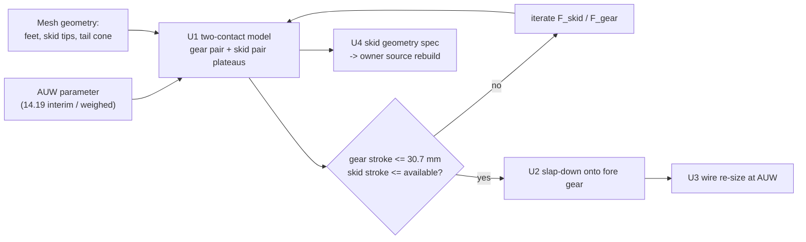

# Aft Gear + Tail Skid Co-Strike (4 ft Drop) - Plan

**AI note:** Planned by Claude Opus 5.5 (Anthropic) under the direction of Steve Griffing
(Stab-Rabbit-coding). Research was done in this conversation; no independent research or
review agents were dispatched.

> **ENGINEERING REVIEW REQUIRED.** Every figure here must be reviewed and accepted by a
> qualified engineer before it is applied to any system carrying risk to life or safety.

## Goal Capsule

- **Objective:** In the LG-17 4 ft drop at the tip-back attitude, the aft feet and the
  PA11 tail skids reach the ground **together**. The energy split between them is sized,
  the nose slap-down onto the fore gear is covered, and the gear wires are re-sized at the
  SLS AUW.
- **Authority:** Owner decisions, 2026-10-31 (KTD1–KTD4).
- **Open blockers:** none for U1–U3. U4 depends on the owner's Blender/OpenSCAD source
  rebuild of the one-piece aft part (plan 2026-10-31-001).

---

## Problem Frame

`docs/TAIL_STRIKE_AND_LG_SLS_MATERIALS.md` found three problems:

- **The skids lead by very little.** The tip-back angle is 25.6°, set by the skid tips
  (X ±37, Y 689.8). The hull (the ventral cross member) is only 6.5 mm off the ground at
  that point. *(Corrected during execution: this line first said the tail cone touched
  first. That vertex is a skid tip.)*
- **The gear is undersized.** It was designed for 13.0 lbm, below the as-built mass.
- **The skids have little stroke.** They hang only 3–7 mm below the hull.

A first two-contact plateau simulation, at the hull-only FDM-solid mass (14.68 lbm, later corrected to 15.09 lbm; see `docs/TAIL_STRIKE_AND_LG_SLS_MATERIALS.md` §6) with F_gear = 2 × 1,296 N, showed:

| Skid pair force | Gear pair energy | Gear stroke | Skid pair energy | Skid stroke | Nose slap-down |
| ---: | ---: | ---: | ---: | ---: | ---: |
| 0 N | 80.0 J | 30.9 mm | 0 J | 22.3 mm of tail descent | 1.6 J |
| 750 N | 66.6 J | 25.7 mm | 5.7 J | 7.7 mm | 8.8 J |
| 1,000 N | 65.1 J | 25.1 mm | 6.3 J | 6.3 mm | 9.8 J |

- **With no skid force, the tail descends 22 mm** while the gear strokes, so it strikes.
- **The gear is already at its 30.7 mm settle limit.**
- **A skid pair of about 750–1,000 N** relieves the gear by about 5 mm and fits the
  available stroke.

---

## Requirements

- **R1.** At tip-back, the aft feet and both skid tips shall be co-planar ground contacts,
  within ±1 mm. The tail cone shall clear the ground through the full skid stroke.
- **R2.** The skid pair shall absorb its share of the co-strike energy within the
  available stroke, and the hull skin shall not touch. Starting target: 700–1,000 N
  plateau, ≤7 mm stroke, about 6 J.
- **R3.** The aft gear stroke in the co-strike shall stay within the 30.7 mm settle limit,
  with the existing residual-clearance rule (`RESIDUAL_MIN`).
- **R4.** The nose slap-down energy (about 10 J) onto the fore gear shall be checked
  against the fore-leg schedule.
- **R5.** The gear wires (ductile and spring) shall be re-sized as a function of AUW. The
  interim value is **14.19 lbm** (SLS on the hull and both nacelles; first written as 14.09,
  which omitted the nacelles); the final value is the as-weighed AUW (LG-15).
- **R6.** The skids shall be PA11 Black [REF-MAT-012], printed as part of the separate
  ring and skid member (Option B).
- **R7.** No change to the pivot station, and no proportion change. Geometry is rebuilt
  from the owner's sources only.

---

## Key Technical Decisions

- **KTD1. The design case is the aft gear and the tail skids striking together.**
  *(session-settled: user-directed, chosen over skid-first strike sizing and TS-1
  skid-leads: owner 2026-10-31)* Governs R1–R4.
- **KTD2. SLS is the fabrication process; AUW stays a parameter until weighed.**
  *(session-settled: user-directed, chosen over enveloping at the FDM-solid mass: owner
  2026-10-31)* Governs R5.
- **KTD3. Ring and skids are PA11, printed separately (Option B); the skin is PA CF.**
  *(session-settled: user-approved, chosen over the one-piece PA CF part and over PA12)*
  Governs R6.
- **KTD4. The two-contact model is a planar rigid body with two constant-force (plateau)
  absorbers.** This extends the single-contact effective-mass method in
  `tools/landing_gear_r6_sizing.py` [REF-NCEES-009]. It needs no new dependencies, and
  matches the ductile-wire plateau already used. A linear-spring variant is deferred.

---

## High-Level Technical Design

---

## Implementation Units

### U1. Two-contact co-strike model

- **Goal:** Compute the energy split and the strokes for the aft-gear and skid pairs at
  tip-back, as a function of AUW, F_gear and F_skid.
- **Requirements:** R1–R3 (KTD1, KTD4).
- **Dependencies:** none.
- **Files:**
    - `tools/tail_strike_requirement.py`: add a co-strike section, reading the geometry
      from the meshes and the ledger.
    - `tools/test_tail_strike_requirement.py`: new.
- **Approach:**
    1. Time-step the planar rigid body: two plateau forces, gravity included, each
       contact releasing when its downward speed reaches zero.
    2. Report each absorber's energy and stroke, the tail-cone clearance, and the
       residual kinetic energy.
    3. Solve for the F_skid band that meets R2 and R3.
- **Patterns to follow:** `effective_mass_ratio()` and `two_point_case()` in
  `tools/landing_gear_r6_sizing.py`.
- **Test scenarios:**
    - **Energy closure:** absorbed energy plus residual kinetic and rotational energy
      equals m·g·(h + strokes), within 1%.
    - **Gear only (F_skid = 0):** with zero skid force the gear energy approaches the full
      kinetic energy, matching the single-contact method in the limit d1 → 0.
    - **Lever check:** with a very large F_skid, the skid stroke falls toward zero and the
      gear share falls.
    - **Mass scaling:** AUW ×1.1 raises the gear stroke monotonically.
    - **No-contact attitude:** an attitude below tip-back reports "no tail contact"
      instead of a negative stroke.
- **Verification:** reproduces the 750 N and 1,000 N rows of the Problem Frame table to
  ±5%.

### U2. Nose slap-down onto the fore gear

- **Goal:** Carry the residual rotation from U1 into a single contact on the fore pair.
  Check it against the fore-leg schedule.
- **Requirements:** R4.
- **Dependencies:** U1.
- **Files:** `tools/tail_strike_requirement.py`, `tools/test_tail_strike_requirement.py`.
- **Approach:** The rotational kinetic energy becomes impact energy at the fore feet
  (Y 259.2), through the effective mass about the aft-foot line. Compare it with the
  fore-leg energy capacity of the current wire schedule.
- **Test scenarios:**
    - **Zero rotation:** zero residual rotation gives zero slap-down energy.
    - **Hand case:** the about-10 J residual gives per-fore-leg energy below the
      tail-down 2-point schedule.
- **Verification:** prints the fore-leg energy margin, and fails if it is below 1.0.

### U3. Gear-wire re-size at an AUW parameter

- **Goal:** Make the wire schedule a function of AUW, run at 14.19 lbm, and record the
  diameters and margins.
- **Requirements:** R3, R5 (KTD2).
- **Dependencies:** U1, for the co-strike gear demand.
- **Files:**
    - `tools/landing_gear_r6_sizing.py`: `DESIGN_AUW_LBM`, read from an argument or
      constant, with 13.0 kept as the historical comparison.
    - `docs/LANDING_GEAR_ANALYSIS.md`: a 14.19 lbm addendum section.
    - `tools/test_landing_gear_r6_sizing.py`: new or extended.
- **Approach:** The demand per leg is the larger of the tail-down 2-point demand and the
  U1 co-strike gear-pair demand. Re-solve the ductile and spring wires. Re-run the
  thigh, bay-boss and bolt checks with the PA12-CF allowables
  (`docs/TAIL_STRIKE_AND_LG_SLS_MATERIALS.md` §3).
- **Test scenarios:**
    - **Regression:** at 13.0 lbm the tool reproduces today's Ø5.27 ductile and Ø4.00
      spring wires.
    - **Scaling:** at a mass above 13.0 lbm the wire diameters grow, roughly with AUW^(1/3).
    - **Material check:** a thigh margin below 1.0 is flagged.
- **Verification:** the addendum lists the wire diameters, F_leg and every structural
  margin at 14.19 lbm, marked interim pending LG-15.

### U4. Skid geometry specification for the source rebuild

- **Goal:** Turn R1 and R2 into a dimensioned skid-tip and stroke specification for the
  owner's Blender/OpenSCAD rebuild of the separate PA11 ring and skid member.
- **Requirements:** R1, R2, R6, R7 (KTD3).
- **Dependencies:** U1 for the F_skid band; plan 2026-10-31-001 for the source rebuild.
- **Files:**
    - `docs/TAIL_STRIKE_AND_LG_SLS_MATERIALS.md`: a co-strike section with the skid
      specification.
    - `docs/plans/2026-10-31-001-feat-one-piece-aft-sls-hull-plan.md`: cross-reference
      Option B.
    - `tools/tail_strike_requirement.py`: a mesh check of the rebuilt part.
- **Approach:**
    1. Specify the skid-tip contact point on the line from the aft feet at tip-back.
    2. Specify the skid section that gives the F_skid plateau over the stroke in PA11
       bending.
    3. Specify the tail-cone clearance.
    4. Once the rebuilt STL exists, the mesh check re-measures the co-planarity.
- **Test scenarios:**
    - **Rebuilt mesh:** feet and skid tips co-planar within ±1 mm.
    - **Tail cone:** above the ground through the full stroke.
    - **Current mesh:** the check reports the 0.6° tail-cone lead as a failure.
- **Verification:** the mesh check fails on today's STL and passes on the rebuild.

---

## Scope Boundaries

### Deferred to Follow-Up Work

- Final wire stock at the as-weighed AUW (LG-15).
- A linear-spring or rate-dependent PA11 skid model, and coupon testing.
- A crash test of the co-strike.

### Outside this plan

- Moving the pivot or changing the proportions (owner constraints).
- The fore-gear redesign, unless U2 fails.

---

## Risks

- **Too little skid stroke** (3–7 mm today) may force F_skid above the hull's local
  capacity. U4 resolves this in the rebuild.
- **PA11 plateau behaviour is assumed.** Nylon yields gradually rather than at a flat
  plateau. The coupons are deferred.
- **AUW drift.** Every number in U1–U3 scales with mass. KTD2 keeps it a parameter.

---

## Verification Contract

- U1–U3 tests pass. `ruff` is clean. The repo pre-commit gate passes.
- `tools/tail_strike_requirement.py` prints the co-strike, slap-down and wire tables at
  14.19 lbm.

## Definition of Done

U1–U4 are complete. The addendum and the skid specification are written. The mesh check
fails on today's STL with the reason stated. Every citation is in `REFERENCES.md`.
