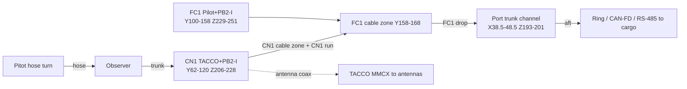

<!-- markdownlint-disable-next-line MD025 -->
# Bay A Forward Adoption - Plan

## Goal Capsule

**Objective.** Publish the "Bay A forward" layout as the airframe baseline.
CN1 (TACCO + PB2-I) moves under the nose Observer, FC1 (Pilot + PB2-I) rises
above the twin tray rail, and the twin pack tray moves forward to Y 163.

**Authority.** The owner adopted the option on 2026-11-01 (see origin, section
"Option: Bay A forward"). Repo `AGENTS.md`, then subsystem `AGENTS.md`, then
this plan. WBS/TODO never override AGENTS.

**Stop conditions.**

- A real-mesh gate fails and no shared-parameter fix exists. Report it; do not
  patch published STLs.
- The thermal budget (U4) shows a part over its rating with passive and active
  controls both applied. Report it as a blocker.

**Tail.** Standalone `ce-work`. Commit on
`claude/3d-print-material-scaling-66d85n`. Do not push.

---

## Product Contract

### Summary

Adopt Bay A forward. Generate the mounts, cable routes, and thermal routes
for both pouches. Publish the twin tray at Y 163. Update the specifications.
Track every open item in WBS.md, and regenerate TODO.md from it.

### Problem Frame

Plan 003 found little forward trim room. The Bay A forward option gives about
1.3–1.6 mm of CG forward. It passes both gates as an option only. The SCAD,
STLs, specifications, and WBS still describe the side-by-side Bay A and the
tray at Y 172.

### Requirements

#### Layout and parts

- R1. The head layout gate and the twin tray gate shall default to Bay A
  forward with the tray at Y 163. The published tray SCAD parameters and STLs
  shall match.
- R2. CN1 and FC1 shall each have a generated, bonded mount with retention
  and a PGND bond point. Each mount shall have a stated service-access path.

#### Routes

- R3. Every Bay A forward harness run shall be a gated envelope. The runs are
  Ethernet ring, CAN-FD, RS-485, 5 V feed, TACCO antenna coax, and the pitot
  hose. This includes the FC1 drop to the port trunk channel.
- R4. The CN1 bus-start termination stub shall be measured from the routed
  lengths. It shall be checked against the CAN-FD and RS-485 stub limits from
  the fitted transceivers' datasheets. Each limit is ASSUMED until it is cited
  in `REFERENCES.md`.

#### Thermal

- R5. Each enclosed node shall have a stated heat path and a temperature-rise
  estimate at average and peak dissipation. Passive control comes first.
  Active control is added only where the budget requires it.

#### Records

- R6. The specifications shall describe the published layout, mount points,
  cable routes, and thermal routes.
- R7. Every open item shall be in the owning WBS.md, with TODO.md regenerated
  from it.

### Scope Boundaries

- Out of scope: the other plan-003 relocations (Flight Engineer, Simon, aft
  nodes); airspeed sensor selection (the WBS §1.10 airspeed-sensor item owns
  it; this plan reserves its footprint only); hull re-cut.
- Kept, not deleted: `--bay-a side` stays selectable as the historical
  reference layout.

---

## Planning Contract

### Key Technical Decisions

- KTD1. Bay A forward becomes the default in both gate tools, and `side`
  becomes the reference mode. (session-settled: user-directed — chosen over
  keeping it an option: owner said "make it so", 2026-11-01.)
- KTD2. Mounts are bonded printed bridges with cam straps (`BATT-STRAP-CAM`),
  modelled on `airframe/openscad/fuselage/simon_node_saddle.scad`. Their
  stations are generated from `tools/head_layout_fit.py --write-scad`.
  Material order follows the owner's preference: printable composite first.
- KTD3. One route table in `tools/head_layout_fit.py` is the single source
  for harness envelopes. The twin tool imports it; no route is retyped.
- KTD4. The thermal budget is a lumped-resistance model. Every unsourced
  value is labelled ASSUMED. A PASS that rests on an assumption is reported
  as provisional.
- KTD6. The twin tray parameters are the only source for the battery rail and
  stop. `head_layout_fit.py` retires its single-cell rail, stop, sled, and
  catch from the published keys, and gates against the twin tray instead.
  `--bay-a side` is read-only: it never writes SCAD.
- KTD7. The head shell drops the side-by-side Bay A pockets. Re-cut it from
  `head_shell24.scad` and the merge pipeline, per the rebuild-from-source
  rule. If the pipeline cannot reproduce the published head (the known nose
  gap), stop and report it; do not patch the STL.
- KTD5. Thermal control tiers are cumulative: tier N adds its control to
  tiers 1 to N−1.
    1. A conductive pad from the pouch to the mount.
    2. The mount to the skin.
    3. Vent slots to the bow sensor bay.
    4. A thermostatic 5 V fan.

### High-Level Technical Design

Heat path (KTD5): node → pouch → pad → mount → skin → air. Vent slots (tier
3) add a parallel convection path; the fan is tier 4.

### Assumptions

- Design ambient is 40 °C (104 °F). This is ASSUMED. The owner confirms it
  through the open item in U4.
- Dissipation is CN1 3 W average / 8.3 W peak and FC1 1.25 W
  (`docs/AVIONICS_PB2_REDESIGN.md` §Power).
- PB2-I −40…85 °C is a module rating, not an owner requirement.

### Sequencing

U1 → U2 → U3 → U4 → U5 → U6. U2 and U3 depend on U1's published stations. U5
records the outputs of U1–U4; U6 records U1–U5.

---

## Implementation Units

### U1. Publish Bay A forward and tray Y 163

**Goal:** Make Bay A forward and the Y 163 tray the published defaults.
**Requirements:** R1; KTD1, KTD6, KTD7.
**Dependencies:** none.
**Files:**

- `tools/head_layout_fit.py`
- `tools/twin_head_pack_fit.py`
- `airframe/openscad/fuselage/twin_pack_tray_params.scad`
- `airframe/openscad/fuselage/head_layout_params.scad`
- `airframe/stls/fuselage/head/twin_pack_{tray,sled,gate}.stl`
- `airframe/openscad/fuselage/head_shell24.scad`,
  `airframe/openscad/fuselage/bow_sensor_pod.scad`
- the published head and merged head+cargo shell STLs

**Approach:**

1. Flip the defaults.
2. Make `TRAY_Y0` 163.
3. Let `--write-scad` publish the fwd stations, and add the CN1/FC1 keys.
4. Make `--bay-a side` read-only in both tools (KTD6).
5. Retire the single-cell rail keys from the head params (KTD6).
6. Remove the side Bay A pockets and re-cut the head shell (KTD7).
7. Regenerate the params, then render the three tray STLs from
   `twin_pack_tray.scad`.

**Test scenarios:**

- The head gate passes in both modes.
- The twin gate passes in both modes.
- The params file reads `TRAY_Y0 = 163`.
- All three STLs are watertight.
- A `--bay-a side` run of either tool leaves both params files unchanged.
- The head and twin params agree on the rail and stop stations.
- The re-cut head shell is watertight, and both gates pass on it.

**Verification:** all gates PASS; the STLs are regenerated and watertight.

### U2. Harness routes and FC1 drop

**Goal:** Gate every Bay A forward run, including the FC1 drop to the port
channel.
**Requirements:** R3, R4; KTD3.
**Dependencies:** U1.
**Files:** `tools/head_layout_fit.py`, `tools/twin_head_pack_fit.py`,
`tools/tests/test_bay_a_fwd_routes.py`.
**Approach:**

1. Add a route table: name, from, to, section, minimum bend radius, and
   length.
2. Add the FC1 drop envelope to the port channel.
3. Add a TACCO MMCX coax keep-out.
4. Report the routed length of the CN1 termination stub.

**Test scenarios:**

- Each route clears the shell and every non-mate envelope.
- The FC1 drop meets the port channel with no gap.
- The stub length is printed and compared with each R4 limit. An over-limit
  stub fails with its name.
- A route with an unknown endpoint raises an error.

**Verification:** both gates PASS with the routes; the test passes.

### U3. CN1 and FC1 mounts

**Goal:** Generated bonded mounts with retention, a PGND bond point, and a
service path.
**Requirements:** R2; KTD2.
**Dependencies:** U1, U2.
**Files:**

- `airframe/openscad/fuselage/bay_a_fwd_mounts.scad`
- `airframe/stls/fuselage/head/bay_a_cn1_cradle.stl`
- `airframe/stls/fuselage/head/bay_a_fc1_shelf.stl`
- `tools/head_layout_fit.py`

**Approach:**

1. The CN1 cradle bridges the head skin below CN1.
2. The FC1 shelf bridges above the tray rail, clear of the CN1 run.
3. Each mount has strap slots and an M2.5 PGND lug.
4. Write the service path into the SCAD header.
5. Gate the mounts as skin-seat parts.

**Test scenarios:**

- Each mount clears every envelope.
- Each mount's skin seat is at or under `SEAT_MAX`.
- Strap slots do not cut the route envelopes.
- The CN1 removal sweep clears once FC1 is out.
- Each mount's SCAD header states its service-access path.

**Verification:** the gate PASSES; the STLs are watertight; both service
paths are stated.

### U4. Thermal budget and controls

**Goal:** Heat paths, temperature rise, and a passive/active control plan.
**Requirements:** R5; KTD4, KTD5.
**Dependencies:** U3.
**Files:** `tools/bay_a_thermal_budget.py`,
`tools/tests/test_bay_a_thermal_budget.py`, `docs/BAY_A_FWD_THERMAL.md`.
**Approach:**

1. Build a resistance network from node to pouch, pad, mount, skin, and air.
2. Compute the rise at average and peak for each control tier in KTD5.
3. Adopt the lowest cumulative tier that passes.
4. Specify vent slots only at tier 3 or above, and the fan only at tier 4.
5. Open item: the owner confirms the 40 °C design ambient. Record it in the
   thermal doc and the owning WBS.md.

**Test scenarios:**

- A known network reproduces a hand calculation.
- An ASSUMED input marks the result provisional.
- Over-rating at every tier gives FAIL.
- Zero power gives zero rise.

**Verification:** the test passes; the doc states the tier and its margins.

### U5. Specifications

**Goal:** Specifications describe the published layout, mounts, and routes.
**Requirements:** R6.
**Dependencies:** U1–U4.
**Files:**

- `docs/BAY_A_FWD_LAYOUT.md` (new)
- `docs/BAY_A_FWD_THERMAL.md` (from U4; cited, not restated)
- `docs/AVIONICS_PB2_REDESIGN.md`
- `docs/CG_RELOCATION_STUDY.md`
- `docs/BATTERY_TRIM_ENDURANCE_OPTIONS.md`
- `docs/POWER_DISTRIBUTION.md`
- `REFERENCES.md`

**Approach:** The new spec carries the mount and route tables from tool
output. It cites `docs/BAY_A_FWD_THERMAL.md` for the thermal routes. The
other docs cite the new spec.
**Test expectation:** none -- documentation. markdownlint must be clean on
new text.
**Verification:** no stale station "Y 172" or "on edge" Bay A text remains
in these specifications.

### U6. WBS and TODO

**Goal:** Every open item is in the owning WBS, and TODO.md is regenerated.
**Requirements:** R7.
**Dependencies:** U1–U5.
**Files:** `airframe/fuselage-mid/WBS.md`, `avionics/WBS.md`, `WBS.md`, and
the generated `TODO.md` files.
**Approach:**

1. Put mounts, tray, retention, and service access under fuselage-mid.
2. Put termination, airspeed footprint, antenna coax, and thermal under
   avionics §1.10.
3. Add one-line index entries in the root WBS.md.
4. Run `tools/gen_todo_from_wbs.py`.

**Test expectation:** none -- generated records; `--check` shows no drift.
**Verification:** `gen_todo_from_wbs.py --check` is clean.

---

## Verification Contract

- `/usr/bin/python3 tools/head_layout_fit.py` and `--bay-a side`: PASS.
- `/usr/bin/python3 tools/twin_head_pack_fit.py` and `--bay-a side`: PASS.
- `/usr/bin/python3 -m pytest tools/tests/test_bay_a_fwd_routes.py
  tools/tests/test_bay_a_thermal_budget.py`: pass.
- `flake8` (CI config), mypy: clean on changed Python.
- markdownlint: clean on new or changed text.
- STLs: watertight (trimesh `is_watertight`).
- `tools/gen_todo_from_wbs.py --check`: no drift.

## Definition of Done

- R1–R7 are met, or each gap is recorded as a blocker in WBS.md.
- The gates pass on real meshes, and no published STL is hand-patched.
- No probe or dead-end code is left in the diff.
