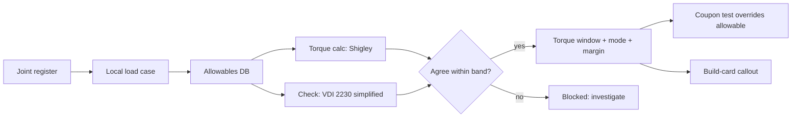
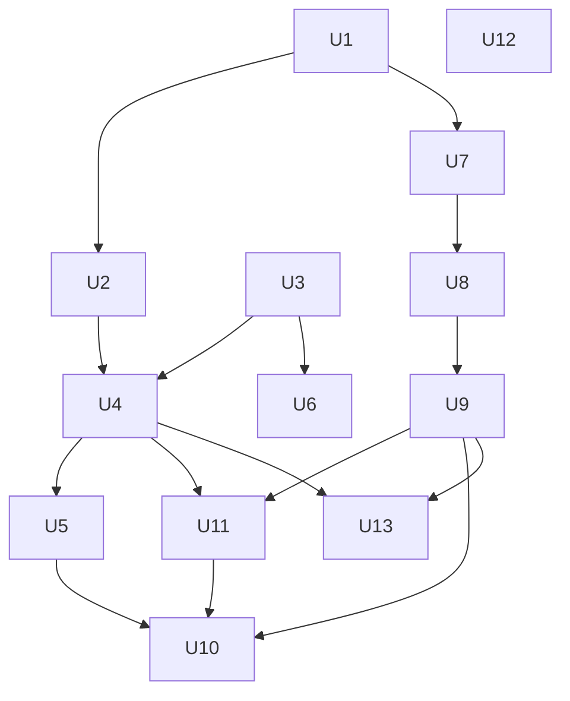

# feat: Sourced joint torque specs and optimized install sequence for the graphical build guide

Written for: the project owner (S. Griffing, PE) and the agents that will execute it.
Authors: Steve Griffing, PE(CSE) (direction); Claude Sonnet 5.5 (Anthropic) drafted 2026-11-02.
License: CC BY-SA 4.0 (SPDX-License-Identifier: CC-BY-SA-4.0).

> **Engineering review required.** Every torque, preload and margin this plan produces is a design value
> that a qualified engineer shall review and accept before the aircraft flies. The tools compute; the owner
> signs. No torque value is entered in a build card without a computed derivation, a named failure mode and a
> cited allowable.

## Summary

The build guide must tell a builder, for every joint, *which fastener, in what order, tightened to what
torque*, and for every wire, *before or after which part*. Neither exists today: the repo has no joint
register, no allowables table and no torque calculator, and the card sequence was never optimized. This plan
creates (A) a repeatable, cited procedure and a tool that derives a torque window per joint from the joint's
local load and its materials, (B) an iterative, search-based optimizer for the install and harness sequence
that feeds the cards, and (C) card renders that use real KiCad board STEP models. Nothing is invented: a joint
whose load or allowable is unknown is marked "requires verification" and blocks its card from release.

## Problem Frame

- The BOM lists fasteners (M2.5/M3 brass heat-set inserts, M3 button heads, dowels, circlips) but no torque
  (`current-specification/bom_revT.csv`). `grep` finds no torque code in `tools/`.
- The aircraft joins printed polymer (PETG, CF-PETG, SLS PA12-CF / PA CF) to brass inserts, aluminum plates and
  steel pins. These are not isotropic metal joints: layer direction, creep and insert pull-out govern, so a
  catalog bolt torque (which assumes steel-in-steel) is wrong and could crack a part or leave a joint loose.
- Wire order is a constraint-satisfaction problem (access, bend radius, connector mating before enclosure
  closes, permanent collar bond, wing attach). A hand-written order was never checked.
- The hull is two permanently bonded sections (head+cargo, middle+rear); everything inside them is installed
  before the collar bond, which is irreversible. A wrong order cannot be repaired.

## Requirements

- **R1** Every fastened joint has a register entry (ID, fasteners, mating materials, print orientation, load
  source) and every build-card fastener step cites a joint ID.
- **R2** Each joint's torque window is derived by one documented procedure (T1–T9 below), with the governing
  failure mode named, the factor of safety and its origin stated, and every allowable cited to a REF-ID.
- **R3** An unknown load or allowable is flagged, never defaulted; flagged joints block card release.
- **R4** Torque derivations are independently cross-checked (second method) and the cross-check is a gate.
- **R5** Printed-polymer joints are validated by coupon test before flight; test data replaces the calculated
  allowable.
- **R6** The install and harness sequence is chosen by a metric-driven search over a precedence-constrained
  model, with hard gates (no precedence violation, no blind connector mate, bend radius, access) and a
  recorded history of every experiment.
- **R7** Cards show side (port/starboard), order, wire, connector, fastener and torque from the register and
  optimizer output, not from hand-typed text.
- **R8** Renders use KiCad-exported STEP models for the PCBs (kicad-cli 9.0.2), not placeholder boxes.
- **R9** The method is captured as a reusable learning after the first joints are worked (`ce-compound`).

## Scope Boundaries

- Not in scope: redesigning joints; changing materials; sizing structure (existing structural docs remain the
  source of member loads).
- Deferred to follow-up: flight-test-derived loads; torque for avionics board mounts beyond the register's first
  pass; a printed torque-wrench jig.
- Outside this plan: the Operator's Manual (it carries no construction detail — OM-10).

## Key Technical Decisions

- **KTD1 — One calculator, two independent methods.** Primary method is the Shigley short-form
  (`T = K·F_i·d`, preload as a fraction of the limiting capacity, joint-stiffness load sharing). The check method
  is the VDI 2230 simplified systematic calculation. Disagreement beyond a stated band blocks the joint.
  Rationale: a single method hides modeling errors; the repo has no precedent for torque, so two methods that
  fail differently are the cheapest independent check. *(Both standards: REQUIRES VERIFICATION, U3.)*
- **KTD2 — Weakest-link preload.** Target preload is the minimum of: bolt proof capacity, insert/thread
  pull-out, printed-material bearing (crush under head/washer), and creep-limited clamp load; the torque window
  is bounded below by the preload needed to prevent separation/slip under the local load with scatter. This
  follows the project rule "name the failure mode" (mechanical-engineering skill).
- **KTD3 — Material preference order governs allowable selection.** Printable composite, then laid-up CF/Kevlar,
  then aluminum, brass, spring steel, stainless; the first material with a *cited* allowable wins (owner
  rule 2026-10-26). A PA12-CF Z-axis allowable is open (3D Systems query), so those joints stay "requires
  verification" until coupon data exists.
- **KTD4 — Polymer joints are torque-then-retorque.** Creep relaxes clamp load; the spec carries a retorque
  interval and a thread-locker/adhesive choice, not just a number.
- **KTD5 — Sequence is searched, not hand-written.** A freerouting-style rip-up-and-reinsert local search over
  topological orders, run under `ce-optimize` with a hard-metric spec and serial first run (owner direction).
- **KTD6 — Board models come from KiCad.** `kicad-cli pcb export step` per board; stock and project 3D models
  (`avionics/kicad/Serenity-Custom.3dshapes/`, `docs/references/PocketBeagle.step`) fill the assemblies.

## High-Level Technical Design

### Torque calculation procedure (repeatable, per joint)

| Step | Action | Output | Source class |
| --- | --- | --- | --- |
| T1 | Identify joint: members, materials, thickness, print orientation, fastener, insert, washer, thread engagement | Register entry | CAD + BOM |
| T2 | Establish **local load**: external tension and shear per fastener from the governing load case (limit and ultimate), moment arms, thrust (4 × 2,370 gf), V-n load factor, landing, tilt-drive torque | F_t, F_s per fastener, case name | Existing analyses; `aeronautical-engineering` loads reference; cited |
| T3 | Apply stated factor of safety (origin recorded) | Design loads | Project criteria record |
| T4 | Joint stiffness: bolt vs clamped members (polymer modulus, knockdown for temperature/creep); load-sharing factor | Φ (load fraction to bolt), clamp stiffness | Shigley ch. 8; VDI 2230 |
| T5 | Required **minimum preload**: no separation, no slip (friction × clamp ≥ shear), fatigue amplitude if cyclic | F_i,min | Calculation |
| T6 | **Maximum preload** = min(bolt proof, insert pull-out, thread strip, bearing crush under head, creep-limited) with the governing mode named | F_i,max, mode | Cited allowables (U3) |
| T7 | Torque window `T = K·F_i·d` with nut factor K by finish/lubrication (range, cited); add scatter | T_min, T_max, K used | Shigley; supplier data |
| T8 | Margin and decision: window non-empty? margin named against its failure mode; if empty, **joint redesign flag** | Pass / flag | Calculation |
| T9 | Spec text: value in in·lbf (N·m), tolerance, tightening pattern, retorque interval, locker/adhesive, inspection mark | Card callout + record | Register |

### Sequence optimization (freerouting-style)

State: an ordered list of install steps (parts, wires, fasteners, cures). Hard constraints form a precedence
graph (structural: inside-before-closure, collar bond, wing attach; access: part X blocks reach to Y;
connector: mate before enclosure closes; cure time). Search: start from a feasible topological order, then
repeatedly **rip up** a contiguous block or one wire's steps and **reinsert** at the best feasible position;
accept by simulated-annealing rule; restart from the best on a plateau. Cost (minimize): re-orientations of the
airframe, hand/tool access score from swept-volume checks against already-installed solids, idle cure time,
number of blind connector mates, harness length slack violations. Hard gates (reject): any precedence
violation, bend radius below the cable minimum, a connector mated after its enclosure closes.

## Implementation Units

### U1. Joint register and card-coverage gate

**Goal:** One authoritative list of joints; every card fastener step points at one.
**Requirements:** R1, R3.
**Dependencies:** none.
**Files:** `current-specification/joint_register.json`, `tools/joint_register.py`,
`tools/check_joint_register.py`, `tools/tests/test_joint_register.py`.
**Approach:**
- Seed from BOM hardware rows (inserts, button heads, dowels, circlips, ball studs, M2 brass) and the 27 card
  specs in `tools/gen_build_guide_cards.py`.
- Record per joint: members, material pair, print orientation, thread/insert, washer, engagement, load-case ref.
- Gate fails when a card names a fastener with no joint ID or a joint has no card.
**Patterns to follow:** `current-specification/auw_ledger.json` + `tools/auw_ledger.py` (generated data with a
checker); `tools/check_datum_drift.py` (pre-commit gate shape).
**Test scenarios:**
- Happy path: seeded register loads; every BOM fastener maps to ≥ 1 joint.
- Edge case: a joint with two fastener types validates and reports both.
- Error path: a card fastener with no joint ID makes the gate exit 1 and name the card.
- Integration: adding a BOM fastener row without a joint entry fails the checker.
**Verification:** checker exits 0 on the committed tree; a deliberately orphaned fastener fails it.

### U2. Local load-case ingestion

**Goal:** Per-joint external loads with provenance.
**Requirements:** R2, R3.
**Dependencies:** U1.
**Files:** `current-specification/joint_loads.json`, `tools/joint_loads.py`, `tools/tests/test_joint_loads.py`.
**Approach:**
- Import member loads from existing analyses (`docs/structural_analysis.md`, `docs/WING_ATTACH_INTERFACE.md`,
  `docs/LANDING_GEAR_ANALYSIS.md`, `docs/LG_BELLCRANK_LOAD_PATH_STUDY.md`, `docs/CARGO_WINCH_SPECIFICATION.md`,
  `docs/TILT_DRIVE_CONTROL_SPEC.md`) and the envelope (`current-specification/flight_limits.json`: 4 × 2,370 gf,
  load factors from the V-n build-up).
- Each load carries case, magnitude (lbf (N)), direction, static/cyclic, source file:section, and a factor of safety
  with its origin.
- A joint with no sourced load is `unknown` and propagates as a blocker.
**Patterns to follow:** `tools/flight_envelope_endurance.py` (every input cited or labeled ASSUMED).
**Test scenarios:**
- Happy path: a wing-root bolt load equals the cited reaction divided by bolt count.
- Edge case: a cyclic load without a cycle count is flagged incomplete.
- Error path: a missing source yields `unknown`, never zero.
**Verification:** every register joint has a load or an explicit `unknown` with an owner action.

### U3. Allowables database and standards catalogue

**Goal:** Cited material and fastener allowables, including printed-polymer knockdowns.
**Requirements:** R2, R3, R5.
**Dependencies:** none.
**Files:** `current-specification/allowables.json`, `tools/allowables.py`, `REFERENCES.md`,
`tools/tests/test_allowables.py`.
**Approach:**
- Add catalogue entries (each marked REQUIRES VERIFICATION until the issuing body's document is checked, with a
  `TODO.md` §0.x item per project rule): VDI 2230 (systematic bolted-joint calculation), ISO 898-1 (fastener
  mechanical properties), NASA-STD-5020 (threaded fastening, spaceflight hardware — scope limitation stated, as
  for NASA-STD-5001), FAA AC 43.13-1B hardware chapter (general torque practice), insert and filament/SLS vendor
  data, and the existing Shigley entry (`REF-STD-GEAR-002`) extended to its bolted-joint chapter.
- Material records: PETG, CF-PETG, SLS PA12-CF (Z allowable open — 3D Systems query), brass insert pull-out,
  aluminum plate, steel/stainless pins; each property with REF-ID, orientation, temperature/creep knockdown.
- Material preference order and "first cited allowable wins" encoded as the selector.
**Patterns to follow:** `REFERENCES.md` entry shape; `docs/TAIL_STRIKE_AND_LG_SLS_MATERIALS.md` allowable handling.
**Test scenarios:**
- Happy path: selector returns the highest-preference material that has a cited allowable.
- Edge case: PA12-CF Z returns `requires verification`, not a number.
- Error path: an allowable with no REF-ID fails schema validation.
**Verification:** zero allowables without a REF-ID; open items are listed.

### U4. Torque calculator (primary method)

**Goal:** Implement T1–T9.
**Requirements:** R2, R3.
**Dependencies:** U1, U2, U3.
**Files:** `tools/joint_torque.py`, `current-specification/joint_torque_specs.json`,
`tools/tests/test_joint_torque.py`.
**Approach:**
- Functions per step; weakest-link preload with the governing mode returned by name; K as a cited range.
- Output a window, margin, mode, retorque interval and the full input echo (units lbf/in·lbf with SI).
- Refuse to emit a number when any input is `unknown`.
**Execution note:** Prove with closed-form hand-check fixtures before wiring to real joints.
**Test scenarios:**
- Happy path: a steel M3 screw into a steel plate matches the closed-form `T = K·F·d`.
- Edge case: insert pull-out limits below bolt proof → mode reported as pull-out.
- Edge case: empty window → joint flagged for redesign, no torque emitted.
- Error path: unknown load → no output and a named blocker.
- Integration: results regenerate deterministically from the register.
**Verification:** tests pass; the committed specs file matches regeneration.

### U5. Cross-check method and agreement gate

**Goal:** Independent second calculation and a gate on disagreement.
**Requirements:** R4.
**Dependencies:** U4.
**Files:** `tools/joint_torque_check.py`, `tools/check_joint_specs.py`, `tools/tests/test_joint_torque_check.py`.
**Approach:** VDI 2230 simplified preload and load-factor calculation; compare windows; band stated in the spec;
wire the checker into `.githooks/pre-commit` and `.github/workflows/ci.yml` beside the datum and manual gates.
**Test scenarios:**
- Happy path: both methods agree within the band on the fixture joints.
- Error path: a perturbed K makes the gate fail and name the joint.
**Verification:** gate exits 0 on the tree; flips to 1 on a seeded disagreement.

### U6. Coupon test protocol and result ingestion

**Goal:** Physical validation of printed-polymer joints.
**Requirements:** R5.
**Dependencies:** U3.
**Files:** `docs/JOINT_COUPON_TEST_PROTOCOL.md`, `current-specification/coupon_results.json`,
`tools/ingest_coupon_results.py`, `tools/tests/test_ingest_coupon_results.py`.
**Approach:** torque-to-strip, insert pull-out and clamp-load relaxation coupons per material and orientation;
results override the calculated allowable and tighten the knockdown; owner prints and tests (no lab assumed).
**Test scenarios:**
- Happy path: a result record replaces the allowable and updates dependent specs.
- Error path: a record with no specimen/orientation is rejected.
**Verification:** allowables used in flight joints carry a coupon or vendor citation.

### U7. Assembly precedence model

**Goal:** Machine-readable steps, constraints and geometry for the sequence search.
**Requirements:** R6, R7.
**Dependencies:** U1.
**Files:** `current-specification/assembly_steps.json`, `tools/assembly_model.py`,
`tools/tests/test_assembly_model.py`.
**Approach:** nodes = parts, fasteners, wires, cures; edges from structure (collar bond encloses interiors),
access (swept-volume check of hand/tool cone against already-installed meshes via trimesh, as in the existing
integrity checks), connectors, cure times; geometry from the placed STLs in the hull frame.
**Patterns to follow:** `tools/assembly_integrity_check.py`; hull-frame placement conventions.
**Test scenarios:**
- Happy path: the model reports a feasible topological order.
- Edge case: closing the hull before a wired part is installed is infeasible.
- Error path: a cyclic precedence is rejected with the cycle named.

### U8. Harness register

**Goal:** Every wire with gauge, color, length, route, connectors and bend radius.
**Requirements:** R6, R7.
**Dependencies:** U7.
**Files:** `current-specification/harness_register.json`, `tools/harness_register.py`,
`tools/tests/test_harness_register.py`.
**Approach:** nets from the KiCad netlists, gauges from `docs/POWER_DISTRIBUTION.md`, routes and lengths from CAD
paths (pattern: `tools/lg_wire_layout_study.py`), minimum bend radii cited from the wire/cable data; unknowns flagged.
**Test scenarios:**
- Happy path: each power net maps to a gauge and a fuse.
- Error path: a wire with no route is flagged unrouted.

### U9. Sequence optimizer under `ce-optimize`

**Goal:** Best feasible install and harness order.
**Requirements:** R6.
**Dependencies:** U7, U8.
**Files:** `tools/sequence_optimizer.py`, `tools/sequence_cost.py`, `.context/compound-engineering/ce-optimize/build-sequence/spec.yaml`
(scratch), `tools/tests/test_sequence_optimizer.py`.
**Approach:**
- Hard metric spec: minimize the cost in the design section; degenerate gates = precedence, bend radius, blind
  mate counts; serial mode, 4 iterations, 1 hour for the first run, per the skill's quick-start guidance.
- Hypotheses: rip-up-and-reinsert block size, wire-first vs structure-first, annealing schedule, access-weight tuning.
- Output: ordered steps with the reason each step precedes its neighbor (feeds BG-SEQ-3).
**Execution note:** Baseline first (a hand-ordered feasible sequence), then improve; the baseline is the control.
**Test scenarios:**
- Happy path: the optimizer returns a feasible order whose cost is ≤ the baseline.
- Edge case: a plateau triggers restart from the best.
- Error path: an infeasible model returns the violated constraint, not an order.
**Verification:** log on disk shows baseline and every experiment; the best sequence passes all gates.

### U10. Fleet audit rotation over the output

**Goal:** Audit sequence, torque specs and cards along rotating dimensions, not repetitions.
**Requirements:** R2, R4, R6, R7.
**Dependencies:** U5, U9, U11.
**Files:** `.superpowers/sdd/audit/<round>-<dimension>.md` (scratch), a disposition ledger beside the plan.
**Approach:** per the `fleet-audit-loop` shape: dimensions = (1) precedence conformance, (2) wire/connector access,
(3) torque derivation coherence (spec vs register vs card), (4) coverage gaps (joints/wires with no step),
(5) card economy, (6) regression of earlier fixes. The house roster agents are not registered in this harness, so
the nearest available agent types substitute and each substitution is recorded; the loop's "dimensions exhausted"
terminal state, not a clean round, ends it.

### U11. Card generator integration

**Goal:** Cards render side, order, wire, connector, fastener and torque from data.
**Requirements:** R7.
**Dependencies:** U4, U9.
**Files:** `tools/gen_build_guide_cards.py`, `graphical-build-guide/build_guide_*.svg`,
`tools/tests/test_gen_build_guide_cards.py`.
**Approach:** new per-step schema (BG-SEQ-1); torque callouts auto-filled from `joint_torque_specs.json`; a step with a
`requires verification` joint renders a visible hold marker instead of a number; hull steps rewritten for the two
merged sections and one collar bond (BG-SEQ-5).
**Test scenarios:**
- Happy path: a card renders its torque with units and source ID.
- Error path: a blocked joint renders "HOLD — torque not released", never a blank.

### U12. KiCad board STEP export and render integration

**Goal:** PCBs in the card renders are the real boards.
**Requirements:** R8.
**Dependencies:** none.
**Files:** `tools/export_pcb_step.py`, `avionics/kicad/<Board>/step/<Board>.step`,
`tools/export_assembly_meshes.py`, `airframe/blender-scripts/build_guide_card_renders.py`,
`tools/tests/test_export_pcb_step.py`.
**Approach:**
- No board-level STEP files exist today (only footprint models in `avionics/kicad/Serenity-Custom.3dshapes/`,
  `docs/references/PocketBeagle.step`, `docs/references/vimdrones_esc_s50_v1.0.step`). Generate each board's STEP with
  `kicad-cli pcb export step` (installed 9.0.2); the kicad-cli version must be ≥ the file's generator version.
- Substitute project/stock 3D models for any footprint lacking one; log the gaps.
- Import the STEP into the FreeCAD mesh export, then Blender; place each board with the cape stack/standoff data from the
  per-board `.md` files.
- Known hazards: the Pilot `sch erc` segfault (separate from `pcb export step`, but verify); `freecadcmd` run from a
  worktree executes main-tree paths (use `-c exec` with `__file__`).
**Test scenarios:**
- Happy path: each first-flight board exports a non-empty STEP with its connectors present.
- Edge case: a footprint with no 3D model is listed, and the board still exports.
- Error path: a board file newer than kicad-cli's version fails with a clear message.
**Verification:** card renders show true board outlines and component heights.

### U13. Capture the method as a learning

**Goal:** `ce-compound` after the first joints and first optimizer run are done.
**Requirements:** R9.
**Dependencies:** U4, U5, U9.
**Files:** `docs/solutions/` (new learning under the category the skill selects).
**Approach:** document the torque procedure and the sequence-search pattern as institutional knowledge, grounded in
verified results, with the open standards items listed.

## Dependencies and Sequencing

Start with U1, U3 and U12 (independent). Pilot slice first: wing root, one landing-gear bay, the nacelle trunnion and
one avionics tray, so the method is proven on four dissimilar joint families before the register is completed.

## Risks and Dependencies

- **Unknown allowables** (PA12-CF Z, CF-PETG bearing, insert pull-out in printed polymer): blocks release of dependent
  cards; mitigated by U6 coupons and vendor queries.
- **Standards unverified** (VDI 2230, ISO 898-1, NASA-STD-5020, AC 43.13-1B): each is REQUIRES VERIFICATION until the
  issuing body's text is checked; paywalled standards may need owner-supplied copies.
- **Load provenance gaps:** several analyses are stale after the 2026-11-02 thrust/tilt correction; U2 re-derives from
  `flight_limits.json` and flags what it cannot.
- **Optimizer realism:** the access model is only as good as the placed meshes; known open mesh defects (spar bore, cargo
  reopen) may make the access check conservative or wrong; the sequence is advice until a physical dry-fit.
- **Owner decisions needed:** torque tolerance bands, the safety-factor set (origin to be recorded), whether to buy a
  torque screwdriver in the required range, and who runs the coupons.

## Deferred to Implementation

- Exact K ranges for brass-in-PETG and brass-in-SLS threads (depends on supplier data and coupons).
- Whether a hull-frame swept-volume check or a coarse reach cone suffices for access scoring.
- Final cost-function weights (tuned by the first `ce-optimize` run).

## Verification Contract

- Gates added to the commit chain: `check_joint_register.py`, `check_joint_specs.py`, sequence feasibility check.
- A card cannot release with an `unknown` joint; the generator renders a hold marker.
- Definition of done for the first slice: four joint families have derived, cross-checked, cited torque windows and a card
  that shows them; one optimized sequence with a full experiment log; real board STEP in at least three renders.
