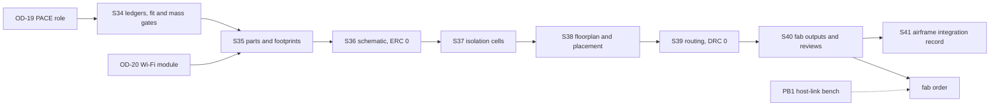

# NoNFO-Pilot-PB2 Stern Control Stack - Plan

**Author:** Steve Griffing, PE(CSE), CISSP-ISSEP, CPP (owner; every product decision below is his). Plan drafted by Claude (Anthropic) under the author's direction, using the `project-overseer` (governed mode) and `ce-plan` skills. `ce-setup` is owner-invoked only and was not run by the agent.
**License:** CC BY-SA 4.0 — see LICENSES/CC-BY-SA-4.0 (SPDX-License-Identifier: CC-BY-SA-4.0)
**Target repos:** design files and board tracking in `SecureControllers` (paths prefixed `SecureControllers:`); airframe integration, ledgers and the Rev U sprint record in `Serenity-UAV` (unprefixed paths).

---

## Goal Capsule

- **Objective.** Take NoNFO-Pilot-PB2 from ideation to fab-ready: ERC 0, DRC 0, schematic parity 0, unconnected 0, Gerbers generated, on KiCad 9.0.2. It becomes the stern (Simon) control stack of Serenity Rev U.
- **Product authority.** Owner (Stab-Rabbit-coding). Sprint order is a recommendation; each owner-decision gate needs the owner's word.
- **Mode.** Governed. This plan creates no second task list. Board items live in `SecureControllers:TODO.md` §5; airframe items live in `avionics/WBS.md` §1.11; sprints S34 to S41 are indexed in Theme A of `docs/plans/2026-11-07-001-feat-rev-u-completion-execution-plan.md`.
- **Owner decisions in force (2026-11-14):** architecture B+; BBE-Black outline; mass minimised, not floored.
- **Stop conditions.** A sprint does not start if its owner decision is open. A fit or mass gate that still fails after the one pre-authorised re-run without GNSS stops layout and goes to the owner as an Owner Decision Brief (`docs/DOC_TEMPLATES.md`).
- **Out of scope.** The BBE-hosted variant. Firmware (Theme F). Any change to the three full stacks.

---

## Product Contract

### Summary

One board carries the Pilot and TACCO functions on one PocketBeagle 2 Industrial (PB2-I) at the stern. Shepherd, Inara and River stay full stacks: Pilot cape + PB2-I + TACCO cape + PB2-I. The fleet goes from eight compute nodes to seven. The purpose is weight reduction at the longest aft arm, moving the CG forward.

### Problem Frame

The 2026-10-31 forward-trim work showed the CG cannot close by relocation alone at 24 in (610 mm). The stern stack sits at Y 494.7, the longest avionics arm, so mass removed there buys the most trim. The ledger credits the merged stack with −0.128 lbm (−58 g) and about 0.055 in (1.4 mm) of CG (`tools/min_stretch_relocation.py`, `docs/ideation/2026-10-31-forward-trim-relocation-ideation.md` row 4). That credit assumed a merged board as light as Pilot; the first estimate here is under half of it (see Risks).

Two facts make the board hard:

- TACCO alone fills the PB2-I header. The merged net set does not fit unless a second processor takes the buses (`SecureControllers:kicad/NoNFO-Pilot/PB2/ARCHITECTURE_BRIEF.md`).
- Pilot and TACCO both stalled in routing at 2.165 × 1.378 in (55 × 35 mm), with the isolation band walling off rail pins.

### Key Decisions

- **KD1. Three full stacks plus one merged stack, at the stern.** (session-settled: user-directed, 2026-11-12 — chosen over the 2026-10-26 mass-diet KD3 of two merged plus two full, and over the 2026-10-26 "held fork" status: weight off the longest arm with three full stacks kept.) Grounded in `docs/plans/2026-10-31-003-feat-forward-trim-room-relocation-plan.md` R3. Governs R1, R2.
- **KD2. Host is the PB2-I; the BBE variant waits.** (session-settled: user-directed, 2026-11-12.) Governs R3.
- **KD3. Outline is the specification outline, 3.402 × 2.098 in (86.4 × 53.3 mm), gated first.** (session-settled: user-approved, 2026-11-12 — chosen over a custom outline fitted to the present Simon envelope, and over 55 × 35 mm: keeps mounts and harness positions common with the BBE variant.) Governs R4, R5.
- **KD4. Ethernet follows the Pilot pattern.** DP83825I on RMII2 plus the AX88772E USB NIC, bridged in Linux. (session-settled: user-approved, 2026-11-12 — chosen over a 3-port switch on RMII2: same parts and software as the other three stacks.) Governs R9.
- **KD5. GNSS receiver on the cape, first overboard.** (session-settled: user-directed, 2026-11-12 — chosen over the dorsal puck alone: "first thing to go overboard if space is an issue".) Governs R12.
- **KD6. Architecture B+.** A trust-module MCU (MSPM0G3519-Q1) owns CAN-FD, RS-485, the HI-6138 and the slow lines; the PB2-I keeps sensors, DSHOT, Ethernet, radios and logging. (session-settled: user-directed, 2026-11-14 — chosen over A, A-diet and B, none of which fits the PB2-I header with every function aboard.) Governs R8, R13.
- **KD7. Mass is minimised against the BBE-Black outline, not floored.** (session-settled: user-directed, 2026-11-14 — "It will weigh more than a Pilot cape. That's ok." Chosen over a mass floor that would force a smaller outline.) Governs R2.
- **KD8. PACE is re-balanced from node capability and loading.** No single point of failure, no stack with a single tasking. (session-settled: user-directed, 2026-11-14.) The assignment itself is OD-19 (`docs/PACE_REBALANCE_BRIEF.md`). Governs R19.

### Requirements

#### Stack and airframe

- R1. The stern stack shall be one NoNFO-Pilot-PB2 board and one PB2-I. The other three stacks shall not change.
- R2. The stern stack mass shall be minimised and shall stay below the present pouched pair of 0.236 lbm (107 g) (`tools/middle_layout_fit.py`: CN4 58 g + FC4 49 g). The ledger credit is whatever the computed stack mass gives; the −58 g figure in `tools/min_stretch_relocation.py` is replaced by it in S41.
- R3. The board shall mate with the PB2-I P1/P2 headers and supply its 5 V.
- R4. The board outline and mounting holes shall be 3.402 × 2.098 in (86.4 × 53.3 mm), common with the BBE variant.
- R5. The assembled stack shall pass a real-mesh fit gate at the Simon site before layout starts.

#### Functions carried

- R6. Each function duplicated across Pilot and TACCO shall appear once: isolated CAN-FD (ISOW1044), isolated RS-485 (ISOW1412), MIL-STD-1553 bus A (HI-6138 with PM-DB2791S), TPM (SLB9672), RMII2 PHY and magnetics, power entry.
- R7. The board shall carry the Pilot flight functions: ICM-42688-P, BMP388, four DSHOT outputs on PRU0, and the expansion SPI port.
- R8. The board shall carry the TACCO functions: mLRS radio (STM32WLE5JC), Bluetooth and 802.15.4, USB Wi-Fi, NOR flash with its write-block interlock, and fan drive.
- R9. The board shall present two Ethernet ring ports: DP83825I on RMII2, and AX88772E on USB1 behind a USB 2.0 hub shared with the Wi-Fi module.
- R10. The PB2-I console on UART0 shall stay free.
- R11. Every field connector shall be a locking JST-GH or U.FL.
- R12. The board shall carry a u-blox MAX-M10S with a U.FL feed. If the fit, mass or routing gate fails, GNSS is the first function removed, and position then comes from the dorsal CAN-FD puck.

#### Architecture and isolation

- R13. The header allocation shall be the output of the pin ledger for the option the owner chooses under OD-18, and the ledger check shall run in CI.
- R14. The board shall keep Pilot Rev T's functional isolation: a named `ISO_BAND` rule area and a 0.5 mm `ISOLATION` rule in the `.kicad_dru`, with every isolated device in one island on one edge.
- R15. Every part shall pass the component-sourcing gate (`AGENTS.md` §5) and every footprint shall be verified against its OEM datasheet before it enters the schematic.

#### PACE

- R19. The PACE assignment shall give every role four distinct holders and every stack one level of every role, and shall be the square the owner chooses under OD-19.

#### Quality checks (owner direction 2026-11-14, PR #289)

- R16. Every brief and design review for this board shall use the avionics check set in `docs/DOC_TEMPLATES.md`: electrical engineering (electrical load and emissions) in place of statics and dynamics, and wire-harness, fastener and mounting fit in place of canonical shape.
- R17. The mass and CG of the board's fasteners, connectors and wire harness shall be tracked as separate ledger lines for this board.
- R18. A thermal load check shall cover the board, its host and its power parts at the worst-case electrical load.

### Success Criteria

- `kicad-cli sch erc`: 0 errors. `kicad-cli pcb drc --schematic-parity`: 0 violations, 0 unconnected, 0 parity. Gerbers, drill, position and BOM files generated.
- `pin_ledger.py --require <chosen option>` exits 0.
- Fit gate PASS at Simon. Computed stack mass below 0.236 lbm (107 g), with the mass-lever table showing each lever taken or the reason it was not.
- Every open item in `SecureControllers:TODO.md` §5.0 and §5.2 closed or carried with a dated note.

### Scope Boundaries

- Not in this plan: the BBE variant; the host-link, device-tree and MCU firmware (handed to S22 and S23); printing or structurally redesigning the Simon saddle (airframe work). The saddle's parametric source and its envelope-sync check **are** in scope for S41, sized by the S34 fit result.

#### Deferred to Follow-Up Work

- Reconcile `docs/ETHERNET_PHY_TRADE.md` and `docs/AVIONICS_PB2_REDESIGN.md` with the RMII2-only finding (`SecureControllers:TODO.md` 5.0.4).
- Decide the future of the frozen board projects under `SecureControllers:kicad/` (open question in that repo's `CLAUDE.md`).

### Outstanding Questions

| ID | Question | Needed before |
|---|---|---|
| OD-18 | Architecture — **decided 2026-11-14: B+** | — |
| OD-19 | PACE re-balance: current / A (keep every Primary, recommended) / B (best balance). Brief `docs/PACE_REBALANCE_BRIEF.md`. | S34 |
| OD-20 | USB Wi-Fi module part (open since 2026-09-29, a fab blocker on TACCO as well). A hard gate: S35 does not start without it. | S35 |
| OD-21 | Mass floor — **decided 2026-11-14: no floor; minimise, BBE-Black outline kept** | — |

---

## Planning Contract

### Key Technical Decisions

- **KTD1. One home for the design files: `SecureControllers:kicad/NoNFO-Pilot/PB2/`.** The owner named that folder as the specification home, and NoNFO-Pilot is a fleet product. Serenity holds integration records only, so no second copy can drift. A KiCad validation job is added to SecureControllers CI.
- **KTD2. Generate, then gate.** Schematic, footprints and PCB come from generator scripts, in the gate order recorded in `avionics/kicad/Pilot/Pilot.md` (gen sch → ERC 0 → netlist → footprints → gen PCB → DRC with parity → route → finish → Gerbers).
- **KTD3. The pin ledger is the single source for the header.** The schematic header table and the Markdown pin map are generated from `pb2_net_demand.json`; nothing is typed twice. This closes the failure recorded in `avionics/WBS.md` where a hand map shorted VIN to ground.
- **KTD4. Isolation cells first.** Each bus cell is placed, routed and DRC-proven alone on a stripped board, then injected as a locked group. Routers start from stripped boards only: freerouting 2.2.4 hangs on existing copper (`avionics/kicad/Pilot/Pilot.md`).
- **KTD5. The PB2-I rides on top.** The carrier is the base with its header strips up; only the PB2-I shadow keeps the low height limit, and the PB2-I's own USB-C is the programming port (idea 4 of `SecureControllers:docs/ideation/2026-10-12-nonfo-pilot-pb2-ideation.html`). The fit gate in S34 tests this arrangement.
- **KTD6. One zone contract file.** Outline, holes, connector edge, zones and height limits sit in one file read by the generators, the DRC rule areas and the fit gate, so the BBE variant can reuse it.
- **KTD7. Sprint numbers are new, not renumbered.** S34 to S41 extend the Rev U plan after S33 and are indexed under Theme A. They may run any time from S13 on; they depend only on their own gates.

### Assumptions

- The TACCO microSD slot is not carried: MMC2 data does not reach the PB2-I header, so the slot has no host. Logging uses the PB2-I eMMC and the NOR flash.
- One TPM, on the PB2-I SPI0, in every architecture option.
- The 49 MHz sub-module header named in the BBE plan is not carried unless the owner asks; Commo owns 49 MHz under Rev T.
- The mass-diet plan's decision to drop foil pouches (2026-10-26-003, its KD1) applies; the stack height limit is then 0.81 in (20.5 mm) unpouched. R2 is stated pouched so it compares like with like against the ledger.
- Requirements R7 and R12, the file lists and the session estimates assume option B+, the only option the pin ledger shows carrying the full function set. A different OD-18 choice reopens R7, R8 and R12 and the estimates before S34 starts.
- **Gate failure order.** KD5 pre-authorises removing GNSS. A failed fit, mass or routing gate is re-run once without GNSS before anything else. If it still fails, work stops and the result goes to the owner as an Owner Decision Brief. The routing gate is S39 reaching its pessimistic estimate with unconnected above 0.

### Risks

| Risk | Effect | Mitigation |
|---|---|---|
| The outline is 0.37 in (9.4 mm) longer than the present Simon stack box (3.03 in (77 mm)) | Fit gate fails | S34 runs the gate on real meshes before any layout; a fail goes to the owner with options (new saddle, rotate, custom outline) |
| The −58 g credit assumed a merged board as light as Pilot (31 g). A first estimate puts the board near 0.14 lbm (63 g) and the pouched stack near 0.18 lbm (81 g): a credit of about −26 g, under half the plan figure [CALC, unverified] | R2 is not expected to hold as written; CG closes by about 0.02 in (0.6 mm), not 0.055 in (1.4 mm) | OD-21 sets the smallest credit worth building for, before S34. S34 computes mass from the part list and fills the lever table below |
| Host-link firmware does not exist (options B, B+), and the link shares SPI0 with the IMU, barometer, TPM, flash and 802.15.4 radio | A throughput or electrical fault found after fab costs a respin | Bench task PB1 (owner, physical): a PB2-I to MSPM0G3519-Q1 SPI link on Observer hardware carrying CAN-FD frames at bus rate beside IMU traffic, worst-case latency measured. PB1 gates the fab **order**, not Gerber generation. S41 hands Theme F the written interface |
| MSPM0G3519-Q1 RGZ-48 function map unverified for 31 lines (the package bonds 44 I/O pins, so the count fits; the function assignment is unchecked) | Option B+ may need the 64-pin package | Pre-decision check PD1, before OD-18 |
| Wi-Fi module still unchosen | Fab blocker | OD-20 is a hard gate on S35 |

### Mass levers (first estimate, all [CALC, unverified]; S34 replaces every row with a computed value)

| Lever | Recovers | Note |
|---|---:|---|
| Board 0.039 in (1.0 mm) in place of 0.063 in (1.6 mm) | about 5 g | Stiffness over the 3.4 in span to be checked |
| No foil pouch (mass-diet plan 2026-10-26-003) | 5 g | Also removes 5 g from the baseline pair's share, so the net gain in credit is 0 if all pouches go |
| GNSS removed (KD5) | about 2 g | Receiver, filter, connector |
| Outline cut to fit the function, not the BBE outline | about 1 g per 0.4 in² (2.6 cm²) | Reverses KD3; owner decision only |

No listed lever closes the gap from about 81 g to 49 g. That is why OD-21 exists.

### Sources and Research

- `SecureControllers:kicad/NoNFO-Pilot/NoNFO-Pilot.md`, `SecureControllers:docs/ideation/2026-10-12-nonfo-pilot-pb2-ideation.html`, `SecureControllers:TODO.md` §5.
- `docs/plans/2026-10-31-003-feat-forward-trim-room-relocation-plan.md` (R3), `docs/ideation/2026-10-31-forward-trim-relocation-ideation.md`, `docs/plans/2026-10-26-003-feat-mass-diet-two-sortie-plan.md` (KD3, superseded by KD1 here).
- `avionics/kicad/PB2I_AM625_HEADER_CAPABILITIES.md` [REF-SENSOR-049 Table 5-1]; `avionics/kicad/Pilot/scripts/gen_pilot_sch.py`, `avionics/kicad/TACCO/scripts/gen_tacco_sch.py` (header maps).
- `tools/middle_layout_fit.py` (Simon envelope), `tools/auw_ledger.py`, `current-specification/bom_revU.csv` (masses).
- Learnings: `docs/solutions/conventions/pb2-cape-datasheet-verified-footprints-and-courtyard-budget-before-layout.md`, `docs/solutions/design-patterns/decide-cape-board-size-against-every-mount-and-guard-envelope-coupling-mechanically.md`, `docs/solutions/design-patterns/pb2-socket-rails-bind-connector-overhang-not-connector-family.md`, `docs/solutions/runtime-errors/pcbnew-flip-segfault-before-board-add.md`.
- No external research was run; every part is already used on a fleet board except the USB hub and the Wi-Fi module, which S35 sources.

---

## Sprint mechanics

Sprints follow §4 of the Rev U plan: one session, 7 points of scope, the same close-out ritual (`ce-doc-review`, `ce-code-review`, `ce-compound`, `ce-commit-push-pr`, burndown). **Est.** is sessions, optimistic / most likely / pessimistic. **Exit** is what has to measure true. **Skills** names the repository skills each sprint uses.

Tooling: KiCad 9.0.2 (`kicad-cli version` reads 9.0.2). The cloud environment cannot reach the KiCad PPA, so the session unpacks the official `kicad/kicad:9.0.2` image; S35, the first sprint to run KiCad, records the method in `docs/solutions/`.

| Sprint | Unit | Goal | Est. | Closes (min.) |
|---|---|---|---|---:|
| S34 | U1 | Ledgers, zone contract, fit and mass gates | 1 / 1 / 2 | −5 |
| S35 | U2 | Parts sourced, footprints verified | 1 / 2 / 3 | −3 |
| S36 | U3 | Schematic generator, ERC 0 | 1 / 2 / 3 | −2 |
| S37 | U4 | Isolation cells proven alone | 1 / 2 / 3 | −1 |
| S38 | U5 | Floorplan and placement | 1 / 2 / 3 | −1 |
| S39 | U6 | Routing to DRC 0 | 2 / 3 / 4 | −1 |
| S40 | U7 | Fab outputs, EMC and DFM reviews | 1 / 1 / 2 | −3 |
| S41 | U8 | Airframe integration record | 1 / 1 / 2 | −4 |

Total: optimistic 9, most likely **14**, pessimistic 22 sessions. At least 20 items closed.

**Pre-decision check PD1 (before OD-18, under one session).** Map the 31 B+ lines onto the MSPM0G3519-Q1 RGZ-48 function table [REF-SENSOR-017 Table 6-2], and count the write-block PLD inputs its fuse map really uses. Append the result to `SecureControllers:kicad/NoNFO-Pilot/PB2/ARCHITECTURE_BRIEF.md`. Exit: every line has a pin and a function, or the brief names the 64-pin package.

**Session checkpoints.** A sprint estimated at more than one session closes one checkpoint per session, each with its own measurable exit:

| Sprint | Session checkpoints (exit) |
|---|---|
| S35 | (a) reused footprints loaded and verified (0 unverified among reused); (b) new parts sourced and verified (0 unverified overall) |
| S36 | (a) all generator blocks emit a netlist (ledger-match test passes); (b) ERC 0 and CI job green |
| S37 | (a) CAN-FD, RS-485 and 1553 cells DRC 0; (b) two Ethernet magnetics cells DRC 0 |
| S38 | (a) every part placed in its zone (height map passes); (b) pre-route DRC hard classes 0 and fit gate PASS |
| S39 | (a) USB, RMII and clock nets routed to rule (those nets unconnected 0); (b) autoroute pass (unconnected ≤ 10); (c) pours, stitching, DRC 0 and unconnected 0 |

---

## Implementation Units

### U1. S34 — Ledgers, zone contract, fit and mass gates

**Goal:** Turn "does it fit" into three computed answers (pins, volume, mass) before any schematic exists.

**Requirements:** R2, R4, R5, R10, R13, R17, R18; KD3, KD6, KTD3, KTD6. Needs OD-19. PD1 is its first task.

**Dependencies:** none.

**Files:**
- `SecureControllers:kicad/NoNFO-Pilot/PB2/pin_ledger/pin_ledger.py`, `pb2_net_demand.json`, `AM625_PB2I_header_mux.json` (exist, 2026-11-14)
- `SecureControllers:kicad/NoNFO-Pilot/PB2/pin_ledger/mcu_net_demand.json` (new, options B and B+ only)
- `SecureControllers:kicad/NoNFO-Pilot/PB2/zone_contract.json` (new)
- `SecureControllers:kicad/NoNFO-Pilot/PB2/tests/test_pin_ledger.py` (new)
- `SecureControllers:.github/workflows/kicad.yml` (new; ledger and test job only)
- `tools/nonfo_simon_fit.py`, `tools/tests/test_nonfo_simon_fit.py` (new)
- `SecureControllers:kicad/NoNFO-Pilot/PB2/NoNFO-Pilot-PB2.md` (new board status file)

**Approach:**
1. Run PD1 (map the 31 B+ lines onto the RGZ-48 function table), then freeze the net list and write the MCU-side ledger file.
2. Write the zone contract: outline, holes, PB2-I shadow, isolation island edge, RF zone, power entry, height limits.
3. Fit the stack envelope (board, PB2-I on top, tallest parts per zone) into the scaled aft-neck mesh at the Simon site, in the pattern of `tools/middle_layout_fit.py`.
4. Compute stack mass from the merged part list for 0.063 in (1.6 mm) and 0.039 in (1.0 mm) boards, with fasteners, connectors and harness as separate lines, and fill the mass-lever table.
6. Write the electrical load budget (5 V and 3V3, typical and peak) and a first thermal load estimate against the Bay D ambient.
5. Catalogue the inherited references under non-colliding IDs (`SecureControllers:TODO.md` 5.0.2).

**Patterns to follow:** `tools/middle_layout_fit.py`, `tools/check_tacco_envelope_sync.py`.

**Test scenarios:**
- The chosen option's net list allocates with no pin used twice and the console pins untouched.
- Option A returns "no fit" (regression guard on the solver).
- A net added to a full header makes `--require` exit 1.
- The fit tool reports FAIL for a box 0.04 in (1 mm) larger than the cavity and PASS for one 0.04 in smaller.
- Dropping the GNSS nets raises the spare count.

**Verification:** `pin_ledger.py --require <option>` exits 0 for the header and the MCU, and the CI ledger job is green. Fit gate prints PASS. Mass table meets R2. A failed gate follows the gate failure order in Assumptions. `SecureControllers:TODO.md` 5.0.2, 5.0.3, 5.2.3, 5.2.4, 5.2.6 closed; `avionics/WBS.md` §1.11 NFP-OD18, NFP-FIT, NFP-MASS closed. **Skills:** `computer-engineering`, `datasheets`, `mechanical-engineering`, `project-overseer`.

### U2. S35 — Parts sourced, footprints verified

**Goal:** Every part chosen, sourced and footprint-verified before it enters the schematic.

**Requirements:** R6 to R9, R11, R12, R15. Needs OD-20.

**Dependencies:** U1.

**Files:**
- `SecureControllers:kicad/NoNFO-Pilot/PB2/scripts/gen_nonfo_pb2_footprints.py` (new)
- `SecureControllers:kicad/NoNFO-Pilot/PB2/NONFO_PB2_FOOTPRINT_VERIFICATION.md` (new)
- `SecureControllers:kicad/NoNFO-Pilot/PB2/docs/BOM.csv` (new)
- `SecureControllers:datasheets/` (new PDFs only), `SecureControllers:REFERENCES.md`

**Approach:** Reuse verified footprints from `avionics/kicad/Serenity-Custom.pretty` and the Pilot and TACCO generators by copy-with-index. Source the two new parts (USB 2.0 hub, Wi-Fi module) through the sourcing gate, recording rejected candidates. Budget real courtyards against the zone contract.

**Patterns to follow:** `avionics/kicad/Pilot/PILOT_FOOTPRINT_VERIFICATION.md`, `avionics/kicad/Pilot/scripts/gen_pilot_footprints.py`.

**Test scenarios:**
- Every BOM row has a manufacturer part number, a public datasheet and a verification row.
- Every generated footprint loads in KiCad 9.0.2 with no error.
- Summed courtyard area per zone is no more than 80 % of that zone.
- A part from a restricted-country manufacturer fails the gate (negative control with a known rejected candidate).

**Verification:** 0 footprints unverified; courtyard budget table passes; rejected-candidate table present. `SecureControllers:TODO.md` 5.2.5 and 5.2.7 closed; `avionics/WBS.md` §1.11 NFP-OD20 closed. **Skills:** `datasheets`, `digikey`, `mouser`, `bom`, `kicad`, `pcb-engineer`.

### U3. S36 — Schematic generator, ERC 0

**Goal:** A generated schematic that passes ERC and matches the ledger.

**Requirements:** R3, R6 to R14.

**Dependencies:** U2.

**Files:**
- `SecureControllers:kicad/NoNFO-Pilot/PB2/scripts/gen_nonfo_pb2_sch.py` (new)
- `SecureControllers:kicad/NoNFO-Pilot/PB2/kicads/NoNFO-Pilot-PB2.kicad_sch`, `.kicad_pro`, `.kicad_sym`, `sym-lib-table`, `fp-lib-table`, `.net` (generated)
- `SecureControllers:kicad/NoNFO-Pilot/PB2/tests/test_sch_matches_ledger.py` (new)
- `SecureControllers:.github/workflows/kicad.yml` (extended with the ERC and ledger-match jobs)

**Approach:** Port the Pilot and TACCO generator blocks, one block per function, with the header table read from the ledger. Size the 5 V entry and the 3V3 rails for the merged worst case with radio transmit peaks, and simulate the regulator and filter blocks.

**Patterns to follow:** `avionics/kicad/Pilot/scripts/gen_pilot_sch.py`, `avionics/kicad/TACCO/scripts/gen_tacco_sch.py`.

**Test scenarios:**
- ERC reports 0 errors; accepted warnings are listed by type in the board file.
- Every ledger net appears on exactly one header pin in the netlist.
- No net appears on both sides of the isolation barrier except through an isolator.
- Every IC power pin has a decoupling capacitor on its net.
- Removing a pull-up from the generator makes the ERC test fail (negative control).

**Verification:** `kicad-cli sch erc` 0 errors; ledger-match test passes; 5 V budget table in the board file; CI job green. **Skills:** `kicad`, `pcb-engineer`, `electronics-engineering`, `electrical-engineering`, `spice`, `secure-controller-assurance`.

### U4. S37 — Isolation cells proven alone

**Goal:** Each isolated bus cell routed and DRC-clean on its own board.

**Requirements:** R6, R14; KTD4.

**Dependencies:** U3.

**Files:**
- `SecureControllers:kicad/NoNFO-Pilot/PB2/scripts/gen_iso_cells.py` (new)
- `SecureControllers:kicad/NoNFO-Pilot/PB2/cells/` (generated: CAN-FD, RS-485, 1553, Ethernet magnetics ×2)
- `SecureControllers:kicad/NoNFO-Pilot/PB2/kicads/NoNFO-Pilot-PB2.kicad_dru` (new)

**Approach:** Build the owner's ISOW layout rules into each cell: 10 nF within 0.04 in (1 mm), BLM15EX331SN1 beads, 0.16 in (4 mm) keep-away at pins 11 and 12. Each cell exposes one row of port pads on the logic side.

**Patterns to follow:** `avionics/kicad/Pilot/scripts/iso_zones_pilot.py`.

**Test scenarios:**
- Each cell: DRC 0, unconnected 0.
- A track drawn across the moat raises an `ISOLATION` violation (negative control).
- Copper-to-copper clearance is at least 0.012 in (0.3 mm) everywhere outside documented fine-pitch exceptions.

**Verification:** five cells, each DRC 0 and unconnected 0. **Skills:** `kicad`, `pcb-designer`, `emc`, `electronics-engineering`.

### U5. S38 — Floorplan and placement

**Goal:** Every part placed inside the zone contract with nothing overlapping.

**Requirements:** R4, R5, R14; KTD5, KTD6.

**Dependencies:** U4.

**Files:**
- `SecureControllers:kicad/NoNFO-Pilot/PB2/scripts/gen_nonfo_pb2_pcb.py` (new)
- `SecureControllers:kicad/NoNFO-Pilot/PB2/kicads/NoNFO-Pilot-PB2.kicad_pcb` (generated)

**Approach:** Six layers. Isolation island on one short edge with its connectors; PB2-I shadow at the far end; RF zone away from the isolated converters. Placement is the owner's call where a DRC fix would move a footprint (`AGENTS.md` §5).

**Execution note:** Call `board.Add(fp)` before `Flip()`; the reverse order crashes pcbnew.

**Test scenarios:**
- DRC before routing: 0 `courtyards_overlap`, 0 `invalid_outline`, parity 0.
- Every part's height is within its zone's limit.
- No logic net's straight-line path crosses the isolation band.
- The fit gate from U1 still passes on the placed board's STEP.

**Verification:** hard DRC classes 0 before routing; height map passes; fit gate PASS on real geometry. **Skills:** `pcb-designer`, `pcb-engineer`, `kicad`, `emc`.

### U6. S39 — Routing to DRC 0

**Goal:** A fully routed board.

**Requirements:** Success Criteria.

**Dependencies:** U5.

**Files:**
- `SecureControllers:kicad/NoNFO-Pilot/PB2/scripts/finish_nonfo_pb2_pcb.py` (new)
- `SecureControllers:kicad/NoNFO-Pilot/PB2/kicads/NoNFO-Pilot-PB2.kicad_pcb`

**Approach:** Route USB, RMII and the 50 MHz clock by hand to their impedance and length rules first; autoroute the rest from a stripped board; pour planes and stitch last.

**Test scenarios:**
- Unconnected 0, DRC 0, parity 0.
- USB differential pairs are 90 Ω ± 10 % by the stackup calculation and length-matched within 0.006 in (0.15 mm).
- RMII traces are within the PHY datasheet's length limit.
- The autorouter's return import adds no short (DRC run immediately after import).

**Verification:** `kicad-cli pcb drc --schematic-parity` reports 0 violations and 0 unconnected. **Skills:** `autoroute`, `pcb-designer`, `kicad`, `electronics-engineering`.

### U7. S40 — Fab outputs, EMC and DFM reviews

**Goal:** A fabrication package and its review records.

**Requirements:** R2, R16, R17, R18, Success Criteria.

**Dependencies:** U6.

**Files:**
- `SecureControllers:kicad/NoNFO-Pilot/PB2/scripts/export_nonfo_pb2_gerbers.sh` (new)
- `SecureControllers:kicad/NoNFO-Pilot/PB2/gerbers/`, `docs/HDD.md`, `docs/ICD.md`, `docs/Design-Review.md` (generated)
- `SecureControllers:index/*.json`, `SecureControllers:INDEX.md`, `SecureControllers:PROJECT_INDEX.md`

**Approach:** Export Gerbers, drill, position, BOM and a STEP in the aircraft datum. Run the EMC pre-compliance rules and the fabricator design rules. Generate the hardware and interface documents from the KiCad files. Regenerate the SecureControllers manifests.

**Test scenarios:**
- The Gerber set has every copper, mask, paste, silk and edge layer plus drill files, and opens with no error.
- EMC review: 0 critical findings; each accepted finding has a reason.
- Fabricator rule check: 0 violations for the chosen fabricator.
- Computed board mass from the STEP agrees with the U1 estimate within 10 %.
- Thermal check: every part's computed junction temperature at peak load and design ambient is below its datasheet limit, with the margin stated.
- The design review carries all six avionics checks, none blank.

**Verification:** fab package complete; EMC, thermal and DFM records in the board file; R2 holds. The fab order itself waits on bench task PB1. **Skills:** `kidoc`, `emc`, `bom`, `jlcpcb`, `pcbway`, `kicad`.

### U8. S41 — Airframe integration record

**Goal:** Serenity's records describe the aircraft as designed: seven nodes, a merged stern stack.

**Requirements:** R1, R2, R17.

**Dependencies:** U7.

**Files:**
- `AGENTS.md` §1 and §9, `avionics/README.md`, `avionics/firmware/README.md`
- `tools/auw_ledger.py`, `tools/middle_layout_fit.py`, `tools/tests/`
- `current-specification/bom_revU.csv` and its JSON twin
- `airframe/openscad/` Simon saddle source and `tools/check_tacco_envelope_sync.py`
- `avionics/WBS.md` §1.11, `docs/plans/2026-11-07-001-feat-rev-u-completion-execution-plan.md`

**Approach:** Enter the stern stack in the ledger at its computed mass (S40 STEP and BOM, marked [CALC] until a built board is weighed) and station, with its fasteners, connectors and harness as their own lines. Add a BOM row. Update the saddle's parametric source to the outline and couple the two in CI. Hand Theme F a written host-link and device-tree interface.

**Test scenarios:**
- The ledger's total falls by the stack's mass delta and the CG moves forward.
- `check_bom_mesh_sync.py` reports no new drift.
- The envelope-sync check fails when the board outline constant is changed without the saddle (negative control).
- `gen_todo_from_wbs.py --check` and `precommit_index.py --check` exit 0.

**Verification:** ledger, BOM and policy files agree on seven nodes; all `--check` tools exit 0; `avionics/WBS.md` §1.11 NFP-OD19, NFP-LEDGER, NFP-SADDLE, NFP-POLICY, NFP-FW-IF closed and no §1.11 item left open. **Skills:** `aeronautical-engineering`, `statics-and-dynamics`, `project-overseer`.

---

## Verification Contract

- KiCad: `kicad-cli sch erc` and `kicad-cli pcb drc --schematic-parity` on KiCad 9.0.2, severity policy as `tools/validate_kicad.py`.
- Ledger: `python3 kicad/NoNFO-Pilot/PB2/pin_ledger/pin_ledger.py --require <option>` in SecureControllers.
- SecureControllers: `ruff check` and `ruff format --check` (ruff 0.17.1); `tools/inventory_scan.py` then `tools/build_manifests.py`.
- Serenity: `python3 -m pytest tools/tests -q`; flake8 at 100 columns; `gen_todo_from_wbs.py --check`; `precommit_index.py --check`; `wbs_burndown.py` against the 2026-11-07 baseline.

## Definition of Done

- Every Success Criterion measures true and is recorded in `SecureControllers:kicad/NoNFO-Pilot/PB2/NoNFO-Pilot-PB2.md`.
- OD-18, OD-19, OD-20 and OD-21 are recorded as decided, with dates.
- No abandoned generator, cell or scratch board remains in either repository.
- Each sprint's lessons are in `docs/solutions/`.
