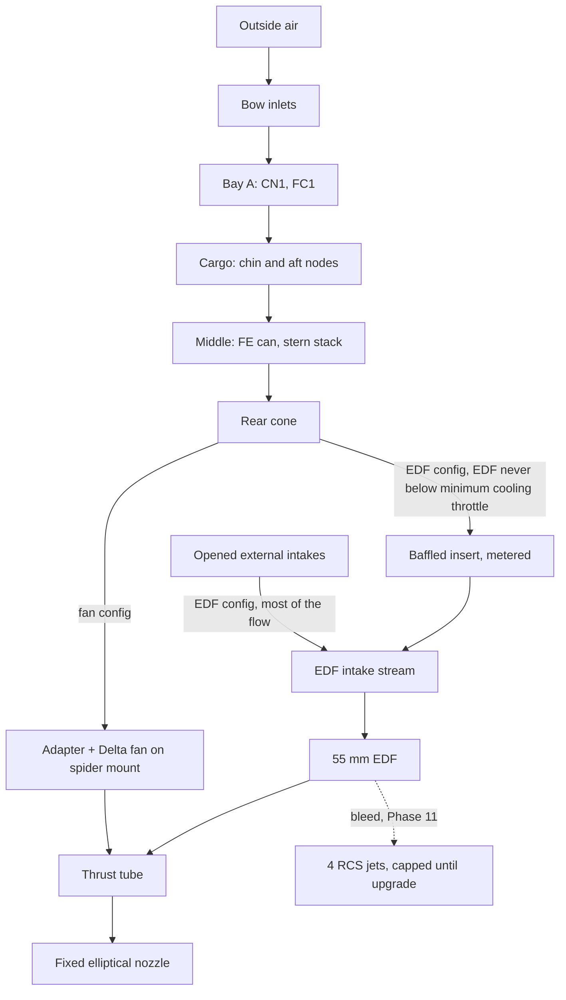
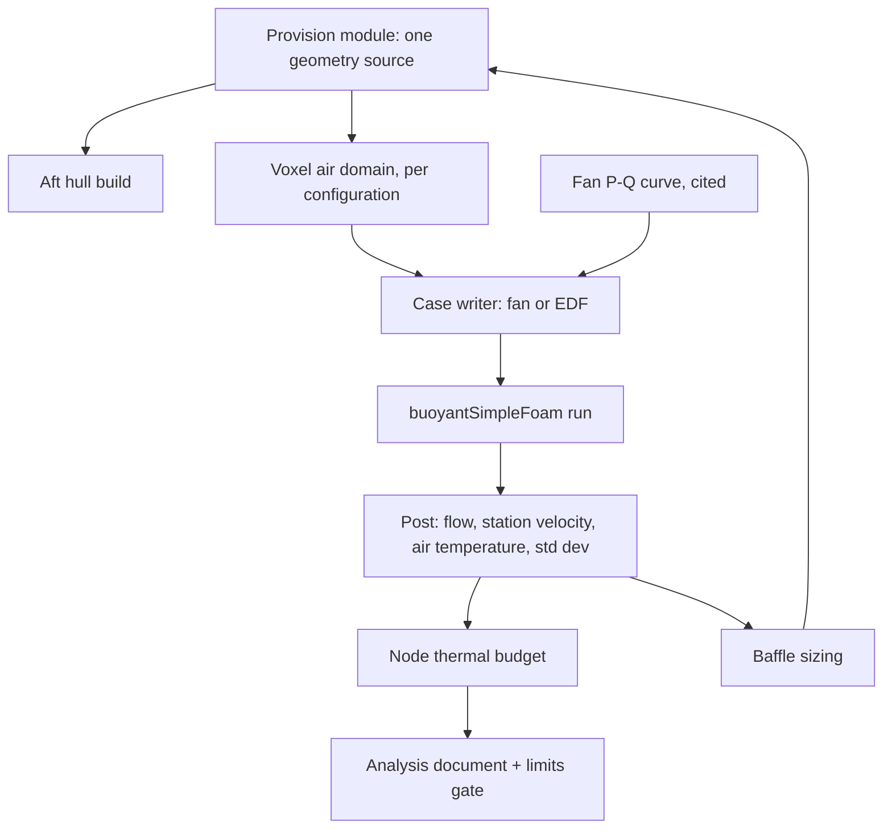
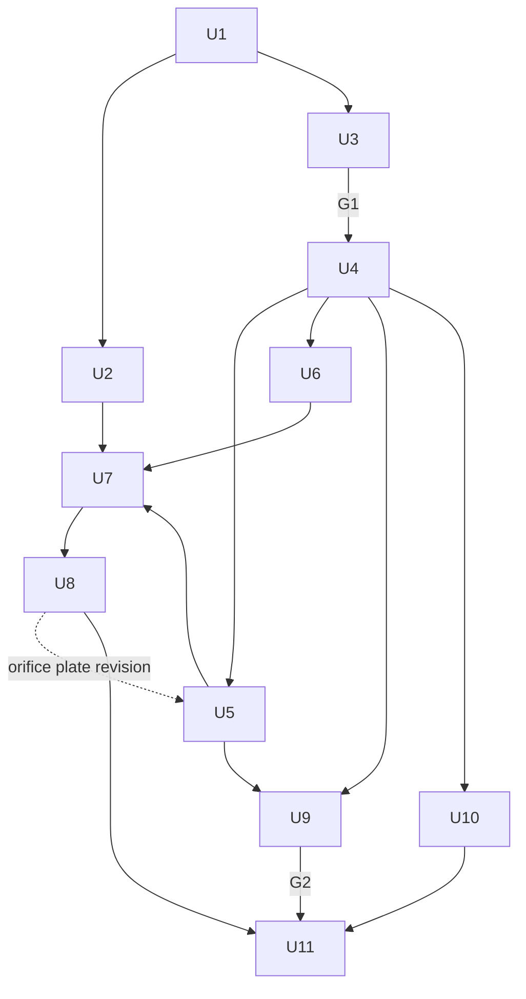

# Fuselage Cooling and Tail EDF Provisions - Plan

**Author:** Steve Griffing, PE(CSE), CISSP-ISSEP, CPP (owner; every product decision below is his). Plan drafted by Claude (Anthropic) under the author's direction, using the `ce-plan` skill, per `AGENTS.md` §3. AI-generated and not yet reviewed.
**License:** CC BY-SA 4.0 — see LICENSES/CC-BY-SA-4.0 (SPDX-License-Identifier: CC-BY-SA-4.0)
**Target repo:** `Serenity-UAV`. All paths are relative to that repo.
**Source issue:** GitHub issue #290, "fuselage cooling". It is the design basis for WBS item COOL-01.

> **WARNING — engineering review required.** Every analysis result this plan produces shall be reviewed and accepted by a qualified engineer before it is applied to flight hardware. A passing margin is an input to that review. It is not a clearance to build.

---

## Goal Capsule

- **Objective.** Give the fuselage one forced-air cooling stream, driven by a fan in the tail. Print every tail EDF provision now, so that the Phase 11 EDF upgrade needs no new hull.
- **Product authority.** The owner (Stab-Rabbit-coding). Issue #290 and the owner's answers of 2026-11-15 override this plan where they differ.
- **Authority order for an executor.** Product Contract requirements, then Key Technical Decisions, then unit text. Root `AGENTS.md` and `airframe/AGENTS.md` bind all of it.
- **Execution profile.** Geometry tools, analysis tools, tests, one analysis document, ledger and tracking updates. No flight hardware is built under this plan.
- **Stop conditions.**
    - Gate G1 (U3) is open: no hull geometry unit starts.
    - Gate G2 (U9) fails: stop and send the owner an Owner Decision Brief (`docs/DOC_TEMPLATES.md`).
    - NFP-THERM is open: U2 step 2 does not start. Do not substitute an assumed stern load.
    - Research finds that a settled decision cannot work: stop and report. Do not work around it.
- **Tail ownership.** The executor closes COOL-01 and the new sub-items in the owning `WBS.md`, regenerates `TODO.md`, and opens the pull request.

---

## Product Contract

### Summary

A Delta ASB02505SHA-AY6B fan sits in the tail and pulls outside air through the whole fuselage, from bow inlets to the tail exit. The fan mounts on a removable, sealed adapter that seats on the spider mount of the deferred 55 mm tail EDF. The aft hull is printed once with every EDF provision in it: external intakes behind cut-out covers, the thrust tube, the fixed elliptical nozzle, and four RCS jet pipes with cut-off caps and empty valve mounts. At Phase 11 the EDF replaces the fan, the covers and caps are cut away, and a baffled insert meters cooling air into the EDF intake stream.

Both configurations are sized by one coupled analysis: an OpenFOAM internal-flow case that feeds the node thermal budget.

### Problem Frame

The avionics nodes sit in closed fabric pouches inside a closed hull. `docs/BAY_A_FWD_THERMAL.md` shows that no passive tier holds the nodes under the 185 °F (85 °C) module limit. The forced-air stream exists only as a 1-D model (`tools/node_thermal_forced_air.py`). The air has no drawn inlet, no drawn exit, and no fan mount. The tail of the Rev U hull is closed.

The tail EDF is deferred to Phase 11, and its design files still describe a superseded 120 mm unit. If the hull is printed without the EDF provisions, the upgrade needs a new aft hull. The aft hull is the largest SLS part in the aircraft.

The aircraft is already aft-heavy. The ledger puts the hover CG at Y 351.2, which is 0.46 in (11.8 mm) aft of the pivot. Every provision this plan adds is aft of the pivot.

### Key Decisions

- KD1. **One stream, one fan, in the tail.** The fan pulls. Bow inlets are the only designed inlets in the fan configuration. Governs R1, R2, R15.
- KD2. **The fan is the Delta ASB02505SHA-AY6B on a removable adapter at the EDF spider mount.** (session-settled: user-directed, 2026-11-15 — chosen over a separate fan mount elsewhere in the rear cone: the EDF mount position is then proven before Phase 11, and the upgrade is a part swap.) Governs R3.
- KD3. **Print every EDF provision now.** Intake covers and RCS caps are cut away at the upgrade. (session-settled: user-directed, issue #290 — chosen over printing a plain aft hull and replacing it at Phase 11: no second aft hull.) Governs R4, R5, R6, R7, R9.
- KD4. **One coordinated plan covers the fan configuration and the EDF upgrade.** (session-settled: user-directed, 2026-11-15 — chosen over planning the printed provisions alone: the baffled insert and the intakes constrain the geometry printed now.) Governs R8, R10.
- KD5. **Baseline is Rev U: the one-piece aft SLS hull, datum R2.** (session-settled: user-directed, 2026-11-15 — chosen over the separate middle and rear shells.) Governs R13, R14.
- KD6. **CFD is tied to the node thermal budget, in both configurations.** (session-settled: user-directed, 2026-11-15 — chosen over a flow-only CFD pass.) Governs R10, R11.
- KD7. **After the upgrade, the EDF holds a minimum cooling flow in hover, and nacelle tilt compensates its thrust.** (session-settled: user-directed, 2026-11-15 — chosen over leaving the EDF stopped in hover, which leaves the nodes with no forced air: the EDF is the only air mover once the fan is removed.) Governs R18, R19.
- KD8. **The tail EDF is an XFly Galaxy X5 motor driving a custom 2.165 in (55 mm) rotor.** (session-settled: user-directed, 2026-11-15 — chosen over an off-the-shelf 55 mm EDF unit, the unsourced `EDF-55-6S` row.) The rotor and its shroud are not yet drawn, so thrust and flow stay ASSUMED until they are bench-tested. Governs R4, R21.
- KD9. **The stern stack's fan-drive output powers the cooling fan and reads its tach.** (session-settled: user-directed, 2026-11-15 — chosen over deciding the source at gate G1, and over tracking fan electrical outside this plan.) Governs R20.
- KD10. **The thrust tube is fused into the aft hull.** (session-settled: user-directed, 2026-11-15 — chosen over a separate bolted tube: issue #290 asks for the tube printed with the hull. Accepted cost: a tube change means a new hull.) Governs R6.
- KD11. **The owner sets the aft CG limit at gate G1, before hull geometry work.** (session-settled: user-approved, 2026-11-15 — chosen over deciding at G2 on mesh-derived masses: a late refusal would discard the hull work.) Governs R12.

### Requirements

**Cooling function**

- R1. One air stream shall run from the bow inlets, past every avionics node, to the tail exit.
- R2. In the fan configuration, every node shall stay under its temperature limit in the average-power case, in still air and at cruise airspeed, with the margin stated.
- R3. The fan shall mount on a removable adapter that seals on the EDF spider mount, so that all fan air comes from inside the fuselage.
- R16. For the peak-power case, the analysis shall report the highest sustained dissipation each node can carry. It shall not claim to close blocker BAYA-FWD-T1.

**Upgrade provisions**

- R4. The EDF upgrade shall need no new hull print. It shall need only removal of covers and caps and fitting of separate parts.
- R5. The aft hull shall carry the external EDF intakes, each closed by a printed cover that can be cut out.
- R6. The aft hull shall carry the thrust tube and the fixed elliptical nozzle, 2.06 × 1.76 in (52.3 × 44.7 mm). The nozzle is never an iris.
- R7. Four RCS jets shall be piped. Each pipe shall have a printed cap on its interior orifice that can be cut off. Mounts for the valves and servos shall be printed and left empty.
- R8. In the EDF configuration, a baffled insert shall admit cooling air from the fuselage interior into the EDF intake stream. The interior flow shall be no less than the fan-configuration flow. Most EDF air shall come from the opened external intakes.
- R18. In the EDF configuration, the EDF shall run at no less than a minimum cooling throttle whenever the avionics are powered in hover. At that throttle every node shall stay under its temperature limit in the average-power case.
- R19. The thrust of the EDF at the minimum cooling throttle shall be trimmed by nacelle tilt in hover. The analysis shall state the trim angle and the hover lift it costs.
- R9. Until they are cut, the covers and caps shall be airtight under the cooling stream's suction.

**Analysis**

- R10. One CFD model of the fuselage interior shall be run in both configurations, and its results shall drive the node thermal budget.
- R11. Every analysis input shall carry a `REFERENCES.md` citation or the label ASSUMED. A result that rests on an ASSUMED input shall be marked PROVISIONAL.

**Airframe integrity**

- R12. Every added part shall enter the mass and CG ledger. Aft CG growth shall not pass gate G2 without an owner decision.
- R13. Every change to the outer mould line shall follow the canon references in their authority order (`docs/AGENTS.md`).
- R14. Every printed feature shall meet `docs/SLS_MIN_WALL_THICKNESS.md` under MS-SLS-PACF.
- R15. The hull shall have no opening to outside air other than the designed apertures of the active configuration.

**Tracking**

- R17. The work shall be tracked in the owning `WBS.md` files before geometry work starts, with `TODO.md` regenerated and every citation indexed in `REFERENCES.md`.
- R20. The cooling fan shall take power from the stern stack's fan-drive output, and the stern stack shall read the fan tach. A stopped fan shall be reported as a fault.
- R21. The fused intake area, thrust tube bore, and RCS pipe bores shall be sized to a stated bounding EDF flow and RCS bleed fraction, each cited or ASSUMED, with the margin shown at gate G1.

### Acceptance Examples

- AE1. **Covers R3, R15.** Given the fan configuration, when the leak check runs, then the only paths from outside air to the interior are the bow inlets and the nozzle exit.
- AE2. **Covers R5, R7, R9.** Given the fan configuration, when a point-containment probe tests each intake cover and each RCS cap, then every one is closed.
- AE3. **Covers R4, R8.** Given the EDF configuration, when the covers and caps are removed in the model and the insert is fitted, then the hull mesh outside those apertures is unchanged from the fan configuration.
- AE4. **Covers R8.** Given the EDF configuration at each analysed throttle point, when the CFD run converges, then the flow through the baffle from the interior is no less than the fan-configuration flow.
- AE6. **Covers R18, R19.** Given the EDF configuration in hover at the minimum cooling throttle, when the coupled analysis runs, then every node passes the average-power case, and the stated nacelle tilt balances the EDF thrust.
- AE5. **Covers R12.** Given the ledger with all new parts, when the CG moves aft by more than the G2 limit, then the run fails and an Owner Decision Brief is written.

### Success Criteria

- The average-power case passes at every node in the fan configuration, with stated margins and stated uncertainty.
- The EDF configuration draws at least the same interior flow.
- The upgrade procedure in the build guide contains no hull reprint.
- Every new gate has a test, and one limits list drives both its printout and its exit code.

### Scope Boundaries

**In scope:** aft hull provisions, the bow inlets, the fan adapter, the Phase 11 baffled insert, the coupled CFD and thermal analysis for both configurations, mass and CG, seals, tracking, and build-guide text.

**Not in scope:**

- Closing BAYA-FWD-T1. The sustained transmit limit stays an owner decision.
- The Bay A internal vent and duct geometry (BAYA-FWD-T4). This plan gives it the inlet position and the flow figures.
- Brass spreader design at each node. The node tool sizes it; the mounts are drawn elsewhere.
- Building or flying anything.

#### Deferred to Follow-Up Work

- Designing, building, and bench-testing the custom 2.165 in (55 mm) rotor and its shroud, and buying the X5 motor and ESC (Phase 11, `deferred/WBS.md`).
- The GW-RCS gateway board, the RCS valves, the servos, and the attitude mixer (Phase 11).
- The flight-control change that holds the minimum cooling throttle and applies the nacelle tilt trim (Phase 11 firmware). This plan supplies the throttle, thrust, and trim figures.
- EDF thrust, nozzle performance, and RCS jet authority analysis. This plan analyses the EDF only as a flow sink for cooling.
- A transient thermal model with measured pouch time constants (`docs/BAY_A_FWD_THERMAL.md` §3).
- Bench measurement of the ASSUMED thermal inputs (BAYA-FWD-T3).

### Outstanding Questions

All are deferred to an owner gate inside the plan. None blocks the start of U1 and U2.

- OQ1 (gate G1). **RCS jet stations.** No station is defined anywhere in the repo. U3 proposes four from geometry and canon.
- OQ2 (gate G1). **EDF envelope.** KD8 names the motor and rotor diameter. The shroud, stator, and motor-mount envelope are not drawn. U3 proposes them from the X5 motor datasheet and the nacelle motor mount.
- OQ3 (gate G1). **Intake count and position.** The legacy design had four radial scoops at the neck. U3 re-derives them on the Rev U hull against canon.
- OQ5 (deferred to U8). **EDF cooling outside hover.** KD7 covers hover. On the ground the nacelles cannot react EDF thrust without lift, and an EDF or ESC fault leaves no air mover. U8 states the thrust at the minimum cooling throttle and the time to limit with the EDF stopped, for the owner to decide.
- OQ4 (gate G1). **Aft CG limit.** The ±0.25 in (±6.4 mm) working band is ASSUMED and already exceeded. The owner sets the limit in the G1 brief (KD11).

---

## Planning Contract

### Key Technical Decisions

- KTD1. **The hull carries the mounting ring, the thrust tube, the nozzle, the intake fairings, and the RCS pipes. The spider mount is a separate bolted part.** The tube bore is fixed by the 2.165 in (55 mm) rotor (KD8), so the fused tube does not wait on the shroud design. The motor mount pattern is not final, so the spider stays bolted. The fan adapter and the Phase 11 insert seat on the same ring-and-spider interface. Implements KD2, KD3, KD10; governs R3, R4, R6.
- KTD2. **Fused provisions are built in the hull's own build chain.** A new module supplies the provision solids to `tools/merge_middle_rear_shell.py`. Published STLs are never patched. Follows R8 of `docs/plans/2026-10-31-001-feat-one-piece-aft-sls-hull-plan.md`.
- KTD3. **Covers and caps are thin membranes with a scored cut line.** The membrane is the 0.059 in (1.5 mm) SLS floor wall. A groove marks the cut. The membrane is non-structural, so the load-bearing wall rule does not apply to it. Governs R5, R7, R9, R14.
- KTD4. **The CFD solver is steady RANS with buoyancy and heat sources: `buoyantSimpleFoam`, k-ω SST, OpenFOAM v1912.** Each node envelope is a wall with its dissipation applied as heat flux. The run gives station velocity, flow split, and bulk air temperature. Conduction inside the pouch stays in the node tool. A full conjugate model (`chtMultiRegionFoam`) is rejected for now because every solid property is ASSUMED (BAYA-FWD-T3). It would add cost without adding truth. Implements KD6; governs R10, R11.
- KTD5. **The node tool stays the temperature authority; CFD replaces its flow inputs.** `tools/node_thermal_forced_air.py` gains an input path for CFD station velocities, flow rate, and air temperatures. Its 1-D system curve stays as the cross-check. Disagreement between the two beyond a stated tolerance is a reported finding.
- KTD6. **The fan is a `fanPressure` outlet using the datasheet P-Q curve.** The EDF is a fixed-flow sink at the EDF face, swept over throttle points. The opened intakes are total-pressure inlets. Free-stream effects are outside the internal domain. They enter as an ASSUMED pressure difference between the bow inlets and the tail exit, swept in both configurations from still air to cruise.
- KTD7. **One case writer, two configurations.** `tools/cfd_cooling_case.py` takes a configuration name. Geometry differences come from the same provision module as the hull build, so the CFD and the print cannot drift apart.
- KTD8. **The baffle is sized at the minimum cooling throttle.** That is the lowest throttle the EDF runs with the avionics powered (R18), so it is the worst case for R8. U8 finds that throttle from the node budget. The insert carries a replaceable orifice plate so the area can be trimmed after bench measurement.
- KTD9. **Follow the v1912 pitfalls already recorded.** No function objects in `controlDict`. Decompose with `hierarchical`. One MPI job at a time. Average the final iterations and report the standard deviation. Treat a single mesh as valid only for A-against-B comparison. Source: `docs/solutions/runtime-errors/openfoam-v1912-ubuntu-build-and-steady-rans-pitfalls.md`.
- KTD11. **The CFD mesh comes from the real surfaces, not from the voxel mask.** `blockMesh` and `snappyHexMesh` mesh the hull and provision-module surfaces, with refinement at the bow inlets, the fan aperture, the intakes, and the baffle orifice. A minimum cell count across each aperture is a quality gate. The 0.098 in (2.5 mm) voxel flood fill stays as the leak check and the patch locator only. (session-settled: user-approved, 2026-11-15 — chosen over meshing from the voxel mask: wall dilation narrows every opening by about 0.2 in (5 mm) and would mis-size the inlets and the orifice.) Governs R10.
- KTD12. **The EDF thrust at the minimum cooling throttle is an ASSUMED input until the custom rotor is bench-tested.** U8 estimates it from the X5 motor datasheet and the 2.165 in (55 mm) rotor disc, and marks the trim angle PROVISIONAL. Implements KD7, KD8; governs R19.
- KTD10. **Mirror starboard from port, and gate every boolean in mm³.** Reuse the hull's keep-out functions. Check the manifold status and compare volume with `trimesh`. A zero-volume result is a failure, not a pass.

### High-Level Technical Design

**Air path, both configurations**

**Analysis data flow**

**Unit order**

The U8 to U5 edge is a revision, not a dependency: baffle sizing may change the orifice plate. It does not change the hull.

### Planning Estimates

These are computed here from stated inputs. They size the problem. They are not results.

- **Fan free delivery.** 0.122 m³/min from the digitized curve in `tools/node_thermal_forced_air.py`, which is 4.3 cfm. The operating point will be lower.
- **EDF flow, order of magnitude.** From momentum theory, Q = √(T·A/ρ). With T = 3.3 lbf (14.7 N) from the unsourced `EDF-55-6S` row, used as a stand-in until the custom rotor of KD8 has data, A = 2.85 in² (1,836 mm²) for the nozzle ellipse, and ρ = 0.0765 lbm/ft³ (1.225 kg/m³), Q is about 310 cfm (0.15 m³/s). ASSUMED thrust. The interior bleed that R8 needs is therefore on the order of 1 % of EDF flow.
- **CG sensitivity.** A mass m at arm a moves the CG by m·a/M. With M = 14.3 lbm (6,494 g) and an arm of about 8.7 in (220 mm) to the rear cone, each 0.22 lbm (100 g) moves the CG about 0.13 in (3.4 mm) aft. The arm is ASSUMED until U3 fixes the stations.

### Assumptions

- The Rev U aft hull is the merged shell built by `tools/merge_middle_rear_shell.py`. Gates G1 to G3 of the aft hull plan are still open, so the hull may change under this work.
- OpenFOAM v1912 and `shapely` are not installed in the cloud container used for planning. CFD units need a machine that has them.
- Design ambient is 104 °F (40 °C), ASSUMED, pending BAYA-FWD-T2.
- The stern is one NoNFO-Pilot-PB2 stack (`avionics/WBS.md` §1.11), not two pouches. Its dissipation comes from the stern thermal check NFP-THERM, which is open.

### Risks and Mitigations

| Risk | Effect | Mitigation |
| --- | --- | --- |
| Aft mass makes an out-of-band CG worse | Trim does not close | Owner sets the limit at G1 from envelope estimates (KD11); U9 confirms on mesh masses |
| Bulk air heats along the stream; aft nodes see air warmed by forward nodes | Aft nodes fail at low flow | U7 reports air temperature at each station; U8 reports margin per node |
| Hull seams leak under suction | Flow bypasses the forward nodes | U10 seal gate; HULL-LEAK-04 door seal |
| Custom rotor or shroud differs from the U3 envelope | Spider reprint; a tube bore change means a new hull (KD10) | Tube bore fixed by KD8; R21 margin; spider stays bolted |
| Stern stack dissipation not yet known (NFP-THERM open) | U2, U7, and U8 cannot finish | Geometry units U3 to U6 proceed; the thermal chain stops at U2 step 2 until NFP-THERM closes |
| Fan curve digitized, not tabulated | Operating point error | U1 cites the datasheet; U8 states the sensitivity |
| Single-mesh CFD | Absolute values uncertain | KTD9; report standard deviation; one mesh-refinement check on the fan case |
| Merged hull tarball size | Push fails at 100 MB | Tarball rule already in `tools/check_hull_tarballs.py` |
| EDF thrust at the minimum cooling throttle costs hover lift and tilt authority | Hover margin falls after the upgrade | U8 states the trim angle and lift loss; KTD12 marks them PROVISIONAL until a unit is selected |
| Free-stream pressure at the intakes unknown in the internal model | EDF-case flow split error | Sweep the intake total pressure; state the bound in U8 |

### Sources and Research

- Issue #290. COOL-01 in `airframe/fuselage-mid/WBS.md`.
- `tools/node_thermal_forced_air.py`, `tools/cfd_internal_air_domain.py`, `tools/assembly_integrity_check.py`, `tools/bay_a_thermal_budget.py`.
- Case-writer pattern: `tools/od17_junction_cfd/` and `tools/nacelle_intake_cfd.py`.
- Canonical tail EDF text: `AGENTS.md` (Propulsion), `deferred/AGENTS.md`, `deferred/WBS.md` §Phase11, `docs/CARGO_DOOR_GATEWAY_SPEC.md` §9.
- Rear-cone reservation and the 4.79 in² (3,090 mm²) scoop capture figure: `tools/middle_layout_fit.py`.
- Learnings applied: the files under `docs/solutions/` named in KTD9, U1, U2, U3, U4, and U10.
- **Findings that this plan must fix.** `REF-FAN-001` and `REF-HT-001` are cited in `tools/node_thermal_forced_air.py` but are absent from `REFERENCES.md`. `REF-MAT-008` is cited there as C26000 brass, but in `REFERENCES.md` it is music wire. `tools/cfd_cooling_case.py` is named as a consumer but does not exist. The thermal and CFD tools load the separate middle and rear STLs, not the merged hull. The files under `deferred/aft-edf/` use pre-R2 stations.
- External research was not run. The fan datasheet and the heat-transfer reference are fetched and verified in U1.

---

## Implementation Units

| U-ID | Title | Key files | Depends on |
| --- | --- | --- | --- |
| U1 | Tracking entries and reference repair | `airframe/fuselage-mid/WBS.md`, `REFERENCES.md` | — |
| U2 | Thermal model refresh | `tools/node_thermal_forced_air.py` | U1, NFP-THERM closed |
| U3 | Rear-cone layout and gate G1 | `tools/rear_cone_layout_fit.py`, `docs/FUSELAGE_COOLING_LAYOUT_BRIEF.md` | U1 |
| U4 | Fused aft hull provisions | `tools/aft_cooling_provisions.py`, `tools/merge_middle_rear_shell.py` | U3 (G1) |
| U5 | Separate parts | `airframe/openscad/fuselage/aft-cooling/` | U4 |
| U6 | Bow inlets | `tools/bow_inlet_provisions.py` | U4 |
| U7 | CFD case, both configurations | `tools/cfd_cooling_case.py` | U2, U5, U6 |
| U8 | Coupled analysis and baffle sizing | `docs/FUSELAGE_COOLING_ANALYSIS.md` | U7 |
| U9 | Mass, CG, and gate G2 | `tools/auw_ledger.py`, `current-specification/bom_revU.json` | U4, U5, G1 limit |
| U10 | Seal and aperture gate | `tools/assembly_integrity_check.py` | U4 |
| U11 | Build guide, Phase 11 records, closeout | `docs/PHASED_BUILD_GUIDE.md`, `deferred/WBS.md` | U8, U9, U10 |

### U1. Tracking entries and reference repair

- **Goal:** Put the work in the WBS before geometry starts, and make every thermal citation resolve.
- **Requirements:** R11, R17.
- **Dependencies:** none.
- **Files:** `airframe/fuselage-mid/WBS.md`, `deferred/WBS.md`, `avionics/WBS.md`, `REFERENCES.md`, `airframe/datasheets/`, `tools/node_thermal_forced_air.py`, generated `TODO.md` files.
- **Approach:**
    1. Split COOL-01 into sub-items that match U2 to U11. Link issue #290.
    2. Add a cross-reference from BAYA-FWD-T4 to the bow inlet item.
    3. Fetch the Delta ASB02505SHA-AY6B datasheet from the manufacturer. Store it under `airframe/datasheets/`. Add `REF-FAN-001` with the validated URL, access date, and the pages used.
    4. Add `REF-HT-001` for the heat-transfer text behind the flat-plate and fin equations. Verify each section number against the book. Mark any that cannot be verified "requires verification" and open a TODO §0.x item.
    5. Add a new REF-MAT entry for C26000 brass and re-point the tool's citation away from `REF-MAT-008`. Record the correction under "Removed / Superseded Citations".
    6. Regenerate `TODO.md` with `tools/gen_todo_from_wbs.py`.
- **Patterns to follow:** `docs/AGENTS.md` reference lifecycle; `docs/solutions/workflow-issues/generate-open-item-views-never-hand-patch-them.md`.
- **Test scenarios:** Test expectation: none -- tracking and citation records only. The generator's `--check` mode and the pre-commit hooks are the proof.
- **Verification:** Every REF-ID in the thermal and CFD tools resolves in `REFERENCES.md`. `tools/gen_todo_from_wbs.py --check` passes.

### U2. Thermal model refresh

- **Goal:** Make the node tool match Rev U and accept CFD inputs.
- **Requirements:** R2, R10, R11, R16.
- **Dependencies:** U1.
- **Files:** `tools/node_thermal_forced_air.py`, `tools/cfd_internal_air_domain.py`, `tools/tests/test_node_thermal_forced_air.py`.
- **Approach:**
    1. Load the merged aft hull in place of the separate middle and rear shells.
    2. Replace the two stern pouches with the single stern stack. Take its dissipation from the closed NFP-THERM item (`avionics/WBS.md` §1.11). Wait for that item; do not assume a value.
    3. Add an optional input for CFD results: flow rate, station velocities, and station air temperatures (KTD5).
    4. Put the limits in one list that drives the printout and the exit code.
- **Execution note:** Add characterization tests of the current outputs before changing the model, so each change in a result is intended.
- **Patterns to follow:** `tools/tests/test_bay_a_thermal_budget.py`; `docs/solutions/conventions/one-limits-list-drives-the-printout-and-the-exit-code.md`.
- **Test scenarios:**
    - The fan and system curves cross at one flow; the operating point lies between zero and free delivery.
    - Zero flow gives zero fan-curve intercept error: pressure equals the shut-off value.
    - Air temperature rises monotonically along the stream, and the rise equals upstream power over ṁ·c_p.
    - Doubling one node's power raises that node and every node downstream, and no node upstream.
    - With CFD inputs supplied, the tool uses them and reports the difference from the 1-D figures.
    - A node over its limit makes the run exit non-zero and names the node.
    - A missing mesh or a missing CFD field fails with a clear message, not a silent default.
- **Verification:** The tool runs on the merged hull with seven nodes. All tests pass under `/usr/bin/python3`.

### U3. Rear-cone layout and gate G1

- **Goal:** Fix the stations of every aft provision on the Rev U hull and get the owner's decision.
- **Requirements:** R4, R5, R6, R7, R12, R13, R14, R20, R21.
- **Dependencies:** U1.
- **Files:** `tools/rear_cone_layout_fit.py`, `tools/tests/test_rear_cone_layout_fit.py`, `docs/FUSELAGE_COOLING_LAYOUT_BRIEF.md`, `tools/hull_datums.py`.
- **Approach:**
    1. Measure the rear cone cavity on the live merged mesh. Record which mesh was measured.
    2. Place envelopes for the mounting ring, spider, X5 motor, 2.165 in (55 mm) rotor and shroud, thrust tube, nozzle, intakes, plenum volume, four RCS pipes, four valve and servo mounts, and the GW-RCS board. The GW-RCS envelope is a space reservation only.
    3. Place the Delta fan and its adapter on the spider. Check the spider arm clocking against the load-bearing azimuths.
    4. Model the air path through the rear cone as a keep-out solid.
    5. Trace the tail exit and any intake lines from the canon images under `docs/references/`, in authority order.
    6. Check intake capture area against the 4.79 in² (3,090 mm²) figure in `tools/middle_layout_fit.py`, and re-derive that figure for the 55 mm unit.
    7. Route the fan lead from the stern stack's fan-drive output to the fan, with its tach line, and place a sealed pass-through in the adapter (R20).
    8. Size the intake area, tube bore, and RCS pipe bores to a stated bounding EDF flow and bleed fraction, and show the margin (R21).
    9. Estimate the mass and CG shift of the fan and EDF configurations from the placed envelopes.
    10. Write an Owner Decision Brief for OQ1, OQ2, OQ3, and OQ4 with the six template checks and figures. It carries the sizing basis and the CG estimate, and asks for the aft CG limit.
- **Patterns to follow:** `tools/middle_layout_fit.py`, `tools/nonfo_simon_fit.py` and its test; `docs/solutions/design-patterns/build-every-joint-in-context-through-its-full-motion.md`; `docs/solutions/workflow-issues/a-recorded-route-or-clearance-goes-stale-when-its-part-changes.md`.
- **Test scenarios:**
    - Every envelope lies inside the measured cavity with the stated clearance.
    - No envelope crosses forward of the rear-cone reservation into the middle layout.
    - Moving an envelope into the air-path keep-out fails the gate.
    - Moving an envelope through the skin fails the gate.
    - Port and starboard placements mirror about the centreline.
    - The stern stack, the aft gear bays, and the tail light cableway do not clash with any envelope.
- **Verification:** The fit tool passes. The brief is in the repo. **Gate G1:** the owner has decided OQ1 to OQ4 in writing.

### U4. Fused aft hull provisions

- **Goal:** Build the mounting ring, thrust tube, nozzle, intake fairings with covers, and RCS pipes with caps and mounts into the one-piece aft hull.
- **Requirements:** R4, R5, R6, R7, R9, R13, R14. Implements KTD1, KTD2, KTD3, KTD10.
- **Dependencies:** U3 with G1 passed.
- **Files:** `tools/aft_cooling_provisions.py`, `tools/merge_middle_rear_shell.py`, `tools/tests/test_aft_cooling_provisions.py`, `airframe/stls/fuselage/middle_rear_shell24_2mm_merged.stl.tar.gz`.
- **Approach:**
    1. Write one provision module that returns each solid and each cut for a named configuration: `fan` (covers and caps present) or `edf` (covers and caps removed).
    2. Open the tail at the nozzle exit. Fair the nozzle and intakes into the measured skin, G1-continuous.
    3. Add membranes and cut grooves per KTD3.
    4. Call the module from the hull build. Gate each boolean in mm³.
    5. Regenerate the hull in the R2 frame. Do not translate or re-bake a published mesh.
- **Patterns to follow:** `docs/solutions/design-patterns/fuse-canonical-styling-as-skin-over-functional-hardware.md`; `docs/solutions/design-patterns/fair-a-forced-exterior-deviation-into-the-measured-canonical-skin.md`; `docs/solutions/design-patterns/cut-the-local-solid-with-a-true-offset-and-gate-the-joint.md`; `docs/solutions/logic-errors/mesh-boolean-layout-proofs-silent-zero-volumes-and-shared-profiles.md`.
- **Test scenarios:**
    - Covers AE2. In the `fan` configuration, a probe point in each intake throat and each RCS pipe cannot reach the interior.
    - Covers AE3. The `edf` hull differs from the `fan` hull only inside the cover and cap volumes; the difference volume equals the membrane volume within tolerance.
    - The nozzle exit section measures 2.06 × 1.76 in (52.3 × 44.7 mm) within tolerance.
    - Every wall of the added features meets the minimum for its category; a deliberately thinned wall fails.
    - The hull stays one body after each boolean; a zero-volume boolean result fails.
    - The starboard features equal the port features mirrored.
    - The outer mould line outside the provision regions is unchanged from the previous hull.
    - Interior volume removed by the provisions does not cut the stern stack envelope or the gear bays.
- **Verification:** The hull tarball rebuilds. `tools/validate_stls.py`, `tools/check_hull_tarballs.py --check`, and `tools/check_datum_drift.py` pass. Multi-angle previews are viewed and show the features as designed.

### U5. Separate parts

- **Goal:** Draw the spider mount, fan adapter, and Phase 11 baffled insert.
- **Requirements:** R3, R4, R6, R8, R14. Implements KTD1, KTD8.
- **Dependencies:** U4. The orifice plate is revised after U8.
- **Files:** `airframe/openscad/fuselage/aft-cooling/edf_55_motor_mount.scad`, `cooling_fan_adapter.scad`, `edf_cooling_baffle_insert.scad` (same folder), `airframe/stls/fuselage/aft-cooling/`, `tools/tests/test_aft_cooling_parts.py`, `deferred/aft-edf/README.md`.
- **Approach:**
    1. Parametrize each part from the U3 stations and the EDF envelope. Take hull interface dimensions from the provision module, not from typed copies.
    2. The adapter seals on the spider and holds the 0.98 in (25 mm) fan frame. It blocks every other path through the ring.
    3. The insert carries the replaceable orifice plate.
    4. Mark the legacy 120 mm files superseded and archive them per root `AGENTS.md` §10.
- **Patterns to follow:** `airframe/openscad/nacelles/edf_motor_mount_64mm.scad`; the `openscad` skill's validate, preview, and export steps.
- **Test scenarios:**
    - Each part renders with no warning and exports a manifold mesh.
    - The adapter and fan, placed at the U3 station, fit the ring with the stated clearance and do not clash with the tube.
    - With the adapter fitted in the model, no path joins the upstream and downstream sides except through the fan aperture.
    - The insert, placed with the EDF envelope, leaves the EDF inlet face clear.
    - Changing the motor mount pattern changes the spider, and leaves the hull ring interface unchanged.
    - Every wall meets the minimum for its category.
- **Verification:** All four parts export in the R2 frame and pass `tools/validate_stls.py`. Previews from six angles are viewed.

### U6. Bow inlets

- **Goal:** Draw the bow inlets on the head hull.
- **Requirements:** R1, R13, R14, R15.
- **Dependencies:** U4 (shares the fairing method).
- **Files:** `tools/bow_inlet_provisions.py`, `tools/build_head_shell.py`, `tools/merge_head_cargo_shell.py`, `tools/head_layout_fit.py`, `tools/tests/test_bow_inlet_provisions.py`.
- **Approach:**
    1. Start from the two 0.98 × 0.63 in (25 × 16 mm) slots that the node tool assumes. Re-size them from the U2 system curve if the inlet loss dominates.
    2. Place them beside the sensor bay on canon lines. Keep clear of the pitot hose turn and the Observer-to-CN1 trunk.
    3. Add a rain and debris provision. State its loss coefficient as ASSUMED.
    4. Add the inlet bodies to the head layout fit gate.
- **Patterns to follow:** same as U4; `docs/BAY_A_FWD_THERMAL.md` §2 for the bounds.
- **Test scenarios:**
    - Each inlet is open: a probe point reaches the interior from outside.
    - Inlet free area equals the design value within tolerance.
    - The inlets do not clash with the pitot, the trunk, or the Bay A mounts in the head fit gate.
    - Port and starboard inlets mirror.
    - The head hull stays one body and the mating faces stay open.
- **Verification:** The head hull rebuilds and passes the STL and tarball checks. `tools/head_layout_fit.py` passes.

### U7. CFD case, both configurations

- **Goal:** Write, run, and post-process the internal-flow case for the fan and EDF configurations.
- **Requirements:** R10, R11. Implements KTD4, KTD6, KTD7, KTD9.
- **Dependencies:** U2, U5, U6.
- **Files:** `tools/cfd_internal_air_domain.py`, `tools/cfd_cooling_case.py`, `tools/cfd_cooling_post.py`, `tools/tests/test_cfd_cooling_case.py`, `reports/cfd_cooling/`.
- **Approach:**
    1. Extend the air domain to take a configuration. Designed apertures become named patches. Any other route to the boundary is still reported as a leak.
    2. Write the case from the hull and provision-module surfaces per KTD11: mesh, patches, node heat-flux walls, fan or EDF boundary, intake boundaries. Use the air mask to locate patches.
    3. Run the fan case at average and peak power, in still air and across the outside pressure sweep to cruise. Run the EDF case at the minimum cooling throttle, at two higher throttle points, and across the same sweep.
    4. Post-process outside the solver: flow at each aperture, velocity and air temperature at each `STREAM` station, mean and standard deviation over the final iterations.
    5. Write the results as a file that U2's input path reads.
- **Execution note:** Prove the case writer on a straight duct with a known answer before the hull domain.
- **Patterns to follow:** `tools/od17_junction_cfd/mkcase.py`, `post.py`, `run.sh`; the `openfoam-cfd` skill.
- **Test scenarios:**
    - Straight-duct check: outlet flow equals inlet flow, and bulk temperature rise equals power over ṁ·c_p within tolerance.
    - Each aperture has at least the minimum cell count across it; a coarsened refinement region fails the gate.
    - The written case has every required dictionary and every patch named in the configuration.
    - Fan configuration: mass flow in at the bow inlets equals mass flow out at the fan within the stated imbalance.
    - EDF configuration: bow inlet flow plus intake flow equals EDF flow.
    - A hull with an undesigned opening stops the domain build with the leak location.
    - A run that has not converged is flagged and its numbers are not written to the results file.
    - The post step reports a standard deviation with every mean.
- **Verification:** Both configurations converge. Results files exist under `reports/cfd_cooling/`. One finer-mesh fan run is compared and the change is stated.

### U8. Coupled analysis and baffle sizing

- **Goal:** Produce the thermal result for both configurations and size the baffle.
- **Requirements:** R2, R8, R10, R11, R16, R18, R19.
- **Dependencies:** U7.
- **Files:** `docs/FUSELAGE_COOLING_ANALYSIS.md`, `docs/BAY_A_FWD_THERMAL.md`, `tools/cooling_baffle_sizing.py`, `tools/tests/test_cooling_baffle_sizing.py`, `REFERENCES.md`.
- **Approach:**
    1. Run the node tool with the CFD inputs for each case.
    2. Find the minimum cooling throttle: the lowest EDF flow at which every node passes the average-power case (R18).
    3. Size the orifice so that interior flow at that throttle meets R8. Cross-check the area against the orifice equation. Feed the area back to U5.
    4. Compute the EDF thrust at that throttle and the nacelle tilt that balances it in hover, with the hover lift lost (R19, KTD12).
    5. State the thrust on the ground and the time to limit with the EDF stopped (OQ5).
    6. Write the analysis document to the `docs/DOC_TEMPLATES.md` analysis template: problem, assumptions, calculations with units, results, references. Give imperial units first.
    7. State the sensitivity of the result to the fan curve, the ambient, and the outside pressure difference. Report the pressure difference at which a node first exceeds its limit.
    8. Update `docs/BAY_A_FWD_THERMAL.md` §3 and §4 with the new fan-tier figures. Leave the T1 decision to the owner.
- **Test scenarios:**
    - Covers AE4. For each EDF throttle point, sized interior flow is at least the fan-configuration flow.
    - Covers AE6. At the minimum cooling throttle every node passes the average-power case; one step lower, at least one node fails.
    - The tilt trim balances the EDF thrust: the net fore-and-aft force in hover is zero within tolerance.
    - Zero EDF thrust gives zero trim angle and no lift loss.
    - A larger orifice gives more interior flow; the relation is monotonic.
    - The sized orifice area agrees with the orifice equation within the stated tolerance.
    - An orifice that would starve the EDF inlet beyond a stated pressure loss fails the gate.
    - When the requirement cannot be met inside the insert's area range, the tool fails and names the limiting throttle point.
    - Limits list: a node over its limit in the average case fails the run.
- **Verification:** The document carries every result with its margin, its limit, and its PROVISIONAL mark where due. Every citation resolves.

### U9. Mass, CG, and gate G2

- **Goal:** Enter every new part in the ledger and decide the CG question.
- **Requirements:** R12.
- **Dependencies:** U4, U5.
- **Files:** `tools/auw_ledger.py`, `current-specification/bom_revU.json`, `current-specification/bom_revU.csv`, `current-specification/auw_ledger.json`, `tools/tests/test_auw_ledger_cooling.py`.
- **Approach:**
    1. Add the fused provisions, the thrust tube among them, through the hull mesh. Add the spider, adapter, and fan as rows with stations. Keep the insert, EDF, and RCS hardware at quantity zero. Retire the separate `PRINT-THRUST-TUBE` row.
    2. Replace the legacy CF-PETG masses of the Phase 11 printed rows with mesh-derived SLS masses.
    3. Report the CG for three states: before this work, the fan configuration, and the EDF configuration.
    4. Fail the gate when the fan-configuration CG moves aft by more than the limit the owner set at G1 (KD11).
- **Test scenarios:**
    - Covers AE5. A ledger with CG growth over the limit exits non-zero.
    - Every new BOM row is classified; an unclassified row with quantity above zero fails the run.
    - BOM mass and mesh mass agree within the sync tolerance.
    - The fan mass equals the cited datasheet value.
- **Verification:** `tools/auw_ledger.py --check` and `tools/check_bom_mesh_sync.py` pass. **Gate G2:** the CG delta is inside the limit, or the owner has decided on a brief.

### U10. Seal and aperture gate

- **Goal:** Prove the hull is closed except at designed apertures, in both configurations.
- **Requirements:** R9, R15.
- **Dependencies:** U4.
- **Files:** `tools/assembly_integrity_check.py`, `tools/tests/test_assembly_integrity_cooling.py`, `airframe/fuselage-mid/WBS.md`.
- **Approach:**
    1. Extend the integrity check: load the merged aft hull for the named configuration, add fore-and-aft ray sets so the nozzle exit and the bow inlets are seen, and exempt allowlisted apertures from the small-hole filter.
    2. Give the check an aperture allowlist per configuration.
    3. Probe each cover and cap closed in the `fan` configuration and open in the `edf` configuration.
    4. Specify the cargo door hinge-edge seal (HULL-LEAK-04) and the adapter seal. State the allowed leak area from the U7 flow-split sensitivity.
- **Patterns to follow:** `docs/solutions/logic-errors/mating-face-aperture-allowlist.md`; `tools/open_mating_faces.py`.
- **Test scenarios:**
    - Covers AE1. Fan configuration: the only openings found are the bow inlets and the nozzle exit.
    - EDF configuration: the openings found are the bow inlets, the intakes, the RCS jets, and the nozzle exit.
    - An opening that is not on the allowlist fails the check and is located.
    - An allowlisted aperture that is found closed fails the check.
    - A watertight-repair pass that caps an aperture is detected.
- **Verification:** The check passes for both configurations. HULL-LEAK-04 has a seal specification.

### U11. Build guide, Phase 11 records, closeout

- **Goal:** Record how to build the fan configuration and how to upgrade, and close the tracking.
- **Requirements:** R4, R17.
- **Dependencies:** U8, U9, U10.
- **Files:** `docs/PHASED_BUILD_GUIDE.md`, `deferred/WBS.md`, `deferred/README.md`, `deferred/aft-edf/README.md`, `airframe/fuselage-mid/WBS.md`, `docs/OPERATORS_MANUAL.md`, `REFERENCES.md`, `PROJECT_INDEX.md`, `ARCHIVE_INDEX.md`, generated `TODO.md` files.
- **Approach:**
    1. Write the fan installation steps and the upgrade steps: cut covers, cut caps, fit insert, fit EDF. Mark hazards to personnel as WARNING and hazards to equipment as CAUTION.
    2. Rewrite the Phase 11 items that this work completes or changes. Convert their stations to R2.
    3. Add the cooling fan check to the pre-flight text, with the tach fault indication (R20).
    4. Index every new citation location in `REFERENCES.md`. Update the project and archive indexes.
    5. Close the COOL-01 sub-items and regenerate `TODO.md`.
    6. Capture the internal-flow CFD learning under `docs/solutions/`.
- **Test scenarios:** Test expectation: none -- documentation and tracking. The sync and index checks are the proof.
- **Verification:** `tools/sync_operators_manual.py --check`, `tools/precommit_index.py --check`, and `tools/gen_todo_from_wbs.py --check` pass. The upgrade procedure contains no hull print step.

---

## Verification Contract

Run every command with `/usr/bin/python3`. The `.venv` hides `trimesh`.

| Gate | Command or check | Applies to |
| --- | --- | --- |
| Unit tests | `/usr/bin/python3 -m pytest tools/tests/` | U2 to U10 |
| Lint | `flake8` with the repo configuration | every Python change |
| STL validity | `tools/validate_stls.py` | U4, U5, U6 |
| Hull tarballs | `tools/check_hull_tarballs.py --check` | U4, U6 |
| Datum drift | `tools/check_datum_drift.py` | U3, U4, U6 |
| BOM against mesh | `tools/check_bom_mesh_sync.py` | U9 |
| Ledger | `tools/auw_ledger.py --check` | U9 |
| Enclosure | `tools/assembly_integrity_check.py`, both configurations | U10 |
| Layout fit | `tools/rear_cone_layout_fit.py`, `tools/head_layout_fit.py`, `tools/middle_layout_fit.py` | U3, U4, U6 |
| Thermal limits | `tools/node_thermal_forced_air.py` with CFD inputs | U8 |
| Tracking | `tools/gen_todo_from_wbs.py --check`, `tools/precommit_index.py --check`, `tools/sync_operators_manual.py --check` | U1, U11 |
| Visual | OpenSCAD multi-angle previews, each image viewed | U4, U5, U6 |
| CFD quality | `checkMesh` clean; minimum cells across each aperture; residual and imbalance limits met; standard deviation reported | U7 |

pytest is not part of CI today. The executor runs it by hand and states the result in the pull request.

---

## Definition of Done

**Global**

- Every requirement R1 to R21 is met or is the subject of a written owner decision.
- Gates G1 and G2 are closed in writing.
- Every Verification Contract gate passes, or its failure is recorded with the rule and the reason.
- Every analysis result carries its inputs, its citations, its margin, and its PROVISIONAL mark where an input is ASSUMED.
- No citation is unverified without a "requires verification" mark and a TODO §0.x item.
- COOL-01 and its sub-items are closed in the owning `WBS.md`; `TODO.md` is regenerated.
- Abandoned attempts, scratch cases, and unused scripts are removed from the diff. CFD run directories are not committed; only the results files under `reports/cfd_cooling/` are.
- The analysis has been sent for qualified engineering review, and that fact is recorded in the analysis document.

**Per unit**

Each unit is done when its Verification line is true and its tests pass.
