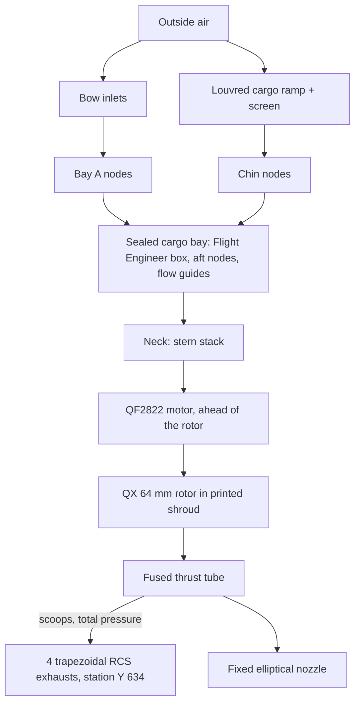
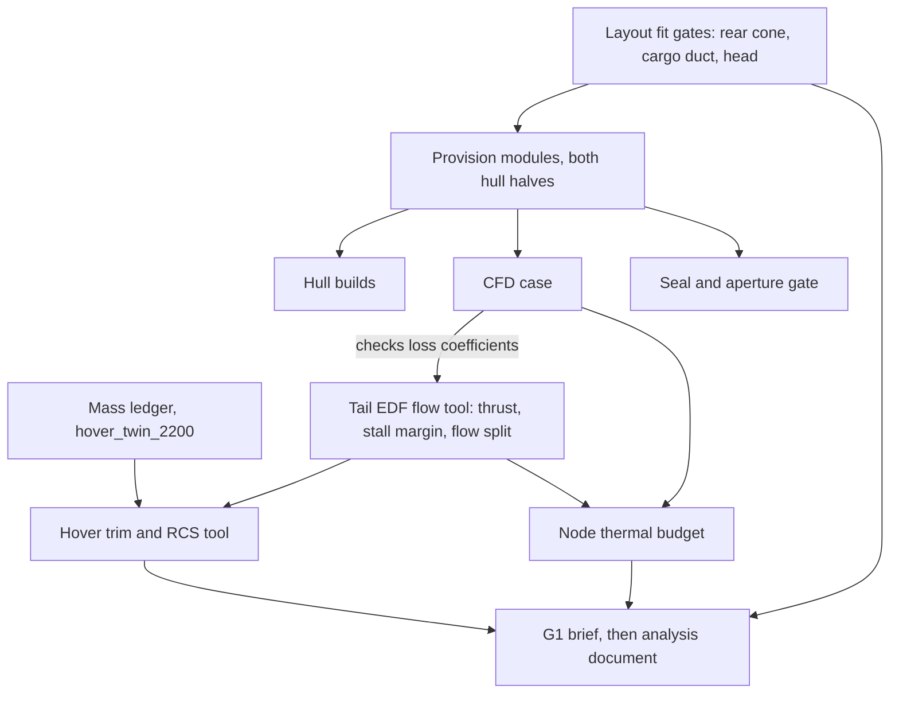
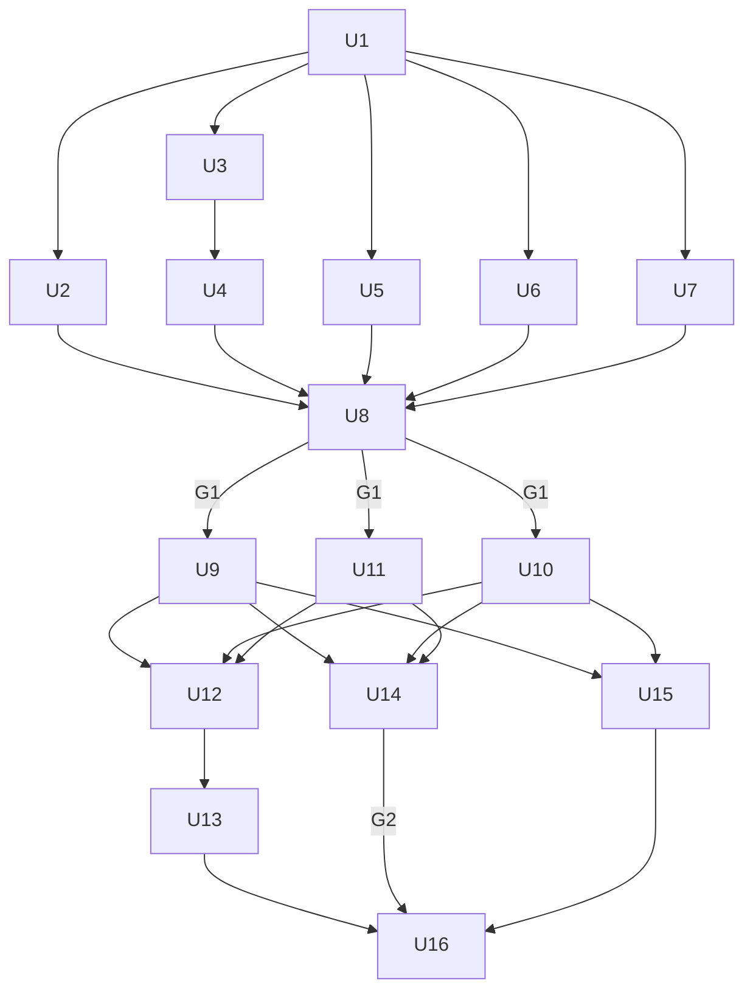

# Cargo-Ramp Intake, Tail EDF Cooling and Forward Relocation - Plan

**Author:** Steve Griffing, PE(CSE), CISSP-ISSEP, CPP (owner; every product decision below is his). Requirements and plan drafted by Claude (Anthropic) under the author's direction, using the `ce-brainstorm` and `ce-plan` skills, per `AGENTS.md` §3. AI-generated and not yet reviewed.
**License:** CC BY-SA 4.0 — see LICENSES/CC-BY-SA-4.0 (SPDX-License-Identifier: CC-BY-SA-4.0)
**Target repo:** `Serenity-UAV`. All paths are relative to that repo.
**Source issue:** GitHub issue #290, "fuselage cooling", and the owner's direction of 2026-11-15.

> **WARNING — engineering review required.** Every figure in this document is a planning estimate. A qualified engineer shall review and accept the analysis that follows from it before it is applied to flight hardware.

---

## Goal Capsule

- **Objective.** Make the tail EDF the fuselage's air mover from the first build. It draws all its air through the fuselage interior, by way of a louvred cargo ramp and the bow inlets. Move mass forward into the freed cargo bay so that the trim closes.
- **Product authority.** The owner (Stab-Rabbit-coding). His decisions of 2026-11-15, recorded under Key Decisions, override anything else here.
- **Standing.** Adopted by the owner on 2026-11-16 as the path forward. The design shift is recorded in `airframe/fuselage-mid/WBS.md` §1.1.1.4.0 and in root `AGENTS.md` §1.
- **Supersedes.** The fan stage, fan adapter, intake covers, rear-bell intakes and baffled insert of `docs/plans/2026-11-15-001-feat-fuselage-cooling-plan.md`.
- **Authority order for an executor.** Product Contract requirements, then Key Technical Decisions, then unit text. Root `AGENTS.md` and `airframe/AGENTS.md` bind all of it.
- **Execution profile.** Records, analysis and layout tools with tests, hull geometry, separate parts, a CFD case, an analysis document and specification updates. No flight hardware is built, and no flight-control firmware is written.
- **Stop conditions.**
    - Gate G1 (U8) is open: no hull geometry or separate part starts.
    - Gate G2 (U14) fails: stop and write an Owner Decision Brief (`docs/DOC_TEMPLATES.md`).
    - The stern thermal check is open: the thermal chain stops at U2. Do not substitute an assumed stern load.
    - Evidence shows that a settled decision cannot work: stop and report.
- **Tail ownership.** The executor closes the WBS items, regenerates `TODO.md`, and opens the pull request.

---

## Product Contract

### Summary

The tail EDF flies from the first build and is the only air mover in the fuselage. All its air passes through the interior: most enters at a louvred, screened forward cargo ramp, and the rest enters at the bow inlets that feed Bay A. The cargo bay becomes a sealed duct with one belly service hatch. Cargo moves to an external sling on a floor-mounted winch, with the line leaving the belly under the tilt pivot. The Flight Engineer box, winch, tail EDF speed controller, battery, RCS servos and Cargo Observer move forward to recover trim.

### Problem Frame

The measured thermal baseline shows that a small tail fan moves enough bulk air but too little local air: three nodes fail the average-power case. Two of them, the chin nodes, sit directly behind the forward cargo ramp, which is sealed today.

The earlier plan gave the tail EDF its own intakes in the rear bell and metered a small bleed of cooling air through a baffle. Almost all EDF air then bypassed the avionics.

The aircraft has little trim room. With the two cells in the twin tray, the corrected ledger puts the hover CG at 0.03 in (0.8 mm) aft of the tilt pivot at Y 339.4. Flying the tail EDF and RCS hardware from the first build adds mass at the tail, and in hover the tail EDF is the only source of pitch trim and control.

Internal cargo occupies the centre of the fuselage, which is the only place where heavy boxes can move forward.

### Key Decisions

- KD1. **The forward cargo ramp is the tail EDF's main intake.** (session-settled: user-directed, 2026-11-15 — chosen over intake holes in the rear bell: all EDF air then cools the interior.) Governs R1, R2, R5.
- KD2. **The bow inlets stay, in parallel with the ramp.** (session-settled: user-directed, 2026-11-15 — chosen over a separate Bay A fan, ducting ramp air forward, and moving the Bay A nodes aft: Bay A sits upstream of the ramp and would get no air.) Governs R3.
- KD3. **There is no fan stage.** The tail EDF flies from the first build. (session-settled: user-directed, 2026-11-15 — chosen over a ramp cover with the Delta fan, and over an open ramp with a metering insert.) Governs R1, R8.
- KD4. **On the ground the EDF idles and the aircraft is restrained.** (session-settled: user-directed, 2026-11-15 — chosen over a ground cooling cart, a power-on time limit, and a standby fan.) Governs R9.
- KD5. **The cargo doors are fused shut, with one bolted belly service hatch.** There is no internal cargo. (session-settled: user-directed, 2026-11-15 — chosen over bolted door panels and over sealed actuated doors.) Governs R11, R12.
- KD6. **The ramp is a louvred panel on its canon outline, with a screen behind it.** (session-settled: user-directed, 2026-11-15 — chosen over a ramp lowered as a scoop and over a plain open hole.) Governs R5, R6.
- KD7. **The winch sits on the cargo floor at its present station, and the load line leaves the belly under the tilt pivot.** The winch and the Cargo Observer move forward only if bench balance needs it. (session-settled: user-directed, 2026-11-15 — the owner first asked for the winch motor as far forward as it fits; on the corrected ledger that move leaves the aircraft nose-heavy, and he chose to leave both in place for trim. The fairlead under the pivot was chosen over one under the empty hover CG: a slung load then adds no pitching moment in hover.) Governs R13, R14, R15, R20.
- KD8. **RCS is populated in the first build.** (session-settled: user-directed, 2026-11-15 — chosen over capped stubs with empty mounts, and over dropping RCS.) Governs R16, R17.
- KD9. **Priority when the intake limits the EDF: cooling, then RCS, then thrust.** Added thrust remains a goal. (session-settled: user-directed, 2026-11-15 — chosen over RCS first, and over a fixed thrust share that could force the ramp beyond its canon outline.) Governs R7, R10.
- KD10. **The EDF motor is mounted as a pusher, ahead of the rotor.** (session-settled: user-directed, 2026-11-15 — chosen over the motor behind the rotor in the exhaust.) Governs R18.
- KD11. **Three items move forward: the Flight Engineer box, the tail EDF speed controller and the RCS servos.** (session-settled: user-directed, 2026-11-15 — the owner first chose six moves on the uncorrected ledger; on the corrected ledger six overshoot and leave the aircraft nose-heavy, and he chose the QX 64 mm with the Flight Engineer box forward. The battery is already forward in the twin tray. The winch and the Cargo Observer stay in place under KD7.) Governs R19.
- KD12. **The stern stack becomes the single Pilot-NoNFO stack and stays aft of the pivot.** (session-settled: user-directed, 2026-11-15 — chosen over moving it forward into the cargo bay.) Governs R21.
- KD14. **The tail EDF is the QX-Motor 64 mm unit used in the nacelles: QF2822 2300 KV motor, 12-blade rotor, OSESC-NAC speed controller, in a printed pusher shroud.** (session-settled: user-directed, 2026-11-15 — chosen over the XFly X5 50 mm, and over the X5 motor with a custom 2.165 in (55 mm) rotor. The owner's rule was to drop the QX if it left the controllable envelope. On the uncorrected mass ledger it did, and the X5 was substituted; on the corrected ledger, with the Flight Engineer box forward, the QX trims at 25 % of control or less, and the owner chose it. Supersedes the earlier plan's KD8.) Governs R18, R29, R30, R38.
- KD15. **The ramp louvres are designed for low pressure loss.** (session-settled: user-directed, 2026-11-15 — chosen over ordinary louvres: installed thrust and RCS authority both fall with intake loss, and behind ordinary louvres the X5 also fails the 50 % trim criterion.) Governs R5, R6, R27, R30.
- KD16. **The ventral RCS jet sits at station Y 628 or further aft.** (session-settled: user-directed, 2026-11-15 — chosen over piping the jet through the skid crossbar, and over moving the crossbar forward 0.25 in (6.4 mm): the crossbar ends at about Y 627, the jet path is clear from Y 628 to Y 640, and no skid structure changes.) Governs R17, R32.
- KD17. **The GNSS antenna sits under the bridge window, behind a cover that passes radio signals and matches the canon window.** (session-settled: user-directed, 2026-11-15 — chosen over the cargo roof station at Y 415.7: it puts real equipment in the nose in place of ballast.) Governs R35.
- KD18. **The bow carries an adjustable ballast pocket, and final balance is done on the bench.** (session-settled: user-directed, 2026-11-15 — chosen over trimming with RCS in flight: dead weight is less desired than equipment, but better than spending endurance on trim control.) Governs R34, R36.
- KD19. **RCS exhausts are trapezoidal openings that follow the canon ribs and plate sections of the rear cone.** They read as missing plates or designed openings, not round holes. Plate joints may shift radially to put each exhaust at its required angle, keeping the canon pattern as far as possible. (session-settled: user-directed, 2026-11-15, comment on PR #291 — chosen over round or elliptical jet holes.) Governs R37.
- KD13. **Carried from the earlier plan.** Nacelle tilt compensates the tail EDF thrust in hover. Printed flow guides raise local air speed at failing nodes. The thrust tube is fused into the aft hull. The owner sets the aft CG limit before hull geometry work. CFD is tied to the node thermal budget. (session-settled: user-directed, 2026-11-15, in `docs/plans/2026-11-15-001-feat-fuselage-cooling-plan.md` KD7, KD8, KD10, KD11, KD12, KD6.) Governs R4, R8, R22, R23.

### Requirements

**Air path**

- R1. The tail EDF shall be the only air mover in the fuselage, and all its air shall pass through the fuselage interior.
- R2. The forward cargo ramp shall admit most of the EDF air.
- R3. The bow inlets shall admit the air for Bay A, and that air shall join the ramp air in the cargo bay.
- R4. Printed flow guides shall direct the stream past each node that needs more local air speed.
- R5. The ramp intake shall keep the canon outline of the cargo ramp.
- R6. A screen behind the ramp louvres shall stop debris that could damage the avionics or the rotor.
- R27. The intake path, louvres and screen included, shall leave the tail EDF a stated pressure margin below the fan's stall point at full throttle.

**Cooling, RCS and thrust**

- R7. Every node shall stay under its temperature limit in the average-power case, at the minimum cooling throttle, in still air and at cruise airspeed.
- R8. In hover the tail EDF shall run at the throttle that pitch trim and RCS authority need. The estimate is about 80 %, where the thrust couple alone trims the aircraft. A lower "minimum cooling throttle" applies only where the RCS is not needed.
- R9. On the ground, the EDF shall run at the minimum cooling throttle with the aircraft restrained against its thrust.
- R10. The analysis shall state the tail EDF thrust that the intake and interior path leave, at each analysed throttle, against the EDF's free-air thrust.
- R24. The requirements shall state the aircraft's response to a tail EDF, speed-controller or RCS fault in hover, which removes pitch control, and in forward flight, which removes forced cooling.

**Sealed cargo bay**

- R11. The cargo doors shall be part of the printed hull skin, with canon panel lines.
- R12. One bolted, gasketed belly hatch shall give service access to the cargo bay.
- R25. The cargo bay shall have no opening to outside air other than the ramp, the service hatch seal, the winch fairlead and the Cargo Observer orifices.

**Winch and sling load**

- R13. The cargo winch shall mount on the cargo bay floor at its present station. It shall move forward only if bench balance needs it.
- R14. The load line shall leave the belly through a fairlead under the tilt pivot.
- R15. A small recess in the belly shall house the hook or magnet when the line is retracted.
- R26. The winch line and fairlead shall be kept clear of the air stream to the EDF, so that a slack line cannot reach the rotor.

**RCS**

- R16. Four RCS jets shall be fitted and working in the first build, with their valves, servos and gateway.
- R17. Each RCS jet shall have a clear discharge path past the dorsal pod, the skids and the skid crossbar.
- R32. The ventral RCS jet shall be at station Y 628 or further aft, clear of the skid crossbar.

**Tail EDF installation**

- R18. The EDF motor shall sit ahead of the rotor, on a shaft short enough to run below its first critical speed with margin.
- R29. The tail EDF, its speed controller and the RCS shall be treated as flight-critical in hover: they are the only pitch trim and pitch control the aircraft has there.
- R30. Hover pitch trim shall use no more than 50 % of the pitch control moment, the criterion adopted in `docs/CG_RELOCATION_STUDY.md` §1.
- R31. The RCS shall give pitch authority in both directions about the trim point, and yaw authority.
- R33. The RCS jets shall be sized from the duct's total pressure and the jet path loss, so that hover pitch trim meets R30.
- R37. Each RCS exhaust shall be a trapezoidal opening on the canon plate pattern of the rear cone, with the flow area that R33 requires.
- R38. The tail EDF shall share its motor, rotor and speed controller part numbers with the nacelle EDFs.
- R22. The aft hull shall carry the mounting ring, the fused thrust tube and the fixed elliptical nozzle, 2.06 × 1.76 in (52.3 × 44.7 mm).

**Mass and trim**

- R19. The Flight Engineer box, the tail EDF speed controller and the RCS servos shall move forward as far as fit and function allow.
- R20. The Cargo Observer shall stay at its present station, and shall view its subject through orifices in the belly.
- R21. The stern stack shall be the single Pilot-NoNFO stack, aft of the pivot.
- R23. The hover CG shall lie inside the limit that the owner sets, with and without a slung load. The estimated window is 0.04 to 0.15 in (1.0 to 3.9 mm) aft of the pivot.
- R34. The bow shall have an adjustable ballast pocket, used after real equipment has been placed forward.
- R35. The GNSS antenna shall sit under the bridge window, in the gap above the nose Observer board, behind a cover that passes GNSS signals and matches the canon window.
- R36. The build plan shall include a bench balance step, with a stated allowance of ballast mass and CG travel to cover the difference between the estimate and the as-built aircraft.

### Acceptance Examples

- AE1. **Covers R1, R25.** Given the built configuration, when the enclosure check runs, then every path from outside air to the EDF passes through the fuselage interior, and the only openings are those R25 names.
- AE2. **Covers R7, R9.** Given the aircraft restrained on the ground at the minimum cooling throttle, when the coupled analysis runs, then every node passes the average-power case.
- AE7. **Covers R8, R30.** Given hover at the stated tail throttle, when the trim analysis runs, then pitch trim uses no more than 50 % of the pitch control moment.
- AE3. **Covers R10.** Given each analysed throttle, when the analysis runs, then it reports installed thrust beside free-air thrust.
- AE4. **Covers R23.** Given the ledger with every moved and added part, when the hover CG is aft of the owner's limit, then the run fails and an Owner Decision Brief is written.
- AE5. **Covers R17.** Given the chosen RCS stations, when the jet-path check runs, then all four jets are clear.
- AE6. **Covers R14, R23.** Given a slung load on the line, when the ledger runs, then the loaded CG is no further from the pivot than the empty CG.

### Success Criteria

- Every node passes the average-power case, with stated margins and stated uncertainty.
- The RCS has stated pitch and yaw authority at the hover tail throttle.
- Installed tail thrust is reported, and the plan shows what was done to raise it inside the canon ramp outline.
- The hover CG is inside the owner's limit.
- Hover pitch trim uses no more than 50 % of the pitch control moment, with the tail throttle it needs stated.
- The first build needs no later hull reprint to gain the EDF, the RCS or the winch.

### Scope Boundaries

**Not in scope**

- Internal cargo, and any door actuation.
- The Delta cooling fan, its adapter and its power circuit.
- Intakes in the rear bell, intake covers, RCS caps and the baffled insert.
- Moving the aft nodes or the stern stack forward.
- A long drive shaft from a motor in the cargo bay to the rotor.

**Deferred for later**

- Bench measurement of the ASSUMED thermal inputs, and a transient thermal model.
- Drawing and bench-testing the custom rotor and its shroud.
- Flight-control firmware for the tail throttle schedule, the tilt trim and the RCS mixer.

### Dependencies and Assumptions

- **Corrected mass baseline, 2026-11-15.** `tools/auw_ledger.py` carried a retired single battery in the cargo bay, the Bay A nodes at a stale station, and no nose Observer. Corrected, with the two cells in the published twin tray, the hover CG is 0.03 in (0.8 mm) aft of the pivot. The earlier figure of 0.46 in (11.8 mm) was wrong. The battery is already forward, so the battery move in KD11 has no further travel to give.

| Tail EDF | Forward moves applied | CG from the pivot | CG the thrust couple alone trims |
| --- | --- | --- | --- |
| X5 50 mm | speed controller and RCS servos only | 0.17 in (4.4 mm) aft | 0.09 in (2.3 mm) aft |
| X5 50 mm | plus winch and Cargo Observer | 0.06 in (1.5 mm) aft | 0.09 in (2.3 mm) aft |
| X5 50 mm | plus Flight Engineer box as well | 0.19 in (4.8 mm) FORWARD | 0.09 in (2.3 mm) aft |
| QX 64 mm | speed controller and RCS servos only | 0.33 in (8.4 mm) aft | 0.14 in (3.6 mm) aft |
| QX 64 mm | plus Flight Engineer box | 0.09 in (2.3 mm) aft | 0.14 in (3.6 mm) aft |
| QX 64 mm | plus winch and Cargo Observer as well | 0.02 in (0.5 mm) FORWARD | 0.14 in (3.6 mm) aft |

- **What the corrected baseline changes.**
    - All six forward moves together now overshoot: the aircraft would be nose-heavy, where pitch authority is weakest.
    - The X5 would need the Flight Engineer box left where it is; the QX needs it forward.
    - The QX 64 mm is inside the controllable envelope with the Flight Engineer box forward, and the owner chose it (KD14).
- **RCS sizing and CG window for the chosen case, planning estimate.** QX 64 mm, Flight Engineer box, speed controller and RCS servos forward, GNSS antenna in the nose: hover mass 15.08 lbm (6,840 g), CG 0.09 in (2.3 mm) aft of the pivot. Low-loss ramp, jet path loss 1.0, four jets of 0.71 in (18 mm) bore at station Y 634.

| Tail throttle | Untrimmed moment | Trim use | Nose-down reserve | Nose-up reserve | Tail thrust, jets closed |
| --- | --- | --- | --- | --- | --- |
| 100 % | 0.75 lbf·in (0.085 N·m) nose-down | 25 % | 6.5 rad/s² | 3.9 rad/s² | 2.9 lbf (13.0 N) |
| 80 % | about zero | 0 % | 3.3 rad/s² | 3.3 rad/s² | 1.9 lbf (8.4 N) |
| 60 % | 0.60 lbf·in (0.068 N·m) nose-up | 55 % | 0.8 rad/s² | 2.9 rad/s² | 1.1 lbf (4.7 N) |

    - At about 80 % tail throttle the thrust couple alone trims the aircraft, and the jets are left for control with equal reserve in both directions.
    - CG window for trim use of 50 % or less: 0.04 to 0.15 in (1.0 to 3.9 mm) aft of the pivot at 80 to 100 % throttle. It narrows to 0.04 to 0.09 in (1.0 to 2.2 mm) if the throttle may fall to 60 %.
    - Jet path loss from 0.5 to 1.5 moves the trim use at full throttle from 20 % to 30 %.
    - One upper jet gives a yaw moment of about 1.28 lbf·in (0.145 N·m) at full throttle.
    - With the winch and Cargo Observer also moved forward the CG would be 0.02 in (0.5 mm) forward of the pivot, outside the window. They stay near their present stations.
    - Pitch inertia is ASSUMED at 0.066 kg·m².

- **Measured baseline.** The fan operating point, node temperatures, rear-cone stations and the CG arm are in `docs/plans/2026-11-15-001-feat-fuselage-cooling-plan.md`, "Measured Baseline". Every thermal input is ASSUMED.
- **Ramp opening.** The sealed ramp fairing measures about 2.0 × 1.4 in (52 × 36 mm), or 2.9 in² (1,870 mm²), in `tools/cargo_layout_fit.py`. The rotor's swept area is about 2.7 in² (1,760 mm²), with an ASSUMED 1.1 in (28 mm) hub. Louvres and a screen reduce the open area.
- **Hover trim and control limits, planning estimate.** Free-body model in hover: nacelle thrust acts at the tilt pivot (Y 339.4, Z 146.9); the tail EDF thrust acts on the tail axis (Z 165.2); weight acts at the CG. A CG aft of the pivot gives a nose-up moment W·d. Two things oppose it. The tail thrust and the nacelle tilt that cancels it form a nose-down couple on a 0.72 in (18.4 mm) arm. Downward RCS jets at the tail give a nose-down moment on an arm of about 11.5 in (291 mm). Nacelle tilt alone cannot trim pitch, because the pivot is 0.41 in (10.3 mm) below the CG. CG is recomputed from `current-specification/auw_ledger.json` with every change in this document applied; added masses and destination stations are ASSUMED.
- **RCS jet model.** Each jet is fed by the duct's total pressure through a scoop, so its speed is the nozzle speed divided by √(1 + K), with a path loss K ASSUMED at 1.0. Jet force is ρ·A·v². Open jets add exit area and lower the nozzle speed; the fan is held at constant flow power.
- **Bow trim, checked 2026-11-15.** Mass at the bow moves the CG about 0.002 in per gram (0.05 mm per gram). The nose has free room: a pocket of about 0.4 to 1.4 in² (240 to 890 mm²) in section from station Y 8 to Y 22, and 2.2 to 3.7 in² (1,430 to 2,410 mm²) from Y 30 to Y 50, measured on the head hull less the head layout envelopes.
    - **Ledger.** Corrected on 2026-11-15; see the corrected mass baseline above. The nose camera, ToF and laser pods and the pitot parts still have no mass in the ledger.
    - **GNSS antenna.** Moves to the nose under KD17. An ASSUMED 0.5 oz (15 g) patch gives about 0.03 in (0.85 mm), and is already in the CG estimate above. Checked against `tools/head_layout_fit.py` on 2026-11-15: the forward camera is not behind the bridge window; it is in the bow sensor bay under the brow, Y 9 to 32, Z 198 to 220. The nose Observer board lies under the bridge roof from Y 27 to Y 86. The gap between the board envelope and the roof is 0.62 in (15.7 mm) at Y 30, 0.55 in (13.9 mm) at Y 40, 0.48 in (12.3 mm) at Y 50 and 0.41 in (10.3 mm) at Y 60. A thin patch antenna fits in that gap forward of the window-aft frame at Y 60; a housed puck does not. The roof skin there is 0.09 in (2.4 mm) of carbon-filled nylon, which the cover replaces. Interference from the Observer board 0.5 in (12 mm) below the antenna is not assessed.
    - **49 MHz loading coil.** The forward post and coil are 0.14 oz (4 g) at Y 155.7. Moved to the bow they give 0.003 in (0.08 mm), which is not worth it for trim. The move would lengthen the end-fed wire by about 5 in (125 mm).
    - **Ballast.** 1.2 oz (35 g) at Y 15 gives 0.07 in (1.7 mm). It is the last resort, sized on the bench after the as-built CG is weighed.
- **Not assessed.** Gust and ground-effect moments, RCS valve and EDF spool dynamics, and the transition from hover to forward flight. The pitch plant is a double integrator with a point-mass inertia of about 0.055 kg·m²; no loop has been tuned and no stability margin is claimed.
- **Installed thrust, planning estimate.** Constant shaft power, calibrated to each unit's free-air static thrust; louvre and screen losses ASSUMED. All units keep about 40 to 47 % of free-air thrust behind louvred ramp intake; a plain screened ramp keeps about 56 to 66 %.

| Unit | Free air | Louvred ramp | Plain screened ramp |
| --- | --- | --- | --- |
| XFly X5 50 mm, stock | 2.73 lbf (12.2 N) | 1.27 lbf (5.7 N) | 1.82 lbf (8.1 N) |
| X5 motor, custom 55 mm rotor | 2.90 lbf (12.9 N) | 1.29 lbf (5.7 N) | 1.84 lbf (8.2 N) |
| QX 64 mm, 2300 KV (chosen) | 5.22 lbf (23.2 N) | 2.03 lbf (9.0 N) | 2.93 lbf (13.0 N) |

- **Stall margin.** Behind a plain screened ramp the QX 64 mm needs about 0.54 psi (3.8 kPa) of about 1.25 psi (8.6 kPa) available at full power. Behind louvres with an ASSUMED loss coefficient of 2.3 on 55 % open area it would need all of it, which is why KD15 and R27 require low-loss louvres.
- **QX 64 mm data.** 1,368 W and 57 A at full throttle [REF-EDF-003]. Shroud lip OD 3.03 in (77 mm), so the rotor fits forward of about station Y 627, and the RCS station at Y 634 is downstream of it.
- **Shaft critical speed.** The QF2822 2300 KV motor turns up to about 51,000 rpm unloaded on 6S. A 0.16 in (4 mm) steel shaft runs clear of its first critical speed at 2 in (50 mm) unsupported, and close to its running range at 4 in (100 mm). Simply supported, ASSUMED properties, rotor overhang not counted.
- **RCS stations.** On the Rev U aft hull, the skid crossbar runs from about station Y 612 to Y 627. A ventral jet is clear from Y 628 to Y 640, with a stub of about 0.6 in (16 mm). A straight dorsal jet is blocked by the dorsal pod neck. The draft tool still places the RCS station at Y 621 and needs this change. Source: `tools/rear_cone_layout_fit.py`.
- **Repo rules that change.** Root `AGENTS.md` §1 calls the tail EDF optional and deferred to Phase 11. This plan makes it part of the first build. The design-shift gate in `AGENTS.md` §10 requires the WBS record before any geometry change.
- **Affected documents.** `docs/CARGO_WINCH_SPECIFICATION.md`, `docs/CARGO_DOOR_GATEWAY_SPEC.md`, `docs/CARGO_SECTION_LAYOUT.md`, `docs/POWER_DISTRIBUTION.md`, `deferred/WBS.md`, and the stern stack plan `docs/plans/2026-11-14-001-feat-nonfo-pilot-pb2-stern-stack-plan.md`.

### Outstanding Questions

**Deferred to Planning.** Each question names the unit or gate that settles it.

- OQ1. **Thrust target.** Default: report installed thrust against free-air thrust, with no fixed share. Planning estimate for the QX 64 mm behind a low-loss ramp: about 2.9 lbf (13 N) at full throttle with the jets closed, and about 1.9 lbf (8.4 N) at the 80 % hover throttle, against 5.2 lbf (23.2 N) free air. Settled in U3 and U13.
- OQ5. **Hover endurance.** The tail EDF runs at about 80 % throttle in hover. Planning states the power this adds and the endurance it costs. Settled in U13; shown as an estimate at G1.
- OQ6. **Holding the CG window.** The estimate puts the CG 0.09 in (2.3 mm) aft of the pivot, inside the window. Planning reconciles the remaining ledger gaps, then sizes the bow ballast pocket for the bench balance. Settled in U4 and U14.
- OQ8. **Bench balance allowance.** Planning sizes the ballast pocket and states the CG travel it gives, from the spread between estimated and as-built mass. Settled in U7 and U14.
- OQ9. **GNSS antenna beside the Observer.** Planning selects a patch that fits the 0.48 to 0.62 in (12 to 16 mm) gap, and checks reception against noise from the Observer board directly below it. Settled in U7 and U16.
- OQ2. **Response to an EDF fault in flight.** Default for planning: shed radio transmit power, report the fault, and land. The owner confirms or changes it. Decided at G1.
- OQ3. **RCS jet pattern and size.** The estimate supports four jets of 0.71 in (18 mm) equivalent bore at station Y 634: two ventral at 255° and 285°, two upper at 45° and 135°. Planning confirms the size with the measured jet path loss and gives each exhaust its trapezoidal outline at the same flow area, 0.39 in² (254 mm²). Settled in U4 and U5; outlines decided at G1.
- OQ4. **What the Cargo Observer watches** now that there is no internal cargo. Default: the sling load and the ground below, through the belly. Decided at G1.

### Relationship to the Earlier Plan

`docs/plans/2026-11-15-001-feat-fuselage-cooling-plan.md` stays the record of the measured baseline and of the decisions carried in KD13. Its fan-stage units no longer apply, and it is retired under KTD3.

The draft tool `tools/rear_cone_layout_fit.py` measures the rear cone and checks RCS jet paths. Its intake, fan and baffle content is superseded, and U5 rewrites it. The draft figure script and its figures showed the retired fan concept and were removed on 2026-11-16; U8 writes the figure script new.

### Sources

- Issue #290 and the owner's direction of 2026-11-15.
- `tools/cargo_layout_fit.py` for the ramp opening; `docs/CARGO_SECTION_LAYOUT.md` §5 for the ramp fairing.
- `current-specification/auw_ledger.json` for masses and stations.
- `tools/rear_cone_layout_fit.py` for rear-cone stations and RCS jet paths.
- [REF-EDF-003] for the QX 64 mm unit; [REF-EDF-001], [REF-EDF-002] for the X5 unit compared against it.
- `docs/CG_RELOCATION_STUDY.md` §1 for the 50 % control-reserve criterion.

---

## Planning Contract

**Product Contract preservation:** Product Contract unchanged. The Goal Capsule gained stop conditions, and each Outstanding Question now names the unit or gate that settles it.

### Key Technical Decisions

- KTD1. **Two phases, with owner gate G1 between them.** Phase A is the record, the analysis tools and the layout, and it ends in the G1 Owner Decision Brief. Phase B is hull geometry, separate parts, CFD and records. (session-settled: user-approved, 2026-11-15 — chosen over planning Phase A alone: one plan, but no hull geometry before the owner signs G1.) Implements the design-shift gate in `AGENTS.md` §10.
- KTD2. **The planning estimates become repo tools with tests.** The installed-thrust model, the RCS jet model and the hover trim model were run from scratch scripts. Each becomes a tool with one limits list that drives its printout and its exit code. (session-settled: user-approved, 2026-11-15 — chosen over leaving the figures in this document only.) Governs R10, R23, R27, R30, R33.
- KTD3. **`docs/plans/2026-11-15-001-feat-fuselage-cooling-plan.md` is retired, not revised.** It stays as the record of the measured baseline. (session-settled: user-approved, 2026-11-15 — chosen over revising it in place: its fan-stage units no longer apply.)
- KTD4. **Flight-control firmware is out of this plan.** The plan produces the tail throttle schedule, the tilt trim angle and the RCS mixer gains as figures, and updates the specifications that own them. (session-settled: user-approved, 2026-11-15.)
- KTD5. **One provision module per hull half supplies every solid and cut.** The hull build, the CFD geometry, the seal check and the layout fit all read it, so they cannot drift apart. Published STLs are never patched.
- KTD6. **The pusher shroud and stator reuse the nacelle 64 mm geometry.** `airframe/openscad/nacelles/nacelle_pod_64mm_tandem.scad` and `edf_motor_mount_64mm.scad` already hold the QX rotor in a printed shroud. The tail unit is a third instance with the motor ahead of the rotor. Implements KD10 and KD14; governs R18, R38.
- KTD7. **The fan model is constant flow power, calibrated to the maker's free-air static thrust.** It is a planning model. The CFD case of U12 checks its loss coefficients, and a bench run replaces it. Every result that rests on it is PROVISIONAL.
- KTD8. **RCS jets are fed by scoops at duct total pressure.** A wall tap sees only static pressure, which is too low to drive a useful jet. Jet speed is the nozzle speed divided by √(1 + K). The trapezoidal exhaust keeps the flow area the tool sizes; its hydraulic diameter sets K. Implements KD19; governs R33, R37.
- KTD9. **The hover CG target is the point where the thrust couple alone trims at the hover throttle.** The jets are then left for control, with equal reserve in both directions. The owner sets the window at G1. Implements KD13; governs R8, R23, R30.
- KTD10. **The CFD case is `buoyantSimpleFoam`, k-ω SST, OpenFOAM v1912, meshed from the real surfaces with `snappyHexMesh`.** The tail EDF is a fixed-flow sink swept over throttle. The ramp and the bow inlets are total-pressure inlets, swept from still air to cruise. RCS jets are closed in the cooling runs. Node envelopes are heat-flux walls. Follow `docs/solutions/runtime-errors/openfoam-v1912-ubuntu-build-and-steady-rans-pitfalls.md`.
- KTD11. **The node tool stays the temperature authority.** `tools/node_thermal_forced_air.py` takes station speeds and air temperatures from the CFD results. Its fan curve is removed with the fan.
- KTD12. **`hover_twin_2200` is this plan's mass baseline.** The tools that read `hover_4000` are not switched until the owner decides at G1.
- KTD13. **The stern stack heat load waits for the stern thermal check.** The thermal chain does not start on an assumed value. (session-settled: user-directed, 2026-11-15, on the earlier plan's review — chosen over carrying the old CN4 and FC4 figures as an assumption.)
- KTD14. **The safety response to a tail EDF or RCS fault is specified apart from the control function.** U8 brings the owner the fault cases with figures. The GW-RCS rule that closes all valves on a lost heartbeat was written when RCS was low-authority, and is re-examined there. Governs R24, R29.

### High-Level Technical Design

**Air path**

**How the tools feed each other**

**Unit order**

### Assumptions

- The QX rotor exists in both hands, and the tail unit takes either [REF-EDF-003].
- A short pusher shaft, or the rotor mounted directly on the motor shaft with the motor reversed, is workable. U5 decides which, from the motor drawing.
- The Flight Engineer box fits forward in the cargo bay once the payload envelope is gone. `tools/cg_relocation_study.py` found no forward placement while the payload was there.
- Blender is needed for `airframe/blender-scripts/merge_cargo_interior.py`. It is not in the cloud container used for planning. OpenFOAM v1912 and the Python libraries are installed per session.
- Design ambient is 104 °F (40 °C), ASSUMED, pending BAYA-FWD-T2.

### Risks and Mitigations

| Risk | Effect | Mitigation |
| --- | --- | --- |
| Tail EDF, speed controller or RCS fault in hover | Pitch control lost | KTD14; U8 fault cases; CG target of KTD9 keeps the unopposed moment small |
| As-built CG outside the window | Trim uses RCS reserve, or runs out | Bench balance and ballast pocket (R34, R36); U14 gate G2 |
| Louvre and screen loss higher than assumed | Less thrust, less RCS authority, fan near stall | U3 states the margin (R27); U12 checks it; U8 shows the louvre options |
| Jet path loss higher than assumed | RCS undersized | U4 sizes with a range of K; scoop and valve drawn for low loss in U11 |
| Avionics exposed to ramp air | Rain, dust and debris on the boards | Screen (R6); U6 places drip and debris guards; U16 states the wet-weather limit |
| Winch line near the stream | Line reaches the rotor | U6 keep-out and line guard (R26) |
| Stern thermal check still open | Thermal chain cannot finish | KTD13; the flow, trim and layout units do not wait for it |
| Hover endurance cost of the tail EDF | Shorter hover | U13 states it (OQ5); owner sees it at G1 as an estimate |
| Flight Engineer box does not fit forward | CG aft of the window | U6 fit gate; fallback is the winch and Cargo Observer moves of KD7 |
| GNSS reception beside the Observer board | Position loss | U7 patch selection and a bench reception check in U16's build steps (OQ9) |
| Hull builds exceed the 100 MB limit | Push fails | Tarball rule, `tools/check_hull_tarballs.py` |

### Sources and Research

- This session's measurements and estimates, recorded under Dependencies and Assumptions above.
- Fit-gate pattern: `tools/middle_layout_fit.py`, `tools/nonfo_simon_fit.py`. Case-writer pattern: `tools/od17_junction_cfd/`.
- Hull builds: `tools/merge_head_cargo_shell.py`, `airframe/blender-scripts/merge_cargo_interior.py`, `tools/build_head_shell.py`, `tools/merge_middle_rear_shell.py`.
- Winch: `tools/winch_packaging_fit.py`, `docs/CARGO_WINCH_SPECIFICATION.md`. RCS gateway: `docs/CARGO_DOOR_GATEWAY_SPEC.md` §9.
- Learnings applied: `docs/solutions/design-patterns/fuse-canonical-styling-as-skin-over-functional-hardware.md`, `docs/solutions/design-patterns/fair-a-forced-exterior-deviation-into-the-measured-canonical-skin.md`, `docs/solutions/design-patterns/cut-the-local-solid-with-a-true-offset-and-gate-the-joint.md`, `docs/solutions/design-patterns/build-every-joint-in-context-through-its-full-motion.md`, `docs/solutions/logic-errors/mating-face-aperture-allowlist.md`, `docs/solutions/logic-errors/mesh-boolean-layout-proofs-silent-zero-volumes-and-shared-profiles.md`, `docs/solutions/conventions/one-limits-list-drives-the-printout-and-the-exit-code.md`, `docs/solutions/workflow-issues/generate-open-item-views-never-hand-patch-them.md`.
- Known citation faults to repair in U1: `REF-HT-001` is cited in `tools/node_thermal_forced_air.py` but absent from `REFERENCES.md`; the brass citation there points at `REF-MAT-008`, which is music wire, where `REF-MAT-009` is C26000 brass.
- External research was not run. No fresh research pass was dispatched for this plan; it rests on the two passes run earlier in the session and on inline lookups.

---

## Implementation Units

| U-ID | Title | Key files | Depends on | Sprint | Model |
| --- | --- | --- | --- | --- | --- |
| U1 | Design-shift record and reference repair | `airframe/fuselage-mid/WBS.md`, `deferred/WBS.md`, `AGENTS.md`, `REFERENCES.md` | — | S42 | STD |
| U2 | Thermal model refresh | `tools/node_thermal_forced_air.py` | U1, stern thermal check | S46 | STD |
| U3 | Tail EDF flow tool | `tools/tail_edf_flow.py` | U1 | S43 | ADV |
| U4 | Hover trim and RCS tool | `tools/hover_trim_rcs.py` | U3 | S43 | ADV |
| U5 | Rear-cone layout | `tools/rear_cone_layout_fit.py` | U1 | S44 | ADV |
| U6 | Cargo duct layout | `tools/cargo_duct_layout_fit.py` | U1 | S44 | STD |
| U7 | Head layout: GNSS, ballast pocket, bow inlets | `tools/head_layout_fit.py` | U1 | S44 | STD |
| U8 | G1 brief and figures | `docs/FUSELAGE_COOLING_LAYOUT_BRIEF.md`, `tools/cooling_g1_figures.py` | U2 to U7 | S45 | ADV |
| U9 | Aft hull provisions | `tools/aft_edf_provisions.py`, `tools/merge_middle_rear_shell.py` | U8 (G1) | S47 | STD |
| U10 | Forward hull provisions | `tools/fwd_duct_provisions.py`, `airframe/blender-scripts/merge_cargo_interior.py` | U8 (G1) | S48 | STD |
| U11 | Separate parts | `airframe/openscad/fuselage/tail-edf/` | U8 (G1) | S49 | STD |
| U12 | CFD case | `tools/cfd_cooling_case.py` | U9, U10, U11 | S50 | ADV |
| U13 | Coupled analysis | `docs/FUSELAGE_COOLING_ANALYSIS.md` | U12, U2 | S51 | ADV |
| U14 | Mass, CG, bench balance and gate G2 | `tools/auw_ledger.py`, `current-specification/bom_revU.json` | U9, U10, U11 | S52 | STD |
| U15 | Seal and aperture gate | `tools/assembly_integrity_check.py` | U9, U10 | S52 | STD |
| U16 | Specifications, build guide and closeout | `docs/CARGO_WINCH_SPECIFICATION.md`, `docs/PHASED_BUILD_GUIDE.md` | U13, U14, U15 | S53 | STD |

**Sprints and model tier.** The units run as sprints S42 to S53 of `docs/plans/2026-11-07-001-feat-rev-u-completion-execution-plan.md`, Theme C. Each sprint fits one session under the 5-hour token cap and ends with that plan's close-out ritual. **STD** means a standard model can do the unit from its text and patterns. **ADV** means the unit needs an advanced model: it derives or validates a physics model, diagnoses CFD, makes a cross-domain trade, or writes an owner brief. Any unit escalates to ADV when one of its gates fails twice. The WBS items are TEDF-01 to TEDF-16 in `airframe/fuselage-mid/WBS.md` §1.1.1.4.0, one per unit.

### U1. Design-shift record and reference repair

- **Goal:** Record the design shift in the owning WBS files before any geometry changes, and make the citations resolve.
- **Requirements:** KD3, KD5, KD8, KD14; `AGENTS.md` §10 design-shift gate.
- **Dependencies:** none.
- **Files:** `airframe/fuselage-mid/WBS.md`, `deferred/WBS.md`, `avionics/WBS.md`, `WBS.md`, `AGENTS.md`, `deferred/AGENTS.md`, `deferred/README.md`, `REFERENCES.md`, `requirements-dev.txt`, `tools/node_thermal_forced_air.py`, `docs/plans/2026-11-15-001-feat-fuselage-cooling-plan.md`, generated `TODO.md` files.
- **Approach:**
    1. Rewrite COOL-01 as this plan's sub-items. State what changes, why, what was rejected, and which parts and files are affected.
    2. Move the tail EDF, its speed controller and the RCS from Phase 11 into the first build in `deferred/WBS.md` and `deferred/AGENTS.md`. Retire the door actuation items.
    3. Change the propulsion paragraph in `AGENTS.md` §1: the tail EDF is part of the first build. Keep the rule that it is not counted toward hover lift.
    4. Add a superseded note at the head of the earlier plan (KTD3).
    5. Repair `REF-HT-001` and the brass citation. Remove the fan citation with the fan. Mark any section that cannot be verified "requires verification" and open a TODO §0.x item.
    6. Add the missing Python libraries to `requirements-dev.txt`. Record the three tests that fail before this work.
    7. Regenerate `TODO.md` with `tools/gen_todo_from_wbs.py`.
- **Patterns to follow:** `docs/AGENTS.md` reference lifecycle; `docs/WBS_FEDERATION.md`.
- **Test scenarios:** Test expectation: none -- records and citations only. The generator and index checks are the proof.
- **Verification:** The WBS states the design shift. Every REF-ID in the thermal tool resolves. `tools/gen_todo_from_wbs.py --check` and `tools/precommit_index.py --check` pass.

### U2. Thermal model refresh

- **Goal:** Make the node tool correct for the Rev U hull and ready for EDF flow.
- **Requirements:** R4, R7. Implements KTD11, KTD13.
- **Dependencies:** U1. The stern stack step waits for the stern thermal check.
- **Files:** `tools/node_thermal_forced_air.py`, `tools/tests/test_node_thermal_forced_air.py`.
- **Approach:**
    1. Fix the cavity measurement: close each section with the parts that close the hull in the built aircraft. Fail the run on an implausibly small cavity.
    2. Load the merged aft hull. Replace the fan curve with a flow input from U3, and accept CFD station speeds and air temperatures.
    3. Add the ramp and bow branches, and the Flight Engineer box at its forward station.
    4. Replace the two stern pouches with the single stern stack, with its heat load from the closed stern thermal check.
    5. Put the limits in one list.
- **Execution note:** The present outputs are invalid through the cargo bay. Write the tests against the closed-cavity figures in the earlier plan's Measured Baseline, not against today's output.
- **Test scenarios:**
    - Free area at the chin and aft stations is within tolerance of the measured closed-cavity figures.
    - A section that is not a closed ring fails with the station named.
    - Air temperature rises monotonically along each branch, by upstream power over ṁ·c_p.
    - Ramp air reaches the chin nodes and not the Bay A nodes; bow air reaches the Bay A nodes.
    - Raising the flow lowers every node temperature.
    - A node over its limit makes the run exit non-zero and names the node.
    - A missing mesh or flow input fails with a clear message.
- **Verification:** The tool runs on the merged hull with the EDF flow input. All tests pass under `/usr/bin/python3`.

### U3. Tail EDF flow tool

- **Goal:** Give the installed thrust, flow, flow split and stall margin of the tail EDF behind the ramp and bow inlets.
- **Requirements:** R2, R10, R27. Implements KTD2, KTD7. Settles OQ1.
- **Dependencies:** U1.
- **Files:** `tools/tail_edf_flow.py`, `tools/tests/test_tail_edf_flow.py`, `REFERENCES.md`.
- **Approach:**
    1. Model the fan at constant flow power, calibrated to the QX free-air static thrust [REF-EDF-003].
    2. Sum the path loss: ramp and bow branches in parallel, then the interior stations in series, with free areas from the meshes.
    3. Report thrust, flow, ramp share, path loss and pressure margin at each throttle, for a list of louvre loss cases.
    4. State the flow regime and the validity envelope: incompressible, every Mach number below 0.3.
- **Patterns to follow:** `tools/node_thermal_forced_air.py` for station areas; `docs/solutions/conventions/one-limits-list-drives-the-printout-and-the-exit-code.md`.
- **Test scenarios:**
    - Covers AE3. Each throttle reports installed thrust beside free-air thrust.
    - With no upstream loss, thrust equals the momentum-theory value for the nozzle area.
    - More louvre loss gives less thrust and less flow, monotonically.
    - Flow in at the ramp and the bow equals flow out at the nozzle.
    - A pressure margin below the stated minimum fails the run.
    - Half throttle gives one eighth of the flow power.
    - An exit Mach number above the validity limit fails with the limit named.
- **Verification:** The tool reproduces the planning figures in this document within tolerance, and its tests pass.

### U4. Hover trim and RCS tool

- **Goal:** Compute hover pitch trim, RCS jet size, control reserve and the CG window from the ledger.
- **Requirements:** R8, R23, R29, R30, R31, R33. Implements KTD2, KTD8, KTD9. Settles OQ3 and OQ6.
- **Dependencies:** U3.
- **Files:** `tools/hover_trim_rcs.py`, `tools/tests/test_hover_trim_rcs.py`, `current-specification/auw_ledger.json`.
- **Approach:**
    1. Take mass and CG from the `hover_twin_2200` configuration, plus the parts this plan adds and moves.
    2. Solve the free-body moment balance about the CG: weight offset, the tail thrust and tilt couple, and the jets.
    3. Model each jet at duct total pressure with path loss K. Open jets add exit area and change the nozzle speed.
    4. Report trim use, reserve in each direction, yaw moment, nacelle tilt and tail thrust at each throttle.
    5. Find the CG window that holds trim use to R30 over a stated throttle range.
    6. Add the slung-load case at the fairlead station.
- **Technical design:** Directional only. Moment about the CG, pitch-up positive: `W·d − F_tail·(z_tail − z_pivot) − ΣF_ventral·cos(splay)·arm + ΣF_upper·sin(azimuth)·arm`.
- **Test scenarios:**
    - Covers AE7. At the hover throttle, trim use is at or below 50 %.
    - Covers AE4. A CG outside the window makes the run exit non-zero.
    - Covers AE6. A slung load at the pivot station leaves the pitching moment unchanged, and moves the CG toward the pivot.
    - With the CG at the couple-trim point, the untrimmed moment is zero within tolerance.
    - Jet force scales with the square of throttle.
    - A larger jet gives more reserve and less tail thrust.
    - The trim couple arm does not change when the CG height changes.
    - Zero tail thrust gives zero couple, and the tool reports that it cannot trim an aft CG without jets.
    - Jet Mach number above the validity limit fails with the limit named.
- **Verification:** The tool reproduces the RCS and CG window figures in this document within tolerance. Its tests pass.

### U5. Rear-cone layout

- **Goal:** Place the QX pusher unit, the fused tube, the nozzle and the four RCS exhausts on the Rev U aft hull.
- **Requirements:** R16, R17, R18, R22, R32, R37, R38. Implements KTD6, KTD8.
- **Dependencies:** U1.
- **Files:** `tools/rear_cone_layout_fit.py`, `tools/tests/test_rear_cone_layout_fit.py`.
- **Approach:**
    1. Remove the fan, adapter, rear-bell intake and baffle content from the draft tool.
    2. Place the QX rotor forward of the station where the shroud lip fits, the motor ahead of it, and the stator and mount from the nacelle geometry.
    3. Decide the drive: rotor on the motor shaft, or a short shaft. Check the first critical speed against the motor's top speed.
    4. Put the RCS station at Y 634. Keep the spreading-jet check for the four azimuths.
    5. Map the canon plate joints of the rear cone from the mesh. Fit a trapezoidal exhaust of the required flow area to each jet, moving joints radially as little as possible.
    6. Place the scoops, valve bodies and pushrod runs, with the air path as a keep-out.
- **Patterns to follow:** `tools/nonfo_simon_fit.py`; `docs/solutions/design-patterns/build-every-joint-in-context-through-its-full-motion.md`.
- **Test scenarios:**
    - Covers AE5. All four jets have a clear path at the chosen stations.
    - The ventral jets are at station Y 628 or further aft.
    - The shroud clears the hull by the static gap along its length.
    - The motor and rotor stay inside the hull and forward of the nozzle exit.
    - Each trapezoidal exhaust has the required flow area within tolerance.
    - Each exhaust edge lies on a plate joint, or the joint shift is reported.
    - A jet aimed at the skid crossbar, a skid or the dorsal pod fails.
    - Port and starboard placements mirror.
    - A shaft longer than the critical-speed limit fails with the margin stated.
- **Verification:** The fit tool passes, and its printout gives every station and gap for the brief.

### U6. Cargo duct layout

- **Goal:** Lay out the sealed cargo bay as a duct with its equipment.
- **Requirements:** R4, R6, R11, R12, R13, R14, R15, R19, R20, R25, R26.
- **Dependencies:** U1.
- **Files:** `tools/cargo_duct_layout_fit.py`, `tools/tests/test_cargo_duct_layout_fit.py`, `tools/cargo_layout_fit.py`, `tools/winch_packaging_fit.py`, `tools/hull_datums.py`.
- **Approach:**
    1. Remove the payload, cradle, door actuation and door gateway envelopes.
    2. Place the Flight Engineer box, the tail EDF speed controller, the RCS servos and the RCS gateway forward, as far as fit and function allow.
    3. Keep the winch and the Cargo Observer at their stations. Move the fairlead to the pivot station, and place the hook recess and the Observer orifices in the belly.
    4. Place the belly service hatch so that every serviceable item is reachable through it.
    5. Place the louvre panel, the screen and its frame at the ramp, and the flow guides at the nodes U2 names.
    6. Model the air stream and the winch line sweep as keep-outs. Add a line guard between the line and the stream.
    7. Route the motor leads, the pushrods and the power runs from the new Flight Engineer station.
- **Patterns to follow:** `tools/cargo_layout_fit.py`; `tools/middle_layout_fit.py`.
- **Test scenarios:**
    - Every envelope clears the hull and its neighbours by the stated gap.
    - The fairlead is at the pivot station within tolerance.
    - The winch line, at any payout angle, does not enter the stream keep-out.
    - No envelope blocks the stream below a stated free area.
    - Every serviceable item is reachable through the hatch opening.
    - The Flight Engineer box at its forward station clears the twin tray loading path, or the path is restated.
    - Moving an envelope into the stream keep-out fails the gate.
    - The screen covers the whole ramp opening.
- **Verification:** The fit tool passes. The aft limit of the middle layout gate still holds.

### U7. Head layout: GNSS, ballast pocket, bow inlets

- **Goal:** Place the GNSS antenna, the bow ballast pocket and the bow inlets in the head.
- **Requirements:** R3, R34, R35. Settles OQ8 in part and OQ9 in part.
- **Dependencies:** U1.
- **Files:** `tools/head_layout_fit.py`, `tools/tests/test_head_layout_gnss_ballast.py`.
- **Approach:**
    1. Place a thin patch antenna in the gap above the nose Observer board, forward of the window-aft frame. Name the candidate parts and their thickness.
    2. Outline the cover on the canon bridge window. Confirm the window station against the canon references in their authority order.
    3. Place the ballast pocket at the bow, with its range of mass and the CG travel that gives.
    4. Place the bow inlets beside the sensor bay, clear of the pitot hose turn and the Observer trunk.
- **Test scenarios:**
    - The antenna envelope clears the Observer board and the roof by the stated gap.
    - The cover outline lies on the bridge window outline within tolerance.
    - The ballast pocket clears the sensor pods, the laser and the pitot.
    - The pocket's stated CG travel equals mass times arm over hover mass.
    - Each bow inlet has the stated free area.
    - An antenna thicker than the gap fails the gate.
- **Verification:** `tools/head_layout_fit.py` passes with the new envelopes.

### U8. G1 brief and figures

- **Goal:** Give the owner one decision brief with every check and figure, and close gate G1.
- **Requirements:** R23, R24, R29, R36. Implements KTD1, KTD12, KTD14. Settles OQ2, OQ4 and OQ5 as owner decisions.
- **Dependencies:** U2, U3, U4, U5, U6, U7. The thermal figures are marked pending if the stern thermal check is still open.
- **Files:** `docs/FUSELAGE_COOLING_LAYOUT_BRIEF.md`, `tools/cooling_g1_figures.py`, `docs/figures/cooling_g1_*.png`, `tools/tests/test_cooling_g1_figures.py`.
- **Approach:**
    1. Write the figure script for the new concept. Every figure comes from the layout tools and the live meshes.
    2. Apply both check sets in `docs/DOC_TEMPLATES.md`, each with a picture and with load and motion vectors.
    3. Put each decision with its options side by side, a recommendation, and what is unverified.
    4. Do not copy the canon references into any figure; name the sheet to compare.
- **G1 package.**

| Check | What the brief shows |
| --- | --- |
| Statics and dynamics | Hover free body with weight, nacelle thrust, tail thrust, tilt couple and jet forces; loads on the mounting ring and the fused tube; winch line load at the fairlead |
| Function | Air path; RCS operation; upgrade-free first build; service access through the belly hatch; ground restraint |
| Structural integrity | Wall map against `docs/SLS_MIN_WALL_THICKNESS.md`; load path of the ring, hatch frame and fairlead; print orientation |
| Mechanism and component interactions | Rear cone, cargo duct and head sections with nearest gaps, port and starboard; winch line sweep; pushrod runs |
| Weight and balance | Mass per part; CG for each configuration and with a slung load; the CG window; ballast range |
| Canonical shape | Ramp louvres, fused doors, hatch, RCS exhausts on the plate pattern, nozzle, bow inlets and the bridge window cover against the references |
| Flow sizing | Installed thrust, flow split, stall margin, jet sizing, each with its Reynolds and Mach number |
| Electrical | Tail EDF current and its speed controller rating; the power run from the forward Flight Engineer station; RCS servo supply |
| Harness and mounting fit | Motor leads, RCS pushrods, GNSS coax, bend radii and connector clearance |
| Thermal load | Node temperatures with EDF flow in still air and at cruise; flow guide positions |

- **G1 decisions:** the aft CG window; the RCS exhaust outlines; the drive arrangement; the louvre form among low-loss options; the response to a tail EDF or RCS fault, and the GW-RCS failsafe state; whether `hover_twin_2200` becomes the headline ledger configuration; what the Cargo Observer watches; the hover endurance cost.
- **Test scenarios:**
    - The figure script writes every figure the package names; a missing figure fails the run.
    - Every check row in the brief has a figure or a one-line not-applicable statement.
    - Each decision carries at least two options and a recommendation.
- **Verification:** The brief is in the repo with its figures, and each figure has been viewed. **Gate G1:** the owner has decided every G1 decision in writing.

### U9. Aft hull provisions

- **Goal:** Build the mounting ring, the fused thrust tube, the nozzle, the RCS exhausts, scoops and valve seats into the one-piece aft hull.
- **Requirements:** R16, R17, R22, R32, R37. Implements KTD5.
- **Dependencies:** U8 with G1 passed.
- **Files:** `tools/aft_edf_provisions.py`, `tools/merge_middle_rear_shell.py`, `tools/tests/test_aft_edf_provisions.py`, `airframe/stls/fuselage/middle_rear_shell24_2mm_merged.stl.tar.gz`.
- **Approach:**
    1. Write the provision module from the U5 stations.
    2. Open the tail at the nozzle. Fair the nozzle into the measured skin.
    3. Cut each RCS exhaust on the plate pattern, with its scoop and valve seat inside.
    4. Call the module from the hull build. Gate each boolean in mm³. Mirror starboard from port.
    5. Regenerate the hull in the R2 frame.
- **Patterns to follow:** the design-pattern learnings named in Sources.
- **Test scenarios:**
    - The nozzle exit measures 2.06 × 1.76 in (52.3 × 44.7 mm) within tolerance.
    - Each RCS exhaust is open from the scoop to the skin, by a point-containment probe.
    - Each exhaust has its flow area within tolerance.
    - Every added wall meets the minimum for its category; a thinned wall fails.
    - The hull stays one body after each boolean; a zero-volume result fails.
    - The outer mould line outside the provision regions is unchanged.
    - Starboard equals port mirrored.
- **Verification:** The hull tarball rebuilds. `tools/validate_stls.py`, `tools/check_hull_tarballs.py --check` and `tools/check_datum_drift.py` pass. Previews are viewed.

### U10. Forward hull provisions

- **Goal:** Build the ramp intake, the fused doors, the belly hatch, the fairlead, the hook recess, the Observer orifices, the bow inlets, the bridge window cover seat and the ballast pocket into the forward hull.
- **Requirements:** R2, R3, R5, R6, R11, R12, R14, R15, R20, R25, R34, R35. Implements KTD5.
- **Dependencies:** U8 with G1 passed.
- **Files:** `tools/fwd_duct_provisions.py`, `airframe/blender-scripts/merge_cargo_interior.py`, `tools/merge_head_cargo_shell.py`, `tools/build_head_shell.py`, `tools/tests/test_fwd_duct_provisions.py`, `airframe/stls/fuselage/head_cargo_shell24_2mm_merged.stl.tar.gz`.
- **Approach:**
    1. Replace the sealed ramp fairing with the louvre panel on the canon outline, and a seat for the screen frame.
    2. Fuse the doors into the skin with their canon panel lines. Remove the hinge and latch features.
    3. Cut the hatch opening with its frame, gasket land and screw bosses.
    4. Cut the fairlead, the hook recess and the Observer orifices.
    5. Cut the bow inlets, the window cover seat and the ballast pocket in the head.
    6. Rebuild the one-piece forward hull.
- **Execution note:** Build and measure the louvre panel alone first. Its open area and loss set the thrust and the RCS authority.
- **Test scenarios:**
    - The ramp opening keeps the canon outline within tolerance.
    - The louvre open area equals the design value.
    - The door seams are closed: a probe cannot pass.
    - The hatch opening passes every serviceable envelope.
    - The fairlead is at the pivot station.
    - The hull stays one body, and the mating face to the aft hull stays open.
    - Every added wall meets the minimum for its category.
- **Verification:** The forward hull rebuilds and passes the STL, tarball and datum checks. `tools/cargo_duct_layout_fit.py` and `tools/head_layout_fit.py` pass against it.

### U11. Separate parts

- **Goal:** Draw the parts that are not fused into the hull.
- **Requirements:** R4, R6, R12, R16, R18, R26, R34, R35, R38. Implements KTD6, KTD8.
- **Dependencies:** U8 with G1 passed.
- **Files:** `airframe/openscad/fuselage/tail-edf/`, `airframe/openscad/fuselage/cargo-duct/`, `airframe/stls/fuselage/`, `tools/tests/test_tail_edf_parts.py`.
- **Approach:**
    1. Tail EDF: pusher shroud, stator and motor mount from the nacelle geometry; the drive that U5 chose.
    2. RCS: four valve bodies, the pushrod guides, and the servo and gateway mounts.
    3. Cargo duct: ramp screen frame, flow guides, winch line guard, Flight Engineer mount, belly hatch cover and gasket land.
    4. Head: bridge window cover in a material that passes GNSS signals; ballast pocket cap and ballast slugs.
    5. Take interface dimensions from the provision modules, not from typed copies.
- **Patterns to follow:** `airframe/openscad/nacelles/edf_motor_mount_64mm.scad`; the `openscad` skill's validate, preview and export steps.
- **Test scenarios:**
    - Each part renders with no warning and exports a manifold mesh.
    - The shroud seats in the mounting ring with the stated clearance.
    - Each valve body, closed, blocks its scoop; open, it passes the design area.
    - The hatch cover seals on its land, and comes off with common hand tools.
    - Each flow guide gives the free area U2 asks for.
    - Every wall meets the minimum for its category.
- **Verification:** All parts export in the R2 frame and pass `tools/validate_stls.py`. Previews from six angles are viewed.

### U12. CFD case

- **Goal:** Compute the interior flow, driven by the tail EDF, in still air and at cruise.
- **Requirements:** R1, R2, R3, R7, R10, R27. Implements KTD10.
- **Dependencies:** U9, U10, U11.
- **Files:** `tools/cfd_internal_air_domain.py`, `tools/cfd_cooling_case.py`, `tools/cfd_cooling_post.py`, `tools/tests/test_cfd_cooling_case.py`, `reports/cfd_cooling/`.
- **Approach:**
    1. Use the voxel flood fill for leak detection and patch location only.
    2. Mesh the hull and provision surfaces, with refinement at the louvres, screen, bow inlets, flow guides and the EDF face. Gate a minimum cell count across each aperture.
    3. Run the throttle points and the outside pressure sweep.
    4. Post-process outside the solver: flow at each inlet, station speeds and air temperatures, path loss, each with mean and standard deviation.
    5. Compare the path loss with U3's coefficients, and write the results for U2.
- **Execution note:** Prove the case writer on a straight duct with a known answer first.
- **Test scenarios:**
    - Straight duct: outlet flow equals inlet flow, and temperature rise equals power over ṁ·c_p.
    - Ramp flow plus bow flow equals EDF flow within the stated imbalance.
    - Each aperture has at least the minimum cell count.
    - An undesigned opening stops the domain build with its location.
    - A run that has not converged writes no results.
    - The post step reports a standard deviation with every mean.
- **Verification:** The cases converge. Results are under `reports/cfd_cooling/`. One finer-mesh run is compared and the change stated.

### U13. Coupled analysis

- **Goal:** Produce the cooling, thrust, trim and endurance results, and size the flow guides.
- **Requirements:** R4, R7, R8, R9, R10, R24, R27, R30. Settles OQ1 and OQ5.
- **Dependencies:** U12, U2.
- **Files:** `docs/FUSELAGE_COOLING_ANALYSIS.md`, `docs/BAY_A_FWD_THERMAL.md`, `REFERENCES.md`.
- **Approach:**
    1. Run the node tool with the CFD inputs for hover, cruise and the restrained ground case.
    2. Size the flow guides, and re-run U12 until R7 passes or the limit is reached.
    3. Re-run U3 and U4 with the measured path loss. State installed thrust, stall margin, trim use and the CG window.
    4. State the hover power of the tail EDF and the endurance it costs.
    5. State the fault cases: time to a temperature limit with no forced air, and pitch acceleration with no tail EDF.
    6. Write the document to the `docs/DOC_TEMPLATES.md` analysis template, imperial units first.
- **Test scenarios:**
    - Covers AE2. On the ground at the minimum cooling throttle, every node passes the average-power case.
    - Every node passes in still air and at cruise, or the document names the node and the margin.
    - Each result carries its inputs, its citation or its ASSUMED label, and its margin.
- **Verification:** The document carries every result with margin, limit and PROVISIONAL mark where due. It records that it has gone for qualified engineering review.

### U14. Mass, CG, bench balance and gate G2

- **Goal:** Enter every part in the ledger, close the remaining ledger gaps, and plan the bench balance.
- **Requirements:** R19, R21, R23, R34, R36. Implements KTD12. Settles OQ6 and OQ8.
- **Dependencies:** U9, U10, U11.
- **Files:** `tools/auw_ledger.py`, `current-specification/bom_revU.json`, `current-specification/bom_revU.csv`, `current-specification/auw_ledger.json`, `tools/tests/test_auw_ledger_tail_edf.py`, `docs/OPERATORS_MANUAL.md`.
- **Approach:**
    1. Add the tail EDF, its speed controller, the RCS hardware, the hatch, the screen, the flow guides, the GNSS antenna and the ballast pocket. Remove the door hardware.
    2. Move the Flight Engineer box, the speed controller and the RCS servos to their U6 stations.
    3. Close the gaps: the nose pods, the pitot parts, the Bay A drawer, shelf and hatch, and a BOM row for the cells.
    4. Apply the owner's G1 decision on the headline configuration.
    5. State the ballast range, the CG travel it gives, and the spread between estimate and as-built mass that it has to cover.
    6. Fail the gate when the hover CG is outside the owner's window.
- **Test scenarios:**
    - Covers AE4. A CG outside the window exits non-zero.
    - Every new BOM row is classified.
    - BOM mass and mesh mass agree within the sync tolerance.
    - The ballast range moves the CG across the stated travel.
    - The slung-load configuration reports its CG.
- **Verification:** `tools/auw_ledger.py --check` and `tools/check_bom_mesh_sync.py` pass. **Gate G2:** the CG is inside the window, or the owner has decided on a brief.

### U15. Seal and aperture gate

- **Goal:** Prove the hull is closed except at the designed apertures.
- **Requirements:** R1, R25.
- **Dependencies:** U9, U10.
- **Files:** `tools/assembly_integrity_check.py`, `tools/tests/test_assembly_integrity_duct.py`.
- **Approach:**
    1. Load the merged hulls. Add fore-and-aft ray sets, so that the nozzle, the ramp and the bow inlets are seen.
    2. Give the check an aperture allowlist, and exempt allowlisted apertures from the small-hole filter.
    3. Specify the hatch gasket, the fairlead seal and the Observer orifice windows, with the leak area the flow split allows.
- **Patterns to follow:** `docs/solutions/logic-errors/mating-face-aperture-allowlist.md`.
- **Test scenarios:**
    - Covers AE1. The only openings are the ramp, the bow inlets, the nozzle, the RCS exhausts, the fairlead, the Observer orifices and the hatch seal.
    - An opening that is not on the allowlist fails and is located.
    - An allowlisted aperture found closed fails.
    - A repair pass that caps an aperture is detected.
- **Verification:** The check passes on the built hulls.

### U16. Specifications, build guide and closeout

- **Goal:** Bring the specifications and the build guide into line, and close the tracking.
- **Requirements:** R9, R13, R16, R24, R29, R36. Implements KTD4, KTD14.
- **Dependencies:** U13, U14, U15.
- **Files:** `docs/CARGO_WINCH_SPECIFICATION.md`, `docs/CARGO_DOOR_GATEWAY_SPEC.md`, `docs/CARGO_SECTION_LAYOUT.md`, `docs/POWER_DISTRIBUTION.md`, `docs/TILT_DRIVE_CONTROL_SPEC.md`, `docs/PHASED_BUILD_GUIDE.md`, `docs/OPERATORS_MANUAL.md`, `docs/plans/2026-11-14-001-feat-nonfo-pilot-pb2-stern-stack-plan.md`, `deferred/aft-edf/README.md`, `airframe/fuselage-mid/WBS.md`, `REFERENCES.md`, `PROJECT_INDEX.md`, `ARCHIVE_INDEX.md`, generated `TODO.md` files.
- **Approach:**
    1. Winch specification: the fairlead under the pivot, the hook recess, the line guard, no internal cargo.
    2. Gateway specification: retire the door gateway; move GW-RCS into the first build with the owner's failsafe decision.
    3. Record the tail throttle schedule, the tilt trim angle and the RCS mixer gains as figures for the flight controller.
    4. Build guide: the tail EDF installation, the bench balance step with its ballast allowance, the GNSS reception check.
    5. Operators manual: the tail EDF runs whenever the avionics are powered; restrain the aircraft on the ground; the response to a tail EDF or RCS fault. Mark hazards to people as WARNING and hazards to equipment as CAUTION.
    6. Archive the superseded 120 mm files. Index every new citation. Close the WBS items and regenerate `TODO.md`.
    7. Capture the learnings under `docs/solutions/`.
- **Test scenarios:** Test expectation: none -- documentation and tracking. The sync and index checks are the proof.
- **Verification:** `tools/sync_operators_manual.py --check`, `tools/precommit_index.py --check` and `tools/gen_todo_from_wbs.py --check` pass.

---

## Verification Contract

Run every command with `/usr/bin/python3`.

| Gate | Command or check | Applies to |
| --- | --- | --- |
| Unit tests | `/usr/bin/python3 -m pytest tools/tests/` | U2 to U15 |
| Lint | `flake8` with the repo configuration | every Python change |
| Layout fit | `tools/rear_cone_layout_fit.py`, `tools/cargo_duct_layout_fit.py`, `tools/head_layout_fit.py`, `tools/middle_layout_fit.py` | U5 to U7, U9 to U11 |
| Flow and trim | `tools/tail_edf_flow.py`, `tools/hover_trim_rcs.py` | U3, U4, U13 |
| Thermal limits | `tools/node_thermal_forced_air.py` | U2, U13 |
| STL validity | `tools/validate_stls.py` | U9 to U11 |
| Hull tarballs | `tools/check_hull_tarballs.py --check` | U9, U10 |
| Datum drift | `tools/check_datum_drift.py` | U5 to U7, U9, U10 |
| Ledger | `tools/auw_ledger.py --check`, `tools/check_bom_mesh_sync.py` | U14 |
| Enclosure | `tools/assembly_integrity_check.py` | U15 |
| Tracking | `tools/gen_todo_from_wbs.py --check`, `tools/precommit_index.py --check`, `tools/sync_operators_manual.py --check` | U1, U14, U16 |
| Visual | Multi-angle previews, each image viewed | U8 to U11 |
| CFD quality | `checkMesh` clean; minimum cells across each aperture; residual and imbalance limits; standard deviation reported | U12 |

pytest is not part of CI today. The executor runs it by hand and states the result. Three tests fail before this work: two in `tools/tests/test_nacelle_esc_service.py` and one in `tools/tests/test_tail_strike_requirement.py`. The executor reports them and does not count them against the plan.

---

## Definition of Done

**Global**

- Every requirement is met, or is the subject of a written owner decision.
- Gates G1 and G2 are closed in writing.
- Every Verification Contract gate passes, or its failure is recorded with the rule and the reason.
- Every analysis result carries its inputs, its citations, its margin, and its PROVISIONAL mark where an input is ASSUMED.
- No citation is unverified without a "requires verification" mark and a TODO §0.x item.
- The WBS items are closed in the owning files, and `TODO.md` is regenerated.
- Abandoned attempts, scratch cases and unused scripts are removed from the diff. CFD run directories are not committed.
- The analysis has gone for qualified engineering review, and the analysis document records it.

**Per unit**

Each unit is done when its Verification line is true and its tests pass.
