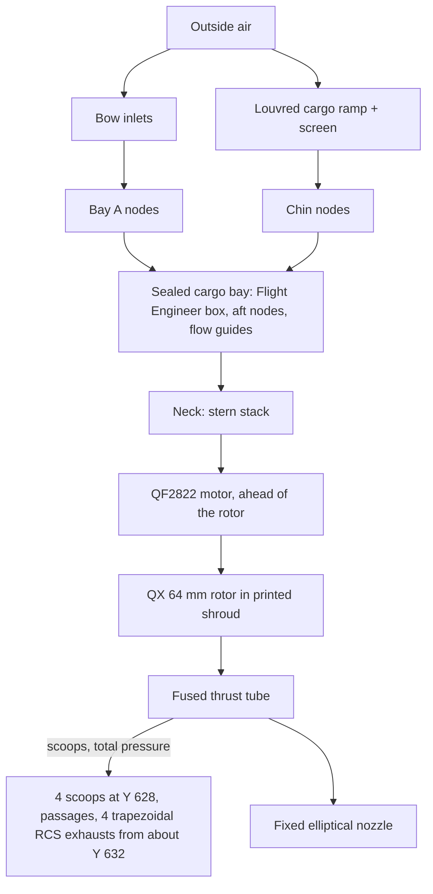
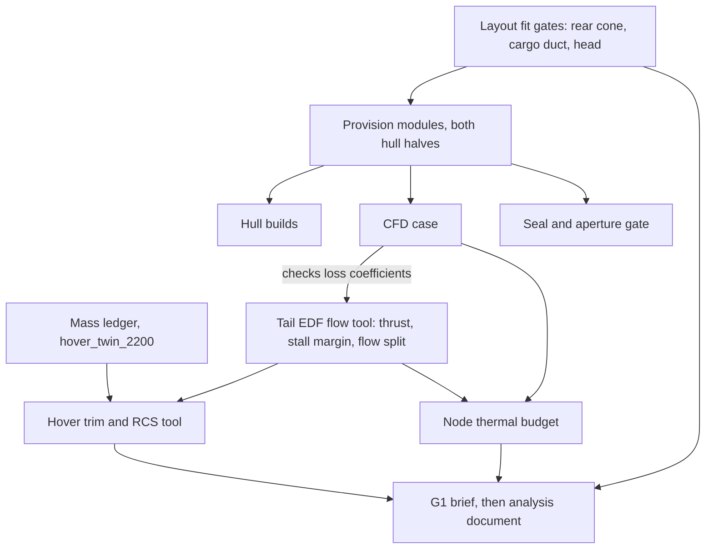
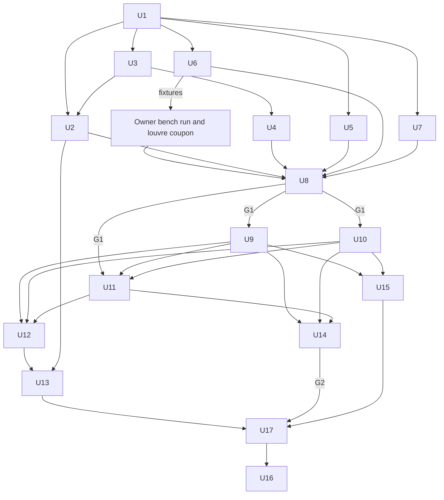

# Cargo-Ramp Intake, Tail EDF Cooling and Forward Relocation - Plan

**Author:** Steve Griffing, PE(CSE), CISSP-ISSEP, CPP (owner; every product decision below is his). Requirements and plan drafted by Claude (Anthropic) under the author's direction, using the `ce-brainstorm` and `ce-plan` skills, per `AGENTS.md` §3. AI-generated and not yet reviewed.
**License:** CC BY-SA 4.0 — see LICENSES/CC-BY-SA-4.0 (SPDX-License-Identifier: CC-BY-SA-4.0)
**Target repo:** `Serenity-UAV`. All paths are relative to that repo.
**Source issue:** GitHub issue #290, "fuselage cooling", and the owner's direction of 2026-11-15.

> **WARNING — engineering review required.** Every figure in this document is a planning estimate. A qualified engineer shall review and accept the analysis that follows from it before it is applied to flight hardware.

---

## Goal Capsule

- **Objective.** Make the tail EDF the fuselage's air mover from the first build. It draws all its air through the fuselage interior, by way of a louvred cargo ramp and the bow inlets. Move mass forward into the freed cargo bay so that the trim closes.
- **Product authority.** The owner (Stab-Rabbit-coding). His decisions of 2026-11-15, recorded under Key Decisions, override anything else here.
- **Standing.** Adopted by the owner on 2026-11-16 as the path forward. The design shift is recorded in `airframe/fuselage-mid/WBS.md` §1.1.1.4.0 and in root `AGENTS.md` §1.
- **Supersedes.** The fan stage, fan adapter, intake covers, rear-bell intakes and baffled insert of `docs/plans/2026-11-15-001-feat-fuselage-cooling-plan.md`.
- **Authority order for an executor.** Product Contract requirements, then Key Technical Decisions, then unit text. Root `AGENTS.md` and `airframe/AGENTS.md` bind all of it.
- **Execution profile.** Records, analysis and layout tools with tests, hull geometry, separate parts, a CFD case, an analysis document and specification updates. No flight hardware is built, and no flight-control firmware is written.
- **Stop conditions.**
    - Gate G1 (U8) is open: no hull geometry or separate part starts. The bench-test fixtures that U6 draws for the owner's pre-G1 bench run are exempt.
    - Gate G2 (U14) fails: stop and write an Owner Decision Brief (`docs/DOC_TEMPLATES.md`).
    - The stern thermal check is open: the thermal chain stops at U2 for the stern stack only. Do not substitute an assumed stern load. The check is an external dependency owned by the stern-stack (Pilot-NoNFO) plan, due before sprint S45; every other node proceeds.
    - R7 still fails after the flow-guide iteration limit of U13: stop and write an Owner Decision Brief.
    - Evidence shows that a settled decision cannot work: stop and report.
- **Tail ownership.** The executor closes the WBS items, regenerates `TODO.md`, and opens the pull request.

---

## Product Contract

### Summary

The tail EDF flies from the first build and is the only air mover in the fuselage. All its air passes through the interior: most enters at a louvred, screened forward cargo ramp, and the rest enters at the bow inlets that feed Bay A. The cargo bay becomes a sealed duct with one belly service hatch. Cargo moves to an external sling on a floor-mounted winch, with the line leaving the belly under the tilt pivot. The Flight Engineer box, the tail EDF speed controller and the RCS servos move forward to recover trim. The battery is already forward in the twin tray, and the winch and Cargo Observer stay at their present stations unless bench balance needs them moved.

### Problem Frame

The measured thermal baseline shows that a small tail fan moves enough bulk air but too little local air: three nodes fail the average-power case. Two of them, the chin nodes, sit directly behind the forward cargo ramp, which is sealed today.

The earlier plan gave the tail EDF its own intakes in the rear bell and metered a small bleed of cooling air through a baffle. Almost all EDF air then bypassed the avionics.

The aircraft has little trim room. With the two cells in the twin tray, the corrected ledger puts the hover CG at 0.03 in (0.8 mm) aft of the tilt pivot at Y 339.4. Flying the tail EDF and RCS hardware from the first build adds mass at the tail, and in hover the tail EDF is the only source of pitch trim and control.

Internal cargo occupies the centre of the fuselage, which is the only place where heavy boxes can move forward.

### Key Decisions

- KD1. **The forward cargo ramp is the tail EDF's main intake.** (session-settled: user-directed, 2026-11-15 — chosen over intake holes in the rear bell: all EDF air then cools the interior.) Governs R1, R2, R5.
- KD2. **The bow inlets stay, in parallel with the ramp.** (session-settled: user-directed, 2026-11-15 — chosen over a separate Bay A fan, ducting ramp air forward, and moving the Bay A nodes aft: Bay A sits upstream of the ramp and would get no air.) Governs R3.
- KD3. **There is no fan stage.** The tail EDF flies from the first build. (session-settled: user-directed, 2026-11-15 — chosen over a ramp cover with the Delta fan, and over an open ramp with a metering insert.) Governs R1, R8.
- KD4. **On the ground the EDF idles and the aircraft is restrained.** (session-settled: user-directed, 2026-11-15 — chosen over a ground cooling cart, a power-on time limit, and a standby fan.) Governs R9.
- KD5. **The cargo doors are fused shut, with one belly service panel secured by captive fasteners.** There is no internal cargo. (session-settled: user-directed, 2026-11-15 — chosen over bolted door panels and over sealed actuated doors.) Governs R11, R12. Amended 2026-11-16 (owner): the panel replaces every door, servo and latch item, and its fasteners shall not wear out with frequent opening and closing nor be easy to lose in the field, so "bolted" is retired in favour of captive quarter-turn fasteners (R12).
- KD6. **The ramp is a louvred panel on its canon outline, with a screen behind it.** (session-settled: user-directed, 2026-11-15 — chosen over a ramp lowered as a scoop and over a plain open hole.) Governs R5, R6.
- KD7. **The winch sits on the cargo floor at its present station, and the load line leaves the belly under the tilt pivot.** The winch and the Cargo Observer move forward only if bench balance needs it. (session-settled: user-directed, 2026-11-15 — the owner first asked for the winch motor as far forward as it fits; on the corrected ledger that move leaves the aircraft nose-heavy, and he chose to leave both in place for trim. The fairlead under the pivot was chosen over one under the empty hover CG: a slung load then adds no pitching moment in hover.) Governs R13, R14, R15, R20.
- KD8. **RCS is populated in the first build.** (session-settled: user-directed, 2026-11-15 — chosen over capped stubs with empty mounts, and over dropping RCS.) Governs R16, R17.
- KD9. **Priority when the intake limits the EDF: cooling, then RCS, then thrust.** Added thrust remains a goal. (session-settled: user-directed, 2026-11-15 — chosen over RCS first, and over a fixed thrust share that could force the ramp beyond its canon outline.) Governs R7, R10.
- KD10. **The EDF motor is mounted as a pusher, ahead of the rotor.** (session-settled: user-directed, 2026-11-15 — chosen over the motor behind the rotor in the exhaust.) Governs R18.
- KD11. **Three items move forward: the Flight Engineer box, the tail EDF speed controller and the RCS servos.** (session-settled: user-directed, 2026-11-15 — the owner first chose six moves on the uncorrected ledger; on the corrected ledger six overshoot and leave the aircraft nose-heavy, and he chose the QX 64 mm with the Flight Engineer box forward. The battery is already forward in the twin tray. The winch and the Cargo Observer stay in place under KD7.) Governs R19.
- KD12. **The stern stack becomes the single Pilot-NoNFO stack and stays aft of the pivot.** (session-settled: user-directed, 2026-11-15 — chosen over moving it forward into the cargo bay.) Governs R21.
- KD14. **The tail EDF is the QX-Motor 64 mm unit used in the nacelles: QF2822 2300 KV motor, 12-blade rotor, OSESC-NAC speed controller, in a printed pusher shroud.** (session-settled: user-directed, 2026-11-15 — chosen over the XFly X5 50 mm, and over the X5 motor with a custom 2.165 in (55 mm) rotor. The owner's rule was to drop the QX if it left the controllable envelope. On the uncorrected mass ledger it did, and the X5 was substituted; on the corrected ledger, with the Flight Engineer box forward, the QX trims at 25 % of control or less, and the owner chose it. Supersedes the earlier plan's KD8.) Governs R18, R29, R30, R38.
- KD15. **The ramp louvres are designed for low pressure loss.** (session-settled: user-directed, 2026-11-15 — chosen over ordinary louvres: installed thrust and RCS authority both fall with intake loss, and behind ordinary louvres the X5 also fails the 50 % trim criterion.) Governs R5, R6, R27, R30.
- KD16. **The ventral RCS jets sit at station Y 628 or further aft.** (session-settled: user-directed, 2026-11-15 — chosen over piping the jet through the skid crossbar, and over moving the crossbar forward 0.25 in (6.4 mm): the crossbar ends at about Y 627, the jet path is clear from Y 628 to Y 640, and no skid structure changes.) Governs R17, R32. Amended 2026-11-16 (owner): the ventral pair is 50° apart (245° and 295°) and canted 25° aft, because a radial ventral jet strikes the crossbar at Y 626 to 627 in a 3D check and two round holes cannot sit 30° apart on the tube. Amended 2026-11-18 (owner, TEDF-05 brief 3, option B): one ventral jet at 270°, canted 25° aft, its exhaust sides on the port and starboard joints of the centre belly panel (about 245.5° and 294.5°), from Y 635 to Y 649, 0.66 in² (428 mm²); the 245°/295° pair strikes the skid pods (TEDF-05 3D check), and a jet at 255° to 285° clears the crossbar from Y 635 aft.
- KD17. **The GNSS antenna's planning default is under the bridge window, behind a cover that passes radio signals and matches the canon window; the placement is an open G1 trade.** (session-settled: user-directed, 2026-11-15 — chosen over the cargo roof station at Y 415.7: it puts real equipment in the nose in place of ballast.) Governs R35. Amended 2026-11-16 (owner): placement is still fluid; U7 compares the bow position with its alternatives on CG, wiring, emissions and reception (OQ9).
- KD18. **The bow carries an adjustable ballast pocket, and final balance is done on the bench.** (session-settled: user-directed, 2026-11-15 — chosen over trimming with RCS in flight: dead weight is less desired than equipment, but better than spending endurance on trim control.) Governs R34, R36.
- KD19. **RCS exhausts are trapezoidal openings that follow the canon ribs and plate sections of the rear cone.** They read as missing plates or designed openings, not round holes. Plate joints may shift radially to put each exhaust at its required angle, keeping the canon pattern as far as possible. (session-settled: user-directed, 2026-11-15, comment on PR #291 — chosen over round or elliptical jet holes.) Governs R37.
- KD20. **The RCS intake scoops sit at station Y 628, at the head of the thrust-tube taper, with added structure at the shroud joint, and each scoop's shape is independent of its exhaust's.** (session-settled: user-directed, 2026-11-16 — chosen over flush wall holes at Y 630 to Y 634, which see static pressure only: about 68 % of duct total pressure at Y 628 against 57 % at Y 634, and falling to 21 % at Y 646.) The scoop is sized for pressure recovery and low blockage; a short passage in the tube-to-skin gap carries the flow to the exhaust. Governs R33, R37, R42.
- KD21. **An independent sensor detects tail EDF loss and reports it to every controller, and independent nacelle trim logic compensates automatically.** (session-settled: user-directed, 2026-11-16 — chosen over detection through the flight controller, whose 0.3 s path lets pitch run to about 2.7° and 18°/s before any response.) Governs R39, R40.
- KD22. **The PACE matrix gains two roles: tail EDF and RCS control, and thrust monitor and trim compensation.** (session-settled: user-directed, 2026-11-16 — chosen over carrying the monitor outside the matrix; the sensor element, its loss flag and the trim logic stay independent hardware under KD21.) Governs R41.
- KD13. **Carried from the earlier plan.** Nacelle tilt compensates the tail EDF thrust in hover. Printed flow guides raise local air speed at failing nodes. The thrust tube is fused into the aft hull. The owner sets the aft CG limit before hull geometry work. CFD is tied to the node thermal budget. (session-settled: user-directed, 2026-11-15, in `docs/plans/2026-11-15-001-feat-fuselage-cooling-plan.md` KD7, KD8, KD10, KD11, KD12, KD6.) Governs R4, R8, R22, R23.

### Requirements

**Air path**

- R1. The tail EDF shall be the only air mover in the fuselage, and all its air shall pass through the fuselage interior.
- R2. The forward cargo ramp shall admit most of the EDF air.
- R3. The bow inlets shall admit the air for Bay A, and that air shall join the ramp air in the cargo bay.
- R4. Printed flow guides shall direct the stream past each node that needs more local air speed.
- R5. The ramp intake shall keep the canon outline of the cargo ramp.
- R6. A screen behind the ramp louvres shall stop debris that could damage the avionics or the rotor.
- R27. The intake path, louvres and screen included, shall leave the tail EDF a pressure margin below the fan's stall point at full throttle. The minimum margin, in psi (kPa), is an owner decision at G1; U3 states the largest louvre loss coefficient at which this margin and R30 still hold at the hover throttle.

**Cooling, RCS and thrust**

- R7. Every node shall stay under its temperature limit in the average-power case, at the minimum cooling throttle, in still air and at cruise airspeed. The minimum cooling throttle is the larger of the tail speed controller's lowest stable throttle (ASSUMED 10 %) and the lowest throttle at which U13 shows every node passing; it is the ground idle of KD4.
- R8. In hover the tail EDF shall run at the throttle that pitch trim and RCS authority need. The estimate is about 80 %, where the thrust couple alone trims the aircraft. A lower "minimum cooling throttle" applies only where the RCS is not needed.
- R9. On the ground, the EDF shall run at the minimum cooling throttle with the aircraft restrained against its thrust. Above the sustained-transmit duty limit (BAYA-FWD-T1) the ground throttle shall follow radio power, up to the throttle U13 states for peak transmit.
- R10. The analysis shall state the tail EDF thrust that the intake and interior path leave, at each analysed throttle, against the EDF's free-air thrust.
- R24. The requirements shall state the aircraft's response to a tail EDF, speed-controller, RCS or intake-blockage fault in hover, and in forward flight, which removes forced cooling. In hover, loss of the tail EDF or its speed controller removes the thrust couple and the jets; the independent thrust monitor (R39) reports it to every controller and the independent trim logic (R40) swings the nacelles to the moment-balance tilt, after which pitch is held by nacelle tilt alone (the tilt-vectoring degraded mode of the Risks table). A blocked ramp screen lowers cooling, the couple and jet authority together.

**Sealed cargo bay**

- R11. The cargo doors shall be part of the printed hull skin, with canon panel lines.
- R12. One gasketed belly service panel shall give service access to the cargo bay. It shall be secured by captive quarter-turn panel fasteners (Dzus- or Camloc-style) in metal receptacles retained in the printed frame, with no screw thread cut directly in the printed plastic, and shall be tethered or hinged so that neither it nor any fastener can be lost. The fasteners shall be rated for an open-and-close life that the owner sets at G1 (the planning figure is 1,000 cycles, ASSUMED). The exact part is sourced and verified against its datasheet before it is named (requires verification).
- R25. The cargo bay and the air path shall have no opening to outside air other than the ramp, the bow inlets, the nozzle, the RCS exhausts, the belly service panel seal, the Bay A battery hatch seal, the winch fairlead and the Cargo Observer orifices. The tail EDF shall stay inhibited until the Bay A hatch is closed.

**Winch and sling load**

- R13. The cargo winch shall mount on the cargo bay floor at its present station. It shall move forward only if bench balance needs it.
- R14. The load line shall leave the belly through a fairlead under the tilt pivot.
- R15. A small recess in the belly shall house the hook or magnet when the line is retracted.
- R26. The winch line and fairlead shall be kept clear of the air stream to the EDF, so that a slack line cannot reach the rotor.

**RCS**

- R16. Four RCS jets shall be fitted and working in the first build, with their valves, servos and gateway.
- R17. Each RCS jet shall have a clear discharge path past the dorsal pod, the skids and the skid crossbar, checked in 3D for the spreading jet at its stated azimuth and aft cant.
- R32. The ventral RCS jets shall exit the skin at station Y 628 or further aft, 50° apart (245° and 295°) and canted 25° aft, clear of the skid crossbar. (Owner direction, 2026-11-16: a radial ventral jet at Y 634 strikes the crossbar at Y 626 to 627; from 20° aft cant the jet is clear. The upper jets stay radial.) (Amended 2026-11-18, owner: one ventral jet at 270°, canted 25° aft, its exhaust sides on the port and starboard joints of the centre belly panel (about 245.5° and 294.5°), from Y 635 to Y 649, 0.66 in² (428 mm²); the 245°/295° pair strikes the skid pods (TEDF-05 3D check), and a jet at 255° to 285° clears the crossbar from Y 635 aft; `tools/rcs_jets.py`.)

**Tail EDF installation**

- R18. The EDF motor shall sit ahead of the rotor, on a shaft short enough to run below its first critical speed with margin.
- R29. The tail EDF, its speed controller and the RCS shall be treated as flight-critical in hover: they are the only pitch trim and pitch control the aircraft has there. So shall the nacelle tilt drive, the thrust monitor (R39) and the independent trim logic (R40), because tilt alone holds pitch after a tail EDF loss. The analysis shall take the tilt drive's lag, rate and backlash from `docs/TILT_DRIVE_CONTROL_SPEC.md` (ASSUMED until measured), state the backlash dead band against the pitch loop, and state the brake-release state the degraded mode needs.
- R30. Hover pitch trim shall use no more than 50 % of the pitch control moment, the criterion adopted in `docs/CG_RELOCATION_STUDY.md` §1.
- R31. The RCS shall give pitch authority in both directions about the trim point, and yaw authority.
- R33. The RCS jets shall be sized from the duct's total pressure at the scoop and the measured jet path loss, so that hover pitch trim meets R30.
- R37. Each RCS exhaust shall be a trapezoidal opening on the canon plate pattern of the rear cone, with the flow area that R33 requires. The scoop that feeds it is not bound to that shape.
- R38. The tail EDF shall share its motor, rotor and speed controller part numbers with the nacelle EDFs.
- R39. An independent sensor shall detect loss or reduction of tail EDF thrust and report it, with the measured tail thrust fraction, to every controller. The sensor element, its own microcontroller and converter, and its fused power branch shall not be shared with the tail EDF's speed controller or with any flight controller. It shall check its reading against the commanded throttle, and on its own failure it shall report "unknown" and shall not trigger any action.
- R40. Independent nacelle trim logic, hosted in the nacelle tilt-drive controller and fed directly by the thrust monitor, shall compensate automatically for a reduction in tail thrust, moving both nacelles together to the moment-balance tilt for the measured tail thrust (about 7.2° aft of vertical at 80 % throttle and 12.9° at zero tail thrust), within a bounded authority and the tilt drive's rate limit, in hover only.
- R41. The PACE matrix shall carry two added roles, tail EDF and RCS control, and thrust monitor and trim compensation, each with a Primary, Alternative, Contingency and Emergency holder on four different stacks. The matrix rules shall be revised for six roles, and the assignment is decided at G1 together with the command node of NFP-TEDF-2.
- R42. The RCS intake scoop shall sit at station Y 628, with structure added at the shroud joint to carry it, and its flow shall reach the exhaust through a passage whose area is at least the exhaust area.
- R22. The aft hull shall carry the mounting ring, the fused thrust tube and the fixed elliptical nozzle, 2.06 × 1.76 in (52.3 × 44.7 mm).

**Mass and trim**

- R19. The Flight Engineer box, the tail EDF speed controller and the RCS servos shall move forward as far as fit and function allow.
- R20. The Cargo Observer shall stay at its present station, and shall view its subject through orifices in the belly.
- R21. The stern stack shall be the single Pilot-NoNFO stack, aft of the pivot.
- R23. The hover CG shall lie inside the limit that the owner sets, with and without a slung load. The estimated window is 0.04 to 0.15 in (1.0 to 3.9 mm) aft of the pivot.
- R34. The bow shall have an adjustable ballast pocket, used after real equipment has been placed forward. Because the pocket moves the CG forward only, the build shall also keep a stated aft balance allowance (an aft ballast provision or a movable-equipment allowance) with CG travel equal to the pocket's.
- R35. The GNSS antenna placement shall be chosen at G1 from a trade of the bow position (under the bridge window, above the nose Observer board, behind a cover that passes GNSS signals and matches the canon window) against its alternatives, on CG, wiring run, emissions and reception. (Owner direction, 2026-11-16: placement is still open.)
- R36. The build plan shall include a bench balance step, with a stated allowance of ballast mass and CG travel to cover the difference between the estimate and the as-built aircraft.

### Acceptance Examples

- AE1. **Covers R1, R25.** Given the built configuration, when the enclosure check runs, then every path from outside air to the EDF passes through the fuselage interior, and the only openings are the eight R25 names.
- AE2. **Covers R7, R9.** Given the aircraft restrained on the ground at the minimum cooling throttle, when the coupled analysis runs, then every node passes the average-power case.
- AE7. **Covers R8, R30.** Given hover at the stated tail throttle, when the trim analysis runs, then pitch trim uses no more than 50 % of the pitch control moment.
- AE8. **Covers R39, R40.** Given a simulated loss of tail thrust in hover, when the trim analysis runs, then the monitor's loss flag, the broadcast and the nacelle move to the moment-balance tilt complete within the latency budget the owner sets, and the pitch excursion stays within the owner's limit.
- AE9. **Covers R12.** Given the belly panel opened and closed for the rated cycle count in a bench test, then no fastener or receptacle wears out of tolerance, no fastener comes free of the panel, and the gasket still seals.
- AE3. **Covers R10.** Given each analysed throttle, when the analysis runs, then it reports installed thrust beside free-air thrust.
- AE4. **Covers R23.** Given the ledger with every moved and added part, when the hover CG is outside the owner's window, forward or aft, then the run fails and an Owner Decision Brief is written.
- AE5. **Covers R17.** Given the chosen RCS stations, when the jet-path check runs, then all four jets are clear.
- AE6. **Covers R14, R23.** Given a slung load on the line, when the ledger runs, then the loaded CG is no further from the pivot than the empty CG.

### Success Criteria

- Every node passes the average-power case, with stated margins and stated uncertainty.
- The RCS has stated pitch and yaw authority at the hover tail throttle.
- Installed tail thrust is reported, and the plan shows what was done to raise it inside the canon ramp outline.
- The hover CG is inside the owner's limit.
- Hover pitch trim uses no more than 50 % of the pitch control moment, with the tail throttle it needs stated.
- The first build needs no later hull reprint to gain the EDF, the RCS or the winch.

### Scope Boundaries

**Not in scope**

- Internal cargo, and any door actuation.
- The Delta cooling fan, its adapter and its power circuit.
- Intakes in the rear bell, intake covers, RCS caps and the baffled insert.
- Moving the aft nodes or the stern stack forward.
- A long drive shaft from a motor in the cargo bay to the rotor.

**Deferred for later**

- Bench measurement of the ASSUMED thermal inputs, and a transient thermal model.
- Drawing and bench-testing the custom rotor and its shroud.
- Flight-control firmware for the tail throttle schedule, the tilt trim, the RCS mixer and the tilt-vectoring degraded mode, and the thrust monitor's firmware and board (NFP-TEDF-4).
- GNSS reception beside the nose Observer board, if the bow placement is chosen at G1: a bench step with acceptance criteria in the U16 build guide.

### Dependencies and Assumptions

- **Corrected mass baseline, 2026-11-15.** `tools/auw_ledger.py` carried a retired single battery in the cargo bay, the Bay A nodes at a stale station, and no nose Observer. Corrected, with the two cells in the published twin tray, the hover CG is 0.03 in (0.8 mm) aft of the pivot. The earlier figure of 0.46 in (11.8 mm) was wrong. The battery is already forward, so the battery move in KD11 has no further travel to give.

| Tail EDF | Forward moves applied | CG from the pivot | CG the thrust couple alone trims (full throttle) |
| --- | --- | --- | --- |
| X5 50 mm | speed controller and RCS servos only | 0.17 in (4.4 mm) aft | 0.09 in (2.3 mm) aft |
| X5 50 mm | plus winch and Cargo Observer | 0.06 in (1.5 mm) aft | 0.09 in (2.3 mm) aft |
| X5 50 mm | plus Flight Engineer box as well | 0.19 in (4.8 mm) FORWARD | 0.09 in (2.3 mm) aft |
| QX 64 mm | speed controller and RCS servos only | 0.33 in (8.4 mm) aft | 0.14 in (3.6 mm) aft |
| QX 64 mm | plus Flight Engineer box | 0.09 in (2.3 mm) aft | 0.14 in (3.6 mm) aft |
| QX 64 mm | plus winch and Cargo Observer as well | 0.02 in (0.5 mm) FORWARD | 0.14 in (3.6 mm) aft |

- **What the corrected baseline changes.**
    - All six forward moves together now overshoot: the aircraft would be nose-heavy, where pitch authority is weakest.
    - The X5 would need the Flight Engineer box left where it is; the QX needs it forward.
    - The QX 64 mm is inside the controllable envelope with the Flight Engineer box forward, and the owner chose it (KD14).
    - The last column is the full-throttle case. At the 80 % hover throttle the couple alone trims at 0.09 in (2.3 mm) aft, which is the KTD9 target.
- **RCS sizing and CG window for the chosen case, planning estimate.** QX 64 mm, Flight Engineer box, speed controller and RCS servos forward, GNSS antenna in the nose: hover mass 15.08 lbm (6,840 g), CG 0.09 in (2.3 mm) aft of the pivot. Low-loss ramp, jet path loss 1.0, four jets of 0.71 in (18 mm) bore, fed by scoops at station Y 628 (KD20) and exiting the skin from about Y 632, the ventral pair at 245° and 295° (50° apart, 25° aft cant) and the upper pair at 45° and 135° (radial). **The table is the plain screened ramp case: it takes no louvre loss.** U3 and U4 report the same figures across the louvre loss cases (R27), and at full, nominal and end-of-hover pack voltage (U4). The table uses radial jets; with the ventral pair canted 25° aft (R32) the ventral moment falls to about 86 % unless the bore grows to about 0.77 in (19.4 mm), which U4 decides.

| Tail throttle | Untrimmed moment | Trim use | Nose-down reserve | Nose-up reserve | Tail thrust, jets closed |
| --- | --- | --- | --- | --- | --- |
| 100 % | 0.75 lbf·in (0.085 N·m) nose-down | 25 % | 6.5 rad/s² | 3.9 rad/s² | 2.9 lbf (13.0 N) |
| 80 % | about zero | 0 % | 3.3 rad/s² | 3.3 rad/s² | 1.9 lbf (8.4 N) |
| 60 % | 0.60 lbf·in (0.068 N·m) nose-up | 55 % | 0.8 rad/s² | 2.9 rad/s² | 1.1 lbf (4.7 N) |

    - At about 80 % tail throttle the thrust couple alone trims the aircraft, and the jets are left for control with equal reserve in both directions.
    - CG window for trim use of 50 % or less: 0.04 to 0.15 in (1.0 to 3.9 mm) aft of the pivot at 80 to 100 % throttle. It narrows to 0.04 to 0.09 in (1.0 to 2.2 mm) if the throttle may fall to 60 %.
    - Jet path loss from 0.5 to 1.5 moves the trim use at full throttle from 20 % to 30 %.
    - One upper jet gives a yaw moment of about 1.28 lbf·in (0.145 N·m) at full throttle.
    - With the winch and Cargo Observer also moved forward the CG would be 0.02 in (0.5 mm) forward of the pivot, outside the window. They stay near their present stations.
    - Pitch inertia is ASSUMED at 225 lbm·in² (0.066 kg·m²) in this table. U4 replaces it with the single value computed from the mass ledger and uses that value everywhere. **U1 result (2026-11-17):** the ledger now publishes that value as `pitch_inertia` in `current-specification/auw_ledger.json` (`hover_twin_2200`, about the CG, with the nose pods, pitot parts, Bay A parts and cells closed): about 285 lbm·in² (0.084 kg·m²), 27 % above the 225 lbm·in² assumed here. With the same gaps closed the CG is 1.5 mm (0.06 in) forward of the tilt pivot, not 0.8 mm aft: the Bay A printed parts move it 1.45 mm, the nose sensor bodies 0.55 mm and the pitot parts 0.23 mm (the nose masses are ESTIMATES, 0.05 mm per gram). A first pass double-counted the Bay A hatch cover, which is part of the published merged hull; it is removed. Applying this plan's own deltas (+7.6 mm for the QX unit, speed controller and RCS servos, −6.1 mm for the Flight Engineer box, taken from the table above and not recomputed) gives a final CG near 0.0 mm, short of the 1.0 to 3.9 mm window by at least 1.0 mm. The trim table above is not re-derived until U4.

- **Measured baseline.** The fan operating point, node temperatures, rear-cone stations and the CG arm are in `docs/plans/2026-11-15-001-feat-fuselage-cooling-plan.md`, "Measured Baseline". Every thermal input is ASSUMED.
- **Ramp opening.** The sealed ramp fairing measures about 2.0 × 1.4 in (52 × 36 mm), or 2.9 in² (1,870 mm²), in `tools/cargo_layout_fit.py`. The QX 64 mm rotor's swept area is about 4.0 in² (2,600 mm²), with an ASSUMED 1.1 in (28 mm) hub. The ramp opening is about 70 % of the fan face before louvres and screen, so the bow inlets carry a real share of the flow; U3 takes the ratio as an input. (The 2.7 in² figure given earlier was the retired 55 mm rotor's.)
- **Hover trim and control limits, planning estimate.** Free-body model in hover: nacelle thrust acts at the tilt pivot (Y 339.4, Z 146.9); the tail EDF thrust acts on the tail axis (Z 165.2); weight acts at the CG. A CG aft of the pivot gives a nose-up moment W·d. Two things oppose it. The tail thrust and the nacelle tilt that cancels it form a nose-down couple on a 0.72 in (18.4 mm) arm. Downward RCS jets at the tail give a nose-down moment on an arm of about 11.5 in (291 mm). At a level attitude nacelle tilt alone cannot trim pitch, because the pivot is 0.41 in (10.3 mm) below the CG. At a nose-down attitude it can: tilting the nacelles aft until the thrust line passes through the CG trims the aircraft, which is the basis of the tilt-vectoring degraded mode (Risks and Mitigations). CG is recomputed from `current-specification/auw_ledger.json` with every change in this document applied; added masses and destination stations are ASSUMED.
- **RCS plumbing, measured 2026-11-16 on the Rev U aft hull.** The tube's outer wall is 0.37 in (9.4 mm) from the inside of the skin at the ventral jets and 0.34 in (8.7 mm) at the upper jets at Y 628, narrowing to 0.32 in (8.1 mm) and 0.28 in (7.1 mm) at Y 634. A jet is therefore a scoop in the tube, a short passage in that gap, and an exhaust in the skin, with no room for a conventional valve body outside the tube. The owner's direction (KD20, 2026-11-16) puts the scoops at Y 628 with structure added at the shroud joint and lets each scoop's shape differ from its exhaust's. Hand estimate of the ventral passage (Y 628, tube radius 1.34 in (34.0 mm), skin radius 1.71 in (43.4 mm)): a 45° sector per jet, which leaves a 5° web between the two ventral passages, gives about 0.40 in² (258 mm²) after 0.06 in (1.5 mm) side walls, roughly the 0.39 in² (254 mm²) exhaust; a 40° sector would be 11 % short. Four inward scoop lips 0.12 to 0.16 in (3 to 4 mm) tall block about 8 % of the tube (ASSUMED). Past the fan mounting ring (OD 3.25 in, 82.6 mm) the room is 0.49 in (12.4 mm) at Y 600, 0.31 in (8.0 mm) at Y 610, 0.15 in (3.9 mm) at Y 620 and none aft of about Y 627, so the ring ends forward of Y 625 and the four control runs (about 11.5 in, 290 mm, from the forward servos) are cables, not pushrods. The valve concept is a G1 trade (U5, U8).
- **RCS intake station, estimated 2026-11-16.** The tube tapers from 2.55 in (64.8 mm) at Y 627 (ASSUMED straight in the ellipse axes) to the 2.06 × 1.76 in (52.3 × 44.7 mm) nozzle at Y 650. At 80 % throttle the nozzle speed is 118 kt (60.9 m/s) and the duct total pressure 0.329 psi (2,269 Pa). Wall static pressure falls along the taper as the air speeds up: 0.222 psi (1,534 Pa), 68 % of total, at Y 628; 65 % at Y 630; 57 % at Y 634; 43 % at Y 640; 21 % at Y 646. A flush wall hole sees only that static pressure, so the intake belongs at the head of the taper, and a scoop recovers part of the rest. Two round 0.71 in holes cannot sit 30° apart on the tube, because the arc between them is 0.70 in (17.8 mm) at Y 628, which is why the ventral pair is 50° apart (arc 1.17 in, 29.6 mm; about 6 % less vertical moment than 30°). The contour is the planning assumption; U5 sets the real one, and the jet coupon replaces these pressures with measurements.
- **Independent EDF-loss detection and trim compensation, owner direction 2026-11-16 (KD21, R39, R40).** After a tail EDF loss the nacelles are still tilted aft to cancel the lost thrust, so pitch moment balance needs *more* aft tilt, not less, because the nacelles' aft force acts below the CG: tilt aft of vertical δ = asin((W·d − F_t·h_t)/(T·h_p)), with CG 0.09 in (2.3 mm) aft of the pivot (d), tail axis 0.32 in (8.1 mm) above the CG (h_t) and pivot 0.41 in (10.3 mm) below it (h_p). Planning schedule (ASSUMED geometry): 2.92 lbf (13.0 N) tail thrust, 4.1°; 1.89 lbf (8.4 N), 7.2°; 1.06 lbf (4.7 N), 9.7°; 0.47 lbf (2.1 N), 11.5°; zero, 12.9°. A force balance alone would unwind the tilt, which is wrong for pitch; the aft drift that remains (about 0.22 g at zero tail thrust) is handled by the attitude loop, which pitches the aircraft nose-down. Latency budget (ASSUMED): sensor 10 ms, bus 5 ms, logic 10 ms, nacelle move of 5.7° at the 120 °/s rate requirement 48 ms, so about 0.1 s, giving about 0.3° of pitch and 6°/s before compensation, against 2.7° and 18°/s at 0.3 s through the flight controller, 11° at 0.6 s and 30° at 1.0 s.
- **RCS jet model.** Each jet is fed by the duct's total pressure through a scoop, so its speed is the nozzle speed divided by √(1 + K), with a path loss K ASSUMED at 1.0. Jet force is ρ·A·v². Open jets add exit area and lower the nozzle speed; the fan is held at constant flow power.
- **Bow trim, checked 2026-11-15.** Mass at the bow moves the CG about 0.002 in per gram (0.05 mm per gram). The nose has free room: a pocket of about 0.4 to 1.4 in² (240 to 890 mm²) in section from station Y 8 to Y 22, and 2.2 to 3.7 in² (1,430 to 2,410 mm²) from Y 30 to Y 50, measured on the head hull less the head layout envelopes.
    - **Ledger.** Corrected on 2026-11-15; see the corrected mass baseline above. The nose camera, ToF and laser pods and the pitot parts still have no mass in the ledger. They are all at the bow, where about 0.9 oz (26 g) reaches the forward edge of the window; U14's gap closure therefore runs in Phase A, before U4.
    - **GNSS antenna.** KD17 places it in the nose; on 2026-11-16 the owner reopened the placement (R35, OQ9), so the bow figures below are provisional until G1. An ASSUMED 0.5 oz (15 g) patch gives about 0.03 in (0.85 mm), and is already in the CG estimate above. Checked against `tools/head_layout_fit.py` on 2026-11-15: the forward camera is not behind the bridge window; it is in the bow sensor bay under the brow, Y 9 to 32, Z 198 to 220. The nose Observer board lies under the bridge roof from Y 27 to Y 86. The gap between the board envelope and the roof is 0.62 in (15.7 mm) at Y 30, 0.55 in (13.9 mm) at Y 40, 0.48 in (12.3 mm) at Y 50 and 0.41 in (10.3 mm) at Y 60. A thin patch antenna fits in that gap forward of the window-aft frame at Y 60; a housed puck does not. The roof skin there is 0.09 in (2.4 mm) of carbon-filled nylon, which the cover replaces. Interference from the Observer board 0.5 in (12 mm) below the antenna is not assessed.
    - **49 MHz loading coil.** The forward post and coil are 0.14 oz (4 g) at Y 155.7. Moved to the bow they give 0.003 in (0.08 mm), which is not worth it for trim. The move would lengthen the end-fed wire by about 5 in (125 mm).
    - **Ballast.** 1.2 oz (35 g) at Y 15 gives 0.07 in (1.7 mm). It is the last resort, sized on the bench after the as-built CG is weighed.
- **Not assessed.** The transition from hover to forward flight. Gust and ground-effect moments and RCS valve and EDF spool lag enter U4's disturbance budget as ASSUMED allowances. The pitch plant is a double integrator on the U4 ledger inertia; no loop has been tuned and no stability margin is claimed, except the degraded-mode estimate in Risks and Mitigations.
- **Installed thrust, planning estimate.** Constant shaft power, calibrated to each unit's free-air static thrust; louvre and screen losses ASSUMED. All units keep about 40 to 47 % of free-air thrust behind louvred ramp intake; a plain screened ramp keeps about 56 to 66 %.

| Unit | Free air | Louvred ramp | Plain screened ramp |
| --- | --- | --- | --- |
| XFly X5 50 mm, stock | 2.73 lbf (12.2 N) | 1.27 lbf (5.7 N) | 1.82 lbf (8.1 N) |
| X5 motor, custom 55 mm rotor | 2.90 lbf (12.9 N) | 1.29 lbf (5.7 N) | 1.84 lbf (8.2 N) |
| QX 64 mm, 2300 KV (chosen) | 5.22 lbf (23.2 N) | 2.03 lbf (9.0 N) | 2.93 lbf (13.0 N) |

- **Stall margin.** Behind a plain screened ramp the QX 64 mm needs about 0.54 psi (3.8 kPa) of about 1.25 psi (8.6 kPa) available at full power. The 1.25 psi figure is ASSUMED: it is the duct total pressure of the constant-flow-power model at zero flow, not a maker fan curve; no stall curve has been published for the unit. U3 prints this provenance with every margin. Behind louvres with an ASSUMED loss coefficient of 2.3 on 55 % open area it would need all of it, which is why KD15 and R27 require low-loss louvres.
- **QX 64 mm data.** 1,368 W and 57 A at full throttle [REF-EDF-003]. Shroud lip OD 3.03 in (77 mm), so the rotor fits forward of about station Y 627, and the RCS scoops at Y 628 are just downstream of the shroud joint.
- **Shaft critical speed.** The QF2822 2300 KV motor turns up to about 51,000 rpm unloaded on 6S. A 0.16 in (4 mm) steel shaft runs clear of its first critical speed at 2 in (50 mm) unsupported, and close to its running range at 4 in (100 mm). Simply supported, ASSUMED properties, rotor overhang not counted. U5 recomputes it with the rotor mass and overhang included (R18).
- **RCS stations.** On the Rev U aft hull, the skid crossbar runs from about station Y 612 to Y 627. A ventral exit is clear from Y 628 to Y 640 in a flat-section check; a 3D check of the spreading jet (2026-11-16) shows a radial ventral jet at Y 634 still strikes the crossbar at Y 626 to 627, and a 25° aft cant clears it (R32). The scoop-to-exhaust stub is the 0.37 in (9.4 mm) gap, not the 0.6 in (16 mm) of the retired 55 mm rotor. A straight dorsal jet is blocked by the dorsal pod neck. The draft tool still places the RCS station at Y 621 and needs this change. Source: `tools/rear_cone_layout_fit.py`.
- **Repo rules that change.** Root `AGENTS.md` §1 calls the tail EDF optional and deferred to Phase 11. This plan makes it part of the first build. The design-shift gate in `AGENTS.md` §10 requires the WBS record before any geometry change.
- **Affected documents.** `docs/CARGO_WINCH_SPECIFICATION.md`, `docs/CARGO_DOOR_GATEWAY_SPEC.md`, `docs/CARGO_SECTION_LAYOUT.md`, `docs/POWER_DISTRIBUTION.md`, `deferred/WBS.md`, and the stern stack plan `docs/plans/2026-11-14-001-feat-nonfo-pilot-pb2-stern-stack-plan.md`.

### Outstanding Questions

**Deferred to Planning.** Each question names the unit or gate that settles it.

- OQ1. **Thrust target.** Default: report installed thrust against free-air thrust, with no fixed share. Planning estimate for the QX 64 mm behind a plain screened ramp (no louvre loss): about 2.9 lbf (13 N) at full throttle with the jets closed, and about 1.9 lbf (8.4 N) at the 80 % hover throttle, against 5.2 lbf (23.2 N) free air (the plain screened ramp, with no louvre loss). Settled in U3 and U13.
- OQ5. **Hover endurance.** The tail EDF runs at about 80 % throttle in hover. U3 states the power this adds and the endurance it costs. Settled in U13; shown as an estimate at G1.
- OQ6. **Holding the CG window.** The estimate puts the CG 0.09 in (2.3 mm) aft of the pivot, inside the window. Planning reconciles the remaining ledger gaps, then sizes the bow ballast pocket for the bench balance. Settled in U4 and U14.
- OQ8. **Bench balance allowance.** Planning sizes the ballast pocket and states the CG travel it gives, from the spread between estimated and as-built mass. Settled in U7 and U14.
- OQ9. **GNSS antenna placement.** Open (owner, 2026-11-16). U7 compares the bow position, a patch in the 0.48 to 0.62 in (12 to 16 mm) gap above the nose Observer board, with its alternatives on CG, wiring run, emissions near the Observer board and the 49 MHz antenna, and sky view. Decided at G1; the reception bench step for the chosen place is in U16.
- OQ10. **Payload-release servo.** Does the servo that releases the sling's hook or magnet survive the fused doors, or does it retire with the door servos? Default: keep one servo until G1 decides. Tied to what the Cargo Observer watches (OQ4). Decided at G1.
- OQ11. **Independent monitor and trim logic.** Which sensor (thrust-tube pressure, rotor speed tach, or speed-controller lead current), the owner's pitch-excursion limit for a tail EDF loss, and the trim logic's authority bound. U4 derives the latency requirement from the limit. Decided at G1.
- OQ2. **Response to an EDF fault in flight.** Default for planning, in hover: switch to the tilt-vectoring degraded mode, hold attitude nose-down, hold position slowly and land now. In forward flight: shed radio transmit power, report the fault, and land. The owner confirms or changes both. Decided at G1.
- OQ3. **RCS jet pattern and size.** The estimate supports four jets of 0.71 in (18 mm) equivalent bore, scoops at station Y 628: two ventral at 245° and 295° canted 25° aft, two upper at 45° and 135° radial. A larger bore of about 0.77 in (19.4 mm) restores the ventral moment the cant costs; U4 decides. Planning confirms the size with the measured jet path loss and gives each exhaust its trapezoidal outline at the same flow area, 0.39 in² (254 mm²). Settled in U4 and U5; outlines decided at G1. (2026-11-18, owner: the ventral pair becomes one jet at 270° on the centre belly panel, 0.66 in² (428 mm²); the upper pair stays at 45° and 135°; the upper passage width is open, TEDF-05 brief 4.)
- OQ4. **What the Cargo Observer watches** now that there is no internal cargo. Default: the sling load and the ground below, through the belly. Decided at G1.

### Relationship to the Earlier Plan

`docs/plans/2026-11-15-001-feat-fuselage-cooling-plan.md` stays the record of the measured baseline and of the decisions carried in KD13. Its fan-stage units no longer apply, and it is retired under KTD3.

The draft tool `tools/rear_cone_layout_fit.py` measures the rear cone and checks RCS jet paths. Its intake, fan and baffle content is superseded, and U5 rewrites it. The draft figure script and its figures showed the retired fan concept and were removed on 2026-11-16; U8 writes the figure script new.

### Sources

- Issue #290 and the owner's direction of 2026-11-15.
- `tools/cargo_layout_fit.py` for the ramp opening; `docs/CARGO_SECTION_LAYOUT.md` §5 for the ramp fairing.
- `current-specification/auw_ledger.json` for masses and stations.
- `tools/rear_cone_layout_fit.py` for rear-cone stations and RCS jet paths.
- [REF-EDF-003] for the QX 64 mm unit; [REF-EDF-001], [REF-EDF-002] for the X5 unit compared against it.
- `docs/CG_RELOCATION_STUDY.md` §1 for the 50 % control-reserve criterion.

---

## Planning Contract

**Product Contract preservation:** The Product Contract was amended by the owner on 2026-11-16 during the document review: KD5 (belly panel, captive fasteners), KD16 (ventral pair 50° apart, 25° cant), KD17 (GNSS placement open), and new KD20 to KD22 (scoops at Y 628, independent monitor and trim logic, PACE roles); requirements R7, R9, R12, R17, R24, R25, R27, R29, R32, R33, R34, R35, R37 and new R39 to R42; AE1, AE4 and new AE8, AE9; and OQ2, OQ3, OQ9 and new OQ10, OQ11. The Goal Capsule gained stop conditions, and each Outstanding Question names the unit or gate that settles it.

### Key Technical Decisions

- KTD1. **Two phases, with owner gate G1 between them.** Phase A is the record, the analysis tools and the layout, and it ends in the G1 Owner Decision Brief. Phase B is hull geometry, separate parts, CFD and records. (session-settled: user-approved, 2026-11-15 — chosen over planning Phase A alone: one plan, but no hull geometry before the owner signs G1.) Implements the design-shift gate in `AGENTS.md` §10.
- KTD2. **The planning estimates become repo tools with tests.** The installed-thrust model, the RCS jet model and the hover trim model were run from scratch scripts. Each becomes a tool with one limits list that drives its printout and its exit code. (session-settled: user-approved, 2026-11-15 — chosen over leaving the figures in this document only.) Governs R10, R23, R27, R30, R33.
- KTD3. **`docs/plans/2026-11-15-001-feat-fuselage-cooling-plan.md` is retired, not revised.** It stays as the record of the measured baseline. (session-settled: user-approved, 2026-11-15 — chosen over revising it in place: its fan-stage units no longer apply.)
- KTD4. **Flight-control firmware is out of this plan.** The plan produces the tail throttle schedule, the tilt trim angle and the RCS mixer gains as figures, and updates the specifications that own them. (session-settled: user-approved, 2026-11-15.)
- KTD5. **One provision module per hull half supplies every solid and cut.** The hull build, the CFD geometry, the seal check and the layout fit all read it, so they cannot drift apart. Published STLs are never patched.
- KTD6. **The pusher shroud and stator reuse the nacelle 64 mm geometry.** `airframe/openscad/nacelles/nacelle_pod_64mm_tandem.scad` and `edf_motor_mount_64mm.scad` already hold the QX rotor in a printed shroud. The tail unit is a third instance with the motor ahead of the rotor. Implements KD10 and KD14; governs R18, R38.
- KTD7. **The fan model is constant flow power, calibrated to the maker's free-air static thrust.** It is a planning model. The CFD case of U12 checks its loss coefficients, and a bench run replaces it. Every result that rests on it is PROVISIONAL.
- KTD8. **RCS jets are fed by scoops at duct total pressure.** The scoops sit at Y 628 (KD20). A flush wall hole sees only static pressure, 68 % of the total there and less further aft. Jet speed is the nozzle speed divided by √(1 + K), with K including the scoop, the passage and the exhaust. The scoop, the passage and the exhaust are three independent shapes: the exhaust is the trapezoid on the canon plates (flow area as sized), the scoop is shaped for pressure recovery and low blockage, and the passage's area is at least the exhaust's. The jet coupon of the pre-G1 bench run measures the feed pressure, K and effective direction, flush against lipped scoops, and replaces these estimates. Implements KD19, KD20; governs R33, R37, R42.
- KTD9. **The hover CG target is the point where the thrust couple alone trims at the hover throttle.** The jets are then left for control, with equal reserve in both directions. The owner sets the window at G1. Implements KD13; governs R8, R23, R30.
- KTD10. **The CFD case is `buoyantSimpleFoam`, k-ω SST, OpenFOAM v1912, meshed from the real surfaces with `snappyHexMesh`.** The tail EDF is a fixed-flow sink swept over throttle. The ramp and the bow inlets are total-pressure inlets, swept from still air to cruise. RCS jets are closed in the cooling runs. Node envelopes are heat-flux walls. Follow `docs/solutions/runtime-errors/openfoam-v1912-ubuntu-build-and-steady-rans-pitfalls.md`.
- KTD11. **The node tool stays the temperature authority.** `tools/node_thermal_forced_air.py` takes station speeds and air temperatures from the CFD results. Its fan curve is removed with the fan.
- KTD12. **`hover_twin_2200` is this plan's mass baseline.** The tools that read `hover_4000` are not switched until the owner decides at G1.
- KTD13. **The stern stack heat load waits for the stern thermal check.** The thermal chain does not start on an assumed value. (session-settled: user-directed, 2026-11-15, on the earlier plan's review — chosen over carrying the old CN4 and FC4 figures as an assumption.)
- KTD14. **The safety response to a tail EDF or RCS fault is specified apart from the control function.** U8 brings the owner the fault cases with figures. The GW-RCS rule that closes all valves on a lost heartbeat was written when RCS was low-authority, and is re-examined there. Governs R24, R29.
- KTD15. **Independent detection and trim compensation are specified here and built later.** U4 derives the moment-balance schedule and the latency requirement, U16 writes `docs/TAIL_EDF_FAULT_COMPENSATION_SPEC.md`, and the monitor node and logic hardware are NFP-TEDF-4. The same duct-pressure sensor can give the blockage signal and the RCS feed pressure. Implements KD21; governs R39, R40. (session-settled: user-directed, 2026-11-16.)
- KTD16. **The control figures are calculated in U17, after G2, from as-built geometry.** U17 gives the RCS mixer matrix and the nacelle tilt and trim PID gains with gain and phase margins, as figures; firmware stays out of scope (KTD4). Governs R30, R31, R40. (session-settled: user-directed, 2026-11-16.)

### High-Level Technical Design

**Air path**

**How the tools feed each other**

**Unit order**

### Assumptions

- The QX rotor exists in both hands, and the tail unit takes either [REF-EDF-003].
- A short pusher shaft, or the rotor mounted directly on the motor shaft with the motor reversed, is workable. U5 recommends one, with its critical-speed check from the motor drawing; the owner decides at G1; U11 builds the drive the owner chose.
- The Flight Engineer box fits forward in the cargo bay once the payload envelope is gone. `tools/cg_relocation_study.py` found no forward placement while the payload was there.
- **Build route for hull geometry.** OpenSCAD is the CAD tool, run with `--backend=manifold`, and the `.scad` sources are the record. Python mesh booleans with `manifold3d` are the fallback, gated by the existing mesh-proof checks. The owner's Build cloud environment installs OpenSCAD (a pinned snapshot), `manifold3d` and KiCad exactly 9.0.2 at every new session (set 2026-11-16). KiCad is the owner's PC version, because KiCad files are not forward compatible. It is the official `kicad/kicad:9.0.2` image unpacked under `/opt/kicad-9.0.2` and run through two wrappers: `kicad-cli`, and `kicad-python3` for scripts that `import pcbnew` (the image's Python 3.11, not `/usr/bin/python3`). Each hull unit starts by checking `openscad --version` and `kicad-cli --version`, and stops with a clear message if either is missing. `airframe/blender-scripts/merge_cargo_interior.py` does not need Blender: it is a `trimesh` and `manifold3d` script that reads the committed `*_repaired.stl` shells in `airframe/blender-scripts/files-hollowed-24in/`, and runs with `/usr/bin/python3`. OpenFOAM v1912 and the other Python libraries are installed per session.
- Design ambient is 104 °F (40 °C), ASSUMED, pending BAYA-FWD-T2.

### Risks and Mitigations

| Risk | Effect | Mitigation |
| --- | --- | --- |
| Tail EDF or speed-controller loss in hover | The thrust couple and all four jets are lost together. With the nacelles tilted aft at the trim, the unopposed moment at the instant of loss at the KTD9 CG target is about 0.60 lbf·in (0.068 N·m), about 1.0 rad/s² nose-up, and the aircraft drifts aft | Independent detection and compensation (KD21): the thrust monitor (R39) reports the loss to every controller and the independent trim logic (R40) swings both nacelles to the moment-balance tilt, about 12.9° aft of vertical (102.9° tilt) at zero tail thrust, within about 0.1 s (ASSUMED budget), against 0.3 s or more through the flight controller. The aircraft then settles about 12.6° nose-down, so that the thrust is vertical in the world, holds position slowly and lands now. Planning estimate: 0.112 lbf·in (0.0127 N·m) per degree of tilt; a PD loop at 4 rad/s crossover gives about 58° phase margin and 28 dB gain margin with an ASSUMED 0.05 s servo lag and 10 ms delay. Position hold has a right-half-plane zero near 3.3 rad/s and must stay below about 1.5 rad/s. U4 gives the transient time history, the credited minimum hover height, the tilt range and rate against `docs/TILT_DRIVE_CONTROL_SPEC.md` (−5° to +140°, slew limiter, TILT-CTL-07), and the yaw source; U8 shows the CG-target trade at 0.1, 0.3, 0.6 and 1.0 s detection; U13 checks the nose-down touchdown |
| RCS fault in hover, tail EDF running | Pitch reserve lost, or an uncommanded moment from a stuck jet | Nacelle tilt gives about 0.19 rad/s² per degree, so about ±17° of tilt matches the full jet reserve; KTD14 and the GW-RCS failsafe state at G1 |
| Ramp screen blocked by debris in hover | Cooling, the thrust couple and jet authority fall together | U3 and U4 sweep blocked screen area to fully blocked (bow inlets only) and state where R27 or R30 fails; duct-pressure or motor-current monitoring is the detection signal handed to the flight controller under KTD4; pitch falls back to the tilt-vectoring mode |
| As-built CG outside the window | Trim uses RCS reserve, or runs out | Bench balance and ballast pocket (R34, R36); U14 gate G2 |
| Louvre and screen loss higher than assumed | Less thrust, less RCS authority, fan near stall | U3 states the margin (R27); U12 checks it; U8 shows the louvre options |
| Jet path loss higher than assumed | RCS undersized | U4 sizes with a range of K; scoop and valve drawn for low loss in U11 |
| Avionics exposed to ramp air | Rain, dust and debris on the boards | Screen (R6); U6 places drip and debris guards; U16 states the wet-weather limit |
| Winch line near the stream | Line reaches the rotor | U6 keep-out and line guard (R26) |
| Stern thermal check still open | Thermal chain cannot finish for the stern stack | External dependency owned by the stern-stack (Pilot-NoNFO) plan, due before S45; G1 shows the stern load as a bracketed range; the Definition of Done records the stern stack as the one exception until it closes |
| Hover endurance cost of the tail EDF | Shorter hover | U13 states it (OQ5); owner sees it at G1 as an estimate |
| Flight Engineer box does not fit forward | CG aft of the window | U6 fit gate; fallback is the winch and Cargo Observer moves of KD7 |
| GNSS antenna placement | Trim, wiring, emissions or reception compromised | U7 placement trade, decided at G1 (OQ9); bench reception check for the chosen place in U16 |
| RCS plumbing in a 0.28 to 0.37 in (7 to 9.4 mm) annulus | No room for valve bodies; control runs cannot pass the fan ring | Scoops at Y 628 with added structure at the shroud joint, a passage in the gap, an exhaust in the skin (KD20); valve-concept trade at G1: A, thin sliding shutters in a track between tube and skin, cable-driven; B, hinged skin-plate flaps that open aft (KD19 look); C, RCS servos aft at Y 590 to 600, which reverses part of KD11 and costs trim. U5 records the measured limits; U11 builds the chosen concept |
| Reserve too small for real disturbances | Control shortfall in flight | U4 disturbance budget: sling swing at the fairlead, ASSUMED gust and ground-effect allowance, valve and spool lag |
| Hull builds exceed the 100 MB limit | Push fails | Tarball rule, `tools/check_hull_tarballs.py` |

### Sources and Research

- This session's measurements and estimates, recorded under Dependencies and Assumptions above.
- Fit-gate pattern: `tools/middle_layout_fit.py`, `tools/nonfo_simon_fit.py`. Case-writer pattern: `tools/od17_junction_cfd/`.
- Hull builds: `tools/merge_head_cargo_shell.py`, `airframe/blender-scripts/merge_cargo_interior.py`, `tools/build_head_shell.py`, `tools/merge_middle_rear_shell.py`.
- Winch: `tools/winch_packaging_fit.py`, `docs/CARGO_WINCH_SPECIFICATION.md`. RCS gateway: `docs/CARGO_DOOR_GATEWAY_SPEC.md` §9.
- Learnings applied: `docs/solutions/design-patterns/fuse-canonical-styling-as-skin-over-functional-hardware.md`, `docs/solutions/design-patterns/fair-a-forced-exterior-deviation-into-the-measured-canonical-skin.md`, `docs/solutions/design-patterns/cut-the-local-solid-with-a-true-offset-and-gate-the-joint.md`, `docs/solutions/design-patterns/build-every-joint-in-context-through-its-full-motion.md`, `docs/solutions/logic-errors/mating-face-aperture-allowlist.md`, `docs/solutions/logic-errors/mesh-boolean-layout-proofs-silent-zero-volumes-and-shared-profiles.md`, `docs/solutions/conventions/one-limits-list-drives-the-printout-and-the-exit-code.md`, `docs/solutions/workflow-issues/generate-open-item-views-never-hand-patch-them.md`.
- Known citation faults to repair in U1: `REF-HT-001` is cited in `tools/node_thermal_forced_air.py` but absent from `REFERENCES.md`; the brass citation there points at `REF-MAT-008`, which is music wire, where `REF-MAT-009` is C26000 brass.
- External research was not run. No fresh research pass was dispatched for this plan; it rests on the two passes run earlier in the session and on inline lookups.

---

## Implementation Units

| U-ID | Title | Key files | Depends on | Sprint | Model |
| --- | --- | --- | --- | --- | --- |
| U1 | Design-shift record and reference repair | `airframe/fuselage-mid/WBS.md`, `deferred/WBS.md`, `AGENTS.md`, `REFERENCES.md` | — | S42 | STD |
| U2 | Thermal model refresh | `tools/node_thermal_forced_air.py`, `tools/auw_ledger.py` | U1, U3 | S45 | STD |
| U3 | Tail EDF flow tool | `tools/tail_edf_flow.py` | U1 | S43 | ADV |
| U4 | Hover trim and RCS tool | `tools/hover_trim_rcs.py` | U3 | S43 | ADV |
| U5 | Rear-cone layout | `tools/rear_cone_layout_fit.py` | U1 | S44 | ADV |
| U6 | Cargo duct layout | `tools/cargo_duct_layout_fit.py` | U1 | S44 | STD |
| U7 | Head layout: GNSS, ballast pocket, bow inlets | `tools/head_layout_fit.py` | U1 | S45 | STD |
| U8 | G1 brief and figures | `docs/FUSELAGE_COOLING_LAYOUT_BRIEF.md`, `tools/cooling_g1_figures.py` | U2 to U7, owner bench run | S46 | ADV |
| U9 | Aft hull provisions | `tools/aft_edf_provisions.py`, `tools/merge_middle_rear_shell.py` | U8 (G1) | S47 | STD |
| U10 | Forward hull provisions | `tools/fwd_duct_provisions.py`, `airframe/blender-scripts/merge_cargo_interior.py` | U8 (G1) | S48 | STD |
| U11 | Separate parts | `airframe/openscad/fuselage/tail-edf/` | U8 (G1), U9, U10 | S49 | STD |
| U12 | CFD case | `tools/cfd_cooling_case.py` | U9, U10, U11 | S50 | ADV |
| U13 | Coupled analysis | `docs/FUSELAGE_COOLING_ANALYSIS.md` | U12, U2 | S51 | ADV |
| U14 | Mass, CG, bench balance and gate G2 | `tools/auw_ledger.py`, `current-specification/bom_revU.json` | U9, U10, U11 | S52 | STD |
| U15 | Seal and aperture gate | `tools/assembly_integrity_check.py` | U9, U10 | S52 | STD |
| U16 | Specifications, build guide and closeout | `docs/CARGO_WINCH_SPECIFICATION.md`, `docs/PHASED_BUILD_GUIDE.md` | U13, U14, U15, U17 | S54 | STD (step 4a ADV) |
| U17 | Control figures | `tools/tilt_trim_control_figures.py`, `docs/TAIL_EDF_CONTROL_FIGURES.md` | U13, U14, U15 | S53 | ADV |

**Sprints and model tier.** The units run as sprints S42 to S54 of `docs/plans/2026-11-07-001-feat-rev-u-completion-execution-plan.md`, Theme C. Each sprint is sized by that plan's session estimate under the 5-hour token cap and ends with its close-out ritual. **STD** means a standard model can do the unit from its text and patterns. **ADV** means the unit needs an advanced model: it derives or validates a physics model, diagnoses CFD, makes a cross-domain trade, or writes an owner brief. Any unit escalates to ADV when one of its gates fails twice. The WBS items are TEDF-01 to TEDF-17 in `airframe/fuselage-mid/WBS.md` §1.1.1.4.0, one per unit.

**WBS and decision cross-reference.** TEDF-01 to TEDF-17 map one to one to U1 to U17. OSESC-TAIL-1 (the fifth Open-Secure-ESC's mount, cooling and lead run) is drawn in U11; its bench qualification at about 80 % continuous duty stays a hardware item in the P3 bench phase. OSESC-TAIL-2 (its throttle floor while the avionics are powered, and fault reporting, at hover duty) is specified in U16 step 4a. NFP-TEDF-4 (the thrust monitor node and the independent trim logic) and NFP-TEDF-5 (extending the PACE matrix tool and brief to six roles) are the new stern-stack and avionics items for R39 to R41. The stern stack items in `avionics/WBS.md` §1.11 feed this plan: NFP-TEDF-1 (the stern stack's heat load, the stern thermal check) feeds U2; NFP-TEDF-2 (which node commands the tail EDF throttle and the RCS valves, and the PACE assignment of the two new roles) is decided at G1 in U8; NFP-TEDF-3 (the stern board's now-unused fan output) is closed in the stern-stack plan. Gate G1 is owner decision OD-22 and gate G2 is OD-23 in `docs/plans/2026-11-07-001-feat-rev-u-completion-execution-plan.md`. Sprints S45 and S46 were swapped on 2026-11-16 (owner direction): the thermal refresh (U2) runs in S45 and the G1 brief (U8) in S46, so that G1 sees thermal figures.

### U1. Design-shift record and reference repair

- **Goal:** Record the design shift in the owning WBS files before any geometry changes, and make the citations resolve.
- **Requirements:** KD3, KD5, KD8, KD14; R23, R34, R36 (ledger gaps); `AGENTS.md` §10 design-shift gate.
- **Dependencies:** none.
- **Files:** `airframe/fuselage-mid/WBS.md`, `deferred/WBS.md`, `avionics/WBS.md`, `WBS.md`, `AGENTS.md`, `deferred/AGENTS.md`, `deferred/README.md`, `REFERENCES.md`, `requirements-dev.txt`, `tools/node_thermal_forced_air.py`, `docs/plans/2026-11-15-001-feat-fuselage-cooling-plan.md`, `tools/auw_ledger.py`, `current-specification/bom_revU.json`, `current-specification/bom_revU.csv`, `current-specification/auw_ledger.json`, generated `TODO.md` files.
- **Approach:**
    1. Rewrite COOL-01 as this plan's sub-items. State what changes, why, what was rejected, and which parts and files are affected.
    2. Move the tail EDF, its speed controller and the RCS from Phase 11 into the first build in `deferred/WBS.md` and `deferred/AGENTS.md`. Retire the door actuation items. (Done by the 2026-11-16 document review: design-shift notes in the `deferred/` files, the root and middle-section WBS, the door and latch items, the build guide and the AGENTS files. U1 checks they are complete.)
    3. Change the propulsion paragraph in `AGENTS.md` §1: the tail EDF is part of the first build. Keep the rule that it is not counted toward hover lift.
    4. Add a superseded note at the head of the earlier plan (KTD3).
    5. Repair `REF-HT-001` and the brass citation. Remove the fan citation with the fan. Mark any section that cannot be verified "requires verification" and open a TODO §0.x item.
    6. Add the missing Python libraries to `requirements-dev.txt`. Record the three tests that fail before this work.
    7. Regenerate `TODO.md` with `tools/gen_todo_from_wbs.py`.
    8. Close the ledger gaps (moved here from U4 and U14 on 2026-11-16, because they sit at the bow and every later result needs them): the nose camera, ToF and laser pods, the pitot parts, the Bay A drawer, shelf and hatch, and a BOM row for the cells. Take one pitch inertia from the ledger. Edit the constants and BOM rows in `tools/auw_ledger.py`, then run `--write` and `--check`; never hand-edit the JSON.
    9. Confirm that the zero-quantity retired BOM rows (the 55 mm EDF, its 50 A speed controller, the Phase 11 plenum, tube, manifold, thruster and valve bracket parts, the door gateway driver breakout and its tray, and the cargo cradle) were removed by the 2026-11-16 review, and that `tools/auw_ledger.py --check` and `tools/check_bom_mesh_sync.py` pass. The live door hardware rows leave in U14.
- **Patterns to follow:** `docs/AGENTS.md` reference lifecycle; `docs/WBS_FEDERATION.md`.
- **Test scenarios:** Test expectation: none -- records and citations only. The generator and index checks are the proof.
- **Verification:** The WBS states the design shift. Every REF-ID in the thermal tool resolves. `tools/gen_todo_from_wbs.py --check` and `tools/precommit_index.py --check` pass.

### U2. Thermal model refresh

- **Goal:** Make the node tool correct for the Rev U hull and ready for EDF flow.
- **Requirements:** R4, R7, R9. Implements KTD11, KTD13.
- **Dependencies:** U1, U3 (flow input). The stern stack step waits for the stern thermal check, an external dependency owned by the stern-stack (Pilot-NoNFO) plan and due before S45.
- **Files:** `tools/node_thermal_forced_air.py`, `tools/tests/test_node_thermal_forced_air.py`, `tools/auw_ledger.py`, `tools/tests/test_auw_ledger_cooling.py`, `current-specification/auw_ledger.json`.
- **Approach:**
    1. Fix the cavity measurement: close each section with the parts that close the hull in the built aircraft. Fail the run on an implausibly small cavity.
    2. Load the merged aft hull. Replace the fan curve with a flow input from U3, and accept CFD station speeds and air temperatures.
    3. Add the ramp and bow branches, and the Flight Engineer box at its forward station. Add the tail EDF speed controller at its forward station and the QF2822 motor at its station, both as heat sources and as temperature-limited nodes. Take the controller's dissipation from the Open-Secure-ESC loss model in `tools/nacelle_esc_thermal.py` (about 21.7 W at 50 A, scaling with current squared) and the motor's from the QX efficiency [REF-EDF-003], at the hover and ground-idle throttles; mark ASSUMED where no figure exists.
    3a. Report the minimum flow at which each node passes, the governing node, and the minimum cooling throttle (R7), for the average and peak radio cases, with and without the chin flow guides. Planning estimate (2026-11-16): the chin nodes CN2/CN3 govern; with no guides the average case needs about 40 cfm (18.8 L/s), 13 % throttle, and the sustained peak case exceeds full throttle; with guides narrowing the chin to about 4.65 in² (3,000 mm²) the average case needs about 10 to 14 cfm (3.5 to 5.5 %), so idle is set by the controller's lowest stable throttle, and sustained peak needs 27 to 42 %. Write the result into the cooling-airflow block of the mass ledger: edit the constants in `tools/auw_ledger.py`, re-derive `tools/tests/test_auw_ledger_cooling.py` with them, then run `--write` and `--check`; never hand-edit the JSON.
    3b. Add the external pressure difference between the inlets and the exits at cruise and in a stated ground wind (10 m/s, ASSUMED pressure coefficients). The fan's pressure rise falls with the square of its speed: at the ASSUMED 10 % controller floor it is about 0.012 psi (86 Pa), the same order as the dynamic pressure at cruise or in the wind (60 to 250 Pa). Report the throttle at which the flow stays aft through both branches. The minimum cooling throttle of R7 is the largest of this, the controller floor and the node need.
    3c. State the hover endurance estimate (OQ5): the tail EDF power at each throttle, the ledger's cell capacity, the nacelle hover power and the minimum cooling throttle. It is shown at G1 as an estimate and settled in U13.
    4. Replace the two stern pouches with the single stern stack, with its heat load from the closed stern thermal check.
    5. Put the limits in one list.
- **Execution note:** The present outputs are invalid through the cargo bay. Write the tests against the closed-cavity figures in the earlier plan's Measured Baseline, not against today's output.
- **Test scenarios:**
    - Free area at the chin and aft stations is within tolerance of the measured closed-cavity figures.
    - A section that is not a closed ring fails with the station named.
    - Air temperature rises monotonically along each branch, by upstream power over ṁ·c_p.
    - Ramp air reaches the chin nodes and not the Bay A nodes; bow air reaches the Bay A nodes.
    - Raising the flow lowers every node temperature.
    - A node over its limit makes the run exit non-zero and names the node.
    - A missing mesh or flow input fails with a clear message.
    - The tail speed controller and the motor appear in the limits list.
    - Narrowing the chin passage lowers the flow the chin nodes need.
- **Verification:** The tool runs on the merged hull with the EDF flow input. All tests pass under `/usr/bin/python3`.

### U3. Tail EDF flow tool

- **Goal:** Give the installed thrust, flow, flow split and stall margin of the tail EDF behind the ramp and bow inlets.
- **Requirements:** R2, R10, R27, R39. Implements KTD2, KTD7. Settles OQ1.
- **Dependencies:** U1.
- **Files:** `tools/tail_edf_flow.py`, `tools/tests/test_tail_edf_flow.py`, `REFERENCES.md`.
- **Approach:**
    1. Model the fan at constant flow power, calibrated to the QX free-air static thrust [REF-EDF-003].
    2. Sum the path loss: ramp and bow branches in parallel, then the interior stations in series, with the interior free areas taken from the closed-cavity figures in `docs/plans/2026-11-15-001-feat-fuselage-cooling-plan.md` "Measured Baseline", not from the node tool's cavity measurement, which U2 repairs. U13 re-runs this tool against U2's corrected areas.
    3. Report thrust, flow, ramp share, path loss and pressure margin at each throttle, for a list of louvre loss cases.
    4. State the flow regime and the validity envelope: incompressible, every Mach number below 0.3.
    5. Print the provenance of the stall figure (ASSUMED, no maker fan curve) with every margin it reports.
    6. Sweep blocked ramp-screen area from clear to fully blocked (bow inlets only), and report flow, thrust and margin at each. The blockage at which R30 fails comes from U4.
    7. Add a cruise case: the ramp and bow inlets at the free-stream total pressure for a stated cruise airspeed (ASSUMED pressure recovery), reporting flow and split at the minimum cooling and hover throttles for U2.
    8. Recalibrate to the owner's pre-G1 bench run, which is required before U8; the run's results file is `docs/bench/tail_edf_coupon_<date>.json`.
- **Patterns to follow:** `tools/node_thermal_forced_air.py` for station areas; `docs/solutions/conventions/one-limits-list-drives-the-printout-and-the-exit-code.md`.
- **Test scenarios:**
    - Covers AE3. Each throttle reports installed thrust beside free-air thrust.
    - With no upstream loss, thrust equals the momentum-theory value for the nozzle area.
    - More louvre loss gives less thrust and less flow, monotonically.
    - Flow in at the ramp and the bow equals flow out at the nozzle.
    - A pressure margin below the stated minimum fails the run.
    - Half throttle gives one eighth of the flow power.
    - An exit Mach number above the validity limit fails with the limit named.
    - A fully blocked ramp leaves only the bow-inlet flow.
    - Raising the inlet total pressure raises the flow at a fixed throttle.
- **Verification:** The tool passes against independent references: momentum theory for the free-air case, and the maker's free-air thrust, current and power for the QX unit [REF-EDF-003]. Agreement with the planning figures in this document is reported as a regression note, not a pass criterion. Its tests pass.

### U4. Hover trim and RCS tool

- **Goal:** Compute hover pitch trim, RCS jet size, control reserve and the CG window from the ledger.
- **Requirements:** R8, R23, R24, R29, R30, R31, R32, R33, R39, R40. Implements KTD2, KTD8, KTD9, KTD15. Settles OQ3 and OQ6.
- **Dependencies:** U3.
- **Files:** `tools/hover_trim_rcs.py`, `tools/tests/test_hover_trim_rcs.py`, `tools/auw_ledger.py`, `current-specification/bom_revU.json`, `current-specification/bom_revU.csv`, `current-specification/auw_ledger.json`.
- **Approach:**
    1. Take mass and CG from the `hover_twin_2200` configuration, with the ledger gaps closed in U1, plus the parts this plan adds and moves. Use the one pitch inertia the ledger gives, everywhere.
    2. Solve the free-body moment balance about the CG: weight offset, the tail thrust and tilt couple, and the jets.
    3. Model each jet at the scoop's pressure, which is a stated fraction of the duct's total pressure at Y 628 (KD20), with path loss K for the scoop, the passage and the exhaust. Take the scoop recovery, K and the effective jet direction from the jet coupon once it is measured. Open jets add exit area and change the nozzle speed.
    4. Report trim use, reserve in each direction, yaw moment, nacelle tilt and tail thrust at each throttle, across the louvre loss cases and the blocked-screen sweep of U3. Express the trim point as required tail thrust, and report it at full, nominal and end-of-hover pack voltage under hover load.
    4a. Report a disturbance budget beside the reserves: sling swing at a stated angle acting at the fairlead's height below the CG, an ASSUMED gust and ground-effect allowance, and the reserve lost to valve and spool lag at a stated delay.
    4b. Check the tilt-vectoring degraded mode with the independent monitor and trim logic (R39, R40): the moment-balance tilt schedule δ = asin((W·d − F_t·h_t)/(T·h_p)) against tail thrust, the degraded-trim tilt and attitude, tilt per unit moment, the required tilt range and rate against `docs/TILT_DRIVE_CONTROL_SPEC.md` (−5° to +140°, the reference slew limiter, TILT-CTL-07), the servo lag, rate and backlash from that spec (ASSUMED until measured) and the backlash dead band against the pitch loop.
    4c. Give the transient time history for a tail thrust loss: aft speed, aft travel and attitude from loss through detection to settled position hold, with an ASSUMED ground-effect allowance, at detection times of 0.1, 0.3, 0.6 and 1.0 s, and state the minimum hover height at which the mode is credited. The history is also the plant, delay and limit input to the nacelle tilt and trim PID control that U17 calculates.
    4d. Give the degraded-mode yaw source and authority (differential nacelle tilt is the likely substitute), the split it needs and the reaction-torque step at spin-down, and hand the split to `TILT-CTL-02` as an input to the trip threshold.
    4e. State the largest louvre loss coefficient at which the R27 margin and R30 still hold at the hover throttle, and the screen blockage at which R30 or R27 fails, using the flow results of U3.
    4f. Derive the latency requirement for the monitor and the trim logic from the owner's pitch-excursion limit (OQ11).
    5. Find the CG window that holds trim use to R30 over a stated throttle range.
    6. Add the slung-load case at the fairlead station.
- **Technical design:** Directional only. Moment about the CG, pitch-up positive: `W·d − F_tail·(z_tail − z_pivot) − ΣF_ventral·cos(cant)·cos(splay)·arm + ΣF_ventral·sin(cant)·h_v + ΣF_upper·sin(azimuth)·arm`, where `cant` is the ventral jets' aft cant (25°, R32), `splay` their angle from straight down (25° for the 245° and 295° pair) and `h_v` their exit height below the CG (about 1.28 in, 32 mm); a canted jet's forward thrust acting below the CG opposes its own pitch moment.
- **Test scenarios:**
    - Covers AE7. At the hover throttle, trim use is at or below 50 %.
    - Covers AE4. A CG outside the window makes the run exit non-zero.
    - Covers AE6. A slung load at the pivot station leaves the pitching moment unchanged, and moves the CG toward the pivot.
    - With the CG at the couple-trim point, the untrimmed moment is zero within tolerance.
    - Jet force scales with the square of throttle.
    - A larger jet gives more reserve and less tail thrust.
    - The trim couple arm does not change when the CG height changes.
    - Zero tail thrust gives zero couple. At a level attitude the tool reports that tilt alone cannot trim an aft CG, and in the degraded mode it reports the nose-down attitude at which tilt does.
    - The moment-balance tilt rises as tail thrust falls and matches the schedule in this plan within tolerance.
    - At 0.1 s detection the pitch before compensation is under 0.5°, and at 1.0 s it is near 30°.
    - Jet Mach number above the validity limit fails with the limit named.
    - A swinging slung load gives a moment equal to its horizontal force times the fairlead-to-CG height.
    - The end-of-hover voltage case fails the run if it breaks R30 or needs more than 100 % throttle.
    - A 25° aft cant gives about 86 % of the radial ventral moment, and 50° ventral spacing about 94 % of the vertical component of 30° spacing.
- **Verification:** The tool passes against a hand-worked moment balance about the CG and about the pivot. Agreement with the RCS and CG window figures in this document is reported as a regression note, not a pass criterion. Its tests pass.

### U5. Rear-cone layout

- **Goal:** Place the QX pusher unit, the fused tube, the nozzle and the four RCS exhausts on the Rev U aft hull.
- **Requirements:** R16, R17, R18, R22, R32, R33, R37, R38, R42. Implements KTD6, KTD8.
- **Dependencies:** U1.
- **Files:** `tools/rear_cone_layout_fit.py`, `tools/tests/test_rear_cone_layout_fit.py`.
- **Approach:**
    1. Remove the fan, adapter, rear-bell intake and baffle content from the draft tool.
    2. Place the QX rotor forward of the station where the shroud lip fits, the motor ahead of it, and the stator and mount from the nacelle geometry.
    3. Recommend the drive: rotor on the motor shaft, or a short shaft. Compute the first critical speed with the rotor mass and its overhang beyond the last bearing included (Rayleigh or Dunkerley, bearing positions from the motor drawing), and state the margin to about 51,000 rpm. The rotor on the motor shaft is the default unless a separate shaft meets a stated minimum margin. The owner decides at G1.
    4. Put the RCS scoops at Y 628 with structure added at the shroud joint (KD20, R42), the ventral exhausts at 245° and 295° canted 25° aft and the upper exhausts at 45° and 135° radial (R32). Replace the flat-section jet check with a 3D check of the spreading jet (bore at the skin, ASSUMED 12° half-angle, out to 5.9 in (150 mm)) at each jet's azimuth and cant, including the 245° and 295° pair against the skid pods. Check the web between the two ventral passages and exhausts at both the tube wall and the skin, against the minimum printed wall (1.5 mm interim, `docs/SLS_MIN_WALL_THICKNESS.md`), and use the smaller. (2026-11-18, owner option B: one ventral jet at 270° on the centre panel replaces the 245°/295° pair; KD16, R32.)
    5. Map the canon plate joints of the rear cone from the mesh. Fit a trapezoidal exhaust of the required flow area to each jet, moving joints radially as little as possible. Shape each scoop independently of its exhaust for pressure recovery and at most about 8 % tube blockage (ASSUMED), and lay out the passage between them in the tube-to-skin gap, with area at least the exhaust area (a 45° sector per ventral jet gives about 258 mm² at Y 628); report the passage loss for the jet coupon.
    6. Record the measured plumbing limits: the 0.28 to 0.37 in (7 to 9.4 mm) annulus between tube and skin from Y 634 to Y 628, the room past the fan mounting ring (none aft of about Y 627, so the ring ends forward of Y 625), and the tube girth taken by the jet apertures. Lay out each of the three valve concepts for the G1 trade (sliding shutter, hinged skin-plate flap, servos aft at Y 590 to 600), with cable runs, not pushrods, from the forward servos, and the air path as a keep-out.
- **Patterns to follow:** `tools/nonfo_simon_fit.py`; `docs/solutions/design-patterns/build-every-joint-in-context-through-its-full-motion.md`.
- **Test scenarios:**
    - Covers AE5. All four jets have a clear path at the chosen stations.
    - The ventral exhausts are at station Y 628 or further aft, and the scoops are at Y 628.
    - Each passage's area is at least its exhaust's.
    - The 245° and 295° ventral pair clears the skid pods in the 3D check. (2026-11-18: it does not; the flown ventral jet is the 270° panel jet, which clears.)
    - The shroud clears the hull by the static gap along its length.
    - The motor and rotor stay inside the hull and forward of the nozzle exit.
    - Each trapezoidal exhaust has the required flow area within tolerance.
    - Each exhaust edge lies on a plate joint, or the joint shift is reported.
    - A jet aimed at the skid crossbar, a skid or the dorsal pod fails, in the 3D spreading-jet check.
    - A radial ventral jet at Y 634 fails against the crossbar, and the 25° aft-canted jet passes.
    - A ventral web thinner than the minimum printed wall fails.
    - Port and starboard placements mirror.
    - A shaft longer than the critical-speed limit fails with the margin stated, with the rotor overhang included.
    - Adding the overhung rotor lowers the computed critical speed.
- **Verification:** The fit tool passes, and its printout gives every station and gap for the brief.

### U6. Cargo duct layout

- **Goal:** Lay out the sealed cargo bay as a duct with its equipment.
- **Requirements:** R4, R6, R11, R12, R13, R14, R15, R19, R20, R25, R26, R34.
- **Dependencies:** U1.
- **Files:** `tools/cargo_duct_layout_fit.py`, `tools/tests/test_cargo_duct_layout_fit.py`, `tools/cargo_layout_fit.py`, `tools/winch_packaging_fit.py`, `tools/hull_datums.py`.
- **Approach:**
    1. Remove the payload, cradle, door actuation and door gateway envelopes.
    2. Place the Flight Engineer box, the tail EDF speed controller, the RCS servos and the RCS gateway forward, as far as fit and function allow.
    3. Keep the winch and the Cargo Observer at their stations. Move the fairlead to the pivot station, and place the hook recess and the Observer orifices in the belly.
    4. Place the belly service panel so that every serviceable item is reachable through it, and place its captive quarter-turn fasteners and tether (R12).
    4a. Draw the bench-test fixtures for the owner's pre-G1 bench run (U8): the ramp-panel coupon on the canon outline, one louvre coupon for each low-loss candidate, the screen frame, and the RCS jet coupon (a tube-wall scoop and passage at the measured gap, flush and lipped, with the valve concepts), as test fixtures exported to `airframe/stls/test-fixtures/`. They are exempt from the G1 stop condition.
    4b. Place the aft balance allowance of R34 (an aft ballast provision, or a stated movable-equipment allowance) with CG travel at least equal to the bow pocket's.
    5. Place the louvre panel, the screen and its frame at the ramp, and the flow guides at the nodes U2 names. Size the chin flow guides first: the chin nodes govern the cooling flow, and narrowing the chin passage to about 4.65 in² (3,000 mm²) cuts the flow they need roughly in proportion (U2).
    6. Model the air stream and the winch line sweep as keep-outs. Add a line guard between the line and the stream.
    7. Route the motor leads, the RCS control cables and the power runs from the new Flight Engineer station. Report the electrical row for G1: the forward-controller-to-motor lead length and gauge, its voltage drop and the current at hover throttle.
- **Patterns to follow:** `tools/cargo_layout_fit.py`; `tools/middle_layout_fit.py`.
- **Test scenarios:**
    - Every envelope clears the hull and its neighbours by the stated gap.
    - The fairlead is at the pivot station within tolerance.
    - The winch line, at any payout angle, does not enter the stream keep-out.
    - No envelope blocks the stream below a stated free area.
    - Every serviceable item is reachable through the hatch opening.
    - The Flight Engineer box at its forward station clears the twin tray loading path, or the path is restated.
    - Moving an envelope into the stream keep-out fails the gate.
    - The screen covers the whole ramp opening.
    - The aft balance allowance gives CG travel at least equal to the bow pocket's.
    - Every fixture exports and passes `tools/validate_stls.py`.
- **Verification:** The fit tool passes. The aft limit of the middle layout gate still holds.

### U7. Head layout: GNSS, ballast pocket, bow inlets

- **Goal:** Place the GNSS antenna, the bow ballast pocket and the bow inlets in the head.
- **Requirements:** R3, R34, R35. Settles OQ8 in part and OQ9 in part.
- **Dependencies:** U1.
- **Files:** `tools/head_layout_fit.py`, `tools/tests/test_head_layout_gnss_ballast.py`.
- **Approach:**
    1. Compare GNSS antenna placements for G1 (OQ9, R35): the bow position, a thin patch in the gap above the nose Observer board forward of the window-aft frame, against the alternatives. Score each on CG effect, wiring run, emissions near the Observer board and the 49 MHz antenna, and sky view. Name the candidate parts and their thickness.
    2. Outline the cover on the canon bridge window. Confirm the window station against the canon references in their authority order.
    3. Place the ballast pocket at the bow, with its range of mass and the CG travel that gives.
    4. Place the bow inlets beside the sensor bay, clear of the pitot hose turn and the Observer trunk.
- **Test scenarios:**
    - The antenna envelope clears the Observer board and the roof by the stated gap.
    - The cover outline lies on the bridge window outline within tolerance.
    - The ballast pocket clears the sensor pods, the laser and the pitot.
    - The pocket's stated CG travel equals mass times arm over hover mass.
    - Each bow inlet has the stated free area.
    - An antenna thicker than the gap fails the gate.
- **Verification:** `tools/head_layout_fit.py` passes with the new envelopes.

### U8. G1 brief and figures

- **Goal:** Give the owner one decision brief with every check and figure, and close gate G1.
- **Requirements:** R23, R24, R27, R29, R36, R39, R40, R41. Implements KTD1, KTD12, KTD14, KTD15. Settles OQ2, OQ4, OQ9, OQ10 and OQ11 as owner decisions and shows the OQ5 estimate.
- **Dependencies:** U2, U3, U4, U5, U6, U7. **Entry criteria:** the node tool (U2) has run on the U3 flow for hover, cruise and the restrained ground case, with the stern load shown as a bracketed range for owner information until the stern thermal check closes; the owner has run the pre-G1 bench test below and U3 has been recalibrated to it.
- **Files:** `docs/FUSELAGE_COOLING_LAYOUT_BRIEF.md`, `tools/cooling_g1_figures.py`, `docs/figures/cooling_g1_*.png`, `tools/tests/test_cooling_g1_figures.py`.
- **Approach:**
    0. Recalibrate U3 to the bench data, then re-run U4 and U2 on the recalibrated flow, before any brief text is written. The re-runs are a separate session from the brief and figures.
    1. Write the figure script for the new concept. Every figure comes from the layout tools and the live meshes.
    2. Apply both check sets in `docs/DOC_TEMPLATES.md`, each with a picture and with load and motion vectors.
    3. Put each decision with its options side by side, a recommendation, and what is unverified.
    4. Do not copy the canon references into any figure; name the sheet to compare.
    5. List every G1 figure that no independent source has checked.
    6. Show the CG-target trade for the tail EDF loss in hover: at 0.04 in (1.0 mm) aft of the pivot the unopposed moment at loss is about 0.26 lbf·in with about 1.2° of pitch before a 0.3 s detection and a 5.5° nose-down degraded hover; at 0.09 in (2.3 mm), 0.60 lbf·in, 2.6° and 12.6°; at 0.15 in (3.9 mm), 1.02 lbf·in, 4.5° and 20.7°. Show each at the independent chain's budget of about 0.1 s and at 0.3, 0.6 and 1.0 s; the 0.1 s figure is ASSUMED until the owner picks the sensor.
    7. Show the PACE matrix with the two added roles, the tool's scores and the options (NFP-TEDF-5), for the owner's assignment.
- **Owner bench run before G1.** The rig uses the fixtures U6 draws. Throttles 40, 80 and 100 %. Measure thrust by load cell, supply voltage and current, flow from a calibrated bellmouth or pitot rake at the coupon face, and total pressure at the fan face. Configurations: the louvre coupon alone (louvre loss coefficient from Δp/(½ρv²)); the ramp-panel coupon with its screen ahead of the QX; and the RCS jet coupon, flush against lipped scoops, measuring feed pressure, K and effective jet direction. At full throttle, run a back-pressure sweep with interchangeable orifice plates until thrust or duct pressure collapses, to locate stall. Results go to `docs/bench/tail_edf_coupon_<date>.json`, which U3 reads. The entry criterion is met when the recalibrated U3 reproduces the measured thrust within ±10 % at each throttle and the measured louvre loss is within U3's stated maximum; otherwise write an Owner Decision Brief.
- **G1 package.**

| Check | What the brief shows |
| --- | --- |
| Statics and dynamics | Hover free body with weight, nacelle thrust, tail thrust, tilt couple and jet forces; the disturbance budget beside the reserves; the tilt-vectoring degraded mode; loads on the mounting ring and the fused tube; winch line load at the fairlead |
| Function | Air path; RCS operation; upgrade-free first build; service access through the belly hatch; ground restraint |
| Structural integrity | Wall map against `docs/SLS_MIN_WALL_THICKNESS.md`; load path of the ring, hatch frame and fairlead; print orientation |
| Mechanism and component interactions | Rear cone, cargo duct and head sections with nearest gaps, port and starboard; winch line sweep; RCS control cable runs and the three valve concepts |
| Weight and balance | Mass per part; CG for each configuration and with a slung load; the CG window; ballast range |
| Canonical shape | Ramp louvres, fused doors, hatch, RCS exhausts on the plate pattern, nozzle, bow inlets and the bridge window cover against the references |
| Flow sizing | Installed thrust, flow split, stall margin, jet sizing, each with its Reynolds and Mach number |
| Electrical | Tail EDF current and its speed controller rating; the power run from the forward Flight Engineer station (from U6); RCS servo supply |
| Harness and mounting fit | Motor leads, RCS control cables, GNSS coax, bend radii and connector clearance |
| Thermal load | Node temperatures with EDF flow in still air, at cruise and in the restrained ground case; the minimum cooling throttle and the governing node; flow guide positions; the stern load as a bracketed range |

- **G1 decisions:** the aft CG window; the RCS exhaust outlines, the scoop and passage shapes, the 50° ventral spacing and the 25° cant; the RCS valve concept (sliding shutter, hinged plate flap, or servos aft); the thrust monitor's sensor, the owner's pitch-excursion limit for a tail EDF loss and the trim logic's authority bound (OQ11); which node commands the tail EDF throttle and the RCS valves, and the PACE assignment of the two added roles (NFP-TEDF-2, R41); the minimum credited hover height for the degraded mode; the payload-release servo (OQ10); the drive arrangement; the louvre form among low-loss options and the minimum R27 pressure margin; the GNSS antenna placement; the response to a tail EDF, RCS or intake-blockage fault in hover and in forward flight, and the GW-RCS failsafe state; whether `hover_twin_2200` becomes the headline ledger configuration (if yes, the build guide, the EMI WBS and the Phase 5 hover-endurance criterion move to the twin cells, with the tail EDF load, in U16); what the Cargo Observer watches. The hover endurance cost is shown as an estimate.
- **Test scenarios:**
    - The figure script writes every figure the package names; a missing figure fails the run.
    - Every check row in the brief has a figure or a one-line not-applicable statement.
    - Each decision carries at least two options and a recommendation.
- **Verification:** The brief is in the repo with its figures, and each figure has been viewed. **Gate G1:** the owner has decided every G1 decision in writing.

### U9. Aft hull provisions

- **Goal:** Build the mounting ring, the fused thrust tube, the nozzle, the RCS exhausts, scoops and valve seats into the one-piece aft hull.
- **Requirements:** R16, R17, R22, R32, R37, R42. Implements KTD5.
- **Dependencies:** U8 with G1 passed.
- **Files:** `tools/aft_edf_provisions.py`, `tools/merge_middle_rear_shell.py`, `tools/tests/test_aft_edf_provisions.py`, `airframe/stls/fuselage/middle_rear_shell24_2mm_merged.stl.tar.gz`.
- **Approach:**
    0. Check `openscad --version` and `kicad-cli --version`; stop with a clear message if either is missing (Build environment).
    1. Write the provision module from the U5 stations.
    2. Open the tail at the nozzle. Fair the nozzle into the measured skin.
    3. Add the structure at the shroud joint (KD20). Cut each scoop at Y 628 in the tube wall, the passage in the tube-to-skin gap, and the exhaust on the plate pattern at its azimuth (270° on the centre belly panel, 45°, 135°; owner option B, 2026-11-18) and cant, with the seat for the valve concept chosen at G1.
    4. Call the module from the hull build. Gate each boolean in mm³. Mirror starboard from port.
    5. Regenerate the hull in the R2 frame.
- **Patterns to follow:** the design-pattern learnings named in Sources.
- **Test scenarios:**
    - The nozzle exit measures 2.06 × 1.76 in (52.3 × 44.7 mm) within tolerance.
    - Each RCS exhaust is open from the scoop to the skin, by a point-containment probe.
    - Each exhaust has its flow area within tolerance, and each passage's area is at least its exhaust's.
    - The web between the two ventral passages meets the minimum wall at both the tube wall and the skin.
    - Every added wall meets the minimum for its category; a thinned wall fails.
    - The hull stays one body after each boolean; a zero-volume result fails.
    - The outer mould line outside the provision regions is unchanged.
    - Starboard equals port mirrored.
- **Verification:** The hull tarball rebuilds. `tools/validate_stls.py`, `tools/check_hull_tarballs.py --check` and `tools/check_datum_drift.py` pass. Previews are viewed.

### U10. Forward hull provisions

- **Goal:** Build the ramp intake, the fused doors, the belly hatch, the fairlead, the hook recess, the Observer orifices, the bow inlets, the bridge window cover seat and the ballast pocket into the forward hull.
- **Requirements:** R2, R3, R5, R6, R11, R12, R14, R15, R20, R25, R34, R35. Implements KTD5, KTD1.
- **Dependencies:** U8 with G1 passed.
- **Files:** `tools/fwd_duct_provisions.py`, `airframe/blender-scripts/merge_cargo_interior.py`, `tools/merge_head_cargo_shell.py`, `tools/build_head_shell.py`, `tools/tests/test_fwd_duct_provisions.py`, `airframe/stls/fuselage/head_cargo_shell24_2mm_merged.stl.tar.gz`.
- **Approach:**
    0. Check `openscad --version`; stop with a clear message if it is missing. `airframe/blender-scripts/merge_cargo_interior.py` does not need Blender: it is a `trimesh` and `manifold3d` script that reads the committed `*_repaired.stl` shells in `airframe/blender-scripts/files-hollowed-24in/`. Run it with `/usr/bin/python3`.
    1. Replace the sealed ramp fairing with the louvre panel on the canon outline, and a seat for the screen frame.
    2. Fuse the doors into the skin with their canon panel lines. Remove the hinge and latch features.
    3. Cut the belly service panel opening with its frame, gasket land and seats for metal receptacles that take the captive quarter-turn fasteners (no thread cut in the printed plastic), and the tether point (R12).
    3a. Cut the gasket land for the Bay A battery hatch seal (R25).
    4. Cut the fairlead, the hook recess and the Observer orifices, and the aft ballast provision of R34.
    5. Cut the bow inlets, the window cover seat and the ballast pocket in the head.
    6. Rebuild the one-piece forward hull.
- **Execution note:** The louvre panel coupon was built and measured before G1 (U8); build the panel to the measured design.
- **Test scenarios:**
    - The ramp opening keeps the canon outline within tolerance.
    - The louvre open area equals the design value.
    - The door seams are closed: a probe cannot pass.
    - The panel opening passes every serviceable envelope, and every receptacle seat holds its metal receptacle with the stated retention.
    - The aft ballast provision gives the CG travel U6 states.
    - The fairlead is at the pivot station.
    - The hull stays one body, and the mating face to the aft hull stays open.
    - Every added wall meets the minimum for its category.
- **Verification:** The forward hull rebuilds and passes the STL, tarball and datum checks. `tools/cargo_duct_layout_fit.py` and `tools/head_layout_fit.py` pass against it.

### U11. Separate parts

- **Goal:** Draw the parts that are not fused into the hull.
- **Requirements:** R4, R6, R12, R16, R18, R26, R34, R35, R38. Implements KTD6, KTD8.
- **Dependencies:** U8 with G1 passed.
- **Files:** `airframe/openscad/fuselage/tail-edf/`, `airframe/openscad/fuselage/cargo-duct/`, `airframe/stls/fuselage/`, `tools/tests/test_tail_edf_parts.py`.
- **Approach:**
    0. Check `openscad --version`; stop with a clear message if it is missing.
    1. Tail EDF: pusher shroud, stator and motor mount from the nacelle geometry; the drive the owner chose at G1. The fifth Open-Secure-ESC speed controller (OSESC-NAC, OSESC-TAIL-1): draw its mount at the forward station, its cooling air and its lead run to the motor. Its bench qualification at about 80 % continuous duty stays a hardware item in the P3 bench phase.
    2. RCS: the valve concept the owner chose at G1, its cable guides, and the servo and gateway mounts.
    3. Cargo duct: ramp screen frame, flow guides, winch line guard, Flight Engineer mount, the belly service panel with its captive quarter-turn fasteners, tether and gasket, and the aft ballast provision.
    4. Head: bridge window cover in a material that passes GNSS signals; ballast pocket cap and ballast slugs.
    5. Take interface dimensions from the provision modules, not from typed copies.
- **Patterns to follow:** `airframe/openscad/nacelles/edf_motor_mount_64mm.scad`; the `openscad` skill's validate, preview and export steps.
- **Test scenarios:**
    - Each part renders with no warning and exports a manifold mesh.
    - The shroud seats in the mounting ring with the stated clearance.
    - Each valve body, closed, blocks its scoop; open, it passes the design area.
    - The belly panel seals on its land, comes off with common hand tools, and no fastener can come free of it or the panel be lost; the receptacles and fasteners are rated for the owner's cycle count (AE9, a hardware bench test).
    - Each flow guide gives the free area U2 asks for.
    - Every wall meets the minimum for its category.
- **Verification:** All parts export in the R2 frame and pass `tools/validate_stls.py`. Previews from six angles are viewed.

### U12. CFD case

- **Goal:** Compute the interior flow, driven by the tail EDF, in still air and at cruise.
- **Requirements:** R1, R2, R3, R7, R10, R27. Implements KTD10.
- **Dependencies:** U9, U10, U11.
- **Files:** `tools/cfd_internal_air_domain.py`, `tools/cfd_cooling_case.py`, `tools/cfd_cooling_post.py`, `tools/tests/test_cfd_cooling_case.py`, `reports/cfd_cooling/`.
- **Approach:**
    1. Use the voxel flood fill for leak detection and patch location only.
    2. Mesh the hull and provision surfaces, with refinement at the louvres, screen, bow inlets, flow guides and the EDF face. Gate a minimum cell count across each aperture.
    3. Run the throttle points and the outside pressure sweep.
    4. Post-process outside the solver: flow at each inlet, station speeds and air temperatures, path loss, each with mean and standard deviation.
    5. Compare the path loss with U3's coefficients, and write the results for U2.
- **Execution note:** Prove the case writer on a straight duct with a known answer first.
- **Test scenarios:**
    - Straight duct: outlet flow equals inlet flow, and temperature rise equals power over ṁ·c_p.
    - Ramp flow plus bow flow equals EDF flow within the stated imbalance.
    - Each aperture has at least the minimum cell count.
    - An undesigned opening stops the domain build with its location.
    - A run that has not converged writes no results.
    - The post step reports a standard deviation with every mean.
- **Verification:** The cases converge. Results are under `reports/cfd_cooling/`. One finer-mesh run is compared and the change stated.

### U13. Coupled analysis

- **Goal:** Produce the cooling, thrust, trim and endurance results, and size the flow guides.
- **Requirements:** R4, R7, R8, R9, R10, R24, R27, R30. Settles OQ1 and OQ5.
- **Dependencies:** U12, U2.
- **Files:** `docs/FUSELAGE_COOLING_ANALYSIS.md`, `docs/BAY_A_FWD_THERMAL.md`, `REFERENCES.md`.
- **Approach:**
    1. Run the node tool with the CFD inputs for hover, cruise and the restrained ground case.
    2. Size the flow guides, starting at the chin, and re-run U12 until R7 passes, for at most three flow-guide iterations. Each iteration is its own session. If R7 still fails at the third, stop and write an Owner Decision Brief (Goal Capsule stop conditions).
    2a. State the minimum cooling throttle (R7): the larger of the speed controller's lowest stable throttle and the lowest throttle at which every node passes, and the ground throttle needed for sustained peak transmit (R9).
    3. Re-run U3 and U4 with the measured path loss and U2's corrected interior areas. State installed thrust, stall margin, trim use and the CG window.
    4. State the hover power of the tail EDF and the endurance it costs. State the ground-idle power and the pack energy used per ten minutes of pre-flight at the minimum cooling throttle.
    5. State the fault cases: time to a temperature limit with no forced air, including a tail EDF that fails to start on the ground; pitch acceleration at the instant of a tail EDF loss and the tilt-vectoring recovery with the independent monitor and trim logic; the nose-down touchdown case (skid-toe contact load at the degraded attitude for each CG target, residual aft velocity, and the nacelle-tilt unwind needed to avoid an aft slide or tail strike, against `docs/LANDING_GEAR_ANALYSIS.md` and the tail-strike requirement); and a blocked ramp screen.
    6. Write the document to the `docs/DOC_TEMPLATES.md` analysis template, imperial units first.
- **Test scenarios:**
    - Covers AE2. On the ground at the minimum cooling throttle, every node passes the average-power case.
    - Every node passes in still air and at cruise, or the document names the node and the margin.
    - Each result carries its inputs, its citation or its ASSUMED label, and its margin.
- **Verification:** The document carries every result with margin, limit and PROVISIONAL mark where due. It records that it has gone for qualified engineering review.

### U14. Mass, CG, bench balance and gate G2

- **Goal:** Enter every part in the ledger, close the remaining ledger gaps, and plan the bench balance.
- **Requirements:** R12, R19, R21, R23, R34, R36. Implements KTD12. Settles OQ6 and OQ8.
- **Dependencies:** U9, U10, U11.
- **Files:** `tools/auw_ledger.py`, `current-specification/bom_revU.json`, `current-specification/bom_revU.csv`, `current-specification/auw_ledger.json`, `tools/tests/test_auw_ledger_tail_edf.py`, `airframe/WBS.md`, `docs/OPERATORS_MANUAL.md`.
- **Approach:**
    1. Add the tail EDF, its speed controller, the RCS hardware, the belly service panel with its fasteners, the screen, the flow guides, the GNSS antenna and the ballast pockets. Remove the retired live BOM rows (owner direction, 2026-11-16: remove, do not annotate), with the hull rebuild so that the BOM, the meshes and the ledger stay in step: the two cargo door shells, the door servo and release servo brackets, the door latch brackets, cranks and horns and their pins, the door gateway tray, the neck intake frame, and two of the three cargo servos (one stays until G1 decides the payload-release servo, OQ10). Rename the door gateway BOM row to the RCS gateway rather than deleting it, turn the cargo door gasket row into the belly panel gasket row, and mirror the removals in the BOM table of `airframe/WBS.md`. Record the mass change.
    2. Move the Flight Engineer box, the speed controller and the RCS servos to their U6 stations.
    3. Confirm the ledger gaps closed in U4 are still closed with the built parts.
    4. Apply the owner's G1 decision on the headline configuration.
    5. State the ballast range, the CG travel it gives, and the spread between estimate and as-built mass that it has to cover.
    6. Fail the gate when the hover CG is outside the owner's window.
- **Test scenarios:**
    - Covers AE4. A CG outside the window exits non-zero.
    - Every new BOM row is classified.
    - BOM mass and mesh mass agree within the sync tolerance.
    - The bow and aft ballast ranges move the CG across the stated travel, and the aft travel is at least the bow's.
    - The slung-load configuration reports its CG.
- **Verification:** `tools/auw_ledger.py --check` and `tools/check_bom_mesh_sync.py` pass. **Gate G2:** the CG is inside the window, or the owner has decided on a brief.

### U15. Seal and aperture gate

- **Goal:** Prove the hull is closed except at the designed apertures.
- **Requirements:** R1, R25.
- **Dependencies:** U9, U10.
- **Files:** `tools/assembly_integrity_check.py`, `tools/tests/test_assembly_integrity_duct.py`.
- **Approach:**
    1. Load the merged hulls. Add fore-and-aft ray sets, so that the nozzle, the ramp, the bow inlets and the Bay A hatch are seen.
    2. Give the check an aperture allowlist, and exempt allowlisted apertures from the small-hole filter.
    3. Specify the belly panel gasket, the Bay A hatch seal, the fairlead seal and the Observer orifice windows, with the leak area the flow split allows.
- **Patterns to follow:** `docs/solutions/logic-errors/mating-face-aperture-allowlist.md`.
- **Test scenarios:**
    - Covers AE1. The only openings are the ramp, the bow inlets, the nozzle, the RCS exhausts, the belly panel seal, the Bay A hatch seal, the fairlead and the Observer orifices.
    - An opening that is not on the allowlist fails and is located.
    - An allowlisted aperture found closed fails.
    - A repair pass that caps an aperture is detected.
- **Verification:** The check passes on the built hulls.

### U16. Specifications, build guide and closeout

- **Goal:** Bring the specifications and the build guide into line, and close the tracking.
- **Requirements:** R9, R12, R13, R16, R24, R29, R36, R39, R40, R41. Implements KTD4, KTD14, KTD15.
- **Dependencies:** U13, U14, U15, U17.
- **Files:** `docs/TAIL_EDF_FAULT_COMPENSATION_SPEC.md`, `docs/PACE_REBALANCE_BRIEF.md`, `docs/CARGO_WINCH_SPECIFICATION.md`, `docs/CARGO_DOOR_GATEWAY_SPEC.md`, `docs/CARGO_SECTION_LAYOUT.md`, `docs/POWER_DISTRIBUTION.md`, `docs/TILT_DRIVE_CONTROL_SPEC.md`, `docs/PHASED_BUILD_GUIDE.md`, `graphical-build-guide/AGENTS.md`, `graphical-build-guide/WBS.md`, `graphical-build-guide/flight-phases/WBS.md`, `avionics/emi-hardening/WBS.md`, `docs/OPERATORS_MANUAL.md`, `docs/plans/2026-11-14-001-feat-nonfo-pilot-pb2-stern-stack-plan.md`, `deferred/aft-edf/README.md`, `airframe/fuselage-mid/WBS.md`, `REFERENCES.md`, `PROJECT_INDEX.md`, `ARCHIVE_INDEX.md`, generated `TODO.md` files.
- **Approach:**
    1. Winch specification: the fairlead under the pivot, the hook recess, the line guard, no internal cargo.
    2. Gateway specification: retire the door gateway; move GW-RCS into the first build with the owner's failsafe decision.
    3. Record the tail throttle schedule and the tilt trim angle from U4, and the RCS mixer gains and the nacelle tilt and trim PID gains from U17, as figures for the flight controller.
    3a. Write `docs/TAIL_EDF_FAULT_COMPENSATION_SPEC.md` for R39 and R40: the thrust monitor's sensor and independence rules, the broadcast to every controller, the moment-balance schedule, the authority bound, the latency budget, the failure behaviour of the monitor itself and the plausibility check against commanded throttle. Put the PACE assignment the owner chose at G1, with the two added roles, into root `AGENTS.md` §9, `avionics/WBS.md` §1.9 and `docs/PACE_REBALANCE_BRIEF.md`.
    4. Build guide: the tail EDF, its speed controller and RCS installation in Phase 5 (`graphical-build-guide/`), the bench balance step with its ballast and aft balance allowances, and the GNSS reception bench check, with acceptance criteria, for the placement chosen at G1. If G1 adopts `hover_twin_2200`, move the build guide, `avionics/emi-hardening/WBS.md` and the Phase 5 hover-endurance criterion to the twin cells, with the tail EDF load from U13.
    4a. [ADV] Speed controller specification (OSESC-TAIL-2): the fifth Open-Secure-ESC, OSESC-NAC, at the tail EDF's continuous hover duty: its throttle floor while the avionics are powered and its fault reporting to the flight controller. Put it in `docs/POWER_DISTRIBUTION.md`, with the controller's firmware changes left to `Stab-Rabbit-coding/Open-Secure-ESC`.
    5. Operators manual: the tail EDF runs whenever the avionics are powered, so the rotor starts when the battery is connected (a WARNING, with the restraint, the intake-clear check and the closing of the Bay A hatch ordered before battery connection; the rotor shall not start while that hatch is open); the belly panel's open and close procedure and its fastener inspection interval; restrain the aircraft on the ground; the ground throttle rises with radio power; the response to a tail EDF, RCS or intake-blockage fault in hover (tilt-vectoring degraded mode, land now) and in forward flight. Mark hazards to people as WARNING and hazards to equipment as CAUTION.
    6. Archive the superseded 120 mm files. Index every new citation. Close the WBS items and regenerate `TODO.md`.
    7. Capture the learnings under `docs/solutions/`.
- **Test scenarios:** Test expectation: none -- documentation and tracking. The sync and index checks are the proof.
- **Verification:** `tools/sync_operators_manual.py --check`, `tools/precommit_index.py --check` and `tools/gen_todo_from_wbs.py --check` pass.

### U17. Control figures

- **Goal:** Calculate the RCS mixer matrix and the nacelle tilt and trim PID gains, with their margins, from the as-built geometry, as figures for the flight controller.
- **Requirements:** R30, R31, R33, R39, R40. Implements KTD4, KTD16.
- **Dependencies:** U13, U14 (gate G2 passed), U15.
- **Files:** `tools/tilt_trim_control_figures.py`, `tools/tests/test_tilt_trim_control_figures.py`, `docs/TAIL_EDF_CONTROL_FIGURES.md`.
- **Execution note:** Use the control-systems method: state the plant before the gains, and state the margins and the failure behaviour with every gain set. No firmware is written; the output is figures.
- **Approach:**
    1. Take the pitch and yaw plant from the final ledger inertia and CG, the jet authority per unit command from U4 with U9's as-built geometry and the jet coupon's measured feed pressure, K and effective direction, and the tilt plant, lag, rate and backlash from `docs/TILT_DRIVE_CONTROL_SPEC.md` and U4's degraded-mode history.
    2. Calculate the RCS mixer matrix from pitch and yaw commands to the four valve commands, with the saturation and the cross-coupling of the canted ventral pair and the radial upper pair stated.
    3. Calculate the nacelle tilt and trim PID gains for normal hover trim and for the degraded mode, including the independent trim logic's schedule (R40) and its hand-over to the attitude loop. State the gain and phase margins and the frequencies at which they occur, the effect of the backlash dead band, and the integrator's behaviour on saturation.
    4. State what each loop does on sensor loss, actuator failure and a monitor "unknown" report.
    5. Write the document to the `docs/DOC_TEMPLATES.md` analysis template, imperial units first, with each figure marked PROVISIONAL where an input is ASSUMED.
- **Test scenarios:**
    - The mixer matrix reproduces the commanded pitch and yaw moments within tolerance, and a saturated valve is reported.
    - Every gain set reports a gain margin and a phase margin, and a set below the stated minimum fails the run.
    - A larger backlash lowers the phase margin.
    - A longer detection delay lowers the margin of the degraded-mode loop.
    - The right-half-plane zero of the position loop limits its bandwidth below the stated figure.
- **Verification:** The tool passes its tests, the document carries every figure with its margin and PROVISIONAL mark, and it records that it has gone for qualified engineering review.

---

## Verification Contract

Run every command with `/usr/bin/python3`.

| Gate | Command or check | Applies to |
| --- | --- | --- |
| Unit tests | `/usr/bin/python3 -m pytest tools/tests/` | U2 to U15, U17 |
| Lint | `flake8` with the repo configuration | every Python change |
| Layout fit | `tools/rear_cone_layout_fit.py`, `tools/cargo_duct_layout_fit.py`, `tools/head_layout_fit.py`, `tools/middle_layout_fit.py` | U5 to U7, U9 to U11 |
| Flow and trim | `tools/tail_edf_flow.py`, `tools/hover_trim_rcs.py` | U3, U4, U13 |
| Control figures | `tools/tilt_trim_control_figures.py` | U17 |
| PACE matrix | `tools/pace_balance.py` extended to six roles (NFP-TEDF-5) | G1 input |
| Thermal limits | `tools/node_thermal_forced_air.py` | U2, U13 |
| STL validity | `tools/validate_stls.py` | U9 to U11 |
| Hull tarballs | `tools/check_hull_tarballs.py --check` | U9, U10 |
| Datum drift | `tools/check_datum_drift.py` | U5 to U7, U9, U10 |
| Ledger | `tools/auw_ledger.py --check`, `tools/check_bom_mesh_sync.py` | U14 |
| Enclosure | `tools/assembly_integrity_check.py` | U15 |
| Tracking | `tools/gen_todo_from_wbs.py --check`, `tools/precommit_index.py --check`, `tools/sync_operators_manual.py --check` | U1, U14, U16 |
| Visual | Multi-angle previews, each image viewed | U8 to U11 |
| CFD quality | `checkMesh` clean; minimum cells across each aperture; residual and imbalance limits; standard deviation reported | U12 |

pytest is not part of CI today. The executor runs it by hand and states the result. Three tests fail before this work: two in `tools/tests/test_nacelle_esc_service.py` and one in `tools/tests/test_tail_strike_requirement.py`. The executor reports them and does not count them against the plan.

---

## Definition of Done

**Global**

- Every requirement is met, or is the subject of a written owner decision. One recorded exception: R7 and AE2 are met for every node except the stern stack until the stern thermal check closes.
- Gates G1 and G2 are closed in writing.
- The independent thrust monitor and trim logic are specified in `docs/TAIL_EDF_FAULT_COMPENSATION_SPEC.md`, the PACE matrix carries the two added roles, and the control figures of U17 are recorded.
- Every Verification Contract gate passes, or its failure is recorded with the rule and the reason.
- Every analysis result carries its inputs, its citations, its margin, and its PROVISIONAL mark where an input is ASSUMED.
- No citation is unverified without a "requires verification" mark and a TODO §0.x item.
- The WBS items are closed in the owning files, and `TODO.md` is regenerated.
- Abandoned attempts, scratch cases and unused scripts are removed from the diff. CFD run directories are not committed.
- The analysis has gone for qualified engineering review, and the analysis document records it.

**Per unit**

Each unit is done when its Verification line is true and its tests pass.
