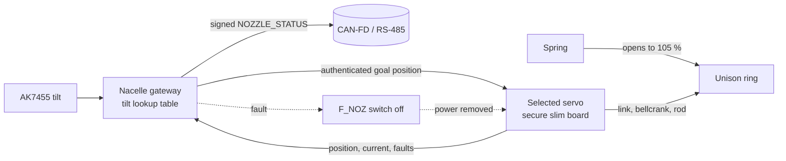
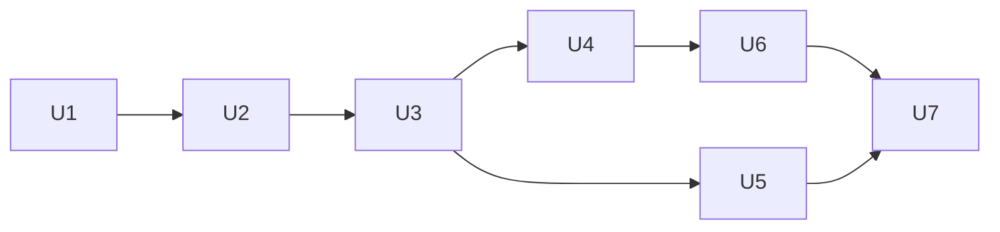

# Nozzle Servo Selection and Secure Servo Integration - Plan

**Roadmap index (2026-11-16, owner):** this plan's Sprints 0–6 (U1–U7) are Rev U sprints **S5.0–S5.6**
in `docs/plans/2026-11-07-001-feat-rev-u-completion-execution-plan.md` §6, ahead of S5's geometry units.
KTD4 is the proposed answer to that plan's OD-8 (nozzle-servo gateway variant).

**Companion plan:**
`open-servo-core-secure/docs/plans/2026-11-16-001-feat-parametric-secure-microservo-board-plan.md`
(the board family). Its units are named `BD-U<n>` here. Paths are relative to this repository
unless prefixed with another repository's name.

**Author:** Steve Griffing, PE(CSE), CISSP-ISSEP, CEH (GitHub `Stab-Rabbit-coding`) — owner
decisions. **AI contribution:** research, analysis and plan text by Claude Fable 5.2 (Anthropic).

---

## Goal Capsule

- **Objective:** Choose the nacelle nozzle servo from four candidates on measured and published
  evidence, and move the nozzle and RCS-valve servos onto the authenticated osc-native chain
  using the secure swap boards.
- **Authority:** owner decisions in this plan > plan `2026-09-28-001` for nozzle behaviour >
  `AGENTS.md` sourcing and geometry rules > manufacturer datasheets > this plan.
- **Stop conditions:**
    - Stop at any sprint whose QA gate fails.
    - Stop before changing any pocket, shroud or linkage geometry until the owner decides D-SV-1.
    - Stop if a candidate needs more dorsal-shroud growth than the current resize; that is a
      canon deviation for the owner.
    - Stop if no candidate holds the nozzle closed inside its continuous rating (see Problem
      Frame); return with the options in KTD3.
- **Execution profile:** Python sizing tools, OpenSCAD fit checks, specification documents,
  WBS-generated task lists, bench measurements.
- **Tail ownership:** each sprint closes with a QA gate record and owner sign-off (KTD5).

---

## Product Contract

### Summary

The nozzle drive was fit-closed around the KST X06 from aggregator data. This plan re-bases it
on the X06H manufacturer sheet, evaluates the KST CM07, FrSky LD5801 and FrSky Act W5711A
against it, and records an owner decision. It then changes the nozzle command path from 50 Hz
PWM to the osc-native chain already specified for the door and RCS gateways.

### Problem Frame

Candidate data, from the sources listed below:

| | KST X06H (baseline) | KST CM07 | FrSky LD5801 | FrSky Act W5711A |
| --- | --- | --- | --- | --- |
| Case L × W × H | 0.787 × 0.276 × 0.654 in (20 × 7 × 16.6 mm) | 0.807 × 0.295 × 0.748 in (20.5 × 7.5 × 19 mm) | 0.906 × 0.276 × 0.709 in (23 × 7 × 18 mm) | 0.906 × 0.236 × 0.815 in (23 × 6 × 20.7 mm) |
| Over lugs | 1.02 in (26 mm) | 1.12 in (28.5 mm) | 1.18 in (30 mm) | not stated |
| Mass | 0.0132 lbm (6 g) ±10 % | 0.0154 lbm (7 g) ±10 % | 0.0165 lbm (7.5 g) | 0.0159 lbm (7.2 g) |
| Supply | 3.8–8.4 V | 3.5–8.4 V | not stated | 4.8–8.4 V |
| Stall torque, 6.0 V | 21.2 ozf·in (15 N·cm) | 25.0 ozf·in (1.80 kgf·cm) | not stated | 23.6 ozf·in (1.7 kgf·cm) |
| Stall torque, 8.4 V | 25.5 ozf·in (18 N·cm) | 33.3 ozf·in (2.40 kgf·cm) | 52.8 ozf·in (3.80 kgf·cm) ±15 % | 31.9 ozf·in (2.3 kgf·cm) |
| Continuous torque | 5.7 ozf·in (4 N·cm) at 6.0 V | chart only, at 7.4 V | not stated | not stated |
| Stall current | 0.58 A at 6.0 V | chart only | not stated | 0.45 / 0.52 / 0.62 A at 6.0 / 7.4 / 8.4 V |
| Case | aluminium alloy | plastic | not stated | CNC aluminium |
| Gears / sensor | steel / potentiometer | hardened steel / potentiometer | not stated | metal / potentiometer |
| Temperature | 14 to 149 °F (−10 to +65 °C) | 14 to 149 °F (−10 to +65 °C) | not stated | not stated |

Three findings shape the work:

1. **The baseline has no continuous-duty margin at 6 V.** `tools/nozzle_servo_linkage_64.py`
   gives 1.65 lbf (7.3 N) at the ring ear for 0.147 N·m of servo torque. Scaled linearly, the
   X06H's 4 N·cm continuous rating gives 0.45 lbf (2.0 N) at the ear, which equals the 0.45 lbf
   (2.0 N) fail-open spring before any flap load. The servo holds against that spring for the
   whole of forward flight. The tool's present "holding" figure assumes 50 % of stall; the
   X06H sheet's continuous zone ends at 27 % of stall. This is an analytical result, labelled as
   such until `U6` measures it.
2. **The records cite the wrong sheet.** `REFERENCES.md` REF-ACT-005, the BOM and the tools
   cite the X06 from an aggregator. The owner has supplied the X06H manufacturer sheet.
3. **Every alternative is larger on at least one axis.** The pocket is sized 20 × 7 × 16.6 mm
   with length axial, width radial and height tangential. The dorsal shroud is already resized
   ×1.45. Only the W5711A is thinner radially.

Ear force by candidate, by the same linear scaling (analytical):

| Supply | X06H | CM07 | LD5801 | W5711A |
| --- | --- | --- | --- | --- |
| 6.0 V stall | 1.65 lbf (7.3 N) | 1.97 lbf (8.8 N) | not stated | 1.86 lbf (8.3 N) |
| 8.4 V stall | 2.00 lbf (8.9 N) | 2.63 lbf (11.7 N) | 4.16 lbf (18.5 N) | 2.52 lbf (11.2 N) |

### Requirements

- **R1.** The four candidates are evaluated on one servo table that drives the linkage, pocket,
  shroud and mass tools. No tool carries a servo constant of its own.
- **R2.** The evaluation reports, per candidate and per supply voltage: stall and continuous
  force margin at the ear, pocket and shroud fit, mass and pivot shift, thermal exposure, swap
  board fit (from `BD-U2`), and data completeness.
- **R3.** The owner decides the servo (D-SV-1) and the nozzle rail voltage (D-SV-2) from a
  single decision document.
- **R4.** The nozzle servo is commanded over the authenticated osc-native chain. The tilt
  schedule stays on the gateway. Fail-open by removing servo power is unchanged from plan
  `2026-09-28-001` KTD3 and KTD4.
- **R5.** The four RCS valve servos and three cargo servos are re-pointed to the compliant SG90
  board (`BD-U9`), RCS fail state closed.
- **R6.** `REFERENCES.md`, the BOM, the WBS and the generated task lists match the decision.
  Superseded citations are logged, not deleted.
- **R7.** Every sprint ends in a QA gate with a written record.

### Scope Boundaries

- In scope: servo evaluation and decision, tool parameterization, command-path specification,
  RCS and cargo re-pointing, bench gates, records.
- Out: board and firmware design (companion plan); gateway variant choice D-NZ-1, which stays
  with plan `2026-09-28-001`; nozzle iris, ring and spring geometry unless D-SV-1 forces a
  pocket change.
- Out: Phase 11 aft-EDF hardware. Only the RCS servo and gateway records change.

### Outstanding Questions

- **D-SV-1 — DECIDED 2026-11-21 (owner): KST CM07**, ahead of the U3 gate. U1/U2 still run (records,
  servo table); U3 narrows to D-SV-2 (rail voltage) for the CM07.
- **D-SV-2 (decided at the U3 gate):** nozzle servo rail at 6.0 V, or raised toward 8.4 V.
- **Deferred to U1:** LD5801 supply range, 6 V torque, motor, case, sensor and temperature
  range. Its source page is not catalogued. Until filled, it cannot be selected.
- **Deferred to U6:** measured holding current and case temperature at the closed position.

### Sources

- `open-servo-core-secure/hardware/X06H2021423-172435499.pdf` — KST X06H, 2021-03.
- `open-servo-core-secure/hardware/CM07_Technical_Specifcation.pdf` — KST CM07, 2026-05.
- `open-servo-core-secure/hardware/ld5801-4.webp` — FrSky LD5801 dimension sheet
  (owner-supplied image).
- <https://www.frsky-rc.biz/ws/frsky-act-w5711a.html> — FrSky Act W5711A, read 2026-11-16.
  The link the owner supplied resolves to this model, not the LD5801.
- `tools/nozzle_servo_linkage_64.py` output, run 2026-11-16; `airframe/wings-nacelles/WBS.md`
  NAC-64-SERVO-01; `avionics/kicad/Bus-Gateway/CAN-PERIPH-GW-1.md` §5;
  `docs/CARGO_DOOR_GATEWAY_SPEC.md`.

---

## Planning Contract

### Key Technical Decisions

- **KTD1 — Evaluate both FrSky servos** *(session-settled: user-directed — chosen over
  evaluating only one)*.
- **KTD2 — One servo table for every tool.** It reads the published and measured fields of the
  companion plan's servo profiles, so the board and the airframe use the same numbers.
- **KTD3 — Treat continuous holding torque as a selection criterion.** Options if a candidate
  fails it, in order of preference: raise the rail voltage (D-SV-2); pick a higher-torque
  candidate; lower the spring force within plan `2026-09-28-001` KTD3's 1.5 × friction floor;
  change the lever ratio. The last two reopen fit-closed geometry and need the owner.
- **KTD4 — osc-native replaces PWM for the nozzle.** The gateway sends an authenticated goal
  position from its tilt lookup table. The servo's position and current telemetry feed the
  pre-arm sweep and seized-servo detection. Servo-side loss-of-command behaviour is provisioned
  "hold"; the fail-open action remains the gateway removing servo power.
- **KTD5 — Sprint and QA gate structure** *(session-settled: user-directed)*. Each unit is one
  sprint. Its gate requires: the unit's test scenarios pass; the Verification Contract checks
  pass; a negative control shows each new check can fail; a gate record is written under
  `docs/qa/` and signed by the owner.
- **KTD6 — The servo body is outside the silicon rule once gutted.** KST and FrSky are
  PRC-domiciled. With the stock controller removed, the body carries no semiconductor. A stock
  PWM servo flown as-is would not pass. Owner confirmation is requested at the U1 gate.

### High-Level Technical Design

### Sequencing

`U3` also needs `BD-U2` (teardown). `U4` and `U5` need `BD-U3` (MCU and crypto selection).
`U6` needs `BD-U8` (bench-proven boards).

---

## Implementation Units

### U1. Sprint 0 — Correct the servo records

**Goal:** Records cite manufacturer sheets for all four candidates.

**Requirements:** R6, R7.

**Dependencies:** none.

**Files:** `REFERENCES.md` (REF-ACT-005 re-based on the X06H sheet; new entries for CM07, LD5801,
W5711A; "Removed / Superseded Citations"); `avionics/datasheets/kst/`,
`avionics/datasheets/frsky/` (new); `current-specification/bom_revU.csv` and `.json`;
`airframe/wings-nacelles/WBS.md` (SERVO-01.b, SERVO-01.d); `docs/qa/README.md` (new).

**Approach:**

1. Re-base REF-ACT-005 on the X06H sheet and log the aggregator citation as superseded.
2. Catalogue the other three. Find the LD5801 manufacturer page; if none is found, mark the
   entry "requires verification" and open a WBS item.
3. Rename the BOM row to the X06H, both mirrors.
4. Regenerate task lists from the WBS; never hand-edit them.

**Test scenarios:**

- BOM CSV and JSON agree on every row.
- Every new REF-ID is cited from a listed repository location.
- `tools/gen_todo_from_wbs.py --check` passes.

**Verification:** records consistent; gate record signed.

### U2. Sprint 1 — Parameterize the nozzle tools on a servo table

**Goal:** One table of servos feeds the linkage, pocket, shroud and mass tools.

**Requirements:** R1.

**Dependencies:** U1.

**Files:** `tools/nozzle_servo_table.py` (new); `tools/nozzle_servo_linkage_64.py`;
`tools/dorsal_shroud_resize_64.py`; `tools/nacelle_mass_cg_64.py`;
`airframe/openscad/nacelles/nozzle_servo_linkage_64_params.scad` (generated);
`tools/tests/test_nozzle_servo_table.py` (new).

**Approach:**

1. Move servo dimensions, mass, torque by voltage, continuous torque and stall current into the
   table, each with its REF-ID.
2. Add a `--servo` and `--volts` selection to each tool. Default stays X06H at 6.0 V so current
   outputs are unchanged.
3. Add a continuous-duty check: force needed at the ear to hold closed against the spring plus
   the flap allowance, against the candidate's continuous rating.

**Execution note:** Characterize first. Capture the present X06 outputs as a regression fixture
before changing the tools.

**Test scenarios:**

- Default run reproduces today's output: 1.65 lbf (7.3 N) stall at the ear and an unchanged
  generated parameter file.
- X06H at 6.0 V fails the continuous-duty check with zero margin reported.
- A servo with a missing torque value at the requested voltage is refused, not interpolated.
- Selecting each candidate changes the pocket box in the generated file to that candidate's
  dimensions.

**Verification:** tests pass under `/usr/bin/python3`; static analysis clean; gate record signed.

### U3. Sprint 2 — Four-candidate evaluation and owner decision

**Goal:** A decision document from which the owner settles D-SV-1 and D-SV-2.

**Requirements:** R2, R3.

**Dependencies:** U2, `BD-U2`.

**Files:** `docs/NOZZLE_SERVO_SELECTION.md` (new); `docs/NOZZLE_DRIVE_TRADE.md` (pointer);
`airframe/wings-nacelles/WBS.md`.

**Approach:**

1. Run every candidate at 6.0, 7.4 and 8.4 V through the tools. Run the pocket, shroud and
   housing interference checks for each.
2. Tabulate R2's criteria. Mark each cell published, measured, analytical or not stated.
3. Add `BD-U2`'s swap-board fit result and thermal exposure near the EDF (plastic against
   aluminium case; all sheets stop at 149 °F (65 °C)).
4. State a recommendation and end with the owner decision box.

**Test scenarios:**

- Every candidate has a result or an explicit "not stated" for every criterion at each voltage.
- A candidate with any "not stated" in a selection-critical row is flagged not selectable.
- Interference results come from the mesh check, not from dimension comparison.

**Verification:** the owner can decide from the document alone; the decision is recorded.

### U4. Sprint 3 — Nozzle command path on osc-native

**Goal:** The nozzle servo specification reflects KTD4.

**Requirements:** R4.

**Dependencies:** U3, `BD-U3`.

**Files:** `docs/NACELLE_NOZZLE_SERVO_SPEC.md`; `avionics/kicad/Bus-Gateway/CAN-PERIPH-GW-1.md`;
`docs/POWER_DISTRIBUTION.md` (rail voltage per D-SV-2);
`docs/plans/2026-09-28-001-feat-nacelle-nozzle-servo-drive-plan.md` (KTD2, KTD4, KTD6, U6
amendment notes); `avionics/WBS.md`.

**Approach:**

1. Specify the chain: gateway UART lane, logic level, baud, goal-position rate, telemetry used.
2. Restate the fault table: which faults the servo detects, which the gateway detects, and that
   every fail-open path ends in the power switch.
3. Redefine the pre-arm sweep on servo telemetry.
4. Amend the 2026-09-28 plan by dated note; do not rewrite its history.

**Test scenarios:**

- Each fault in plan `2026-09-28-001` KTD4 maps to one detecting party and one action.
- No fault path depends on the servo executing firmware in order to open the nozzle.
- The pin table matches the gateway document's net names.
- The debounce and re-arm behaviour is unchanged from the existing state diagram.

**Verification:** three documents agree on lane, level, rail and fault action; gate record
signed.

### U5. Sprint 4 — RCS valve and cargo servo re-pointing

**Goal:** RCS and cargo servo records name the compliant SG90 board.

**Requirements:** R5, R6.

**Dependencies:** U3, `BD-U3`.

**Files:** `current-specification/bom_revU.csv` and `.json` (`SERVO-RCS-VALVE`, `SERVO-CARGO`);
`REFERENCES.md` (REF-SENSOR-015); `docs/CARGO_DOOR_GATEWAY_SPEC.md` §9;
`avionics/kicad/Bus-Gateway/CAN-PERIPH-GW-1.md` §5; `avionics/WBS.md` (GW-RCS, GW-DOOR-2);
`deferred/WBS.md`.

**Approach:**

1. Re-point both BOM rows from the upstream board to the secure fork's re-targeted board.
2. Record the upstream CH32V006 board as rejected under the sourcing rule.
3. Fix GW-RCS on one osc-native chain, fail state closed, and close GW-DOOR-2's open
   physical-layer question from the secure fork's specification.

**Test scenarios:**

- No active BOM row or specification names a CH32V006 board.
- RCS fail state reads "closed" in the BOM note, gateway document and door specification.
- Phase 11 rows stay at quantity zero.

**Verification:** records consistent; task lists regenerated; gate record signed.

### U6. Sprint 5 — Bench gates

**Goal:** Measured proof of the selected servo in the nozzle drive.

**Requirements:** R2, R4.

**Dependencies:** U4, `BD-U8`.

**Files:** `airframe/wings-nacelles/WBS.md` §1.1.4 (bench items with pass/fail criteria);
`docs/FIRST_FLIGHT_READINESS.md`; `docs/NOZZLE_SERVO_SELECTION.md` (measured values).

**Approach:** add and run these items on the selected servo with its secure board:

1. Holding current and case temperature at the closed position for 30 min at the chosen rail
   voltage, in still air at the highest expected nacelle temperature.
2. Flap load at the ear against the 0.38 lbf (1.7 N) allowance.
3. Fail-open with power removed, and with the servo seized at 75 %, 90 % and 105 %.
4. Authenticated command, bad-tag rejection and replay rejection on the installed chain.

**Test expectation:** none in this plan — these are the tests; each WBS item states its own
criterion.

**Verification:** all four items pass, or the failing item returns to the owner under KTD3.

### U7. Sprint 6 — Close-out

**Goal:** Geometry and records match the decision.

**Requirements:** R6.

**Dependencies:** U5, U6.

**Files:** `airframe/openscad/nacelles/nacelle_nozzle_servo_64mm.scad` and regenerated STLs if
D-SV-1 changed the servo; `tools/nacelle_mass_cg_64.py` outputs; `tools/auw_ledger.py`;
`README.md`; `PROJECT_INDEX.md`; `CLAUDE-MEMORY.md`.

**Approach:** if the servo changed, regenerate the pocket and shroud from the table,
re-converge the pivot, and re-run the interference census. Regenerate indexes; do not merge them
by hand.

**Test scenarios:**

- Regenerated parts are watertight single bodies with zero interference.
- Port and starboard pods remain mirror images.
- Mass roll-up changes by the servo mass difference times two.

**Verification:** gates green; no checkbox left open whose text says resolved; gate record
signed.

---

## Verification Contract

Standing checks at every sprint gate:

- `/usr/bin/python3 -m pytest tools/tests/` for touched tools. Use the system interpreter; the
  virtual environment hides `manifold3d`.
- `tools/validate_stls.py` on every regenerated STL; OpenSCAD renders report `Simple: yes`.
- `tools/gen_todo_from_wbs.py --check`; BOM CSV and JSON mirror check.
- Markdown lint and the repository pre-commit hooks, including modal-verb and callout rules.
- Static analysis clean on new Python.
- `REFERENCES.md`: every changed entry has a validated source or a "requires verification" mark.

## Definition of Done

- U1–U7 complete, each with a signed gate record under `docs/qa/`.
- D-SV-1 and D-SV-2 are decided and recorded.
- The selected servo holds the nozzle closed inside its continuous rating, by measurement.
- Nozzle, RCS and cargo servos are specified on compliant secure boards; no record names a
  CH32V006 board as active.
- No tool carries a servo constant outside the servo table.
- Mass and force figures are imperial-primary with metric in parentheses; estimates are marked.
- Scratch outputs and abandoned candidate geometry are removed from the tree.
- AI and human contributions are attributed in touched file headers and commit messages.
