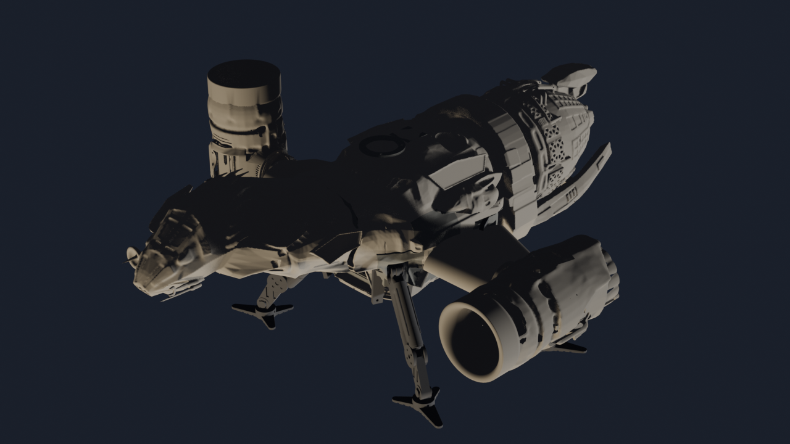
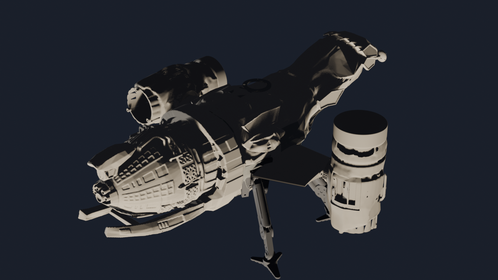
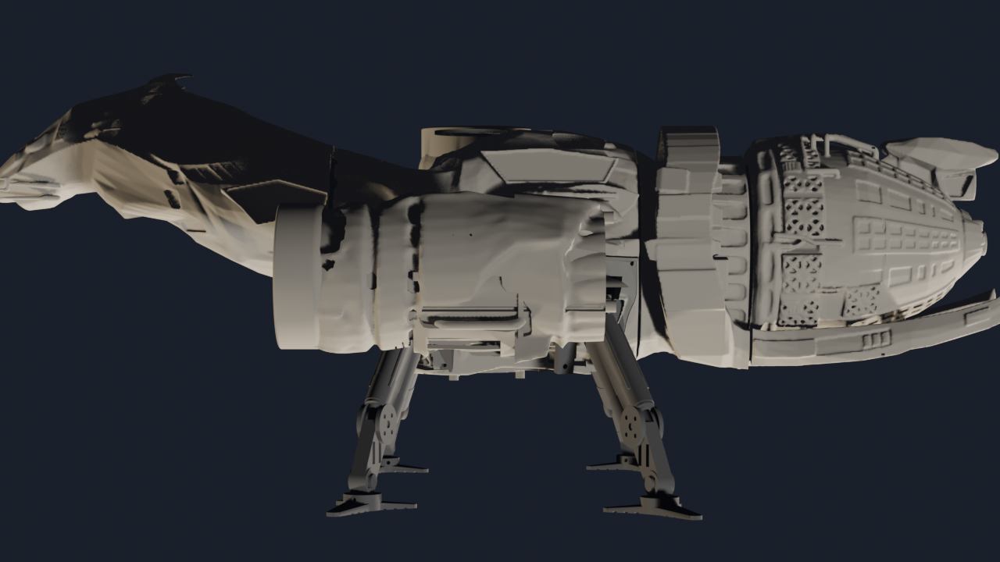
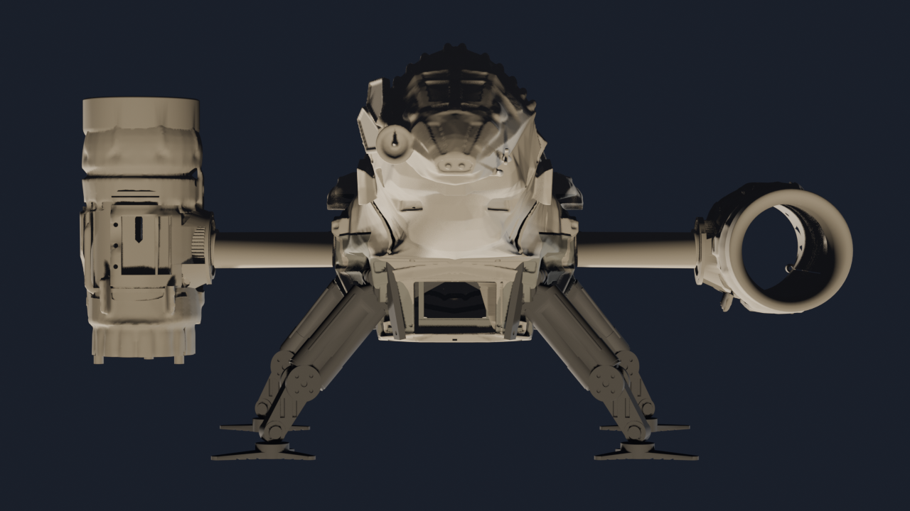
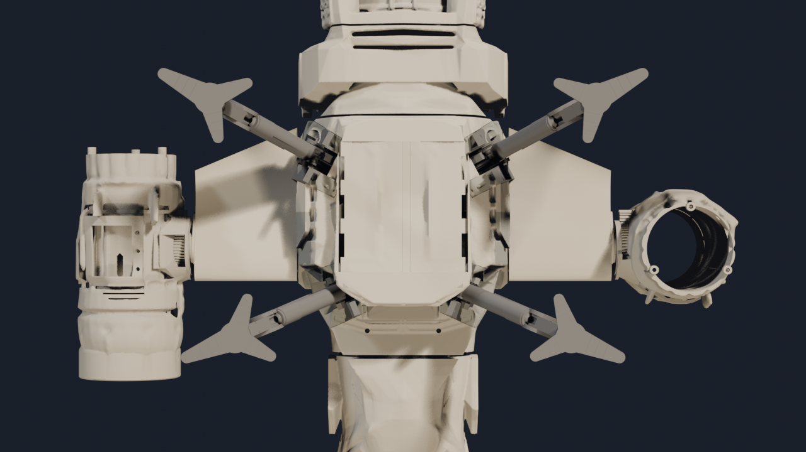
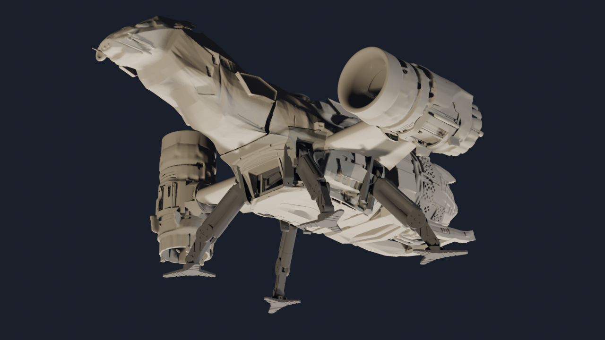
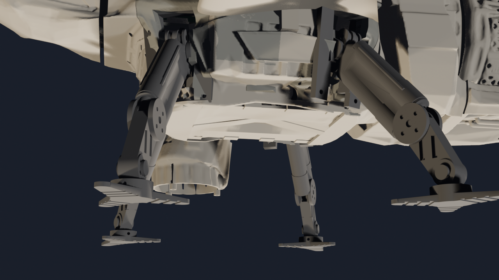
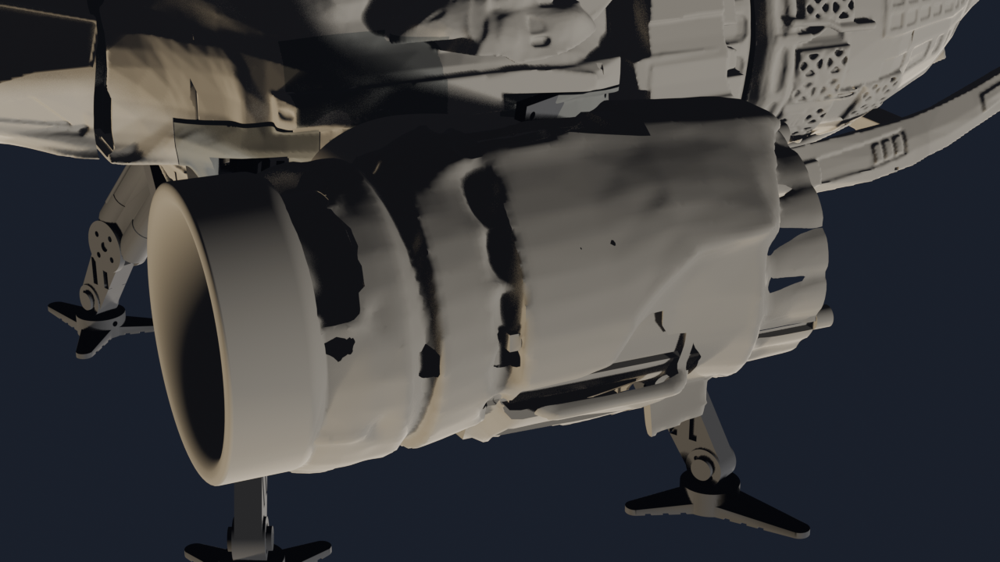

<!-- markdownlint-disable MD041 -->
<!-- Intentional accessibility font-loading preamble (OpenDyslexic, CC BY 4.0) must precede the document's H1. -->
<!-- OpenDyslexic font for screen reading (CC BY 4.0) -->
<link rel="stylesheet" href="https://fonts.cdnfonts.com/css/opendyslexic">
<style>
body,p,li,td,th,code,pre{font-family:'OpenDyslexic','OpenDyslexicMono',sans-serif!important;line-height:1.8}
@media screen{body{background:#0d1117;color:#e6edf3}a{color:#58a6ff}
  h1,h2,h3,h4{color:#58a6ff;border-bottom:1px solid #30363d;padding-bottom:6px}
  code{background:#161b22;color:#e6edf3;padding:2px 6px;border-radius:4px}
  th{background:#21262d;color:#79c0ff}tr:nth-child(even)td{background:#161b22}
  blockquote{border-left:4px solid #388bfd;color:#8b949e;padding-left:12px}}
@media print{body{background:#fff!important;color:#111!important}a{color:#003399!important}}
</style>

# Serenity-Class Tiltrotor UAV — Build Guide Rev T+ (24-inch)

**Author:** Steve Griffing, PE(CSE), CISSP-ISSEP, CPP  
**License:** CC BY-SA 4.0 — creativecommons.org/licenses/by-sa/4.0 (SPDX-License-Identifier: CC-BY-SA-4.0)
**Year:** 2026 | **Status:** Rev T+ refresh (2026-10-31). Phases 0–3 now describe the Rev T+
airframe in `airframe/FreeCAD-scripts/serenity_assembly.py`. No phase has been built or bench
tested; steps marked **DRAFT — not bench-verified** have not been proven.

> **Rev T+ note (2026-10-31):** This guide used to describe the Rev P/Rev S baseline. Phases 0–3
> now follow the Rev T+ airframe. In Rev T+ the wing spar is a fixed, bonded CF tube (Rev T1). The
> nacelle tilts on a trunnion (Rev T4) through a worm drive with a pin brake (Rev T5e). Each
> nozzle is driven by its own servo (2026-09-28). The landing gear is the 3.0 in R6 flight article
> with conforming bays and the A1b balanced couple. Every figure comes from the regenerated master
> assembly and the renders in [Current Assembly Views](#current-assembly-views). The Rev T BOM
> (`current-specification/bom_revU.csv`) still lags parts of this design; see
> `current-specification/README.md` "Not yet in the Rev T BOM." Phases 4–11 have not been
> re-audited for Rev T+ (`graphical-build-guide/WBS.md` task 1.5.6).
>
> Fan engineering work inspired by the Firefly-class transport ship *Serenity*  
> from *Firefly* (Fox, 2002) and *Serenity* (Universal, 2005).  
> © Joss Whedon / Mutant Enemy Productions — **Not an officially licensed product.**

---

## Attribution

| Work | Author | License | Source |
|------|--------|---------|--------|
| Hull geometry | misubisu | CC BY-SA 4.0 | thingiverse.com/thing:7330462 |
| Hull geometry (historical, Rev M and earlier 18") | Peter Farell | CC BY 4.0 | printables.com/model/548545 |
| Iris nozzle concept (nacelle) | BamJr | CC BY 4.0 | thingiverse.com/thing:2991269 |
| Blueprint proportions | Mandel + Earls / QMx / Universal | © 2007 QMx | 269 ft × 170 ft × 79 ft ratios |
| All other design (hardware/CAD/PCB) | Steve Griffing | CERN-OHL-W 2.0 | This project |
| All other design (docs/code/scripts) | Steve Griffing | CC BY-SA 4.0 | This project |

---

## Rev T+ Configuration

Performance figures (AUW, thrust, T/W) are provisional until the bottom-up AUW ledger
recompute closes, so this guide does not restate them. Read them in `docs/WBS.md` §0.10.1 and
`current-specification/auw_ledger.json`.

| Subsystem | Rev T+ configuration | Authority |
|-----------|----------------------|-----------|
| Hull | 24.00 in (609.6 mm) SLS-printed (DuraForm PA CF) shell. **Head+cargo is one part** (`PRINT-HEAD-CARGO-ONEPIECE`); middle (horseshoe ring + inner neck) and rear are still two parts joined by one internal splice collar until the planned one-piece middle+rear part exists (`PRINT-MIDDLE-REAR-ONEPIECE`, Qty 0). The cargo/middle joint keeps its splice collar. Foam-filled. | `airframe/README.md` |
| Datum | Aircraft datum R2: nose tip at Y 0, centerline at X 0, 3.0 in gear ground plane at Z 0 | `tools/hull_datums.py` |
| Wing | S1223-derived section (t17.7 root / t26.7 tip) on a **fixed, bonded** 20 mm CF spar (`SPAR-CF-20X16`). The root moment goes to the hull through a bonded root flange (`PRINT-WING-ROOT-FLANGE`). | Rev T1 / T1c |
| Nacelle | Tandem-EDF pod on a trunnion with 2 × 6704ZZ bearings (**open owner decision:** the pair runs at 89 % of C0 under ultimate load, `docs/NACELLE_64MM_VERIFICATION.md` §5b). The master assembly carries the **64 mm** pod. The procurement BOM keeps the 50 mm EDF rows until the NAC-64 gates close. | `docs/NACELLE_64MM_VERIFICATION.md` |
| Tilt drive | Per side: Pololu 20D 25:1 gearmotor driving a six-start worm and 40T wheel in the cargo bay, with a solenoid pin brake. Drives a 4 mm shaft to a 14T pinion on the trunnion's 50T ring gear. Hard stops at −5° and 140° (0° = cruise, 90° = hover); commanded range −5° to 135°. | `docs/TILT_ACTUATOR_SELECTION.md` |
| Tilt sensing | AKM AK7455 off-axis encoder per nacelle, published on the bus | `docs/TILT_ENCODER_WIRING_EMI_SPEC.md` |
| Nozzle | Rev T3 shingled 8-flap nozzle (4 master + 4 seal flaps). One sub-micro servo per nacelle, scheduled on measured tilt: 75 % of bore at 0°, 105 % from 90° to 140°. A spring returns it to 105 % on any fault. | `docs/NOZZLE_DRIVE_TRADE.md` (2026-09-28) |
| Landing gear | 3.0 in (76 mm) R6 leg frames with the A1b balanced-couple absorber, in four conforming bays (port/stbd distinct mirror prints) | `docs/LANDING_GEAR_ANALYSIS.md` |
| Cargo | Clamshell doors with one bell-crank latch; SG90 door/release servos on their own door gateway; SPT5425LV + LibreServo winch | `docs/CARGO_WINCH_SPECIFICATION.md` |
| Avionics | 8-node baseline (4 Pilot + 4 TACCO) plus Observer, Flight Engineer, and Commo | `avionics/AGENTS.md` |

### Current Assembly Views

Rendered 2026-10-31 by `airframe/blender-scripts/serenity_render_views.py` from every placed
mesh of the master assembly (`tools/export_assembly_meshes.py`). The default attitude shows the
**port nacelle at cruise (0°)** and the **starboard nacelle at hover (90°)**. The dorsal antenna
fin is left out: its assembly placement is still a VERIFY placeholder at the datum origin.

| | |
|---|---|
|  |  |
| Port bow, dorsal | Starboard stern, dorsal |
|  |  |
| Port side | Bow |
|  |  |
| Ventral (gear, bays, doors) | Port bow, ventral |
|  |  |
| 3.0 in gear and conforming bays | Port nacelle, trunnion, tilt pinion |

All 17 views are in `pngs/`. To regenerate after any STL change:

```bash
# 1. Export the placed meshes of the master assembly (FreeCAD 1.0, headless)
xvfb-run -a freecadcmd -c "import sys; sys.argv=['x','--','/tmp/asm']; \
    exec(open('tools/export_assembly_meshes.py').read())"
# 2. Render the 17 views into graphical-build-guide/pngs/
blender --background --python airframe/blender-scripts/serenity_render_views.py -- /tmp/asm
```

---

## Anti-Rework Rules — Read Before Phase 0

> **CAUTION:** Several rules below (foam pour, nacelle sealing/fiberglass, TPM provisioning)
> describe irreversible steps. Complete every dependent check first — there is no going back
> once these are done.

1. **Print everything before first epoxy joint.** Filament costs pennies compared to build time.
2. **Install every conduit, standoff, void former, and sensor mount before the foam pour.** Once foam cures these cannot be added.
3. **The foam pour is the point of no return.** Do a full dry-fit with all wiring and components before mixing.
4. **Do NOT foam the nacelle interior.** Nacelles are CF-PETG structural shells — foam in the bore traps EDF heat and ruins the press-fit.
5. **Verify EDF rotation direction before nacelle installation.** Port EDFs shall rotate CW from the intake end; starboard CCW. Swap any two motor leads to reverse if wrong. Once nacelle is sealed and fiberglassed, this is a full disassembly.
6. **Bond the wing-root flanges, and keep the spar passage clear, before the foam pour.** The flange carries the root moment through a bond to the inner sidewall, and foam seals it in. The spar is **not** bonded into the hull. It bonds into the wing, and the wing + spar assembly clamps into the fuselage so the joint stays releasable (`docs/WING_ATTACH_INTERFACE.md` §3.3–3.4). Foam in the spar passage makes the wing unremovable.
7. **FAA registration on airframe before first untethered flight.** Replace placeholder with your issued number.
8. **TPM 2.0 provisioning is non-reversible.** Provision all 8 nodes before first flight.
9. **Prove the nozzle fail-safe before closing the nacelle covers.** With the nozzle servo unpowered, the torsion spring shall drive the unison ring to the hard 105 % stop from any position.

---

## Phase Overview

| Phase | Name | Milestone | Est. Cost |
|-------|------|-----------|-----------|
| 0 | Print All Parts + CF Cuts | All parts ready | ~$75 |
| 1 | Hull Structure + Provisions | Hull sealed, all conduits installed, foam-ready | ~$90 |
| 2 | Nacelle Assembly | Both nacelles complete with EDFs, stators, trunnion, servo-driven nozzle | ~$190 |
| 3 | Tilt Mechanism | Nacelles mount, pivot, and tilt on fuselage | ~$80 |
| 4 | Hull Foam Pour + Close-up | Structural foam cured, all access panels fitted | ~$30 |
| 5 | Minimum Viable Flyer (4 nodes) | ★ **FIRST FLIGHT** — nacelle EDFs only; forward flight / partial hover | ~$640 |
| 6 | Full 8-Node Architecture | All 8 nodes, full ring redundancy, ToF OA operational | ~$480 |
| 7 | Cargo System | 250 g delivery operational | ~$30 |
| 8 | Finishing: Decals + FAA + Docs | Legal, complete, documented | ~$25 |
| 9 | Performance Tuning | PID governor optimisation, endurance, cross-wind hover | ~$0 |
| 10 | Advanced Autonomy | BVLOS readiness, extended missions, multi-link redundancy | ~$0 |
| 11 | **Aft EDF Integration** *(deferred)* | ★ **CRUISE + RCS** — 55mm rear EDF + canonical nozzle + 4 RCS jets | ~$70 |

> Costs are USD estimates as of 2026. PCB assembly assumes JLCPCB pricing.
> Phase 11 is intentionally deferred until Phases 0–10 are proven in flight.
> See `deferred/aft-edf/` for all Phase 11 design files.

---

## Phase 0 — Print All Parts + CF Cuts

**Goal:** Every printed part complete and dry-fitted before Phase 1 begins.

### Printer Setup

| Setting | Value |
|---------|-------|
| Nozzle | Hardened steel (CF-PETG abrades brass — required for nacelles, brackets) |
| Bed | PEI spring steel, leveled |
| PETG profile | 230°C / 70°C bed |
| CF-PETG profile | 240–245°C / 80°C bed |
| TPU 95A profile | 220°C / 50°C bed, direct drive only |
| Dry time | 6 h at 65°C for all filament before printing |

### Print Schedule

The Rev U printed parts are the ones the master assembly places
(`airframe/FreeCAD-scripts/serenity_assembly.py`), plus print-only parts that never get a
flight position (void formers, nozzle flaps, ESC covers). Slicer settings per part are in
`current-specification/bom_revU.csv` (Notes column) and
`airframe/gcode/davinci-jr-proto/cura/slice_all_batches_cura.py`. **Print the
`*_print.stl` sibling** wherever one exists; it is the same part re-oriented for the bed.

| Group | STL (under `airframe/stls/`) | Qty | BOM ref |
|-------|------------------------------|-----|---------|
| Hull | `fuselage/head_cargo_shell24_2mm_merged_hatch.stl` (one-piece head+cargo, SLS), `fuselage/middle_shell24_2mm_repaired.stl`, `fuselage/rear_shell24_2mm_repaired.stl` (middle+rear one-piece is planned, not yet designed) | 1 each | `PRINT-HEAD-CARGO-ONEPIECE`, `PRINT-MIDDLE-CANONICAL`, `PRINT-REAR-NECK-INTAKE` |
| Splice collars | `fuselage/cargo_middle_splice_collar.stl`, `fuselage/middle_rear_splice_collar.stl` (the head/cargo collar is retired; the middle/rear collar goes away with the planned one-piece middle+rear) | 1 each | `PRINT-CARGO-MIDDLE-COLLAR`, `PRINT-MIDDLE-REAR-COLLAR` |
| Wing | `wings/wing_port_s1223_revo.stl`, `wings/wing_stbd_s1223_revo.stl` | 1 each | `PRINT-WINGS-S1223` |
| Wing root | `fuselage/wing_root_flange_port.stl`, `fuselage/wing_root_flange_stbd.stl` (CF-PETG, essentially solid at 5 mm) | 1 each | `PRINT-WING-ROOT-FLANGE` |
| Nacelle | `nacelles/nacelle_port_64mm.stl`, `nacelles/nacelle_stbd_64mm.stl` (master-assembly pods; see the 64 mm note in the configuration table) | 1 each | `PRINT-NACELLE-PORT/STBD` |
| Trunnion | `nacelles/nacelle_trunnion_64mm_port.stl`, `nacelles/nacelle_trunnion_64mm_stbd.stl` | 1 each | `PRINT-NACELLE-TRUNNION` |
| Nozzle | `nacelles/nozzles/nacelle_nozzle_flap.stl` (master) + `nacelle_nozzle_flap_seal.stl` (seal), `nacelle_nozzle_throat.stl`, `nacelle_nozzle_ring.stl` | 4 + 4 per nacelle; 1 each per nacelle | `PRINT-NACELLE-FLAP-*`, `-THROAT`, `-RING` |
| ESC bay covers | `nacelles/esc/nacelle_esc_cover_{port,stbd}_{a,b}.stl`, four distinct parts | 1 each | `PRINT-NACELLE-ESC-COVER` |
| Tilt drive (cargo) | `fuselage/cargo/tilt_actuator_bracket_{port,stbd}.stl`, `tilt_actuator_worm.stl` ×2, `tilt_actuator_wheel.stl` ×2, `tilt_brake_guide.stl` + `tilt_brake_guide_stbd.stl` (stbd is a **mirrored** print, not a copy) | as listed | `PRINT-TILT-*` |
| Landing gear | `fuselage/landing-gear/lg_r6_3_0in_leg_frame.stl` (aft) and `lg_r6_3_0in_leg_frame_fore.stl` (fore); `lg_r6_common_foot.stl` ×4; bays `lg_r6_3_0in_bay_{fore,aft}-{port,stbd}_print.stl`, four distinct mirror parts | as listed | `PRINT-LG-*` |
| Cargo | `fuselage/cargo/cargo_door_{port,stbd}.stl`, `fuselage/cargo/cargo_hinge_retention.stl`, `fuselage/cargo/door_latch_bracket_{port,stbd}.stl`, `fuselage/cargo/door_latch_crank_{port,stbd}.stl`, `fuselage/cargo/door_horn.stl` ×2, `fuselage/cargo/gateway_door_tray.stl`, `fuselage/cargo/cargo_door_servo_bracket.stl`, `fuselage/cargo/cargo_release_servo_bracket.stl`, `fuselage/cargo/cargo_fpv_bezel.stl`, `fuselage/cargo/cargo_gps_retention_ring.stl`, `fuselage/cargo/battery_cradle.stl`, `fuselage/cargo/chin_node_shelf.stl` | as listed | `PRINT-CARGO-*`, `PRINT-DOOR-*`, `PRINT-GW-DOOR-TRAY`, `PRINT-BATT-CRADLE`, `PRINT-CHIN-SHELF` |
| Void formers | `fuselage/cargo/void_former_cargo_{collar_rim,batt_chimney,harness_trunk_port,harness_trunk_stbd,node_bay}.stl` | 1 each | `PRINT-VOID-FORMER-CARGO` |
| Deferred (Phase 11) | Rear canonical nozzle, RCS nozzles, RCS manifold: see `deferred/AGENTS.md` | — | — |

> **NOTE:** The winch has no hull-frame STLs yet (WBS LEDGER-GAPS), so it is not in the
> master assembly or the renders. Print its parts from the `PRINT-CARGO-WINCH-*` rows.
> Retired parts are **not** printed: the Thingiverse feet/legs, the MF104ZZ pivot housing and
> pins, the sector-gear tilt bracket, the bevel/crown nozzle gear train, the N20 winch mount and
> spool, and the DRV8833 tray (`ARCHIVE_INDEX.md`).

### CF Cuts and Machined Parts

| Part | Material | Dimension | Notes |
|------|----------|-----------|-------|
| Keel | CF flat bar 6×3 mm, 2 lap-spliced segments | See Phase 1 step 1 | Bar oriented 3 mm lateral (X) × 6 mm vertical (Z) |
| Wing spars | Roll-wrapped CF tube 20 mm OD × 16.3 mm ID (`SPAR-CF-20X16`) | 2, cut per `docs/TILT_SPAR_ANALYSIS.md` | **Fixed, bonded wing member**, not a rotating shaft (Rev T1) |
| Tilt drive shafts | Steel tube 4 mm OD × 0.5 mm wall (`SHAFT-TILT-4MM`) | 2 × ~250 mm (9.8 in) | Fuselage worm wheel to the trunnion pinion; runs in bronze bushings (`BUSH-TILT-4MM`) |
| Tilt pinions, 14T | **Brass or steel, machined, NOT printed** (`airframe/openscad/wings/wing_tilt_pinion.scad`; geometry in `wings/wing_tilt_pinion_{port,stbd}.stl`) | 1 per side | A printed pinion falls short of the ≥ 76 MPa allowable (`docs/NACELLE_64MM_VERIFICATION.md` §5c). **No BOM row yet.** |
| A1b backbone cheeks | CF quasi-isotropic plate 1/8 in (3.2 mm) (`LG-A1B-CF-CHEEK`) | 8, waterjet | 2 per leg |
| Ring frames | CF plate 2 mm | 2 profiles | See `airframe/diagrams/ring_frames/*.dxf` |

> ⚠ **CF dust hazard.** Wear N95 mask + safety glasses. Cut outdoors or with dust extraction.

### Phase 0 Checks

- [ ] Every STL in the print schedule sliced from the current `main` checkout (not from a stale branch)
- [ ] Port and starboard mirror parts (gear bays, brake guide, ESC covers) are the correct hand
- [ ] Trunnion bearing seats accept 6704ZZ with the specified fit
- [ ] Nozzle master and seal flaps lap without interference on the ring (dry fit, 8 flaps)
- [ ] Worm turns the 40T wheel freely by hand on the bracket; brake pin enters a collar slot
- [ ] Wing-root flange back face matches the inner cargo sidewall (dry fit, no rocking)
- [ ] All access panel lids flush ±0.2 mm in frames

---

## Phase 1 — Hull Structure + All Future Provisions

**Goal:** Structurally complete hull with every conduit, standoff, void former, access panel, and cargo hard point installed — ready for foam pour.

### Buy List

| Item | Qty | Notes |
|------|-----|-------|
| West System 105/206 epoxy | 1 kit | Keel + spar bonding |
| 5-minute epoxy syringe 25mL | 3× | Access frames, sensor mounts, standoffs |
| X-30 polyurethane foam 2-part | ~600 mL kit | 2 lb/ft³, 4× expansion, 2-min pot life |
| EPS blue foam board 25mm | 500×250mm | Void formers A–E (bay + cargo cutouts); Owens Corning Foamular 150 |
| Johnson's Paste Wax | 1 tin | 2 coats on all EPS void surfaces (release agent) |
| 3M 4016 closed-cell gasket tape | 1 roll | Seal all access panel frame lips |
| PTFE tube 5mm OD × 3mm ID | 6 m | 8 conduits (CAN FD, RS-485, 1553, ETH×4, PWR) |
| M2.5 nylon hex standoffs 6mm | 16× | TACCO floor mounts (4 per bay × 4 bays) |
| M2.5 nylon hex standoffs 20mm | 16× | Pilot inter-cape spacing |
| M2.5 × 8mm SS button screws | 64× | Standoff attachment + panel B/E fasteners |
| M3 heat-set inserts | 4× | Cargo gondola belly hard points |
| N42 neodymium disc magnet 6×2mm | 8× | Panel D (4 in frame + 4 in lid) |
| SMA panel-mount bulkhead | 3× | 915MHz SiK (belly) + LoRa (belly) + Wi-Fi (dorsal fwd). Note: the 49MHz (Part 15 §15.235) link now uses a dorsal wire antenna — no belly SMA for that system |
| PETG wire post (49MHz fwd + aft) | 2× | Print from s_rcrs49_wire_post.scad: forward post (~120mm from nose, dorsal) + aft post (top of rear nozzle cone). Both ~10mm tall insulated hooks |
| 0.3mm stainless steel wire or 22AWG enamelled Cu | ~500mm | 49MHz (Part 15 §15.235) top wire |
| Ceramic bead insulator (3mm ID) | 1× | Aft end of 49MHz wire (insulated/open) |
| Wing-root flanges (printed) | 2× | `PRINT-WING-ROOT-FLANGE`; bond with West System 105/206 |

### Installation Sequence

> **Critical:** Complete steps 1–12 before mixing any foam (step 13).

**1. Epoxy keel segments into the cargo and rear sections only** (head and middle sections are
keelless — see docs/structural_analysis.md §4.1–§4.2). Keel spans hull Y −71 mm → +384 mm
(455 mm / 17.9 in) as two lap-spliced CF-BAR-6X3 segments: cargo (hull Y −71..+132 mm) and rear
(hull Y +203..+384 mm), bar oriented 3 mm lateral (X) × 6 mm vertical (Z). Lap-splice the two
segments with a 100 mm (3.9 in) overlap centered on the middle/rear joint (hull Y ≈ +203 mm),
bonded with West System 105/206 + peel-ply prep. Ring-notch datum marks at hull Y = +30 mm and
+290 mm (supersedes the stale 91/165/251/320/388 mm nose-station marks, which were tied to the
pre-Rev N ring-plate layout). Cure 2 h minimum.

**2. Bond ring frames to keel** at the 2 station notches: hull Y = +30 mm (cargo, wing-spar zone) and +290 mm (rear, landing zone) — down from 5 stations in the pre-Rev N layout (see airframe/diagrams/ring_frames/*.dxf; the cargo profile is PROVISIONAL pending the open cargo-mesh fix, TODO §1.1.1). Cure 1 h.

**3. Bond access panel frames A–F into hull sections:**

| Panel | Station | Bay | Closure |
|-------|---------|-----|---------|
| A — Nose | 0–3.58 in (0–91 mm) | CN1+FC1 | Bayonet PETG frame |
| B — Dorsal Fwd | 3.58–6.50 in (91–165 mm) | CN2+FC2 | 4× M2.5 screws |
| C — Cargo Belly | 6.30–9.88 in (160–251 mm) | Cargo | Hinge + latch |
| D — Dorsal Aft | 9.88–12.60 in (251–320 mm) | CN3+FC3 | 4× N42 magnets |
| E — Aft Service | 12.60–15.28 in (320–388 mm) | CN4+FC4 | 4× M2.5 screws |
| F — Rear | 15.28–23.98 in (388–609 mm) | EDF access | Bayonet PETG frame |

**4. Install M2.5 nylon standoffs in bays A, B, D, E.**
- Floor standoffs (6mm): TACCO (55×35mm) hole pattern
- Inter-cape standoffs (20mm): Pilot (55×35mm) hole pattern above TACCO
- Verify 44mm total stack height clears bay void former

**5. Bond the wing-root flanges** (port and starboard) to the inner cargo sidewall with West
System 105/206, following the adhesive maker's cure schedule. Then **dry-fit** the fixed 20 mm CF
spar through the flange and hull with **no adhesive**. Withdraw it, and cap the spar passage
against foam. Bond the spar into the wing root as a separate wing + spar sub-assembly
(`docs/WING_ATTACH_INTERFACE.md` §3.3–3.4). **DRAFT — not bench-verified.** The spar clamp at the
wall (WA-R3 split collar) is not yet a part (fuselage-mid WBS WA-R17). Hold final wing fit until it is.

**6. Mount the tilt-drive brackets** (`tilt_actuator_bracket_port/stbd`) in the cargo bay on
their three shell feet. Fit each worm, wheel, and brake guide, and use the mirrored brake guide
on the starboard side. Then install the four conforming landing-gear bays in their sponson
rebates (port and starboard are distinct mirror prints). **DRAFT — not bench-verified.**

**7. Install M3 heat-set inserts ×4** at belly cargo hard-point locations.

**8. Install antenna posts and SMA bulkhead pass-throughs:**
- Belly port, X≈**260mm**: SiK 915MHz SMA-RP bulkhead *(relocated forward from 310mm — station 310mm is now the neck intake ring; 260mm is in cargo bay belly, Panel C, clear of intake frame)*
- Belly stbd, X≈260mm: LoRa RFM95W 915MHz SMA-RP bulkhead
- Dorsal, X≈**120mm**: **49MHz (Part 15 §15.235) forward wire post** — PETG insulated mast (~10mm tall, 12×12mm foot), bonded to dorsal hull skin just aft of bridge/cockpit section; loading coil + LC pi-network at this post; RG-316 coax routed internally to Bay A Commo (XCVR-49MHZ-2) module *(replaces dorsal fin + vertical whip — wire now runs nose-to-tail along hull spine)*
- Aft dorsal hull, X≈580mm: **49MHz (Part 15 §15.235) temporary aft wire post** — PETG hook post (~10mm tall) bonded to aft dorsal hull skin near station ~580mm with 5-min epoxy; electrically open (insulated end). *(Note: the permanent aft post on the canonical tail nozzle (`rear_nozzle_canonical.stl`) is a Phase 11 item. This temporary post is removed and replaced in Phase 11.)*
- Dorsal fwd, X≈140mm: Wi-Fi 2.4/5GHz antenna
- **49MHz top wire**: 0.3mm stainless steel wire or 22AWG enamelled copper, strung from forward post hook (~120mm) to temporary aft post hook (~580mm) with light tension (~20g); CF keel bar connected to Commo (XCVR-49MHZ-2) GND as counterpoise
- **⚠ GPS clearance check**: forward wire post at ~120mm is ~43mm from GPS patch (both dorsal face). Bench-verify GPS HDOP ≤1.5 with Commo (49 MHz) transmitting before flight. If GPS degrades, move GPS patch to ≥165mm from nose.

**9. Install 12× ToF sensor flush-mount PETG frames** (6.5mm hull cutouts):

| Sensor | X (mm) | Position | Array |
|--------|---------|----------|-------|
| S1A / S1B | 30, 50 | Nose ring | A / B |
| S3B / S4B | 180 | Port / Stbd hull sides | B |
| S3A / S4A | 240 | Port / Stbd hull sides | A |
| S6A / S6B | 195, 265 | Belly blisters | A / B |
| S5A / S5B | 215, 315 | Dorsal keel | A / B |
| S2B / S2A | 510, 525 | Rear bell rim | B / A |

**10. Feed 8× PTFE conduits nose-to-tail.** Thread pull strings immediately:

| Conduit | Route | Signal |
|---------|-------|--------|
| CAN-FD | Port keel rail | CAN FD ring — 120Ω term at CN1 and FC4 |
| RS-485 | Stbd keel rail | RS-485 multidrop — 120Ω at CN1 and FC4 |
| 1553-A | Port upper | MIL-STD-1553 bus A |
| 1553-B | Stbd upper | MIL-STD-1553 bus B |
| ETH-1 | Port lower | Ethernet ring segment |
| ETH-2 | Stbd lower | Ethernet ring segment |
| SERVO-PWR | Belly centerline | 6V servo bus + PWM signal harness |
| MAIN-PWR | Belly centerline | 10AWG main power from battery to PDB |

**11. Install EPS void formers** (waxed 2×) in all bays. Verify pull strings clear voids.

**12. Full dry-fit verification:**
- [ ] All 8 conduits routed and pull strings accessible at both ends
- [ ] All standoffs installed and fastener access clear through access panel opening
- [ ] EPS void formers seated without gaps at hull inner wall
- [ ] SMA bulkheads installed and dusted
- [ ] Cargo inserts flush with belly skin

**13. Foam pour.** Mix per manufacturer ratio. Pour in sections from aft forward. Do NOT pour into nacelle bays or pivot housing areas. Allow 24 h full cure before removing void formers.

**14. Remove EPS void formers.** Strip wax film with isopropyl alcohol. Install access panel lids; verify flush fit.

### Phase 1 Checks

- [ ] Hull rigid — no flex when held at nose and tail
- [ ] All 8 pull strings accessible
- [ ] All standoffs in place; screws start freely
- [ ] Foam not in nacelle mounting bay, pivot housing, or access panel bays

> **NOTE (skid-tip height, SLS ring and skid frame, Rev S+):** The skid tips must sit
> **0.256 in (6.5 mm) below the lowest hull point** (the ventral cross member) when the
> aircraft rests nose-up on the aft feet at the 25.6° tip-back attitude. The printed parts
> can be off by about ±0.025 in (±0.63 mm), which eats most of the 0.039 in (1 mm) hull
> margin (worst case 0.018 in left). At assembly, before torquing the ring-to-hull bolts:
>
> 1. Measure the skid-tip-to-cross-member height on both sides, using a height gauge or
>    feeler stack on a flat plate.
> 2. Shim the ring-to-hull joint so that both tips read 0.256 in ±0.008 in
>    (6.5 mm ±0.2 mm) and match each other within 0.008 in.
> 3. Record the shim stack in the build log.
> 4. Bench-check each skid's tip stiffness: at least **1,207 lbf/in** (`docs/SKID_FAILURE_MODE_STUDY.md` §10.1).

---

## Phase 2 — Nacelle Assembly

**Goal:** Both nacelles fully assembled: EDFs installed, stators integral, trunnion seated,
shingled nozzle fitted, nozzle servo installed and its spring fail-safe proven.

### Materials Needed — Phase 2

| Item | Qty | Notes |
|------|-----|-------|
| Tandem EDF stages | 4 | 2 per nacelle. The BOM row is still 50 mm (`EDF-50-6S`); the 64 mm unit enters after the NAC-64 gates |
| ESC | 4 | 1 per EDF, in the hinged nacelle ESC bays behind the four covers. ESC rating is held pending the NAC-64 power gate |
| 6704ZZ bearing | 4 | 2 per trunnion |
| Nozzle servo, sub-micro | 2 | 1 per nacelle, inside the pod forward of the unison ring (`docs/plans/2026-09-28-001-feat-nacelle-nozzle-servo-drive-plan.md`) |
| Nozzle return torsion spring | 2 | Drives the ring to the 105 % stop whenever the servo stops pulling |
| Structural epoxy (slow cure) | — | EDF casing bonding |
| Wire sleeve 8 mm | ~500 mm | Bundle ESC + motor leads |

### 2A — EDF Installation

**For each nacelle** (port first, then starboard — VERIFY ROTATION DIRECTION DIFFERS):

> **WARNING:** The EDF spins at high speed on bench power. Keep hands, tools, and loose
> clothing clear of the duct during the rotation-direction test.

Stations below are pod Z, measured aft from the nacelle nose, from
`airframe/openscad/nacelles/nacelle_pod_64mm_tandem.scad`. The pod uses **stator-as-mount**:
each stage's motor bolts to the integral stator, so there are no separate spider sleeves. Motor
and rotor stations are **VERIFY** until NAC-64-FIT-02 measures a physical QF2822 and rotor.
**DRAFT — not bench-verified.**

| Station | Pod Z |
|---------|-------|
| Stage 1 (fore) rotor + motor | 1.20–4.06 in (30.5–103.2 mm) |
| Stage 1 stator / motor mount | 1.66–4.06 in (42.2–103.2 mm) |
| Interstage running gap | 0.04 in (1.0 mm) |
| Stage 2 (aft) rotor + motor | 4.10–6.96 in (104.2–176.9 mm) |
| Bulkheads (10 AWG disconnect bay between them, at Z 57.6) | 1.78 in (45.2 mm) and 2.76 in (70.1 mm) |
| ESC bays (hinged, behind the covers) | from 3.40 in (86.35 mm) aft |

1. **Test EDF rotation direction before installation.** Connect to bench ESC + power supply (safe prop/duct test only).
   - Port EDF shall spin **CW viewed from intake** (fore end).
   - Starboard EDF shall spin **CCW viewed from intake**.
   - To reverse: swap any two motor phase wires at the ESC.

2. **Mount each stage's motor on its stator** (4 × M3 on Ø16.00 mm, VERIFY). Fit stage 2 first,
   from the aft (nozzle) end, then stage 1 from the intake end. Hold the 1.0 mm running gap at the
   interstage, and keep rotor-to-bore clearance even all around.
3. **Route the motor phase leads** forward along the stator vanes to that stage's ESC bay. Keep
   them clear of the trunnion cavity and the disconnect bay.
4. **Spin-check both stages by hand**: no rub at the bore or the interstage.

5. **Power routing, PDB to ESC.** The ESCs live **in the nacelle**, on hinges in the two ESC bays
   behind the four covers (Rev T4c). They are not in the fuselage. Each ESC's feed is one 10 AWG
   silicone branch from the Flight Engineer PDB `J_ESCn` connector (fused per ESC by
   `FUSE-ESC-40A`; `avionics/kicad/FlightEngineer/FlightEngineer.md`, 10 AWG branch, 300 mm
   [11.8 in] max). The trace:

   | Leg | Path | Authority |
   |-----|------|-----------|
   | 1 | PDB `J_ESCn` in the fuselage → wing root | `FlightEngineer.md` |
   | 2 | Through the bore of the **fixed** 20 mm CF spar. All four 10 AWG feeds per side ride the bore; it is sized at 16.3 mm ID so the bundle (13.28 mm circumscribed) twists freely through the tilt sweep instead of flexing across an arc | `airframe/wings-nacelles/WBS.md` SPAR-20-1/-2 |
   | 3 | Spar bore → nacelle **10 AWG disconnect bay** (pod Z 57.6 mm, between the Z 45.2/70.1 bulkheads). The nacelle is the cover; there is no hatch | `docs/NACELLE_64MM_VERIFICATION.md` §5; WA-R10 |
   | 4 | Disconnect bay → each ESC in its hinged bay, strain-relieved | **OPEN, WA-R10: route not yet drawn**; conductor OD still unrecorded (`docs/WING_ATTACH_INTERFACE.md` OI-1) |

   > **CAUTION:** Leg 4 has no drawn route. Before you cut leads, measure the actual run from the
   > PDB through the spar to each ESC and confirm it is within the 300 mm (11.8 in) branch
   > limit, and that nothing chafes at the trunnion through the full −5° to 140° travel.

6. **Cure 2h minimum** before proceeding.

### 2B — Shingled Nozzle Assembly (Rev T3) — DRAFT, not bench-verified

1. **Press the throat** (`nacelle_nozzle_throat.stl`) onto the nacelle exit and confirm it seats flush.
2. **Fit the unison ring** (`nacelle_nozzle_ring.stl`) over the throat housing.
3. **Hang the 8 flaps** by alternating **master** and **seal** flaps. Each seal flap laps 0.2 mm
   outboard of its neighbors, so the band closes without interpenetration.
4. **Dry test by hand:** rotate the ring through its full stroke. The exit shall open smoothly from
   75 % to 105 % of bore with no flap binding.

### 2C — Nozzle Servo Drive (owner decision 2026-09-28) — DRAFT, not bench-verified

The nozzle is **not** geared to the tilt pivot; that passive drive is retired. One sub-micro servo
per nacelle pulls the unison ring toward 75 % through a pull-only slotted link. A torsion spring
returns the ring to a hard 105 % stop. The gateway that reads the AK7455 schedules the servo on
measured tilt angle (`docs/NOZZLE_DRIVE_TRADE.md`).

1. Mount the servo in the pod annulus forward of the unison ring.
2. Fit the slotted pull link. The slot shall be at least as long as the full ring stroke.
3. Fit the torsion spring and the hard 105 % stop.
4. **Fail-safe check:** with the servo unpowered, move the ring to 75 % by hand and release it.
   The spring shall return the ring to the 105 % stop every time.
5. Route the servo lead to the nacelle harness port.

> **CAUTION:** Never test the nozzle schedule with the EDFs spinning until the gateway's fault
> logic (105 % command, then load-switch trip) has been verified on the bench.

### 2D — Nacelle Final Check

- [ ] Both EDF stages bonded and leads routed to the ESC bays
- [ ] Port nacelle EDF rotation: CW from intake
- [ ] Starboard nacelle EDF rotation: CCW from intake
- [ ] Trunnion turns freely on both 6704ZZ bearings
- [ ] Nozzle opens and closes smoothly between 75 % and 105 %; flaps lap evenly
- [ ] Spring returns the unpowered nozzle to the 105 % stop
- [ ] All four ESC covers seat flush

---

## Phase 3 — Tilt Mechanism

**Goal:** Both nacelles on their trunnions, turning on the fixed spar, driven through the
cargo-bay worm drive. Pin brakes engage, and both sides track to the encoder.

**DRAFT — not bench-verified.** Sources: `docs/TILT_ACTUATOR_SELECTION.md`,
`docs/TILT_DRIVE_CONTROL_SPEC.md`, `docs/TILT_SPAR_ANALYSIS.md`.

### Materials Needed — Phase 3

| Item | Qty | BOM ref |
|------|-----|---------|
| Pololu 20D 25:1 CB 6 V gearmotor | 2 | `GM-TILT-20D` |
| Tilt controller (Open-Secure-ESC brushed build) | 2 | `OSESC-TILT-TC` |
| Pull solenoid, brake | 2 | `SOL-TILT-BRAKE` |
| 3 A mini blade fuse (one per tilt path) | 2 | `FUSE-TILT-3A` |
| 4 mm steel tilt shaft | 2 | `SHAFT-TILT-4MM` |
| Flanged bronze bushing 4 × 8 × 5 mm | 4 | `BUSH-TILT-4MM` |
| AK7455 tilt-encoder PCB | 2 | `SKIPPER-TILT-ENC-PCB` |

### Installation

1. **Seat the trunnion** (with its 6704ZZ pair) on the fixed CF spar at the wing tip.
   Check the nacelle rotates freely with no perceptible axial play.
2. **Run the 4 mm tilt shaft** from the cargo-bay worm wheel out through its bushings to the
   wing tilt pinion (14T), and mesh the pinion with the trunnion's 50T ring gear.
3. **Mount the gearmotor** on the worm and wire it through its own fused feed to the tilt
   controller. Fit the brake solenoid on its guide.
4. **Fit the AK7455 encoder** at the trunnion ring magnet and route its harness per
   `docs/TILT_ENCODER_WIRING_EMI_SPEC.md`.
5. **Brake check:** with the motor unpowered, the brake pin shall lock the worm collar, and the
   nacelle shall not back-drive under hand load. The train is **not** self-locking, so the brake
   is what holds attitude.
6. **Sweep and calibrate:** fit the hard stops at −5° and 140°, then command −5° → 90° → 135° and
   back. Set the controller's soft limits to −5° and 135°, inside the mechanical travel, and record the encoder zero at 0° (cruise).

> **CAUTION:** The worm train is not self-locking. Never leave a nacelle unbraked and unpowered
> with a load on it. It will back-drive.

### Phase 3 Checks

- [ ] Both nacelles rotate freely on their trunnions with no grinding or wobble
- [ ] Pin brake holds each nacelle against hand load with the motor unpowered
- [ ] Hard stops engage at −5° and 140° on both nacelles
- [ ] Encoder reads 0° at cruise and tracks through the commanded −5° to 135° range
- [ ] Both nacelles synchronize to within 2° at 0° and 90°
- [ ] Nozzle schedule follows measured tilt (75 % at 0°, 105 % from 90° to 140°)

---

## Phase 4 — Hull Foam Pour + Close-up

**Goal:** Structural foam cured throughout hull interior; all void formers removed; hull rigid.

### Pre-Pour Final Checklist

- [ ] All PTFE conduits routed — pull strings accessible at both ends
- [ ] All bay standoffs installed
- [ ] Cargo hard points installed
- [ ] SMA bulkhead pass-throughs installed
- [ ] EPS void formers waxed (2 coats) and seated
- [ ] Nacelle bays and pivot housings masked OFF — do not foam
- [ ] Servo mount brackets clear of foam path

### Pour Sequence

Mix and pour per X-30 datasheet (2:1 ratio by volume, 2-min pot life, 4× expansion).
Pour from aft forward in three shots to control expansion direction:
1. Rear bay (aft of Panel E)
2. Mid bays (D + C)
3. Forward bays (B + A)

**Allow 24 h full cure before opening or removing void formers.**

After cure:
- Remove EPS void formers
- Wipe bay walls with IPA to remove wax film
- Verify foam did not intrude into access panel bays, cargo bay, or conduit runs
- Test all 8 pull strings — should still move freely

---

## Phase 5 — Minimum Viable Flyer (CN1 + FC1 + CN2 + FC2)

**Goal:** ★ **FIRST FLIGHT** with 4-node avionics — full VTOL hover using nacelle EDFs only.

> **Aft EDF not installed.** The 55mm fuselage EDF is deferred to Phase 11. The 4 nacelle EDFs
> (XFly Galaxy X5, 2.73 lbf / 1,240 gf each, 90% additive via stator = 4.91 lbf (2,232 gf)/nacelle × 2 = 9.84 lbf (4,464 gf) total)
> deliver nacelle T/W ≈ **1.61** at the Phase 5–10 AUW of 6.10 lbm (2,768 g) — **sufficient for full VTOL
> hover**. Phase 11 adds the rear EDF for forward-flight (cruise) thrust and RCS attitude authority — it
> fires aft through the canonical nozzle and does not boost hover (Phase 11 hover T/W ≈ 1.43).

### Node Install Order

Install **CN1 + FC1** in Shepherd's room / Bay A (nose), **CN2 + FC2** in Inara's shuttle / Bay B (dorsal fwd).

**For each bay:**
1. Seat TACCO (CN node) on floor standoffs (M2.5 × 6mm). 4 screws.
2. Seat Pilot (FC node) on 20mm inter-cape standoffs above TACCO. 4 screws.
3. Plug 72-pin expansion connector between PB2-I and Cape.
4. Connect CAN FD, RS-485, 1553, ETH chain connectors per bus harness.
5. Connect ESC DSHOT signal leads to Pilot PRU-ICSS header.
6. Connect the two tilt controllers (`OSESC-TILT-TC`, DRV8874-Q1 brushed drive) to the bus, each with its gearmotor and brake solenoid on its own `FUSE-TILT-3A` feed. Connect the two nozzle servos to their gateway. The 4 RCS valve servos are Phase 11.
7. Connect GPS patch antenna coax to Pilot GPS header. Mount GPS patch antenna on hull dorsal surface at nearest bay location.

### ESC Assignment — Cross-Nacelle Redundancy

ESCs are split across FC1 and FC2 so that each flight controller drives **one EDF per nacelle**.
If either FC fails, the surviving FC retains 50% thrust in both nacelles — the aircraft can still
hover rather than losing one nacelle entirely.

| ESC | EDF | Nacelle | Position | Controlled by |
| --- | --- | ------- | -------- | ------------- |
| ESC1 | Stage 1 (fore) | Port | pod Z 30.5–103.2 mm | **FC1** |
| ESC2 | Stage 2 (aft) | Port | pod Z 104.2–176.9 mm | **FC2** |
| ESC3 | Stage 1 (fore) | Starboard | pod Z 30.5–103.2 mm | **FC1** |
| ESC4 | Stage 2 (aft) | Starboard | pod Z 104.2–176.9 mm | **FC2** |
| ESC5 | 55mm rear EDF | Fuselage | — | **DEFERRED — Phase 11** |

> **Failure mode (nacelles only):** FC1 loss → FC2 holds ESC2 (port aft) + ESC4 (stbd aft).
> FC2 loss → FC1 holds ESC1 (port fore) + ESC3 (stbd fore). Half-thrust in both nacelles either way.
> ESC5 and Panel F 50A ESC are not installed until Phase 11.

### Wiring Connections for 4-Node Minimum Build

| Signal | From | To | Via |
|--------|------|----|-----|
| ESC1 DSHOT (port EDF1) | Pilot FC1 PRU Ch.0 | ESC1 | Conduit Shepherd's room (Bay A) → port wing root |
| ESC3 DSHOT (stbd EDF1) | Pilot FC1 PRU Ch.1 | ESC3 | Conduit Shepherd's room (Bay A) → stbd wing root |
| ESC2 DSHOT (port EDF2) | Pilot FC2 PRU Ch.0 | ESC2 | Conduit Inara's shuttle (Bay B) → port wing root |
| ESC4 DSHOT (stbd EDF2) | Pilot FC2 PRU Ch.1 | ESC4 | Conduit Inara's shuttle (Bay B) → stbd wing root |
| ESC5 / rear EDF | — | — | **DEFERRED — Phase 11** (PRU Ch.2 reserved) |
| Nacelle tilt drive (port) | Tilt controller, bus-networked | 20D gearmotor + brake solenoid | Fused tilt feed `F_TILT_P` |
| Nacelle tilt drive (stbd) | Tilt controller, bus-networked | 20D gearmotor + brake solenoid | Fused tilt feed `F_TILT_S` |
| 4× RCS valve servos | — | — | **DEFERRED — Phase 11** |
| CAN FD bus | CN1→FC1→CN2→FC2 | Ring (open at FC2 end) | CAN conduit, 120Ω term at CN1 |

### Firmware Flash

1. Flash OS image (Debian/Ubuntu for AM6254) to each PB2-I via USB-C to eMMC.
2. Flash Rev N PID governor firmware binary to M4F coprocessor on each FC node.
3. Upload via CN1 MAVLink → ETH ring → TPM-verified flash on FC1, FC2.
4. Verify `GOV_STATE = NORMAL` on all active ESCs via MAVLink.

### Pre-Flight Checklist

- [ ] All 4 nacelle EDFs spin-tested on bench with correct rotation direction
- [ ] Both tilt drives move smoothly through the commanded −5° to 135° range; pin brakes hold with motors unpowered
- [ ] Nozzles follow the measured-tilt schedule (75 % at 0°, 105 % from 90° to 140°); unpowered spring return reaches 105 %
- [ ] CAN FD bus: all 4 active nodes heartbeat visible in MAVLink
- [ ] GPS lock achieved on all 4 FC nodes (CN1/CN2 may relay for minimum flight)
- [ ] FAA registration applied
- [ ] Battery C-rating confirmed for peak draw
- [ ] *(Rear 55mm EDF, 4× RCS valve servos, and 50A Panel F ESC are Phase 11 items — do not install yet)*

### First Flight Protocol

**Tethered hover test first — nacelle EDFs only (T/W ≈ 1.61).**

> **WARNING:** Keep all personnel clear of the nacelle intakes/exhausts and the tether radius
> before applying throttle. Spinning EDFs and a tethered airframe under power are a bodily
> injury hazard if the tether fails or someone enters the thrust path.

1. Secure tether lines to belly hard points. 11.0 lbm (5 kg) breaking strength minimum, 9.8 ft (3 m) length.
2. Bring up on throttle to 30% with nacelles at 90° (hover position) — verify all 4 EDF sounds and lift response.
3. Increase to 60% — verify stable hover and altitude-hold authority on tether.
4. Verify each nacelle nozzle reaches 105 % at 90° tilt on its servo schedule.
5. **Only after 3 successful tethered hover passes:** proceed to free hover at 1 m AGL.
6. Free hover: altitude hold ±0.3 m for 30 s; yaw response; then nacelle transition forward flight circuit.

> **CAUTION:** Rolled (one-skid-first) hard landing. Each aft skid is sized to share a
> nose-high 4 ft drop *with the other skid and the aft gear*. If the aircraft touches down
> rolled, so that one skid takes the strike alone, that skid can be driven past its ultimate
> strength (about 355 lbf, 1.27 × ultimate, conservative pitch-only estimate) and **fracture
> at the ring root**. The tail cross member and hull can then touch the ground. Inspect both
> skids, the ring root and the ventral strut pads after any rolled or hard landing, and
> replace a cracked skid frame before the next flight. Avoid rolled touchdowns until the
> I_roll re-analysis (WBS §0.12) sets a roll-attitude limit.

---

## Phase 6 — Full 8-Node Architecture

**Goal:** All 8 nodes installed, full ring redundancy, obstacle avoidance operational.

Install **CN3 + FC3** in River's room / Bay C (dorsal aft), **CN4 + FC4** in Simon's medbay / Bay D (aft service). Same procedure as Phase 5 for each bay.

Connect remaining CAN FD / RS-485 / 1553 / ETH ring segments (CN3→FC3→CN4→FC4). Terminate CAN FD bus at FC4 (120Ω).

Install 12× ToF sensor array:

- Array A sensors on FC3 (River's room / Bay C): S1A, S3A, S4A, S5A, S6A, S2A
- Array B sensors on FC1 (Shepherd's room / Bay A): S1B, S3B, S4B, S5B, S6B, S2B

Verify full obstacle avoidance in firmware (dual-redundant arrays — A and B cover identical fields, any single FC failure leaves full coverage on the other).

---

## Phase 7 — Cargo System

Install clamshell cargo door hinges and latch. Bond cargo bay walls (per cargo_sect_shell24.stl interior). Install the STS3215 winch train in the aft bay: both pedestals, the Ø4 mm fixed axle, the spool on its two MR84ZZ bearings, the ratchet ring, and the pawl + spring + catch solenoid. **The spool shall be supported at both pedestals — never hung off the servo output.** Fit the auto-latch cradle. Wire the load cell (read by the LC-ADC ADS1231 board, WBS CARGO-LC-01) and the STS3215 TTL bus to the cargo-bay CAN-PERIPH-GW (not TACCO). Bench-calibrate the pawl spring to an 8.0 N ± 1.0 N slip threshold, then test release and retrieval with a 250 g dummy load. Ref: `docs/CARGO_WINCH_SPECIFICATION.md`.

---

## Phase 8 — Finishing

1. **Decals and paint.** Airbrush or hand-paint hull sections in Serenity's distinctive brown. Panel lines with thin pilot.
2. **NAV lights.** Port = red, starboard = green, aft/top = white strobe
   [REF-FAA-003 §91.209(a)] / [REF-ICAO-001 Ch.3 §3.1.9]. Wire to TACCO CN4 GPIO.
3. **FAA registration.** Display on hull exterior per 14 CFR Part 48 §48.205(b)(1)
   [REF-FAA-001 §48.205] — minimum 3 in (76 mm) characters, clearly visible.
   Replace N00000 on decal sheet with your FAA-issued number.
   Note: 14 CFR Part 47 applies to manned aircraft; the applicable UAS regulation is Part 48.
4. **Firmware security provisioning.** Program TACCO CPLD write-blocker (ATF16V8BQL). Provision SLB9672 TPM 2.0 endorsement keys on all 8 nodes. Keys cannot be regenerated without physical node replacement.
5. **Weight and balance.** Measure actual AUW with battery. CG should be at 40–45% of hull length from nose. Adjust battery position in cargo bay for trim if needed.
6. **Documentation.** Log all configuration in `governor_config.h`. Archive MAVLink parameter file. Photograph completed build for insurance / forensic baseline.

---

## Structural Specifications Summary

| Component | Spec | Analysis |
|-----------|------|----------|
| Wing spar | Fixed, bonded CF tube 20 mm OD × 16.3 mm ID (`SPAR-CF-20X16`, Rev T1) | `docs/TILT_SPAR_ANALYSIS.md` §3.6; root joint splits shear (socket) and moment (bonded root flange), `docs/structural_analysis.md` §7.3 |
| Keel | CF flat bar 6×3mm | Carries fuselage bending; adequate for 24-inch hull at <5g maneuver |
| Tilt bearings | 2 × 6704ZZ per trunnion, concentric with the spar | 653 N (147 lbf) per bearing = 89 % of C0 under ultimate load: **open owner decision** (`docs/NACELLE_64MM_VERIFICATION.md` §5b) |
| Foam fill | 2 lb/ft³ closed-cell PU | Provides hull rigidity, crash absorption; adds ~0.397 lbm (~180 g) to total AUW |
| Tilt drive | Pololu 20D 25:1 + six-start worm / 40T wheel + 14T/50T trunnion stage, solenoid pin brake | Train is **not** self-locking; the brake holds attitude. Sizing: `docs/TILT_ACTUATOR_SELECTION.md`, `docs/NACELLE_64MM_VERIFICATION.md` §5b |
| Nacelle shell | CF-PETG 25% gyroid, 4 walls | Adequate for EDF thrust loads and nacelle-tilt reaction forces |

---

## Blender Script Reference

> **Fuselage shell source — Rev R1 canonical (Blender pipeline, supersedes SCAD regen).**
> The four 2 mm hollow fuselage shells (head, cargo, middle, rear) are NO LONGER
> regenerated from OpenSCAD.  Their **authoritative canonical sources** are the
> Blender-derived, repaired STLs in `airframe/blender-scripts/files-hollowed-24in/`
> (`head_shell24_2mm_repaired.stl`, `cargo_sect_shell24_2mm_repaired.stl`,
> `middle_shell24_2mm_repaired.stl`, `rear_shell24_2mm_repaired.stl`).  To (re)publish:
> (1) edit/copy the source in `airframe/blender-scripts/files-hollowed-24in/`;
> (2) copy it to `airframe/stls/fuselage/` (or `fuselage/cargo/` for cargo);
> (3) run `python3 tools/bake_hull_frame.py` to bake hull-frame coords + header marker;
> (4) verify Z-range/watertightness before committing.  The SCAD shell files
> (`s_head_shell24.scad`, `s_middle_canonical_shell24.scad`,
> `s_rear_neck_intake_shell24.scad`, `cargo_sect_shell24.scad`) are **secondary
> references only** (cargo SCAD still sources interior boss geometry pending the
> §1.1.1.0a merge).  See `airframe/AGENTS.md` "Blender Pipeline" and
> TODO.md §1.1.1.0a.

| Script / File | Tool | Purpose | Output |
|---------------|------|---------|--------|
| `airframe/blender-scripts/files-hollowed-24in/` → `tools/bake_hull_frame.py` | Blender + bake | **Canonical** 2 mm hollow fuselage shells (head/cargo/middle/rear) | `*_shell24_2mm_repaired.stl` (baked, hull-frame) |
| `blender_shells_v3.py` | Blender | *(legacy)* hollow/scale hull STLs to 24" — superseded by the canonical Blender sources above | `*_shell24.stl` (all hull sections) |
| `blender_nacelle_integrated_v1.py` | Blender | Generate nacelle shells with integrated stators | `s_eng_left_stator_shell24.stl`, `s_eng_right_stator_shell24.stl` |
| ~~`blender_intake_cut.py`~~ | ~~Blender~~ | ~~Cut 120mm belly intake in s_middle~~ | **Superseded** — belly scoop removed in Rev N; use canonical middle shell instead |
| `blender_nozzle_gen.py` | Blender | Generate nacelle iris nozzle petals and rings | `nacelle_nozzle_petal.stl`, `nacelle_nozzle_ring.stl` |
| `serenity/stl/middle_canonical_shell24.scad` | OpenSCAD | Canonical middle fuselage shell (belly restored) | `middle_canonical_shell24.stl` |
| `deferred/aft-edf/openscad/rear_neck_intake_shell24.scad` | OpenSCAD | Rear neck shell with reduced-area scoop windows (55mm EDF) *(Phase 11 — regen)* | `rear_neck_intake_shell24.stl` |
| `deferred/aft-edf/openscad/neck_intake_frame.scad` | OpenSCAD | CF-PETG structural intake frame ring (55mm) *(Phase 11 — regen)* | `neck_intake_frame.stl` |
| `deferred/aft-edf/openscad/aft_edf_plenum.scad` | OpenSCAD | Plenum: 55mm EDF inlet + 4 RCS bleed taps *(Phase 11 — regen)* | `aft_edf_plenum.stl` |
| `deferred/aft-edf/openscad/rear_nozzle_canonical.scad` | OpenSCAD | Fixed canonical elliptical tail nozzle (2.06×1.76 in) *(Phase 11 — new)* | `rear_nozzle_canonical.stl` |
| `deferred/aft-edf/openscad/rcs_thruster.scad` | OpenSCAD | RCS bleed-jet nozzle + manifold + valve bracket *(Phase 11 — new)* | `rcs_thruster_nozzle.stl`, `rcs_distribution_manifold.stl`, `rcs_valve_bracket.stl` |

Blender scripts run headless: `blender --background --python <script>.py`  
OpenSCAD STLs: `openscad -o <output>.stl <file>.scad`

---

---

## Phase 9 — Performance Tuning and Flight Envelope Expansion

**Goal:** Optimise PID governor, characterise real-world thrust and endurance, and expand the
demonstrated flight envelope beyond Phase 5 minimums.

**Dependency:** Phase 6 (all 8 nodes + ToF OA) and Phase 7 (cargo) complete.

1. **Thrust stand calibration** — bench-test all 4 nacelle EDFs with production ESCs; run
   `airframe/scripts/governor_cal.py`; record actual `EDF_THRUST_K` values; update `governor_config.h`.
2. **PID hover tuning** — in-flight trim with all 8 nodes active; target altitude hold ±0.15m,
   attitude hold ±2° in calm air.
3. **Nacelle transition refinement** — sweep rate and cross-axis coupling; target altitude
   excursion ≤0.5m during 90°→0° nacelle sweep.
4. **Endurance baseline** — hover or slow forward flight until 3.7V/cell battery cutoff;
   record flight time and battery degradation.
5. **Cross-wind test** — demonstrate stable forward flight in ≥10 kt (5.1 m/s) crosswind.

**Phase 9 pass criteria:**
- [ ] Measured nacelle-only T/W ≥0.55 on thrust stand
- [ ] Hover / slow-speed altitude hold ±0.15m for 60 s
- [ ] Nacelle transition altitude excursion ≤0.5m
- [ ] Endurance ≥6 min under nacelle-only power
- [ ] All 8 CAN FD node logs verified

---

## Phase 10 — Advanced Autonomy and Long-Range Operations

**Goal:** Validate extended autonomous missions, multi-link communication redundancy, and
regulatory readiness for real-world deployment.

**Dependency:** Phase 9 complete.

1. **Multi-link failover mission** — fly 5-waypoint mission; disable each radio link in sequence
   (SiK → LoRa → Wi-Fi → 49 MHz Commo); verify mission continues on surviving link.
2. **10-waypoint autonomous mission** — full mission at ≤120m AGL including obstacle avoidance halts.
3. **Autonomous cargo delivery** — takeoff → transit → deploy payload at waypoint → return → land;
   cradle auto-latched on return.
4. **Simulated node failure in flight** — cut one FC node; verify remaining nodes maintain flight ≥30s; RTL.
5. **Emergency RTL validation** — disable all links; verify RTL within 5s of link loss, lands within 3m of home.
6. **Regulatory documentation review** — FAA Part 107 [REF-FAA-002] Remote Pilot Certificate
   current; FAA Part 48 [REF-FAA-001 §48.205] registration number visible on hull exterior;
   pre-flight checklist signed; flight area LAANC authorised.

**Phase 10 pass criteria:**
- [ ] Mission completes on any single surviving radio link
- [ ] 10-waypoint mission completed without intervention
- [ ] Autonomous cargo delivery within 2m of target
- [ ] Node failure: sustained flight ≥30s; correct RTL
- [ ] RTL on link loss: lands within 3m of home point
- [ ] All regulatory documentation current and on file

---

## Phase 11 — Aft EDF Integration *(Deferred)*

**Goal:** Install the 55mm fuselage EDF, reduced-area intake, the fixed canonical elliptical tail
nozzle, and 4 EDF-fed RCS bleed-air thrusters — adding forward-flight (cruise) thrust and pitch/yaw
attitude authority. The rear EDF exhausts aft and contributes no hover lift.

**Dependency:** Phases 0–10 complete and proven in flight.
**Design files:** `deferred/aft-edf/` — see `deferred/aft-edf/README.md` for full detail.
**NOTE (Rev R1 redesign):** the 120mm SCAD/STLs in `deferred/aft-edf/` are superseded. All rear-EDF
geometry shall be regenerated for the 55mm fan, the canonical nozzle, and the RCS system before fabrication.

> This phase was deferred per the project design philosophy: *"The large fuselage EDF is now an
> optional addition once everything else works."* (root AGENTS.md)

### 11A — Procurement

| Item | Qty | Approx. Cost |
|------|-----|-------------|
| 55mm 6S EDF (~1,500 gf) | 1× | ~$35–55 |
| 50A 6S BLHeli32 ESC | 1× | ~$18–28 |
| SG90-class proportional valve servo (RCS) | 4× | ~$12 |

### 11B — Intake Frame and Plenum (regenerate for 55mm + RCS)

1. **Regenerate and print** `neck_intake_frame.stl` from `deferred/aft-edf/openscad/neck_intake_frame.scad`
   (CF-PETG, 0.15mm, 40% gyroid, 4 walls) — sized for the 55mm intake area.
2. **Regenerate and print** `aft_edf_plenum.stl` from `deferred/aft-edf/openscad/aft_edf_plenum.scad`
   (PETG, 0.20mm, 20% gyroid) — 55mm EDF inlet + 4 RCS bleed taps.
3. Remove temporary window covers from rear neck hull section.
4. Dry-fit intake frame into the reduced-area scoop windows (tongues ~0.2mm clearance); verify lip orientation (forward, nose-ward).
5. Bond with West System 105/206; cure 24h. Fillet all joints; cure 2h.
6. Dry-fit plenum against intake frame exits; bond and fillet; cure 2h.
7. Pressure-test: shop-vac one scoop — confirm draft at the 55mm EDF inlet and all 4 RCS bleed taps, no joint leaks.

### 11C — 55mm EDF Installation

1. Bench-test EDF (correct rotation, no vibration). Verify fan rotation direction before installation.
2. Install EDF retaining ring at station ~430mm inside Panel F. Bond; cure 1h.
3. Seat EDF in plenum 55mm inlet; press to retaining lip; bond with 4 dabs slow-cure epoxy.
4. Route motor leads to 50A ESC in Panel F bay; route DSHOT signal lead forward to FC2 PRU Ch.2.
5. Bond 50A ESC in Panel F bay (foam tape + cable tie). Cure 2h before thrust application.

### 11D — Canonical Nozzle + RCS Thrusters

1. Generate and print `rear_nozzle_canonical.stl` (fixed canonical elliptical tail nozzle, 2.06×1.76 in exit; CF-PETG).
2. Bond the canonical nozzle to the tail-cone exit at Panel F aft, blending into the canonical hull outer mold line. **Fixed — no moving petals, no servo.**
3. Generate and print `rcs_distribution_manifold.stl` (×1), `rcs_thruster_nozzle.stl` (×4), `rcs_valve_bracket.stl` (×4).
4. Bond the RCS manifold to the 4 plenum bleed taps; route bleed ducts to the 4 RCS jet stations.
5. Install 4× SG90-class proportional valves on their brackets; link each to its bleed duct.
6. Calibrate RCS valves: 0% = closed, 100% = full bleed jet. Map 2 jets to pitch, 2 to yaw.

### 11E — 49MHz Antenna Upgrade

1. Bond permanent aft 49MHz (Part 15 §15.235) wire post to the top of `rear_nozzle_canonical.stl` (5-min epoxy).
2. Remove temporary aft post from ~580mm hull station.
3. Restring 49MHz top wire (~470mm full span) from forward post to nozzle aft post; ~20g tension.

### 11F — Software and Commissioning

1. Enable ESC5 in FC2 firmware (PRU Ch.2 BDSHOT); configure `EDF_THRUST_K` for the 55mm motor.
2. Add the 4 RCS proportional-valve channels to the attitude-control mixer (2 pitch + 2 yaw); calibrate authority.
3. Verify all 5 ESC heartbeats on CAN FD; confirm FC2 cross-drive on single-FC failure scenario.
4. Run `governor_cal.py` bench calibration for ESC5; update `governor_config.h`.
5. **Bench RCS test** — confirm pitch/yaw authority from the 4 bleed jets at cruise throttle.
6. **Forward-flight thrust test** — rear EDF at 60% throttle; verify forward thrust and ESC temps ≤70°C. **Do not use the rear EDF for hover lift.**

### Phase 11 Checks

- [ ] All regenerated rear-EDF STLs pass mesh watertightness verification
- [ ] Intake frame tongues fully seated; shoulder flanges bonded flush; no gaps
- [ ] Plenum + RCS manifold pressure-test passed — draft at EDF inlet and all 4 RCS jets; no leakage
- [ ] EDF at station ~430mm, centerline ±2mm; rotation verified before sealing
- [ ] 50A ESC installed; ESC5 DSHOT signal to FC2 PRU Ch.2
- [ ] Canonical nozzle bonded flush to hull outer mold line; exit 2.06×1.76 in verified
- [ ] All 4 RCS valves calibrated; pitch/yaw authority confirmed on bench
- [ ] Permanent 49MHz aft wire post on canonical nozzle; top wire at full ~470mm span
- [ ] Forward-thrust test passed; rear EDF NOT used for hover; ESC temps ≤70°C
- [ ] All 5 ESC telemetry on CAN FD; ESC temps ≤70°C at cruise power

---

*Rev T+ refresh 2026-10-31 (first 24-inch build documented as Rev N, May 2026)*  
*Supersedes Rev M (18-inch, 80mm EDF, AM6254 upgrade)*  
*Phase 11 (Aft EDF) deferred per root AGENTS.md — 2026-06-07*
